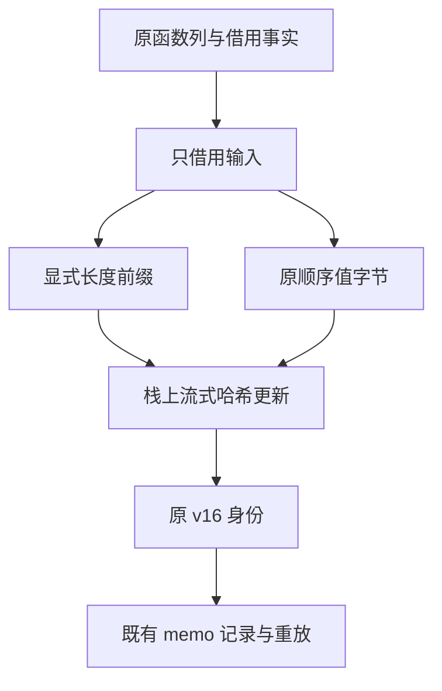

# 程序所有权缓存身份自举

## Intent：最终目标

将所有权分析共享的程序身份编码规则迁入 RX/ZX，保留原 v16 键、跨平台编码与零
堆分配成本。复用上一阶段统一的 SHA-256 后端，不新增专用运行库或编译器语义桥。

## Data：可用证据

旧 `uniqueness/identity.zig::program` 的顺序为：

1. 带 u64 小端长度的 `zxc.uniqueness.program.v16` 域与类型摘要。
2. 函数数量，以及每个函数按 input_type / output_type / external 顺序的签名。
3. held、written 的二维 bool 行，以及 return_only 的 bool 列。

旧泛型 write 对所有整数（包括 u32 TypeId、usize 长度）统一编码为 8 字节小端；
bool 为 0/1 一个字节。二维行同时编码外层行数和每行长度；不因为底层借用 u8
表示而遗漏长度。原协议不含 text_held，本轮不顺手改变键规则。

现有 bytes.encodeU64Le 会分配返回数组，不能用于原本栈上的整数编码。新增普通
标准接口 crypto.updateSha256U64Le，直接用栈上固定缓冲更新既有借用状态；它只
处理通用整数编码，不包含函数、槽、缓存或编译器判断。

固定累计基线仍为 inbound-conversion；上阶段正式工具位于
`ownership-research/flow-key/production/bin/zxc-bootstrap`。不能只看构建退出码，
也不能重复使用空的 flowed 表证明所有 memo 键相同。

## Edges：边界与限制

- RX 显式编排域/类型、签名、held、written、return_only 各阶段。
- ZX 保留内聚遍历及编码规则；bool 行在 ABI 边界借用其 0/1 字节表示，不复制内容。
- 签名的 external 标志来自 native_modules 是否为空，与原 Function.external 一致。
- 宿主只构造借用输入与栈上的哈希状态、执行标准 final；容量为零的分配器是硬门禁。
- 仅迁移 program 身份；类型/函数内容的结构遍历、并行内容摘要与 memo 状态仍有
  原生实现，不把它们当成已完成。
- 旧 seed 保留原规则；正式生成路径切换 RX/ZX。不通过改键版本掩盖编码不一致。

## Answer：交付与成功标准

验收覆盖标准整数更新的真实消费、零分配、自编译、非空 memo 键和值、合法依赖
编辑及恢复、增量与冷生成一致性；成本分别记录固定输入累计趋势与实际受影响路径。
记录均来自同一工具链与隔离采样。所有未提交内容验收后统一提交并推送。

## 迁移暴露的通用参数借用缺陷

初次新入口在真实既有夹具上触发 `program identity failed: OutOfMemory`，而不是
仅静态猜测；记录为 `program-identity/before-borrow-fix.log`。根因是普通 Call 仅在
scalar 输出且 pure=true 时借用临时参数。bytes/rows helper 会调用接收字节切片的
Native 哈希更新，因此 pure=false；但 local=true，且没有保存父参数描述符的路径。
生成器把 RX 三处及 ZX 内部 Frame 包装分配到堆上，违反原成本模型。

修复复用已有 local 事实：普通标量结果调用的临时参数资格由 pure 扩为 pure || local，
保留无缓存 guard 和现有 argument.borrow 递归。没有把所有 Native 标成 pure，
没有修改类型表示，也没有通过加大 FBA 或改写业务编排绕过申请。

安全边界来自已有 local 分析：Source 不含 Store/Task/Parallel，调用只指向已证明
的 local 函数；Native 只接受叶值、借用标量列表与 opaque，拒绝聚合对象、IO 与
process 能力。标量输出不能返回父对象描述符；字符串仍指向原有字节存储，借用
参数不会把列表底层数据改为栈分配。已缓存参数沿原路径处理，不新授予来源独占性。

修复后，十四条既有输入的真实生成在 FBA0 下成功。前后 memo 的四类记录数均为
17 / 15 / 14 / 14，所有键和值逐项一致，不是只比较 flowed 或空表。

受影响的八个目标集中验收 **418/418 构建步骤、19,280/19,280 检查通过**，覆盖
函数摘要、Native 值边界、缓存所有权、loan、字段事实、Store、Task 与标准接口。
引导构建 39/39、正式构建 21/21；main / collections / growth 的阶段自编译为
2,728 / 64 / 356 文件，仅工具身份 `.zxc-inputs` 不同。

原始记录位于忽略目录 `ownership-research/program-identity/`：
`bootstrap-final.log`、`production.log`、`regressions.log`、
`after-borrow-fix.log`、`proof-memo-comparison.json`、
`final-shared-fixedpoint-result.json`。性能与合法编辑/恢复对照正在收口。

## 最终对照与成本

冻结输入仍为 141 入口、2,220 模块。停止其他构建后，八轮交替、舍弃各自首轮：

| 工具                    | CPU    | 墙钟   | 峰值 RSS      |
| ----------------------- | ------ | ------ | ------------- |
| 固定 inbound-conversion | 5.33 s | 1.16 s | 492,093,440 B |
| 上阶段 flow-key         | 5.24 s | 1.12 s | 483,229,696 B |
| 当前程序身份迁移        | 5.22 s | 1.12 s | 486,326,272 B |

CPU 阶段 -0.02 s、累计 -0.11 s；墙钟不增长，累计 -0.04 s。
RSS 中位数阶段约 +3.10 MB、累计约 -5.77 MB。样本范围明显重叠：旧工具
453.02～471.47 MiB，新工具 445.08～469.13 MiB，未形成单向增长证据。
不将微小中位数差异称为确定收益或完整冷构建内存问题已解决；固定基线继续保留。

既有十四份输入的独立八轮采样，CPU **24.993 → 25.500 ms**，墙钟
**9.936 → 9.993 ms**；CPU 增量约 0.507 ms，在既定容差内。

### 相同 IR 的完整键证明

新增标准接口会增加类型表中的 Native 元组与 API 声明。直接比较新旧工具的冻结
memo 时，类型摘要和后续类型编号改变，不能将键不同直接判为编码不一致。旧、新
初始 seed 还存在其他分析路径差异，也不能作为只切换该算法的独立控制变量。

为此构建隔离对照：保留当前所有前端、分析、标准接口和生成器，仅在独立编译时
暂时使用旧 Native program 编码；使用 try/finally 恢复源码，工具单独安装，不向
正式工具加入探针、双重哈希或额外运行分支。正式采样工具从未被插桩，SHA-256
保持不变，不为得到通过而重复计时。

在相同冻结 IR 上，两工具 **8,248 / 2,419 / 1,945 / 0** 条 memo 记录的所有键
和值完全一致，共 **12,612 条非空记录**，覆盖当前 shared program 身份参与的
全部三类实际记录。不是用几份空表或只看产物成功来证明。

另外，在缓存目录复制既有夹具，将 borrow 返回输入改为返回空数组再恢复，使
callee held 依赖发生变化。initial / changed / restored 三阶段的旧新工具输出
一致，增量与各自冷生成逐文件一致；恢复后四类 memo 的 17 / 15 / 14 / 14 条
记录全部一致。没有修改仓库夹具或添加针对特定路径的生产规则。

### 生成形态核对

冻结输出均为 2,268 文件，差异为 48 个函数模块、types 与两份元数据。
类型文件只增加标准接口声明；48 个模块的 `create` 静态站点 **216 → 58**，
其中 41 个减少参数装箱，7 个只去掉无效绑定与重编号。这是静态站点，不等同于
本轮运行次数或峰值字节收益。

只读审查确认函数调用目标及 variant 数量一致，reserve / renew / allocate /
retract 次数一致；递归 ABI 重建的 fallback 仍在原惰性分支内，保持参数先于
callee 求值。行为边界由上述 Native、Store、Task、字段和标准接口回归支撑。

最新 CLI 对七份新增 RX/ZX 的 fmt / lint 均通过。详细原始证据位于
`program-identity/` 的 `final-runtime-comparison.json`、`fixtures-cost.json`、
`isolated-native-memo-comparison.json`、`edits-comparison.json`、
`edits-memo-comparison.json`、`parameter-borrow-static-audit.md`。

自我审查：本阶段程序身份编码与临时描述符借用都有非空、可复核证据。local 只
证明父描述符可局部使用，不意味着 Native 永不保留输入切片；底层数据保持原有
存储和所有权。仍有类型/函数内容的 Native 泛型遍历、状态及宿主适配，完整自举
和前端 NLL 尚未完成；也没有新的完整冷构建 GB 峰值测量。
