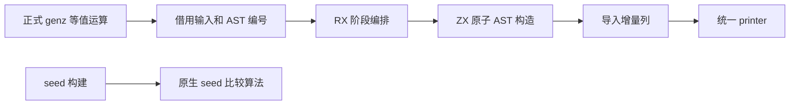

# 等值表达式生成自举

## Intent：最终目标

将正式 genz 路径中的等值表达式生成迁入 RX/ZX，保留普通值、字符串和可空值的
比较语义、操作数求值次数及求值顺序，保持累计性能约束。

## Data：可用证据

- 原实现位于 `packages/genz/src/zx/comparison.zig`；`lower.zig` 的等值运算实际调用它。
- 两个操作数依次绑定一次。字符串使用 `std.mem.eql`；可空值先判断空值，非空分支
  才解包并比较；普通值使用 Zig 等值运算。
- 复用已有结构化 AST 构造器、fresh 名称与列式导入，不生成源码字符串。
- 迁移前正式生成器保存在
  `.zig-cache/cold-build-analysis/ownership-research/error-queries/production/bin/zxc-bootstrap`。
- 固定累计基线仍为 `inbound-conversion/production-bootstrap/bin/zxc-bootstrap`；
  不以本次提交重置基线。

## Edges：边界与限制

- 本阶段只迁移完整的等值表达式生成职责，排序比较器仍为待迁移原生语义。
- 原实现保留为 seed 路径；正式路径调用生成的 Source 实现。
- 原生适配器暂时借用类型表、提供 AST 起始编号、导入增量列并更新 serial；
  这些状态和存储桥仍须后续迁移，不能据此宣称 genz 完整自举。
- 不更改运算求值顺序、空值惰性分支、错误行为或所有权契约。
- 性能比较对应实际生成路径，使用同输入、同工具链和固定基线；已有有效证据复用。

## Answer：交付格式与成功标准

RX 显式编排初始化、操作数绑定、比较构造与结果块组装。ZX 原子函数承担各项构造，
递归可空比较是同一算法内部的递归，保留在 ZX 中。

验收要求：新增源码通过格式与 lint，seed 引导及正式编译器构建可运行；复用相关
既有回归，比较全部生成产物并验证增量结果等于干净生成；记录本阶段及固定基线
累计性能。完成后统一收口全部变更，英文规范提交并推送，确认工作区干净且无未推送提交。

### 执行与自我复核

实现与验收已贯通：

- RX 显式连接 initialize → bind → compare → finish；左右各绑定一次，递归可空
  比较保留原 AST 插入顺序和短路分支，三个 fresh 名称及 serial 增量与原实现一致。
- 正式适配器使用同步 value ABI，借用类型表；从私有输出投影公开列描述符再导入，
  不把内部 origin 元数据当作 AST 列。临时 arena 在本次发射完成后释放，文本和
  嵌套 slice 由导入器复制到目标存储，避免留下临时引用。
- 7 个 RX/ZX 文件共 14 项格式与 lint 检查通过；Zig 格式与 diff 空白检查通过。
- seed 引导构建 39/39 步、正式构建 21/21 步通过。
- 复用 function-analysis、value-return、null-inequality、number-special-values、
  switch-scalars、strings 六组既有回归，337/337 步、3385/3385 项通过。
- 当前 main、collections、growth 三组生成文件分别为 2796、64、356 个；迁移前、
  引导版和正式版仅 `.zxc-inputs` 不同，生成代码一致。当前三组缓存四类 memo 的
  键和值逐项一致；冻结输入的 12612 项 memo 同样一致。
- 复制既有 optional 的 bool、f64、string、u32、i64 五个用例到忽略目录，修改
  string 的一个等值运算再恢复。三个阶段各 18 个代码文件，迁移前后相同，且
  增量结果等于干净生成；四类 memo 各 5 项，前后键和值一致。没有新增测试用例。

### 性能与累计变化

冻结输入、工具链与配置保持不变；隔离计量在构建及回归结束后执行。8 轮交替运行，
排除首轮，取中位数：

| 指标     | 固定累计基线 | 本阶段前    | 本阶段后    |
| -------- | ------------ | ----------- | ----------- |
| CPU      | 5.35 s       | 5.22 s      | 5.23 s      |
| 耗时     | 1.17 s       | 1.11 s      | 1.12 s      |
| 峰值 RSS | 486719488 B  | 484278272 B | 488669184 B |

本阶段 CPU +0.01 s、耗时 +0.01 s；相对固定基线 CPU −0.12 s、耗时 −0.05 s。
第一轮序列的 RSS 中位数差约 4 MB，不能直接判为实现膨胀；因此追加 12 轮交替
复测，排除首轮后，前后峰值 RSS 中位数均为 486572032 B，CPU 5.21→5.22 s、
耗时 1.11→1.11 s。未发现稳定的峰值内存增长，不把该结果报告为内存优化收益。

冻结输入 2268 个文件仅 `.zxc-inputs` 不同；全部代码产物及 memo 一致。性能增量
处于用户容差内，累计基线不重置；后续阶段仍需观察增长趋势。

### 自我批判与剩余职责

- 静态审查与产物一致支持语义等价，既有回归覆盖生成后运行；不把有限用例视为
  一般证明。没有更改语言语法，也没有用按用例命名的特判。
- 导入器仍会重复复制 AST 内同一 fresh 名称，生命周期安全，但并非原 seed 的
  最少名称分配。已有 value-call 的提升文本范式可参考；本轮计量未证明它形成
  实质瓶颈，因此不增加通用 intern 层或扩大重构范围。
- 排序比较器、AST 原生存储桥及其他原生生成职责尚未完成自举。此次生成代码一致
  不能替代最终传递依赖审计和完整 stage 1→2→3 验收。

原始脚本、报告和日志均位于忽略目录
`.zig-cache/cold-build-analysis/ownership-research/equality/`：
`source-validation.json`、`bootstrap.log`、`production.log`、`regressions.log`、
`known-shared-fixedpoint-result.json`、`current-manifest-memo-comparison.json`、
`memo-comparison.json`、`edits-comparison.json`、`edits-memo-comparison.json`、
`final-runtime-comparison.json` 与 `rss-focused-comparison.json`。
