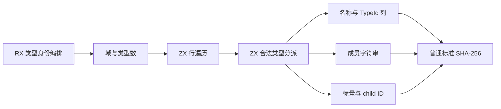
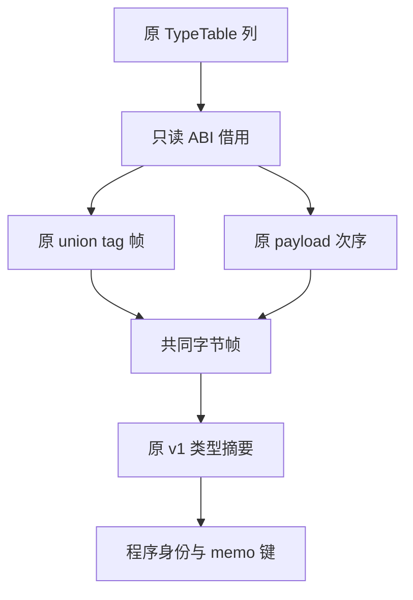

# 类型表所有权缓存身份自举

## Intent：最终目标

将所有权缓存的类型表身份编码从 Native 泛型遍历迁入 RX/ZX，保持原 v1 字节协议，
并继续符合零分配、zero runtime 和零成本抽象。沿用已有标准 SHA-256 整数更新，
不新增专用原生语义接口。

## Data：可用证据

旧 `uniqueness/identity.zig::types` 先编码域 `zxc.uniqueness.types.v1`，再编码
类型数量和每个 Type union 的 tag / payload。所有整数统一为 8 字节小端，字符串
为字节长度加原始字节；不遍历 child Type 的内容，只写其 TypeId。

TypeTable 有九种合法类型。特殊布局不能按直觉重写：

- Object 的 Fields 结构依次编码 names 切片、types 切片、len，字段数出现三次。
- Tuple 的 Ids 结构依次编码 values 切片、len，成员数出现两次。
- Task 的 result / errors 顺序固定；Enumeration 的 name 后才是 members。
- ErrorSet 直接编码字符串列表；NativeReference 直接编码名字字符串。

这些规则已对照 core/type_table/model.zig / root.zig 与旧泛型 write 逐项审查。
现有 TypeTable 列可直接借用，无需创建每行的 Native union 或复制数据。

上一阶段程序身份编码使用的 bytes frame 提升到 identity 共同目录，program 与
类型表编码共享同一份长度前缀逻辑与 Bytes 类型，保留 program/model 的类型导出。

## Edges：边界与限制

- 输入沿用编译器已有合法 TypeTable 契约，不添加新的外部解析入口。
- RX 负责域/数量初始化与行编码两个真实阶段；ZX 保留内聚的类型分派和列遍历。
- 字段名称、TypeId 列与成员名称采用范围引用，不构造临时字段数组或重排顺序。
- 仅有静态原生 ABI 借用与标准 hash final；入口使用容量为零的分配器。
- 旧 seed 仍保留等价算法；正式生成路径使用 Source，不改类型身份域版本。
- 函数内容与表达式/控制流的泛型身份遍历、memo 状态与其他宿主适配仍未迁完。

## Answer：交付与成功标准

验收包括真实生成的 FBA0 门禁、相同 IR 的非空 memo 键和值、依赖编辑和恢复的
增量/冷生成对照、受影响既有回归和阶段自编译。性能同时对照固定累计基线与上一
阶段正式工具；不根据扩展名、构建成功或空表相等宣称完成。

初次引导构建 39/39、正式构建 21/21 成功；十四份既有输入在新入口的 FBA0 下
生成成功，没有放宽分配器或改变行数据表示。另在忽略缓存内复制并格式化既有
Task/capture_error、enumeration、native_reference 输入，分别核对前后四类 memo：
1/1/1/1、2/2/2/2、1/1/1/1 的键和值全部一致。Task 输入同时覆盖错误集合与
optional/tuple，枚举输入覆盖字段和成员列表；没有新增生产特例或仓库测试夹具。

对应原始记录为 `types-identity/first-proof.log`、`type-cases-result.json` 与
各自 `*-memo-comparison.json`。静态协议审查表为 `protocol-audit.md`；全部合法
类型均已逐项核对，但生成闭包、完整回归与成本最终结论仍需收口。

## 最终验收与成本

七个受影响目标共 **253/253 构建步骤、509/509 检查通过**，覆盖函数摘要、缓存
所有权、Task、字段事实、Native 值边界、Store 与值返回。主集合、collections、
growth 的阶段自编译分别为 **2,738 / 64 / 356 文件**，只有 `.zxc-inputs` 不同。
身份目录十八份 RX/ZX 的最新 CLI fmt / lint 全部通过。

冻结输入仍为 141 入口、2,220 模块。隔离执行八轮交替，舍弃每工具首轮：

| 工具                    | CPU    | 墙钟   | 峰值 RSS      |
| ----------------------- | ------ | ------ | ------------- |
| 固定 inbound-conversion | 5.36 s | 1.17 s | 495,271,936 B |
| 上阶段 program-identity | 5.25 s | 1.13 s | 472,809,472 B |
| 当前类型身份迁移        | 5.25 s | 1.14 s | 486,834,176 B |

CPU 阶段不增长、累计 -0.11 s；墙钟阶段 +0.01 s、累计 -0.03 s。首轮 RSS 中位数
阶段约 +14.02 MB，因此没有仅凭累计仍低于基线就放行，而是保留完整首轮数据并
专门补充十二轮新目录的前后配对采样，仍舍弃首轮、不更换基线或正式二进制：

| 配对工具 | CPU    | 墙钟   | 峰值 RSS      |
| -------- | ------ | ------ | ------------- |
| 前一阶段 | 5.23 s | 1.11 s | 487,931,904 B |
| 当前阶段 | 5.23 s | 1.11 s | 486,850,560 B |

RSS 补充采样阶段约 -1.08 MB，没有复现稳定增长；首轮高低两簇重叠，短样本中位数
落在不同区间。两轮记录均保留，不择取其中一轮作为“优化收益”，也不据此宣称完整
冷构建的 GB 峰值已解决。新类型摘要入口及其传递 Source 调用在 FBA0 下运行，
列借用没有新增堆分配或底层数据复制；固定累计基线继续保持。

十四份既有输入另做八轮冷生成，CPU **25.843 → 25.686 ms**、墙钟
**9.996 → 10.078 ms**，保持在约定容差内，不用毫秒样本声称确定速度收益。

### 键、产物与合法编辑

冻结输入的 **8,248 / 2,419 / 1,945 / 0** 条 memo 记录，前后所有键和值逐项
一致，共 **12,612 条非空记录**。这直接覆盖新的类型摘要参与的程序身份与三类
实际记录，不需要临时切换算法或修改键版本。2,268 个冻结输出文件逐字比较，
仅 `.zxc-inputs` 的工具身份元数据不同。

十四份既有夹具四类记录 **17 / 15 / 14 / 14** 也全部一致；将缓存目录内复制的
borrow 从返回输入改为返回空数组，再恢复，三个阶段的增量结果与各自冷生成一致，
且新旧工具代码产物一致。恢复后的完整 memo 仍逐项一致。Task/ErrorSet、枚举及
NativeReference 的额外既有输入记录也一致，没有修改仓库夹具或新增针对输入的规则。

原始证据位于忽略目录 `ownership-research/types-identity/`：
`regressions.log`、`final-shared-fixedpoint-result.json`、
`final-runtime-comparison.json`、`rss-focused-comparison.json`、
`memo-comparison.json`、`fixtures-cost.json`、`fixtures-memo-comparison.json`、
`edits-comparison.json`、`edits-memo-comparison.json`、`source-validation.json`。

自我审查：九种合法 Type 的 wire 顺序、重复长度、零分配闭包、相同 IR 的完整键、
缓存依赖改变与恢复均有可复核证据；RSS 疑点通过独立配对验证，没有隐藏首次波动。
类型摘要只写 child ID，不代表函数内容/控制流摘要已迁移。原生状态、函数内容的
泛型遍历及适配仍然存在，完整自举和前端 NLL 尚未完成。
