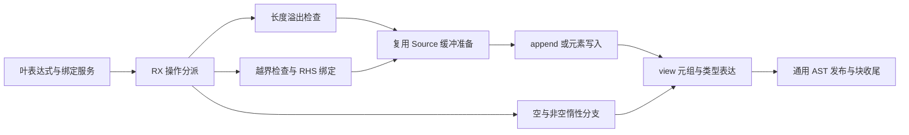
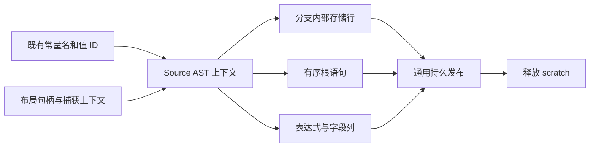

# 缓冲列表变更协议自举

## Intent：最终目标

将 buffered-list 的 push/pop/update 完整 AST 协议迁入 RX/ZX，保持表达式
求值次数、错误顺序、共享 owner/items/owned 语义与原有分配成本模型。

## Data：可用证据

起点 ab2fed95，工作区干净。iteration_value/mutation.zig 仍直接构造三项
操作；buffer.prepare/view、错误分支、元组和强制类型表达均有 Source 原语。
aggregate.bind 固定产生一个 constant 和对应 identifier，可在栈上传输该
已有 Source 绑定的结果，Native 不新增业务规则或操作计划。

## Edges：边界与限制

- push：target→RHS→长度溢出→prepare→append→view/tuple/cast。
- update：target/index→越界→RHS→prepare→写入→view。
- pop：空列表返回原 source/null；减一、slice、index 留在非空惰性分支。
- Native 保持叶表达式与绑定服务的调用顺序；无 fresh 的字段/guard AST 可延后
  构造，RHS 的 reference_storage 和嵌套声明发布仍由原 Lower.expr 调用执行。
- 类型 getter 可能声明命名布局，按原顺序在操作数之后准备，Source 不消费 fresh；
  最终 aggregate.finish 仍在操作构造后执行。
- 补齐 Source AST 已有 discard 语句的列表示，复用 body/storage 分离机制；
  不增加语言语法、解释器、callback 运行层或编译器专用 opcode。
- prepared binding 的名称已属 Lower，导入时借用；静态字段名不重复提升。
- 复用既有 iterate-buffer、nested-buffer、aggregate-loop 回归及分配失败检查，
  不新增用例；两阶段自编译、完整产物/memo和固定累计性能共同验收。

## Answer：交付格式与成功标准

阶段完成以三项协议全部可运行为边界；原生叶表达式驱动与整体循环上下文仍须
明确列为过渡依赖。按 IDEA 保存目标、证据、边界及成功标准，不以入口包装替代
真实 Source 编排，不以产物相同替代最终依赖闭包验收。

## 实现与联动

RX 按 Update/Push/Pop 分派并显式连接 bounds、value、overflow、prepare、
write、cast 与 finish；ZX 构造原子 AST 步骤。Native 仅保留叶表达式/既有
aggregate.bind 服务、类型句柄和持久发布，绑定的单个常量经栈上列传输，
不重复提升名字。Source 决定常量进入运行时 body 的位置，不移动 RHS 的
reference_storage 或嵌套声明发布，也没有引入专用调度或操作计划。

Source AST 的公共 Statements 补齐已有 Discard 列，body/evaluate 统一构造
求值或丢弃。比较、Switch 和 Parallel 原先的额外 discard 已在生产者收口到
公共语句表；移除重复拼接，严格列重叠校验保持。首次构建明确暴露这些联动，
修复后才重新验收，没有通过放宽视图校验掩盖问题。

buffer.prepare/project_context 提取原投影逻辑，旧入口负责初始化并复用它；
mutation 以自己的已有上下文调用同一逻辑，保持同步 owner.items.len 和复制
两个分支。根语句和内部存储共用 payload、分别携带 headers；内部 Block 的
基址在插入前计算，按 selected 行导入，不复制无关 payload。

import_selected 增加借用文本模式，其复制和失败 rollback 使用同一模式。
准备好的 operand/capture 名已属 Lower，静态字段名可长期借用；其他嵌套
非文本载荷仍取得持久存储。没有为本次迁移重复复制这些文本。

## 实际生成审计

目录为 final-build/local-cache/o/8cdccd47ee065a641a8851c8837fe967/main。
RX 根 6c35f31e…对 Update 执行 bounds→value→prepare，对 Push 执行
value→overflow→prepare。Pop 的 89cca1ed…仅先构造 slice/index 节点，
最终保留于 conditional 的 no 分支，未提升成运行时绑定。prepare 的
5d1e251e…先记录语句位置，再调用投影 c544e5b9…和分支 804bcb9d…，
后者按顺序追加同步 assignment 与复制 expression，符合 yes/no 范围。

Full Statements 仍有宽描述符 create 和少量已有列前缀复制，不能称为完全
无复制或零分配。每项协议从空 Context 开始，阶段和列长度均为固定上界，
没有随输入长度增长的循环，未发现此前 Switch 的无界二次复制形态。
Expression 列保留增长描述符；实际 CPU/内存代价另由动态对照判断。

## 正确性与配置

两阶段自编译均 21/21 步通过，二进制 SHA-256 相同：
bc8afe81a81756fb926da96df8409c8cbdf898a65172e40761ae66ce841248cb。
正式 generated、generated_analysis、partition_groups 均启用。
当前 main/collections/growth/ordered 各 3313/65/358/24 文件；上一工具与
bootstrap 仅 .zxc-inputs 不同，bootstrap 与 production 四组完全相同。

既有 iterate-buffer、nested-buffer、aggregate-loop、function-analysis、
switch-evaluation-order、zx-parallel-runtime 共 268/268 步、316/316 用例
通过。补充现有 iterate、function-updates 覆盖 indexed update、条件顺序和
RHS 效果，159/159 步、378/378 用例通过。两组按各自真实汇总记录，不把
可能复用的依赖检查机械相加为不同用例数量；没有新增测试。

26 份 Source 的最终格式检查及对应 lint 通过；Native 格式检查在交付前收口。
mutation_seed 与起点 Native 文件逐字一致。局部对照仅将新 mutation 入口的
两个 guard 切回该 seed，其他 Source 配置和代码保持当前版；完整性能结果
及固定累计基线另列，不以构建成功替代开销验收。

## 性能与累计趋势

所有构建结束后分别进行局部和整体交替八轮测量，均排除首轮。局部使用
nested-buffer 的 5 项与 aggregate-loop 的 8 项真实调用，每轮 52 份生成文件，
八轮全部逐字节相同；Native 副本的两个 guard 差异已精确核对，旧 seed 未改。

| 指标           | 原 Native mutation | Source mutation |
| -------------- | -----------------: | --------------: |
| CPU            |         0.424050 s |      0.422576 s |
| 墙钟           |         0.438338 s |      0.436803 s |
| 最大子进程 RSS |         14106624 B |      14073856 B |

局部 CPU 少约 0.00147 s、墙钟少约 0.00154 s，仅对应现有规模；墙钟含启动，
RSS 是单项子进程最大值，不是整树峰值，不能外推为整体稳定加速或内存收益。

整体同时覆盖本阶段公共 AST 模型与 discard 消费者的联动。固定 141 入口、
2220 模块、2268 文件；累计基线仍是 inbound-conversion 原工具：

| 指标            | 固定累计基线 |      上阶段 |      本阶段 |
| --------------- | -----------: | ----------: | ----------: |
| CPU             |       5.34 s |      5.32 s |      5.32 s |
| 墙钟            |       1.16 s |      1.14 s |      1.13 s |
| 最大 RSS 中位数 |  491634688 B | 490766336 B | 482951168 B |

CPU 单阶段不变，累计 −0.02 s；墙钟单阶段 −0.01 s、累计 −0.03 s。没有
随提交重置基线或重复领取容差；近期各阶段约 5.3 s，没有持续累计增长证据。
RSS 上阶段范围 474988544～492912640 B，本阶段 476577792～494223360 B，
明显重叠，不将中位数少约 8 MB 说成稳定内存改善。未重新测最新完整冷构建，
这些结果不替代 Zig/LLVM 后端峰值测量。

四组当前源码和冻结输入的 memo 逐键逐内容相同：main 11403/3192/2670/0；
collections 67/45/27/27；growth 1130/312/267/0；ordered 27/14/14/14；
冻结输入 8248/2419/1945/0。固定输入完整产物仅 .zxc-inputs 不同。

## 自我复核与交接

三项协议已以真实 RX 编排与 ZX 原子构造执行；没有用入口转发、结果 DTO 或
操作计划替代流程迁移。运行时错误顺序、旧值/owner/owned 关系和 pop 惰性均
保留。Source 小前缀复制与宽描述符装箱明确存在，现有动态证据未见超限退化；
未来更大输入仍需沿固定基线观察，不把有界成本称为完全零开销。

Native 仍承担叶表达式求值服务、命名布局准备、最终块封装和通用 AST 发布；
整个 iteration_value/Lower 状态与循环驱动尚未完成迁移。本阶段不等于完整
自举，也不解决全部所有权生命周期和冷编译内存问题。7 份 Native 最终格式
检查通过，所有 Source 校验和行为证据均对应最终代码，没有新增测试。

证据位于忽略目录 .zig-cache/cold-build-analysis/ownership-research/buffered-mutation：
bootstrap.log、production.log、regressions.log、update-regressions.log、
fixedpoint.json、production-fixedpoint.json、memo-results.json、driver-scope.json、
affected-comparison.json、final-runtime-comparison.json，以及各轮命令和完整产物。
本文按 IDEA 保留目标、证据、边界和交付标准；整体目标继续进行。
