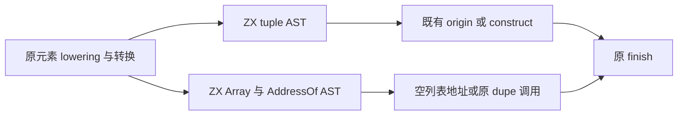
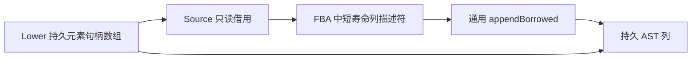
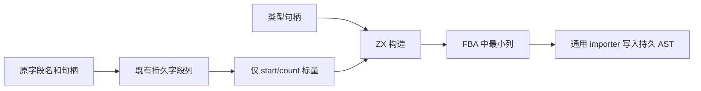

# 聚合字面量构造自举

本文先记录 tuple/list 迁移，再记录对象节点构造。两次阶段的配置、工具身份与
验收证据分别保留，不将后一阶段复用前一阶段的性能结论。

## Intent：最终目标

将普通 tuple/list 的底层 AST 构造迁入 ZX，保持元素数组共享和原求值顺序。
本轮覆盖 tuple 节点及列表的 Array→AddressOf 节点，不将完整 aggregate lowering
宣称为完成自举。

## Data：可用证据

原 sequenceMode 先按顺序 lowering 并绑定每个元素，再做状态表示转换，将结果
写入 Lower allocator 所拥有的 expressions。tuple 直接引用这份数组；list 构造
Array 和 AddressOf，空列表直接用地址，非空列表继续通过既有 allocator.dupe 调用。
模板、static_list 快路径、origin、construct 和最终 finish 已有独立职责。

现有 access/length 等 emitter 通过 Source 最小列和 appendBorrowed 导入 AST，
保持嵌套 payload 指向稳定 owner。本轮复用该机制，不另建 builder 桥。

## Edges：边界与限制

- Source 返回的外层列描述符位于短寿命 FBA；目标 importer 复制描述符，嵌套元素
  句柄数组仍归 Lower 所有，不能随 FBA 失效，也不能再复制一份元素数组。
- 节点插入顺序保持 tuple 一节点、list 两节点；list 的 dupe/capture/错误顺序不变。
- Source 不调用专用运行库，不生成 RawCode，不改变应用 ABI 与列表所有权。
- 原生调用只适配列和持久容器，seed 保留原 builder 行为；正式路径调用 Source。
- 不新增用例。集中验证现有 tuple/list、元素求值顺序、空数组、状态表示与生成。

## Answer：交付格式与成功标准

验收 Source fmt/lint、引导与正式自编译、完整生成代码及 memo、相关既有运行回归
和固定累计基线性能；生成节点形态预期完全相同，不能只检查编译成功。阶段收口
时提交推送全部变更并确认干净；完整自举继续。

## 执行记录

两个 ZX 文件通过 fmt/lint，原生 diff 通过 zig fmt。首次构建发现 tuple 输入
是切片，通用 columns.invoke 仅适配对象描述符指针；本地 adapter 改为编译期
区分入口形状，切片直接 executeValue，对象继续 invoke。不改通用 API 或语言
契约，也没有额外包装持久列表。保留 bootstrap.log 中的失败与 bootstrap-fixed.log
中的修复验证，避免将第一次失败写成通过。

修复后引导与正式构建各 21/21，工具 SHA-256 均为
f8b4ffb3374765ba03b3b5ad86cae9c925fcc412eae05c81418043e7e24e1901。
先由上阶段 Source 正式工具构建引导版，再用引导版构建正式版，运行时均走
generated_analysis 的 Source 规则。

完整 main/collections/growth 输入在上阶段与本阶段工具下分别为 2937/65/357
文件，仅 .zxc-inputs 不同；引导与正式工具生成连元数据也相同。四类 memo 为
10420/2943/2422/0、67/45/27/27、1126/311/266/0，逐键逐内容相同。此阶段不改
缓存身份或失效规则，未重复之前已有的编辑/恢复实验。

实际生成体仅复制输入 u32 切片的指针/长度描述符。外层短列在固定页大小 FBA
中申请，appendBorrowed 将列内容提交到目标后退出；tuple/array_values 的内部
切片仍引用 Lower 所有的元素句柄数组。没有新增宿主堆申请、整元素数组复制或
运行库；目标 AST 的原有容量增长保留。tuple 一节点与 list 两节点的句柄顺序、
空列表地址、非空 dupe、origin/construct 与 capture 时点均已按真实产物核对。

冻结 141 入口，三版交替 8 轮，排除首轮；其他构建未并行运行：

| 指标     |      上阶段 |      本阶段 | 同一固定累计基线工具 |
| -------- | ----------: | ----------: | -------------------: |
| CPU      |      5.28 s |      5.27 s |               5.34 s |
| 墙钟     |      1.12 s |      1.12 s |               1.16 s |
| 最大 RSS | 490307584 B | 474054656 B |          490717184 B |

CPU 单阶段 −0.01 s、累计 −0.07 s；墙钟单阶段不变、累计 −0.04 s。RSS 未作为
稳定收益。2268 个文件仅 .zxc-inputs 不同，memo 8248/2419/1945/0 共 12612 条
逐键完全一致。本轮不改变应用生成形态，未重复完整冷构建计时；这些生成器
数字不能用来更新约 2 GB 冷编译峰值的历史结论。

证据在忽略目录 .zig-cache/cold-build-analysis/ownership-research/aggregate-literals：
bootstrap.log、bootstrap-fixed.log、production.log、fixedpoint.json、
production-fixedpoint.json、memo-results.json、final-runtime-comparison.json
及对应完整生成产物。

已有 test-value-return、test-loop-columns、test-object-evaluation-order、
test-array-evaluation-order、test-stores、test-module-generation 集中通过
234/234 构建步骤、559/559 受管用例。regressions.log 保留完整结果；子进程或
脚本独立报告的用例不混入受管总数。没有新增用例。

自我复核：本轮迁移的是 tuple/list 底层 AST 的完整构造规则，采用已有静态函数
和通用列导入能力，既有生成与运行证据支持其行为及共享表示。它仍依赖 Native
适配器、持久 AST 状态和元素 lowering；objectMode、sequenceMode 的阶段编排、
原生类型与状态模型仍待迁移。不能以两个 Source 入口、字节一致或回归通过宣称
完整 aggregate 或整体自举已完成，也未声称优化了最新完整冷编译峰值。

## 对象节点构造迁移

此阶段的 Intent 是补齐普通对象字面量的 AST 构造。Data 为原 stored.copy：
它先将字段写入持久 field_columns，再将 type_expr 和字段范围写入对象节点。
Edges 是原字段排序、类型求值、字段存储顺序、borrowed field 与状态转换均不动。
Answer 是复用已有对象 Columns 类型输出一条结构化 Object 节点，并验证生成
行为、自编译及累计成本。

Source 输入仅含类型句柄与字段 start/count；输出复用 ast/expressions/object 的
Columns 类型。Native 继续调用同一个 storage.fields，Source 不接收字段文本或
字段值数组，不引入新数据复制或持久状态。原 objectMode 末尾的 layoutExpr 仍
先求值，再存字段、发射对象，最后进行 construct/finish。

### 对象阶段验收记录

Source fmt/lint 与 Native fmt 通过，引导、正式构建各 21/21，两个工具 SHA-256
均为 6d93b7e7adb04c6d87ac38e26f29e46d05cca598f9fc4d2a5be65c135230e3c0。
本体依次由上阶段 Source 正式工具、本阶段引导工具生成；运行时启用 Source
generated_analysis。实际 emitter 只产生短标量列，没有字段文本或值数组。

上阶段与新工具的完整 main/collections/growth 产物分别为 2940/65/357 文件，仅
.zxc-inputs 不同；引导与正式版连元数据也完全相同。memo 10421/2944/2423/0、
67/45/27/27、1126/311/266/0 逐键逐内容一致。缓存规则未变，不重复此前有效的
编辑恢复检查。

冻结 141 入口，三版交替 8 轮、排除首轮，期间未并行运行其他构建：

| 指标     |      上阶段 |    对象阶段 | 同一固定累计基线工具 |
| -------- | ----------: | ----------: | -------------------: |
| CPU      |      5.27 s |      5.28 s |               5.34 s |
| 墙钟     |      1.12 s |      1.12 s |               1.17 s |
| 最大 RSS | 488980480 B | 475496448 B |          493043712 B |

CPU 单阶段 +0.01 s、累计 −0.06 s；墙钟单阶段不变、累计 −0.05 s。RSS 不作为
稳定收益。冻结 2268 文件仅 .zxc-inputs 不同，memo 8248/2419/1945/0 共 12612
条完全一致。生成形态相同，本阶段没有重做完整冷构建；另行执行的 TLS 诊断
属于此前假设的归因试验，未修改正式 HTTPS 路径，详见冷编译内存归因文档。

证据位于忽略目录 .zig-cache/cold-build-analysis/ownership-research/aggregate-object：
bootstrap.log、production.log、fixedpoint.json、production-fixedpoint.json、
memo-results.json、final-runtime-comparison.json 与对应完整产物。

对象阶段已有 test-function-updates、test-evaluation-order、test-value-return、
test-loop-columns、test-stores、test-module-generation 共通过 450/450 构建步骤、
1936/1936 受管用例，完整结果保留于 regressions.log。没有新增用例，脚本及
子进程单独报告的数量不混入此总数。

自我复核：复用的是同一字段持久存储和对象列模型，移除了 objectMode 中的
Native 对象节点构造；没有搬动 cache 安装/恢复、递归元素 lowering、loop-field
借用及跨职责调度。因此基本聚合字面量的节点构造已迁入 Source，完整 aggregate
编排、状态与通用持久容器仍待自举。TLS 试验未进入正式构建，不作为本阶段内存
优化交付，也不能用其不可交付的低 RSS 副本替代正式性能验收。
