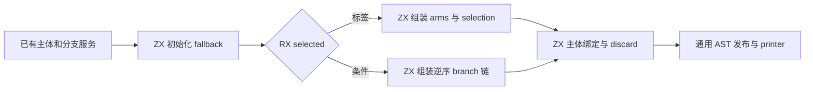
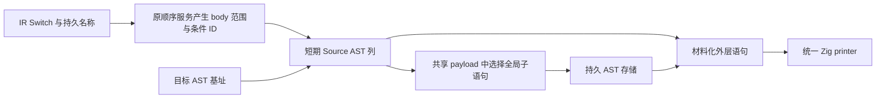

# 语句 Switch 构造自举

## Intent：最终目标

将 Switch 语句的标签 selection 与条件分支链两种完整 AST 组装迁入 RX/ZX，
保持主体只求值一次、分支顺序、不穿透和默认分支行为；不增加专用运行库。

## Data：可用证据

起点 cd8de51c。原 statements.switchStatement 在 Zig 组装两种 AST；工作区已有
未贯通的 Source 草稿。现有结构化 AST 原语、列导入和分支 lowering 可以复用。
本轮内存研究的类型归因及被拒绝 schema 候选记录在既有冷编译研究文档，随本
完整阶段统一提交；诊断源码和日志继续留在忽略目录，不纳入产品。

## Edges：边界与限制

- 先 fresh 名称、求值主体，再读旧 cache 并安装引用，退出时恢复旧值或移除。
- 默认 body 按源码顺序处理；有值分支逆序处理，保持原有编译期服务调用顺序。
- 标签路径先 lower body，再处理最后一项 equality 或其余 literal；条件链先
  equality 再 lower body。最后标签项仍包装 equality 与 fallback，不能直接执行。
- RX 显式分流 selection/chain 并汇合 finish；ZX 内保留分支遍历这个内聚算法。
- Native Lower/cache、body/equality/literal 服务和通用 AST 存储仍为过渡依赖，
  不能宣称完整语句职责、AST 状态或整个编译器已经自举。不引入 Source opcode
  计划或原生解释器。源字符串借用持久名称；短期列释放前取得必需的持久 payload。
- 不新增测试用例，复用 Switch 求值顺序、标量、作用域和嵌套回归。分配与生成
  形态有变化，集中验证受影响路径及固定累计基线，不重复冷构建内存实验。

## Answer：交付格式与成功标准

完整引导与正式自编译、非空产物对照、相关既有行为、memo 和性能检查通过后，
统一验收所有未提交内容，英文提交并推送，核对工作区干净及无未推送提交。

## 执行与验收

初次引导与正式两轮各 21/21 步，编译器二进制一致，当前输入产物对照通过。
四组 Switch 回归初次通过 97/97 步、64/64 用例。但生成闭包审计发现条件链
每次调用宽 Statements helper 后丢失数组增长前沿，因此尚不接纳这一版。

根因：同一个 main 中 growth、ownership 等模块的 Output 同时携带多份同型
Statements，已有 state/duplicates 为保持共享身份将该对象全局 boxed。跨函数
接收此公共表后，branch_* 列被重建为 plain，reserve(false) 每轮复制旧前缀。
这不是 loop 能力缺失，也不能通过忽略身份约束、修改 inline 阈值或 Native 桥
放行。未发现 Context 底层数组整体复制；arm 与 block 列仍保留增长信息。

最小修正只调整本轮消费表示：在 Switch State 中独立携带 headers 和 branch
列，沿用已有 header 原语构造；完整只读 Statements 到 finish 才合并一次。
窄表采用现有 represented 状态路径，保留列表 descriptor、容量与增长前沿，
不新增运行时表示、不改全局 boxing 规则。该表示平移与原生算法的独立 branch
列对应；修正后重新验证受影响生成闭包、行为与性能。

### 最终验收

窄表修正后重新完成引导与正式两轮，各 21/21 步；二进制 SHA-256 均为
0b2dfee106d422b0e4e7a1b8dfd7cadc5a0c4dcb938ad33acf43fc1c6b0e7b78。
同一当前 main/collections/growth 输入分别生成 3178/65/357 个非空文件；上阶段
与本轮除 .zxc-inputs 外完全相同，本轮两阶段逐字节相同。格式和 lint 覆盖全部
11 个 RX/ZX 文件（22 项检查）；Native 使用仓库 spacer 格式规则，生产构建
同时验证 Zig 语法，不以 zig fmt 的不同空行偏好替代仓库格式契约。

四组既有 test-switch-evaluation-order、test-switch-scalars、test-switch-scope、
test-switch-nested 再次通过 97/97 步、64/64 个用例。覆盖 empty/default-only、
default-first/last、无穿透、主体/分支调用及早期错误、整数/布尔/枚举/string、
分支局部绑定和嵌套缓存恢复。没有新增测试用例。

实际生成闭包核对：branch 八列保留 StateList，并使用 reserve(true)；chain
将各列 items/storage 直接传给下一轮，不重建 plain。tags/offsets 通过 header
保留增长 header。完整 Statements 只在 finish 合并；最外层分支的一次 headers
小列表构造受 index==0 保护。arm 和 block 列也保留增长信息，reverse/concat
只在循环结束后各执行一次。此结论来自实际循环传递，不是 reserve 静态计数。
没有声称回调或整个 Context 底层数组发生了深拷贝。

### 性能、产物与 memo

所有构建终止后，复用既有 compile-evaluation-order 工具配置，在忽略副本中
仅令 Switch AST 选择原始 Native seed，正式路径启用修正后的 Source 构造。
两边 generated_analysis=true，其他服务与配置一致。14 份既有 Switch 源码，
八轮交替并排除首轮；每轮 28 个生成文件均非空且逐字节相同：

| 指标（14 次生成合计）     | 原始 Native Switch | Source AST 构造 |
| ------------------------- | -----------------: | --------------: |
| CPU（高精度子进程资源差） |         0.031405 s |      0.031554 s |
| 墙钟（含进程启动）        |         0.046201 s |      0.046533 s |
| 最大单次子进程 RSS        |          7012352 B |       7061504 B |

差异远小于启动及调度波动；该对照证明真实消费路径没有可辨别的时间增长，
不能据此声称所有规模都更快。长链的旧前缀重复复制风险另由上述生成路径
证明消除，不以这些短用例代替复杂度核对。

固定 141 个入口的冻结输入三版交替八轮并排除首轮，固定工具与输入不重置：

| 指标 | 固定累计基线 |      上阶段 |      本阶段 |
| ---- | -----------: | ----------: | ----------: |
| CPU  |       5.33 s |      5.31 s |      5.32 s |
| 墙钟 |       1.17 s |      1.13 s |      1.13 s |
| RSS  |  495468544 B | 493043712 B | 480018432 B |

CPU 单阶段 +0.01 s、相对固定基线 −0.01 s；墙钟单阶段不变、累计 −0.04 s。
前后两个阶段分别有 +0.01 s 的微升，保留增长趋势记录，不把每次容差当作可
重复使用的预算。当前累计没有越界；样本波动不足以将该差异归因成稳定增长。
RSS 波动较大，不将几 MB 差异当作稳定收益，更不当作完整冷构建内存改善。

冻结输入 2268 个文件只 .zxc-inputs 不同。逐键逐内容核对 memo 的四类记录：
main 为 10950/3097/2575/0，collections 为 67/45/27/27，growth 为
1126/311/266/0，冻结输入为 8248/2419/1945/0；全部相同。没有修改缓存、
失效规则或语言语义，不为本次 AST 表示调整机械重复无关的编辑恢复和冷构建。

证据位于忽略目录 ownership-research/switch-statements：bootstrap.log、
production.log、regressions.log、source-checks.json、fixedpoint.json、
production-fixedpoint.json、final-driver-identity.json、affected-comparison.json、
final-runtime-comparison.json、memo-results.json。initial-* 保留被发现增长前沿
缺口之前的验证，不能与最终数据混用。原始 seed 对照只在忽略副本中禁用新
构造，正式迁移始终保留，没有引入生产回退开关或新增运行库。

### 自我复核

本阶段完成的是 Switch AST 组装，Native 仍负责主体/分支服务、顺序与缓存、
AST 物理存储；这些是明确未完成的传递依赖。RX 负责实际 AST 路径分流和汇合，
ZX 保留内聚的逐分支算法，符合本阶段职责边界，不代表整项自举完成。

宽表增长信息丢失由真实生成代码定位，以窄列状态保持原成本模型修复，没有
放宽全局身份检查或借强制内联掩盖问题。参数、返回值与材料化仍有必要的 AST
列描述符和 ID 复制；没有复制主体源码或分支底层数据来迁移，也没有完成一般
boxed 对象的跨边界增长信息保留。相关通用能力若继续需要，应独立给出需求和
成本证据；本次不把消费侧表示修正包装成全语言所有权机制已完成。
