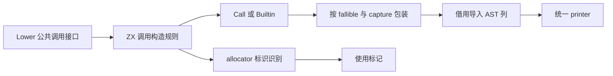
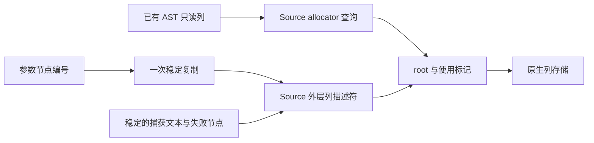

# 调用节点与错误包装自举

## Intent：最终目标

将 Lower.call/builtin 的 AST 规则、allocator 使用识别和 try/catch 选择迁入 ZX。
保持原调用方的求值顺序、错误边界、节点顺序与参数编号数组的一次拥有型复制，
不改变应用的运行时 ABI，不增加专用运行库。

## Data：可用证据

- 原规则在 `packages/genz/src/zx/lower.zig`：callee 是 Field 且直接 owner 为
  allocator identifier，或任一 argument 为 allocator identifier 时标记使用 allocator。
- builtin 原来不执行此检测；fallible 为 false 时也不使用 capture。
- fallible 调用先生成 Call，再生成 CatchValue 或 TryValue；捕获名称、标签和失败
  节点已经由 Lower 持有，不需要复制文本。
- 表达式缓存已使用 core/integer/map 的 executeState，不重复迁移已经存在的能力。
- 上阶段生成器为 `ownership-research/binding/production/bin/zxc-bootstrap`。
  固定累计基线仍使用 inbound-conversion，不随阶段重置。

## Edges：边界与限制

- Source 只读借用 tags/offsets/identifier/field_target，不复制已有 AST 表。
- Native 在同一栈帧建立 capture header，Source 同步调用结束前不修改 AST 表。
- 参数编号数组先获得一次稳定存储，Source 仅组装外层描述符，最终借用导入；
  必须检查实际生成体，不能仅凭源码推断没有隐式深拷贝。
- 原生层保留节点存储与 ABI 适配；本阶段不宣称完整 Lower 或递归调度已自举。
- OOM 终止当前 Lower；不新增失败后继续使用部分状态的恢复协议。
- 不新增仓库测试用例，复用受影响的既有调用、捕获、分配和集合回归。

## Answer：交付格式与成功标准

集中验收格式、lint、引导与正式构建、相关既有回归、全部代码与 memo 对照、
合法编辑/恢复的增量等于干净生成，以及冻结输入的 CPU、耗时和 RSS。
阶段完成后收口全部未提交内容，英文规范提交并推送，确认工作区干净且无未推送提交。

### 执行记录

实现与验收完成：

- call、builtin 构造规则迁入 `analysis/invocation`；allocator 查询复用已存在的
  construction/const.allocator_name，不在消费处重复声明常量。
- 两个入口各为内聚的 AST 构造操作；allocator 扫描和 identifier 判定分别是纯谓词，
  不新增仅转发一个原子调用的 RX。调用方的流程编排和递归求值仍是后续迁移职责。
- 保持 Call 在前、TryValue/CatchValue 在后的顺序；非 fallible 调用忽略 capture，
  builtin 不设置 allocator 使用标记。节点容量守卫按实际一行或两行增量检查。
- 已核对实际 partition 中的函数体与公开 executeValue wrapper：参数内容直接引用
  in.arguments，仅为 call_arguments/builtin_arguments 复制一个外层 slice 描述符。
  capture.name/label 同样借用字节，不深拷贝。Native 参数数组仍只复制一次。
- Native 列投影丢弃私有 zx_origin；固定缓冲中的标量列与外层描述符在返回前已导入
  长期 AST 存储，保留的嵌套参数与文本都具有原 Lower 生命周期。
- 5 个 ZX 文件通过 10 项格式/lint；Zig 格式与 diff 空白检查通过。
- 引导构建 39/39 步、正式构建 21/21 步通过。
- function-analysis、value-return、immutable-list、typed-try、typed-try-runtime、
  evaluation-order 六个既有目标合计 408/408 步、1863/1863 项通过，没有新增用例。
- 当前 main、collections、growth 三组文件数为 2873、64、356；迁移前、引导版与
  正式版仅 `.zxc-inputs` 不同，所有代码一致。四类 memo 键与记录值逐项一致：
  main 为 10391/2919/2398/0，collections 为 65/44/26/26，growth 为 1124/310/265/0。
- 九个既有样例的忽略目录副本完成合法标签编辑 −1→−2→恢复；三阶段各 30 个代码
  文件，前后相同且增量等于干净生成；四类 memo 各 9 项相同。

### 性能与累计变化

构建、回归与产物对照全部结束后，使用同一冻结输入隔离执行 8 轮交替测量，
排除首轮取中位数：

| 指标     | 固定累计基线 | 本阶段前    | 本阶段后    |
| -------- | ------------ | ----------- | ----------- |
| CPU      | 5.35 s       | 5.27 s      | 5.28 s      |
| 耗时     | 1.17 s       | 1.12 s      | 1.12 s      |
| 峰值 RSS | 486719488 B  | 491634688 B | 490799104 B |

本阶段 CPU +0.01 s，耗时无变化，RSS 未增长；按既定 CPU 0.02 s 容差验收。
相对固定基线 CPU −0.07 s、耗时 −0.05 s；RSS 比固定基线高 4079616 B，
但低于本阶段前，不将小幅 RSS 波动解释为确定收益，也不隐去累计内存差异。
近期累计 CPU 优势有缩小趋势，后续应优先关注高频构造适配和临时列成本；
容差不作为每阶段可反复领取的增长预算，固定基线保持不变。

冻结输入 2268 个文件仅 `.zxc-inputs` 不同；12612 项 memo 的键与记录值相同。
这些数字覆盖生成器，不是完整冷构建或 LLVM 峰值的新测量。

### 自我批判与剩余职责

- 本阶段 Source 使用最小列契约，而没有为每次原子调用构造整个 AST context。
  既有 ast/expressions 原语操作完整 context；没有为形式复用引入数十个无关列。
  两处节点字段契约仍需跟随统一 AST 模型维护，不能据此声称已统一所有构造器。
- allocator 识别是纯值查询，找到匹配后停止扫描，结果与原实现一致；没有跨越
  参数表达式求值，因为调用方已经完成参数求值并提供节点编号。
- OOM 时旧实现可能已设置 uses_allocator 或追加 Call，新实现可能尚未提交。
  当前调用均传播失败，不支持恢复并继续使用失败 Lower；不宣称失败内部状态相同。
- 参数编号数组的复制属于编译期 AST 存储所有权，次数与原实现相同；应用值与
  运行时调用 ABI 未改变。节点表存储、递归求值与调用方编排仍留在过渡原生层。
- 仍需完整传递依赖审计和 stage 1→2→3 验收，不能用本阶段代码一致代替完整自举。

原始脚本、日志与报告位于忽略目录
`.zig-cache/cold-build-analysis/ownership-research/invocation/`：
`source-validation.json`、`bootstrap.log`、`production.log`、`regressions.log`、
`call-arguments-proof.zig.txt`、`builtin-arguments-proof.zig.txt`、
`known-shared-fixedpoint-result.json`、`current-manifest-memo-comparison.json`、
`selection-edits-comparison.json`、`selection-memo-comparison.json`、
`final-runtime-comparison.json` 与 `memo-comparison.json`。
