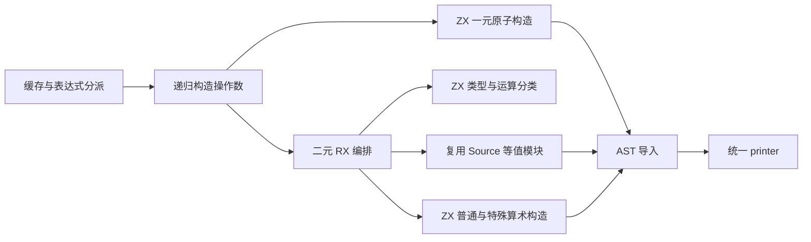
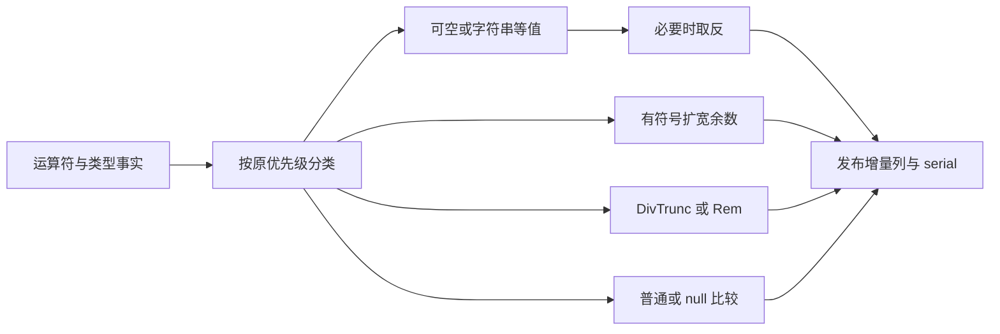

# 运算符表达式生成自举

## Intent：最终目标

将一元、二元运算的分类和 AST 生成迁入 RX/ZX，保留可空值、字符串、短路、
整数除法、有符号余数与浮点行为，维持固定累计性能约束和零运行库设计。

## Data：可用证据

- 原实现位于 `packages/genz/src/zx/lower.zig` 的 unary 分派和 binary 函数。
- 二元操作数编译期依次调用 expr；生成逻辑 AND/OR、coalesce 的 Zig 运算节点，
  由目标语言保留运行时短路。不能将“构造右操作数 AST”改成提前执行右操作数。
- 可空值与 none 比较直接使用 null 节点；其他可空值和字符串等值比较复用已迁移
  equality，再根据运算符取反。
- i32/i64 余数先扩宽到 i33/i65，再 Rem、IntCast、As，避免最小负数除以 −1 的溢出。
  整数除法使用 DivTrunc，浮点除法保留普通 Divide，其余余数使用 Rem。
- 上阶段正式生成器位于 `ownership-research/literals/production/bin/zxc-bootstrap`；
  固定累计基线仍为 `inbound-conversion/production-bootstrap/bin/zxc-bootstrap`。

## Edges：边界与限制

- 原生层暂留操作数递归 expr、类型表达式请求、输入借用及 AST 存储导入。
  递归求值调度与 Lower 状态仍需后续迁移。
- 正式运算规则只来自 RX/ZX；旧二元规则保留为 seed，一元 seed 保持原样。
- RX 真实选择等值、取反等值、扩宽余数、builtin、普通/空值比较的路径；
  ZX 保留每项构造的内聚算法，不将分派隐藏进原生桥。
- 输入是已验证 IR。普通运算映射只被 Direct/Nulls 消费；Remainder 在分类阶段
  已进入 SignedRemainder 或 Builtin，不进入普通映射。
- 目标类型表达式在适配器中提前请求，随后才取得节点基址；需核对生成代码及缓存，
  不要求内部节点编号完全相同。
- Source 等值构造包含 scratch 生成的 fresh 名称，使用拥有型导入，不能直接借用。
- 先贯通实现，再定位实际开销；出现退化时保留迁移并优化，不退回旧实现。

## Answer：交付格式与成功标准

完成格式、lint、seed/正式构建、相关既有行为回归、全代码与 memo 对照、增量与
干净生成核对。隔离记录实际路径的 CPU、耗时和 RSS，保留阶段与固定累计基线。
验收后统一提交推送全部变更，确认工作区干净且无未推送提交。

### 执行与自我复核

实现与验收完成：

- regular 的一元分派和 binary 正式入口接入 Source。RX 显式选择等值、取反等值、
  有符号余数、builtin 和普通/null 比较；复用既有 Source equality 及其 Output 类型。
- 左、右 expr 顺序不变；null 替代节点仍按左→右追加。NotEqual 只在等值结果后
  追加 Not。所有 Remainder 必定进入 SignedRemainder 或 Builtin，不落入普通映射。
- 有符号余数保留 `wide → As(left) → As(right) → Rem → IntCast → As(original)`。
  整数、浮点 Divide 保持不同路径，AND/OR/coalesce 仍是相同短路二元节点。
- Source 名称和 builtin 参数使用拥有型导入；一元输出仅含标量列，可以借用导入。
  临时 arena 在一次发射后 deinit，导入完再释放，没有将 scratch 名称留在 AST 中。
- 11 个新 RX/ZX 文件通过 22 项格式、lint；Zig 格式与 diff 空白检查通过。
- seed 引导构建 39/39 步、正式构建 21/21 步通过。
- 复用 function-analysis、logical-binary、null-inequality、number-special-values、
  boolean-null、strings、safety 七组既有回归，275/275 步、3558/3558 项通过。
- 当前 main、collections、growth 三组生成文件为 2835、64、356 个；迁移前、
  引导版、正式版仅 `.zxc-inputs` 不同，全部代码一致。三组缓存及冻结输入的
  四类 memo 键和值逐项一致，冻结输入为 12612 项。
- 忽略目录复制 11 个既有样例，覆盖 i32/i64/u64 安全运算、f32/f64 余数与除法、
  可空比较、coalesce 和逻辑取反。将 f64 余数改为除法再恢复；三阶段各 36 个
  代码文件，前后相同且增量等于干净生成；memo 逐项相同，没有新增生产用例。

### 性能与累计变化

构建与回归结束后，以同一冻结输入、工具链和配置隔离计量。8 轮交替运行，
排除首轮取中位数：

| 指标     | 固定累计基线 | 本阶段前    | 本阶段后    |
| -------- | ------------ | ----------- | ----------- |
| CPU      | 5.34 s       | 5.24 s      | 5.25 s      |
| 耗时     | 1.16 s       | 1.11 s      | 1.12 s      |
| 峰值 RSS | 489603072 B  | 475480064 B | 491667456 B |

本阶段 CPU、耗时各 +0.01 s；相对固定基线 CPU −0.09 s、耗时 −0.04 s。
近期微小增量继续纳入累计记录，不把每阶段容差当作可重复领取的预算；后续仍需
观察增长趋势，不能因当前尚快于固定基线而忽略持续增长。

首组 RSS 差约 16 MB，故追加 12 轮交替复测，排除首轮后：前后 CPU 5.24→5.25 s、
耗时 1.12→1.12 s、峰值 RSS 491307008→484245504 B。没有复现稳定内存增长，
不将复测的下降解释为确定收益。静态检查确认 workspace 与临时 arena 分离、
scratch 按发射回收；这不等于已测量累计分配量或解决其他内存热点。

冻结输入 2268 个文件仅 `.zxc-inputs` 不同；代码与 memo 一致。测量覆盖正式
生成路径，不是完整冷构建或 LLVM 后端峰值的新测量。

### 自我批判与剩余职责

- 编译期构造两个操作数 AST 与运行时求值不同；本阶段保留相同输出代码和短路
  节点，没有将右操作数提前绑定，因此不改变运行时求值次数和短路。
- 目标类型首次请求时机可以使内部节点编号变化；全部代码与缓存一致支持本次
  等价，有限回归仍不是一般语义证明。
- 普通运算映射依赖分类前置条件；后续扩展 IR 运算符时须同步核对分类与映射，
  不能直接把新运算符送到默认 Coalesce 路径。
- 原生层仍有递归 expr、缓存、Lower 状态及 AST 存储；本阶段完成运算符规则与
  AST 生成，不替代最终传递依赖审计和 stage 1→2→3 验收。

脚本、报告与日志位于忽略目录
`.zig-cache/cold-build-analysis/ownership-research/operators/`：
`source-validation.json`、`bootstrap.log`、`production.log`、`regressions.log`、
`known-shared-fixedpoint-result.json`、`current-manifest-memo-comparison.json`、
`memo-comparison.json`、`operator-edits-comparison.json`、`operator-memo-comparison.json`、
`final-runtime-comparison.json` 与 `rss-focused-comparison.json`。
