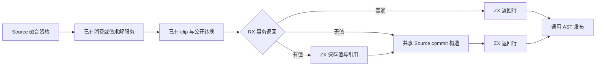
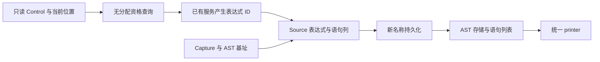

# 返回语句构造自举

## Intent：最终目标

将返回语句的融合资格判断及完整收尾 AST 构造迁入 RX/ZX，包括普通返回、
事务无值返回和先保存值再提交的事务返回。保留值求解、clip、公开视图转换、
fresh 序号、事务提交与 return 的原有顺序，不引入运行库或 Source 执行计划。

## Data：可用证据

起点 3dc42257，工作区干净。statements.lower 的 result 分支仍在 Native 判断
末尾前置常量并拼装事务/返回 AST；iteration consumer、clip、公开转换及 Store
commit 各有既有服务。Store commit 的结构化构造已在 Source，可抽出接受现有
Context 的纯构造复用，避免两份同语义实现或 Native 回调。

## Edges：边界与限制

- 只有有返回值、位于块末尾且前一项为 constant 时尝试融合；查询按原顺序
  短路，offset 为零时不能读取前一项。查询不得申请临时数组或工作区。
- 融合失败才正常求值；然后 clip、公开视图转换，再进入收尾。成功融合仍由
  原服务消费，consumed_previous 仅在得到实际返回值时设置。
- 事务有值时先保留 output fresh 序号并保存值，随后提交，最后返回 identifier；
  事务无值时也必须提交。提交错误不能被提前 return 或额外求值掩盖。
- RX 显式分流三条路径；ZX 完成原子 AST 构造。普通路径不创建 Context 或
  空表达式表，Output.expressions 为 null 表示没有新增表达式。
- Native 值服务、Lower/cache/序号状态和物理材料化仍为过渡依赖，不将其隐藏
  在新的语义桥、opcode 表或专用运行库中，也不宣称完整返回 lowering 已自举。
- Source 新建临时名称在 scratch 释放前取得持久文本；其位置契约是第一个
  identifier 与第一个 constant_name。静态 Store 名称和 Capture 文本沿用已有
  持久寿命，其他嵌套 payload 由通用 importer 取得持久存储。
- 不新增用例；复用返回、loop 消费、所有权公开返回和 Store 事务的既有回归。
  测受影响路径和固定累计基线，记录趋势，不机械重复完整冷构建或缓存编辑。

## Answer：交付格式与成功标准

完整贯通后集中验收自编译、非空产物、实际消费行为、memo 与累计性能；全部
未提交内容统一英文提交推送，确认工作区干净及无未推送提交。文档按 IDEA
记录原始证据、取舍和未完成边界，不以局部格式检查代替功能交付。

## 执行与验收

11 个 RX/ZX 文件通过 fmt --check 与 lint（22 项检查），Native 通过仓库 spacer
格式检查。引导与正式两轮各 21/21 步，二进制 SHA-256 相同：
805b37eeecb0e79c55e5d3adfa9c30e9b1640c092bf65ef704a441c52b1df4f6。

当前 main/collections/growth 分别生成 3201/65/357 个非空文件。上阶段与本轮
除 .zxc-inputs 外完全相同，本轮两阶段逐字节相同。对照集合显式拒绝空输出。

审计发现并修正 seed 提取时的三处多余取址：output 已是指针，clip/bind/convert
不能再次传 &output。正式路径原本正确；随后三份原始对照工具实际编译成功，
证明旧实现的对应分支已经实例化，而非仅凭未触达的 seed 源码推断正确。

### 顺序、寿命与生成成本

eligible 的实际生成闭包仅标量计算和受保护的表读取，明确不使用 allocator，
没有分配或递归；空 FixedBufferAllocator 不是唯一无分配证据。三项前置 guard
保持短路，offset 为零或不在末尾时不读取前一项；只有实际消费成功才跳过常量。

ordinary 的 expressions=null，没有创建 Context 或空表达式表，只生成三个
单元素语句列。事务路径调用共用 commit_value，保存常量和追加 commit 各有
一次完整 Statements 描述符装箱；这是固定次数，不是循环中复制底层数组，
不能将该路径称为无分配或无装箱。

Source 保存的动态名称确实是首个 identifier 与首个 constant_name。Native
只将新名称提升一次并替换这两个切片元素；其他静态名称和 Capture 文本保留
原寿命。call 参数等嵌套非文本 payload 由 importer 取得持久存储，没有 scratch
列指针逃逸。公开返回转换仍在保存值之前，commit 的 try/catch 仍在 return 前。

### 既有行为、产物与性能

test-return-statements、test-value-return、test-loop-columns、test-stores 四组
通过 220/220 步、479/479 个既有用例。覆盖返回行终止符、公开状态返回与逃逸
容器、loop 消费/回退/错误及 Store 暂存、提交和分配失败，没有新增用例。
事务无值分支沿完整 Source/生成 AST 路径核对，不将 Store 有值样例说成专门
覆盖所有无值组合。

全部构建终止后，从这些回归的精确配置构建三个原始对照工具。忽略副本仅将
result lowering 选择未改动的 Native seed，Store 共用构造及其他 Source 服务、
生成模块、选项一致。24 次既有 harness 调用（14 value-return、9 loop-columns、
1 Store 输入），八轮交替并排除首轮；每轮 93 个文件非空且逐字节相同：

| 指标（24 次生成合计）     | 原始 Native 返回 | Source 构造 |
| ------------------------- | ---------------: | ----------: |
| CPU（高精度子进程资源差） |       0.645183 s |  0.645551 s |
| 墙钟（含进程启动）        |       0.670478 s |  0.670524 s |
| 最大单次子进程 RSS        |       13238272 B |  13254656 B |

差异小于 0.001 s，没有可辨别的实际路径退化；这不等于证明所有输入都提速。
固定 141 入口的冻结输入仍用同一累计基线工具，三版交替八轮并排除首轮：

| 指标 | 固定累计基线 |      上阶段 |      本阶段 |
| ---- | -----------: | ----------: | ----------: |
| CPU  |       5.33 s |      5.30 s |      5.31 s |
| 墙钟 |       1.17 s |      1.13 s |      1.13 s |
| RSS  |  494239744 B | 480854016 B | 478740480 B |

CPU 单阶段 +0.01 s、累计 −0.02 s；墙钟单阶段不变、累计 −0.04 s。本轮在
上阶段持平之后有一次微升，保留配对样本和趋势，不将每次容差当作新预算。
当前累计没有扩大到容差边缘，实际消费路径也没有相应的可辨别增长。RSS
波动较大，不将几 MB 差异说成稳定收益或完整冷构建内存改善。

冻结输入 2268 个文件只 .zxc-inputs 不同。memo 四类记录逐键逐内容相同：
main 为 11007/3112/2590/0，collections 为 67/45/27/27，growth 为
1126/311/266/0，冻结输入为 8248/2419/1945/0。缓存与失效规则未修改，不
机械重复编辑恢复或完整冷构建。

证据位于忽略目录 ownership-research/result-statements：bootstrap.log、
production.log、regressions.log、source-checks.json、fixedpoint.json、
production-fixedpoint.json、driver-scope.json、affected-comparison.json、
final-runtime-comparison.json、memo-results.json，以及三个原始工具的编译日志。

### 自我复核

本阶段完成融合资格规则和返回收尾 AST 的 Source 实现，并复用已经迁移的
Store 提交构造。Native 仍驱动值求解、消费、clip、公开转换及 Lower 状态；
这些是明确未完成的传递依赖，不以代码能编译或二进制一致宣称全部自举。

RX 真实分流普通、有值事务和无值事务，ZX 承担原子构造；没有新增 Source
指令解释表或运行库。普通路径省去空 Context，事务仍有固定描述符装箱和
新名称的跨 owner 持久化，不能把 zero runtime/应用零成本误写成编译器不申请
任何内存。后续若需要消除这些成本，应从数据表示和普通资源能力给出新证据，
不通过放宽所有权安全或撤销迁移来满足性能。
