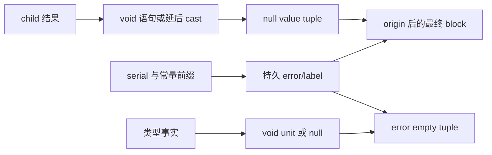

# 错误捕获 AST 自举

## Intent：最终目标

将捕获作用域命名、失败 tuple、成功 tuple 和最终带标签 block 的 AST 构造迁入
ZX。保留现有 origin 服务与词法 capture 状态恢复；Native 递归驱动仍是过渡边界，
不将 AST 职责迁移宣称为整个捕获流程或 Lower 已完成自举。

## Data：可用证据

原 capture.lowerValue 顺序为 fresh error→fresh label→layoutExpr→empty→identifier→
失败 tuple→origin→layout cast。安装新 capture 后递归 child，成功或失败均恢复
旧 capture。child 返回后，void 先记录 expression 语句再发射 unit；非 void 此时
才请求 payload 类型并 cast。随后 null→成功 tuple→origin→layout cast→break→block。

Scope 名称复用 ast/fresh 与 printer/integer，前缀在职责 const.zx；void 标记复用
core/type_table 的 kind 与 scalar_void。节点通过最小列和结构化 importer 写入，
不使用源码模板或片段。

## Edges：边界与限制

- 四个 Source 原子职责为 names、prepare、result、finish；它们不包装整个 Native
  流程。递归 child 和可变 capture 的词法恢复暂留 Native。
- 保留 layout 与 payload 类型的惰性构造位置；两次 tuple origin 仍在 raw tuple
  和 cast 之间，不能直接省略 origin 或提前请求类型。
- 名称只提升一次，identifier/catch/break/block 共同借用持久名称。新建 tuple 与
  builtin 参数数组通过 appendBorrowingText 取得持久存储，不借用 FBA 内的数组。
- 最终语句段仅包含本层 void expression（若有）和 break，不包含 child 嵌套语句。
- 不新增测试用例；复用 typed try、void、nested capture、Task 等相关既有回归。
- 保持 zero runtime、zero copy 和普通静态 Zig 链接；不新增专用运行库或解释层。

## Answer：交付格式与成功标准

```mermaid
flowchart LR
    Names[ZX 作用域命名] --> Layout[已有惰性布局服务]
    Layout --> Failure[ZX 失败 AST]
    Failure --> Origin1[已有 tuple origin 与 cast]
    Origin1 --> Child[Native 词法 capture 内递归]
    Child --> Restore[恢复原 capture]
    Restore --> Success[ZX 成功 AST]
    Success --> Origin2[已有 tuple origin]
    Origin2 --> Finish[ZX cast break block]
```

集中验证格式/lint、引导/正式构建、完整生成产物与 memo、合法编辑恢复及相关
既有行为。只测受影响的生成器路径，保留固定累计基线，性能下降则保留迁移并
定位优化。阶段完成统一提交推送所有变更，确认干净且无未推送提交。

## 执行与证据

5 个 ZX 文件的 10 项 fmt/lint 通过。引导与正式构建各 21/21，两个二进制的
SHA-256 均为 2ae99f6af6b9a0b992cfa608dee75cf548e41c8268c91512feda2847e7efaa13，
复用已测引导版性能。Source 语句 delta 按既有 importer 契约提供空 break 列；
未修改 importer 或放宽 AST 校验。

上阶段与新引导工具，对当前完整三组输入生成 2919/65/357 个文件，仅元数据
.zxc-inputs 不同；引导与正式版连元数据也一致。三组 memo 为
10414/2937/2416/0、67/45/27/27、1126/311/266/0，逐键逐内容相同。
9 份既有样例的初始、合法编辑和恢复，前后输出一致，增量等于干净生成，
四类 memo 各 9 条一致。

另取既有 typed_try/runtime 的 10 份样例及同一 host 声明生成对照，39 文件仅
.zxc-inputs 不同，包含 void、nested、before、after、index 和 compound 的实际
捕获路径。原 nested 样例 outerErr 不符合生成器 lint；仅在忽略目录副本中做
格式化与局部变量的规范化重命名，源码用例未变，实际运行回归仍使用原文件。

冻结 141 个入口，三版交替 8 轮、排除首轮，无其他并行构建：

| 指标     |      上阶段 |      本阶段 | 固定累计基线工具 |
| -------- | ----------: | ----------: | ---------------: |
| CPU      |      5.28 s |      5.27 s |           5.33 s |
| 墙钟     |      1.12 s |      1.12 s |           1.16 s |
| 最大 RSS | 489816064 B | 490749952 B |      492814336 B |

CPU 单阶段 −0.01 s、累计 −0.06 s；墙钟单阶段不变、累计 −0.04 s。固定工具
仍为 inbound-conversion，未随提交重置。RSS 有波动，不声称稳定内存收益。
冻结 2268 文件仅 .zxc-inputs 不同，12612 条 memo 逐键逐内容一致。此处衡量
受影响生成器的总体成本，不将捕获稀少语料的微小变化解释为单次 capture 加速。

精确复核：names 在 layoutExpr 前递增 serial；failure 三节点为 empty→identifier→
tuple，成功为 unit/As→null→tuple；完整 origin 包装位置不变。finish 中本地
BreakValue 暂指向随后写入的 As，statement importer 和 builder.statements 不
解析该引用，随后 As→Block 连续导入，最终 ID 与语句范围与原实现相同。
appendBorrowingText 为 tuple/As 参数数组提供持久存储，名称已提升一次且共享；
没有将 scratch 数组地址留在 AST。capture 状态包括错误退出均恢复原值。

证据位于忽略目录 .zig-cache/cold-build-analysis/ownership-research/capture，包括
source-validation.json、bootstrap/production.log、fixedpoint.json、
production-fixedpoint.json、memo-results.json、cleanup-edits-comparison.json、
cases-comparison.json、case-formatting.json、final-runtime-comparison.json 和
regressions.log。六组既有回归共 255/255 步、279/279 用例全部通过，目标为
typed-try、typed-try-runtime、zx-await-runtime、zx-parallel-runtime、value-return
和 module-generation。实际执行未修改的原始用例，没有新增测试用例。

自我复核：完整生成对照不能单独证明捕获分支覆盖，因此补充了既有十份捕获
样例的产物对照和 typed try/Task 的实际运行检查。词法状态驱动与原生存储仍为
过渡实现，Source 只接管命名及 AST 职责；未以四个入口接通宣称整个捕获模块
或整个编译器已完成自举。此次不把 RSS 波动解释为冷编译内存收益。
