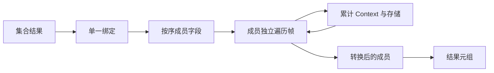

# 集合结果表示转换自举

## Intent：最终目标

将集合操作结果的逐成员 ABI 转换、字段投影和元组重组迁入 RX/ZX。保留已有
求值顺序、借用存储、持久字段及 fresh 编号，不增加运行库或数据复制。

## Data：可用证据

collections.zig 在 state_active 且结果元组未 selected 时绑定结果，再依次转换
各成员为 Pointer，最后重组元组。整个元组本身未 represented，不能用一次整体
conversion 替换逐成员转换。已有 conversion/emit/walk 能构造完整 AST；elements
已使用共享 Context、重置遍历帧的组合方式。

## Edges：边界与限制

- Native 仅准备类型计划、布局资源并发布 Source AST；原表达式递归求值和最终
  construct/layout 调用仍是过渡边界，本阶段不宣称集合生成已全部自举。
- 每个成员保持顺序，只绑定原元组一次；未 represented 成员只投影，不转换。
- 字段、body、reference storage 与 borrow storage 累积保留，遍历帧逐成员重置。
- 资源准备不得改变 serial、全局语句或任务声明；临时资源在持久发布后释放。
- 不新增测试用例，使用既有集合、嵌套结果、循环及所有权回归。

## Answer：交付与验收

实施后集中检查 Source 格式与 lint、两阶段自编译产物和 memo、受影响既有回归，
并比较受影响路径与固定累计性能基线。全部通过后收口所有变更、英文提交推送，
确认工作区干净且无未推送提交。

## 执行记录

### 实现与边界复核

新增 analysis/collections/result：RX 组织初始化、绑定、成员遍历和发布；ZX
按序构造数字字段、执行成员转换并生成元组。members 保留算法循环，不把它拆成
动态调度。未 represented 的成员用 null 资源表示，直接保留字段投影。

从 elements/convert 提取 conversion/emit/append，复用同一转换组合协议：只重置
nodes/index，累计 Context、fields、body、storage、borrow_storage 和 allocator
标志。Native conversion_emission.prepareFor 复用原有计划与布局资源准备，
collections/result 负责资源视图和一次持久发布，保留旧 seed 分支。

只读复核确认 Pointer 的子模式不会进入写 borrow_storage 的 Borrow 路径，统一
发布不会重排成员声明；字段 base 使用原始 base 加累计字段长度。临时 Capture、
计划和类型资源由同一调用帧或 scratch 持有；数字字段名及嵌套 AST payload 经
拥有型导入。资源准备处同时断言 serial、声明、全局语句、调用方 body 和函数级
reference storage 没有变化。没有放宽列视图兼容规则或引入专用语义回调。

### 正式构建与已有行为验证

- 9 个 RX/ZX 文件格式化及 lint 通过，4 个 Native 文件格式与 diff 检查通过。
- bootstrap 与 production 两阶段均 21/21 步成功，工具 SHA-256 同为
  308e0b3f6a645e9027a57519636916204198abef65e42268cd3db6980a154c0e。
- main/collections/growth/ordered 分别为 3425/65/361/24 个文件；上一阶段与
  bootstrap 仅 .zxc-inputs 不同，bootstrap 与 production 全部逐字节相同。
- 四组 memo 逐键逐内容一致，记录数分别为 12037/3292/2770/0、67/45/27/27、
  1154/315/270/0、27/14/14/14；冻结输入的 8248/2419/1945/0 也全部一致。
- test-owned-collections、test-array-pop、test-loop-columns、test-nested-buffer、
  test-aggregate-loop、test-borrowed-call-views 合计 490/490 步、11596/11596
  项通过，覆盖已有集合行为、嵌套缓冲、所有权和借用视图。未新增用例。

### 覆盖诊断改变了性能验证范围

原拟沿用 loop-columns 与 aggregate-loop 的 17 个已有 compile 场景作为局部
对照。静态审查不能证明它们命中新门禁，遂在忽略目录的源码副本中添加入口及
represented 成员计数，复用相同场景的 Source/Library 路径。实际命中全部为 0。

因此没有执行这 17 项的八轮局部性能测量，也不把它们当作新分支直接执行证据。
控制对照驱动已构建，但没有把未受影响路径的计时包装成迁移收益。诊断仅改变
临时副本，正式源码及正式性能工具均不含计数。该结果也说明不能仅从测试名称
或存在 push/pop 推断覆盖；已有零命中场景不再重复扩大搜索与构建。

当前证据支持组件组合、正式编译、生成结果和已覆盖行为保持一致；对 boxed
集合结果门禁的直接运行覆盖仍不足，不宣称已穷尽其所有成员形态。后续出现
适用的已有应用或用户授权新增回归时补足，不为取得覆盖更改正式表示策略。

### 固定累计性能

使用同一冻结 manifest、141 入口/2220 模块、ReleaseSmall、关闭 resident，三版
工具交替八轮，排除首轮。测量前确认构建与诊断进程均已结束。固定基线仍为
inbound-conversion，SHA-256 为
8f1e7cee1eadb3ea0f6f7150bab951c55672ce294e4fbe7c50d5858723bdd92d。

| 指标                | 固定累计基线 |    上一阶段 |      本阶段 |
| ------------------- | -----------: | ----------: | ----------: |
| CPU 中位数          |       5.34 s |      5.35 s |      5.33 s |
| 墙钟中位数          |       1.16 s |      1.14 s |      1.13 s |
| 最大进程 RSS 中位数 |  494911488 B | 492273664 B | 481165312 B |

单阶段 CPU −0.02 s、墙钟 −0.01 s；相对固定基线 CPU −0.01 s、墙钟 −0.03 s，
没有观察到累计退化。前后 RSS 区间 478429184～495026176 B 与
474382336～497205248 B 重叠，不将中位差当作稳定内存收益，更不推断完整冷构建
的 LLVM 峰值。2268 个冻结输出仅 .zxc-inputs 不同。

证据位于忽略目录 .zig-cache/cold-build-analysis/ownership-research/collection-result：
bootstrap.log、production.log、regressions.log，fixedpoint.json、
production-fixedpoint.json、memo-results.json，coverage.py、coverage.json、
各 probe-build.log 和 coverage 子目录，以及 final-runtime-comparison.json。

### 自我复核

本阶段迁移了结果成员转换协议，Native 仍保留类型资源准备、全局 Lower 状态、
递归求值、AST 发布及最终 construct/layout/finish 接线，不宣称完整集合职责
或全编译器自举完成。既有回归通过与产物一致不能代替未命中门禁的直接覆盖；
该限制如实保留。没有用运行库、额外应用数据复制、关闭检查或撤回迁移换性能。
