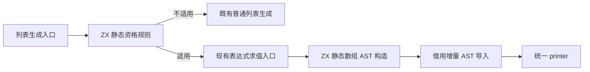

# 静态列表规则与构造自举

## Intent：最终目标

将静态列表的资格判定与静态数组 AST 构造迁入 ZX，保持不可变字面量使用静态存储
的优化，保留元素求值顺序、缓存与上下文，避免增加应用运行时分配或编译期数组复制。

## Data：可用证据

- 入口是 `aggregate.sequenceMode` 调用 `static_list.lower`，属于正式列表生成路径。
- 原规则仅在 scalar entry 中启用；元素类型允许 scalar、enumeration、error_set，
  元素表达式只允许八类字面量。判定失败必须在求值任一元素前返回 null。
- 合格后逐个调用原有 expr 入口，再构造 Array → AddressOf → ComptimeValue → As。
  原有缓存、iteration 上下文与 normalize/renew 规则不能绕过。
- 类型表达式仍由既有类型职责提供；AST 使用统一结构化列与 printer，不输出源码模板。
- 阶段前正式生成器位于 `ownership-research/ordering/production/bin/zxc-bootstrap`；
  固定累计基线仍为 `inbound-conversion/production-bootstrap/bin/zxc-bootstrap`。

## Edges：边界与限制

- 本阶段迁移资格规则与 AST 构造，不宣称完成递归表达式调度或 Lower 状态自举。
  原生适配器暂留两者之间逐项 expr 的调度、类型表达式请求与增量 AST 导入。
- 两个 ZX 入口各是一项原子职责，不用转发 RX 文件制造编排表象。整体表达式调度
  仍属于后续必须迁入 RX/ZX 的自有职责，不能据这两个入口宣称完整自举。
- 原生 seed 只用于引导；正式资格判定使用零字节固定分配器执行，以保证规则无分配。
- ABI 类型首用节点可提前建立；必须核查生成代码和缓存，不以内部节点编号相同作标准。
- 元素编号数组已由 Lower 持有，导入时借用；Source 新建的 As 参数提升到相同生命周期。
  临时列描述符在导入后释放，不能遗留指向 scratch 的 AST payload。

## Answer：交付格式与成功标准

完成格式与 lint、seed/正式构建、相关既有回归、全部产物与缓存对照、增量等于干净
生成验证；隔离计量实际生成路径，记录阶段与固定累计基线变化。验收后收口全部
变更，英文规范提交并推送，确认工作区干净且无未推送提交。

### 执行与自我复核

实现与验收完成：

- 资格检查先确认 scalar entry，再确认元素类型，最后扫描全部元素种类；不合格时
  不求值任何元素。正式路径用零字节固定分配器调用同步 value ABI，实际构建中
  没有触发分配失败；没有将纯谓词的返回值装箱到临时堆对象中。
- AST 构造输出统一列，Array → AddressOf → ComptimeValue → As 的节点关系由 ZX
  明确给出。目标类型首用准备可能提前建立类型节点，但不改变元素求值和 fresh。
- 从真实 bootstrap 生成体确认 `(in).values` 直接进入 `.items`，只复制外层 slice
  描述符，没有复制底层元素。value facade 也只剥离 `.items`。此证据保存在
  `emit-lifetime-proof.zig.txt`，不是仅由源码表面写法推定零复制。
- Native 导入前只提升新建的 builtin 参数内层数组；元素编号数组由 Lower 原本
  持有，两个嵌套 payload 均存活到 AST 使用结束，随后才释放 scratch。
- 3 个新增 ZX 文件通过 6 项格式与 lint；Zig 格式及 diff 空白检查通过。
- seed 引导构建 39/39 步、正式构建 21/21 步通过。
- 复用 function-analysis、array-literal、strings、immutable-list 四组既有回归，
  229/229 步、2515/2515 项通过。原有分配扫查 stderr 提示仍出现，构建进程退出
  0，最终总结没有失败项；未为消除诊断输出而更改既有测试。
- 当前 main、collections、growth 三组生成文件分别为 2816、64、356 个；
  迁移前、引导版与正式版仅 `.zxc-inputs` 不同，全部代码一致。当前三组缓存及
  冻结输入的四类 memo 均逐项比较键和值，不只检查数量；冻结输入为 12612 项。
- 在忽略目录复制既有 sort_literal、concat_reverse_literal 与字符串 literals
  三个样例，修改一个字符串值再恢复；三阶段各 12 个代码文件，前后相同，且
  增量等于干净生成。四类 memo 各 3 项，前后键和值相同；测试目录没有新增用例。

### 性能与累计变化

所有构建、回归和语义核查结束后，使用同一冻结输入、工具链及配置隔离计量。
8 轮交替运行，排除首轮，取中位数：

| 指标     | 固定累计基线 | 本阶段前    | 本阶段后    |
| -------- | ------------ | ----------- | ----------- |
| CPU      | 5.34 s       | 5.24 s      | 5.24 s      |
| 耗时     | 1.17 s       | 1.12 s      | 1.12 s      |
| 峰值 RSS | 493502464 B  | 487669760 B | 486899712 B |

本阶段 CPU 与耗时不变；相对固定基线 CPU −0.10 s、耗时 −0.05 s。RSS 差异不足
1 MB，不视为确定收益。近期阶段 CPU 一直约 5.2 s，未发现持续增长趋势；不重置
固定基线，也不将每阶段容差累加成新的预算。

冻结输入 2268 个文件仅 `.zxc-inputs` 不同，生成代码全部相同。此测量覆盖生成器，
不代表完整冷构建或 LLVM 后端内存峰值已经改善。

### 自我批判与剩余职责

- 规则与 AST 构造已迁移，不能把仍在 Native 的逐项 expr 调度说成 RX 编排。
  递归表达式调度、Lower 状态和 AST 存储仍是整体自举的剩余职责。
- 两项 ZX 原子职责未通过转发标签和机械微文件包装为更大的“已完成阶段”。
  本阶段的价值是移除了正式路径中的资格与静态构造规则，不是文件后缀变化。
- 借用导入成立依赖本构造器的明确契约：唯一 array payload 指向既有 values，
  唯一 builtin payload 已提升。未来扩展构造器时须重审该契约，不能直接沿用。
- 有限回归与产物一致支持本次迁移等价，仍不能替代最终传递依赖审计和完整
  stage 1→2→3 自编译验收。

脚本、报告及日志均在忽略目录
`.zig-cache/cold-build-analysis/ownership-research/static-list/`：
`source-validation.json`、`bootstrap.log`、`production.log`、`regressions.log`、
`emit-lifetime-proof.zig.txt`、`known-shared-fixedpoint-result.json`、
`current-manifest-memo-comparison.json`、`memo-comparison.json`、
`literal-edits-comparison.json`、`literal-memo-comparison.json` 与
`final-runtime-comparison.json`。
