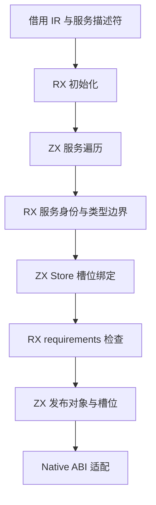
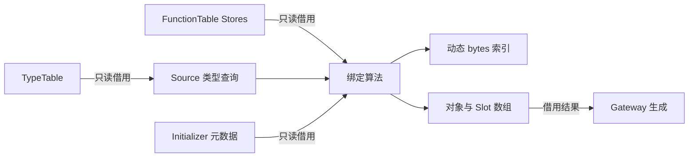

# Gateway 服务状态绑定自举

## Intent

将 Gateway 的服务身份、宿主引用边界和共享 Store 槽位绑定规则迁入 RX/ZX。
保持输入借用、首次出现顺序、错误优先级与动态哈希表的摊还成本。

## Data

- 原实现：`packages/compiler/src/backends/zig/gateway/state.zig`。
- Library.module 仅按函数 ID 替换 Program 描述符；所有服务共享同一 TypeTable。
- 现有 Source 类型包含查询已覆盖 Optional、List、Task、Tuple、Object。
- FunctionTable 的 Stores 列已有经过 ABI 校验的只读借用方式。
- bytes/index 的既有 put 使用固定桶；迁移需要通用动态 insert，不能按总 Store 数预分配。
- 固定完整冷构建基线：墙钟 129.74s、累计 CPU 216.03s，单体峰值 2075033600 B、
  采样进程树峰值 2247294976 B。本阶段不重设基线。

## Edges

- 不复制文本、TypeTable、FunctionTable 或 Store 槽数组。
- exports/facades 允许适配小型只读描述符；Native 仅组装既有 Service ABI。
- 保留 seed；不得把 seed 回调计为正式自举。
- 验证顺序：身份 → 输入/输出宿主引用 → Store 类型与 initializer → requirements。
- 不新增持久测试；使用现有 Gateway 行为、宿主引用拒绝及分配失败检查。
- AST/打印和应用入口整体仍有过渡 Native 边界，本阶段不宣称完成全部自举。

## Answer

RX 表达初始化、服务扫描、结果发布及每个服务的验证顺序；ZX 实现集合算法。
动态 bytes index 按负载增长，保留原固定 put 契约。
验收包括既有行为、生成产物一致、列结果 ABI、受影响路径成本与工作区收口。
Native 记录描述符组装仍是过渡边界，不将它宣称为最终 zero-copy 状态模型。

## 执行与验收

已完成 Source 初始化、服务身份与签名投影、宿主引用查询、首次 Store 注册、
冲突校验、writable 合并和 requirements 检查。单入口生成成功，格式与 lint 通过。

首轮接口检查发现，嵌套 Slot[][] 会进入原始指针数组表示。改为连续 Slot 数组加
服务结束位置；输出只取切片。此判断仍需正式全入口生成与 Native 编译确认，
单入口生成成功不能代替全局结构类型布局证据。

输入 Member/Initializer 在已有 ABI 中采用指针描述符。适配器只构造小型描述符，
不复制其中的文本、TypeTable 或 Store 列。描述符在 scratch arena 内执行后释放；
结果数组使用调用方 allocator，返回值中的文本仅借用 library/bundle 原有存储。

完整冷构建与正式路径验证进行中，尚未作性能结论。

### 全入口布局证据与修正

单入口 flat 输出不足以证明正式全入口可借用。首次正式构建在 39/43 步处拒绝
Slot/Object 的 ABI cast：已有 Gateway adapter 和 Store lifecycle 的公开输入恰好
包含同结构类型，新公开输出会把它们全局标记为 boxed。拒绝的是实际布局不兼容，
未放宽校验或强制转型。失败构建的约 99s 不作为成功冷构建性能数据。

改用 Source 绑定列（indices/access/ends 和 modules/writable）。Native 按列构造一次
原有 Slot/Object ABI；这是记录描述符组装，仍是过渡边界，不宣称所有元数据 zero copy。
文本、原始 Store 列、TypeTable 和 FunctionTable 均没有深拷贝；没有创建 Source
Slot/Object 指针节点，也没有改变既有消费者布局。通用的跨公开边界记录布局能力
仍需单独完善，不能靠改字段名避开同结构类型分析。

## 已取得的验证

- 正式构建 43/43；现有 native reference exports 检查 14/14，包含分配失败回收。
- 现有 Gateway 运行检查 86/86、JSON 输出检查 52/52。
- 初次分目录对照有路径身份导致的模块 import 名差异；同一路径复核，46 个
  生成 Zig 文件无新增、删除或字节差异。没有忽略实际代码差异后宣称一致。
- 3 组交替性能对照，每组 8 次 `--no-cache` 构建同一既有 Gateway，Zig 后端缓存
  已预热；CPU 合计中位 10.21 → 10.22s，墙钟均 9.57s，RSS 中位
  215924736 → 215875584 B。单次 CPU 差额约 0.00125s，不能当作稳定收益。
- 忽略目录中的小范围诊断：128 个 Store、4 个共享服务、512 个槽位，验证多次
  动态扩容后全部路径/索引、writable 和服务结束位置。未添加持久测试用例。
- 最终工具两次生成构建均 21/21，二进制 SHA256 相同：
  `a7b3f1336b9991d77e18267c65118a84cf6774adfda00d3c01e5a5b007cf7dc3`。
  这只证明本阶段工具一致，不能替代完整自举的传递依赖与 stage1/2/3 验收。

### 冷构建计时的有效性

首次列版本完整构建通过 43/43：墙钟 140.35s、累计 CPU 207.38s，单体峰值
2129526784 B、0.2s 采样树峰值 2149236736 B。但期间一次无关的递归文件检索
产生了 CPU/I/O 干扰，故保留记录但不把墙钟差额归因于源码。该轮不能作为
无退化的完整证据；正在补一轮隔离构建，期间不执行其他编译或大量文件读取。

自我复核：最初把单入口 flat 结果外推到正式全入口是错误判断，编译器的严格
ABI 校验阻止了不兼容借用。最终保留全部 Source 绑定规则，用列数据恢复原有
消费接口，未回退迁移，也未新增专用语义桥。尚存的 ABI 组装与公开边界布局
能力缺口明确保留，不能声称整条 Gateway Native 边界已经消失。

### 最终隔离冷构建

同一源码/配置、空 stage0、12 核、新 local/global cache，43/43 步通过：
`/usr/bin/time` 墙钟 **129.05s**，累计 CPU **195.25s**，单体峰值 **2128068608 B**；
0.2s 采样进程树峰值 **2134130688 B**。采样器墙钟 129.083s、单体采样峰
2113798144 B，不与 time 的峰值混用。

- 相对阶段前 130.19s / 196.10s，墙钟 −1.14s、CPU −0.85s；单体
  −10371072 B，树峰 −23183360 B。单轮波动不作稳定加速承诺。
- 相对固定基线 129.74s / 216.03s，墙钟 −0.69s、CPU −20.78s；单体
  +53035008 B，树峰 −113164288 B。单体残余差额仍需跟踪，没有宣称内存问题全部完成。
- 完整构建和受影响 Gateway 的三组对照均未显示本阶段累计退化。

最终证据目录：`.zig-cache/cold-build-analysis/ownership-research/gateway-bindings/`；
隔离冷构建在同级 `partition-reference/cold-gateway-bindings-isolated/`。
日志、诊断输入和临时产物均受忽略规则排除。

下一步仍包括 Gateway 整体入口/资源与输出组装的过渡边界，以及更广的所有权、
状态桥和自编译闭包；本阶段交付不等于整个自举目标已完成。
