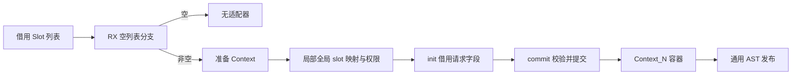
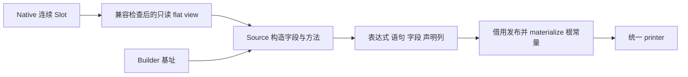
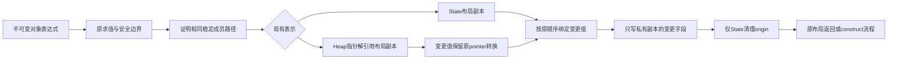

# Gateway 状态适配器生成自举

## Intent：最终目标

将 Gateway Context 的完整生成职责迁入 RX/ZX：空 slot 不生成适配器；非空时
生成 request/store 字段、init、commit、只读写入拒绝及 Context_N 容器。遵循 IDEA。

功能与成本验收通过：439/439步骤、778/778项受管检查；最终两代二进制一致。
固定累计CPU降低0.15 s，普通冷CLI峰值降低约111 MB且CPU降低2.53 s。
具体口径、否定实验及剩余Native过渡职责见文末，不代表编译器完整自举。

## Data：可用证据

源头 gateway/adapter.zig。每个服务的局部 store_N 映射到全局 Slot.index；init
借用 request 中的字段，commit 先按原 slot 次序检查不可写字段，再调用 request.commit。
Source 已有 container/function/fields/statement 构造及同 allocator 借用发布。

数据成本核对：普通 Source string 记录数组默认可能 boxed，不直接假定 Route[]
兼容 Native AoS。Slot 只有 index/writable 标量，已有 flat record 能力可用；
通过 columns.storage.view 验证真实生成布局并直接借用，禁止逐 slot 复制桥。
若布局不兼容，应补齐通用表达，不能绕过兼容检查。

## Edges：边界与限制

- RX 首先处理空列表分支，再显式组装准备、slot 映射、init、commit、容器与发布。
  输出为 nullable AST 片段；Native 仅发布存在的结果，不保留空 slot 业务判断。
- 保持局部/全局编号、成员/对象/参数顺序、只读检查顺序和 StoreNotWritable 错误。
- Slot 输入只读且不逃逸，生成文本与 payload 使用 Builder allocator 并覆盖打印寿命。
- usize/u64 同宽及字段 offset 必须由真实 Target 的兼容检查证明；当前宿主为 64 位，
  不据此声称新增 32 位宿主支持。不得未经证据更改公共 Route 布局。
- 结构化 AST 与统一 printer；不引入专用运行库、源码模板或 Native 语义回调。
- 不新增用例。复用 Gateway 状态与分配失败、JSON Gateway、模块生成回归；
  产物、实际生成成本及固定累计基线按影响验收，保留迁移并优化实际开销。

## Answer：交付与成功标准

成功要求 Source 正式路径覆盖空/非空、只读/可写及非连续映射，既有行为与生成
产物一致，性能满足累计标准。自我复核说明剩余 Native 职责，统一提交推送并
确认干净；该职责不代替整个 Gateway、自有状态或完整编译器自举。

### 实现与 ABI 收口

新增 analysis/gateway/adapter 的十个 RX/ZX 文件。RX 负责空列表选择与阶段依赖；
slots 原子遍历负责局部到全局编号及权限，init/commit/container 负责各自 AST 构造。
旧规则完整保留为 adapter_seed.zig，仅在 generated_analysis=false 的 seed 路径使用。
正式 adapter.zig 提供基址、只读视图、通用 AST 发布与根声明 materialize。

首次接入发现两处真实 ABI 差异，未通过复制或退回 seed 绕过：

- Extra 在 executeValue 中是按值的列描述符，带 zx_origin 元数据；原 importer
  只接受指针。新增编译期 Descriptor，从视图的声明类型投影真实列，沿用 columns.view
  发布；未将元数据误当 AST payload，也不改变既有 owning 模式。
- Native Slot.index 为 usize，生成记录为 u64。storage.view 只在大小、对齐、位宽、
  符号全部一致时接受整数表示；字段顺序、offset、只读指针属性仍逐项检查。
  当前 64 位宿主直接借用底层 Slot 切片，不申请新数组、不逐元素转换；32 位仍拒绝。

第一次回归的 71 项受管测试通过，但 CLI 因上述两处接入失败，不能算阶段通过。
修复后才取得下面的完整验收证据。没有借机更改 Route 公共布局或扩大语言语法。

### 行为、产物与自编译

- 修复后的 bootstrap-stage：21/21 步成功，ReleaseSmall、P16、12 核。
  本阶段第二与第三代工具 SHA-256 相同，均为
  f41f28d6292738a22ae15cbdae2fd73b9d0b88608d6a8d470698fa76cf52c719。
- test-gateway、test-application-json-gateway、test-module-generation 合计
  62/62 步、71/71 项受管测试通过；真实 Gateway HTTP 86 项检查通过，另有
  52 项 JSON HTTP 观察。覆盖双 Store 初始化、逆序局部映射、单独第二个 Store
  更新、请求间保活、事务失败及后续恢复；没有新增用例。
- 同一新 manifest 的四组输出 main/collections/growth/ordered 分别为
  3634/65/361/24 个文件。迁移前、本阶段第二代、第三代逐文件比较，仅
  .zxc-inputs 的工具缓存指纹不同；代码、文件清单及哈希一致。
- memo 全部事实按键和内容一致；main 为 13184/3480/2957/0，其他三组为
  67/45/27/27、1154/315/270/0、27/14/14/14；冻结输入为
  8248/2419/1945/0。没有忽略实际值差异或依赖原始表遍历顺序。

### 实际生成成本与固定累计基线

冻结输入八轮交替，排除首轮；输入、工具链、配置相同，不与其他构建同时计时。

| 指标       | 固定累计基线 |      上阶段 |      本阶段 |
| ---------- | -----------: | ----------: | ----------: |
| CPU        |       5.35 s |      5.27 s |      5.28 s |
| 墙钟       |       1.17 s |      1.13 s |      1.13 s |
| RSS 中位数 |  490422272 B | 495108096 B | 491601920 B |

单阶段 CPU +0.01 s、墙钟不变；相对固定基线累计 CPU −0.07 s、墙钟 −0.04 s。
RSS 范围分别为 476676096～496238592、483672064～498384896、
479215616～497844224 B，明显重叠，不宣称稳定内存改善，也不重置累计容差。

另做受影响路径诊断：八种既有 JSON 输出 fixture × 空 Slot、双只读逆序 Slot、
混合权限逆序 Slot，共 24 份 Gateway 输出，Native 控制与 Source 逐字节一致。
Native 控制仅将忽略副本中的 adapter 选择到 seed，其他生成逻辑与正式路径相同。
每轮 100 次重复、共 2400 次完整 render，六轮交替、排除首轮；CPU 中位数
0.27→0.27 s，墙钟 0.27→0.28 s，RSS 6537216→6586368 B。
这是诊断压力循环，不冒充普通端到端构建，也不把每轮几万字节差异当作泄漏。

普通冷 CLI 对照与最终自我复核在下节收口后记录，不由以上压力循环替代。

### 冷编译首版未通过与继续优化

首版普通冷 CLI 两对均成功，顺序 Native→Source、Source→Native；每轮新 local/global
缓存，保留 OS 缓存，不导出 IR、不采样。原版 CPU/墙钟/RSS 中位数为
87.37 s / 85.555 s / 4232003584 B，Source 为
87.85 s / 86.065 s / 4242604032 B。逐对 CPU +0.60/+0.36 s，
墙钟 +0.65/+0.37 s；RSS +23183360/−1982464 B，内存方向不一致。
CPU 与墙钟增长超过容差，首版不能交付；保留迁移，继续优化而非回到 seed。

同输入诊断 IR 为 205762302→206252922 B。generic 编号因编译闭包变化重排，
不能直接把所有“新增编号”当作新增工作；例如 importer/TLS 的多个大定义仅编号变化。
新增 Source commit/slots/container/prepare/init 分别约 81/79/60/56/48 KB。
原 Native lower 为约 62 KB，Source 宽描述符构造是值得检查的具体成本，静态 memcpy
站点仍不代表底层数组复制或实际 RSS。

直接查到 method 先构造含十二个单元素数组的函数声明列，再追加到最终声明表。
补充通用 ast/declarations/table/define_function.zx，直接由同一元数据追加目标列，
消除一次性中间表；保留容量检查、绝对参数基址、列次序和 valid 传播。
已有 function.zx 与 table/function.zx 的外部契约不变；本阶段先只迁移当前消费点。
这是 Source 生成质量优化，尚须最终形态、行为和成本联合验收，不能预报收益。

### 两项局部改写的决定

直接追加声明版本的 bootstrap 与后续自编译均 21/21，工具 SHA 相同，
18d94b55ec7639a350a45b67b61a9f358f823c5f403aaff750a2cb69d9d5b004。
相关回归再次 62/62 步、71/71 项，Gateway 86 项检查通过；这只证明行为。
普通冷 CLI 一对 Native/Source 的 CPU 为 87.33/87.89 s、墙钟
85.57/86.12 s、RSS 4203872256/4246274048 B，仍未通过。
这不是稳定百分比结论，但没有证据支持采纳其性能取舍，停止继续配对计时。

随后仅做参数组装的隔离形态筛选：取消动态 names/types 数组与循环，由 init、
commit 按一参、两参追加字段。引导 21/21、诊断 IR 编译成功；方法本身由
27544 降至 10919 B，但 init/commit 增大，六个阶段总量仅
351463→348688 B；包含直接追加原语后的完整 IR 206252922→206354153 B。
局部 helper 缩小没有变成总工作集改善，因此不继续为此做冷计时或完整回归。

依据最小范围与成本门禁，两项优化试验均移除，method/init/commit 恢复首版已验证
Source 实现，新增 define_function.zx 删除。保留 RX/ZX 迁移、ABI 接入修复及所有
有效行为和否定性能证据；没有因性能退化撤回自举。当前阶段仍未通过冷成本验收，
不得提交为已完成，也不得标记整个目标完成。

证据均在忽略目录 gateway-adapter：direct-bootstrap.log、direct-production.log、
direct-regressions.log、cold-direct-*/args.rsp/build.log、cold-direct-metrics.json，
parameters-bootstrap.log、parameters-main、parameters-screen/module.ll、
parameters-cli-response.json 与 parameters-ir-summary.json。参数筛选没有宣称行为
验收；直接声明没有宣称微基准或完整根构建内存收益。

后续调查宽状态不可变更新的通用生成路径：先确认是否因重复展开未变字段而增加
IR；没有具体生成证据前，不再追加局部包装或改变所有权、错误与数组成本模型。

### 当前可复核状态

十个 RX/ZX 文件逐文件 SHA 与首版有效行为、产物、memo 和渲染计量的副本完全
一致，复用这些证据，不重跑相同检查。通用单字段更新匹配在 changed.zx 遇第二个
变更即拒绝；method、container 等确实更新多字段。但还存在 selected/borrowed、
状态资格、同类型 Reference 及求值约束，尚未证明这些实例最先被哪道门禁拒绝。
隔离诊断未采到目标对象行，不能把静态限制直接宣称为已定位的性能根因。

下一步必须先确定实际执行路径及首次拒绝条件，再决定是否扩展现有多字段更新；
不得直接放宽所有权、为此引入另一套机制或反复重做本文的局部改写与计时。
当前全部 WIP 保留，阶段尚未通过性能门，未提交推送；最终收口仍必须验收所有
未提交内容后一并提交推送并确认干净。整体自举目标保持 active。

### 已命中的执行路径与通用多字段快照更新

隔离诊断改用 self_function 对应的 Functions.files 标识 Source owner；原来的
program.file_name 实际为合成身份 bootstrap。禁用 resident、使用独立输出与缓存后，
探针实际得到 21836 次匹配入口、11 个含 symbols 的十二字段对象；没有导入到另一个
未知 genz 实现。先前无目标日志不能用作根因证据，已纠正诊断方法。

其中 container/commit/initialize 的目标均 state_active=true、selected=true、
borrowed=false、未缓存、不在 iteration/loop_fields；未变投影可追到 state_members
中的旧引用，且不在 stack_members。多字段是其中一类更新的明确能力缺口；
method 的投影来源及 slots 的循环上下文仍可能受其他门禁限制，不一并放开。

通用实现沿用已有 object_update 资格与结构化发射，保留所有权、类型、plain flags、
求值来源及缓存约束。Scope reuse 继续只接受单字段；仅表达式路径允许多字段，创建
一份私有布局快照，所有变更 RHS 按原字段顺序先绑定，再写快照，最后清 origin 一次。
不修改旧对象，不按函数名特判，不增加运行库，不设置针对当前对象的字段数硬限。

Native 仅降低已有 IR 表达式为 AST ID，借用类型/表达式列，交由 RX/ZX 判断未变字段、
绑定和组装写入；用 u32 AST ID 列替代普通 literal 的 node.Field 临时列，不复制底层
应用数组。Source 分支编排与字段处理完整接通后再集中验收；尚不宣称性能或行为通过。

### 接线修正：原求值绑定先于快照更新

初次多字段实现的第二、第三代工具 SHA 均为
b73cf3c98d8f43fe447cbde36e7b7e4c145e8c71d2a3eceb7db1ca7f99afef9c；
413/413 步、742/742 项既有检查通过。但实际生成的三个目标方法没有 updated 快照，
因此这些结果不能证明新增路径覆盖。检查生成源码发现 evaluation 同时记录显式字段
的求值；旧检查只接受 previous Reference，仍在该阶段拒绝。前述状态资格并非全部门禁，
不再将其写成“已定位全部阻断”。

修正沿用 aggregate.objectMode 的原 evaluation 循环：先按原顺序绑定及缓存，再尝试
对象更新；失败时继续原 literal 路径。表达式模式仅额外接受直接对应变更字段的求值项；
其他求值、显式未变字段求值以及无法对应的项仍保守拒绝。Scope reuse 的旧 guard 不变。
Native 仍按原规则恢复缓存、处理未使用绑定并组装 block；Source 继续先绑定全部 RHS
再写私有快照。修正后的有效命中、ABI、行为、稳定点和成本均需要实际证明。

### 线性判定与实际命中

复核发现 evaluated_field 的逐项查找会造成 O(E×F)，已删除该实验。将协议明确为
“evaluation 已完成”：表达式路径只在原绑定循环之后调用，scope reuse 保留 false。
新增暴露已有 field_unchanged 谓词的内部入口；Native 逐字段调用同一 Source 谓词，
只降低 changed RHS，未变字段槽使用不读取的结构值。这样未实际发射的字段不虚增
cache_reads，重复旧引用或显式未变求值由原 discard 规则保留。匹配、准备与发射
均为固定次数的线性字段扫描，无新增变更列表或按对象规模增长的二次方查找。

线性版本引导 21/21 步通过。实际 CLI 生成树中 container 有一份 updated 快照、
六个变更绑定；commit 一份、四个绑定；initialize 两份快照、两个变更绑定。
这是本次第一次证明通用扩展命中目标；不是编译成本或内存收益。只读复核未发现
cache_reads、别名、求值顺序或 seed 的新增正确性阻断；实际回归与成本继续验收。

### 生成稳定点

线性且实际命中的版本完成三代 bootstrap-stage，各 21/21 步。第一代 SHA 为
37af856bdcc57905ee803cb3f12e170ff02b9b546c41c77410918e1b26af4c20，
后两代一致，均为 80e7ab5a92375c03e772230f23bb80ca00471c1c0062f5e7088d54bd7ce5b19b。
第一代由尚未使用当前发射形态的工具生成，变化有明确原因；后两代一致证明此项
生成形态稳定，不代替最终 Native 传递依赖审计，也不证明性能已达标。

原始证据包括 linear-bootstrap.log、linear-production.log、linear-fixedpoint.log、
linear-fixedpoint.json、linear-hit-summary.json、linear-cli-response.json，以及正在
收口的 linear-regressions.log。此前 multiple-* 的未命中行为证据单独保留，不能
混为当前版本。成本测试须等待全部相关构建结束，复用固定累计基线及既有冷对照。

### 最终行为与固定输入执行成本

实际命中并保持线性后的相关回归完成：413/413 步、742/742 项受管检查通过，
Gateway HTTP 86 项检查通过。覆盖 function-analysis、value-return、function-updates、
zx-tasks、native-value-boundary、Gateway/JSON Gateway 与 module-generation；
没有新增测试。不能用此前未命中的同数量结果替代本轮，日志为 linear-regressions.log。

所有构建结束后单独八轮交替、排除首轮，固定累计基线/上阶段/本阶段 CPU 为
5.34/5.26/5.21 s，墙钟 1.16/1.12/1.11 s。单阶段 −0.05/−0.01 s，
相对固定基线累计 −0.13/−0.05 s；不重置基线或领取新容差。RSS 中位数
489816064/493993984/485310464 B，范围分别为
473399296～496844800、479559680～498335744、483573760～492208128 B；
范围重叠，不宣称稳定内存改善。2268 个输出文件的路径集合相同，其中645个文件
内容变化，包含 .zxc-files/.zxc-inputs；新快照生成形态有意改变，尚须分别核对
memo 与本阶段两代稳定输出，不能继续声称旧版代码字节一致。

### 当前冷门禁与物理提交包装候选

线性命中版本的普通冷 CLI 一对样本：控制 CPU/墙钟/RSS 为
87.59 s / 85.82 s / 4241588224 B，候选为
88.57 s / 86.75 s / 4255481856 B。+0.98/+0.93 s 未通过门禁，不能以生成器
执行变快抵销构建退化，也不以单对内存差值宣称趋势。继续保留迁移与通用能力。

新诊断 IR 为 204584050 B，低于初始迁移的 206252922 B，也低于控制的
205762302 B，进一步证明“总 IR 更小”不是冷构建收益的充分证据。编号归一化后，
真正新增包括物理 commit 包装 110 个/95531 B，不能把重排编号当作新函数。

只读分析定位 node/import_rows.commit：线性版本共6605个定义/3917943 B，
多为固定字段 GEP 与递归转发，叶子仍调用已有 appendSliceAssumeCapacity。
隔离副本仅加 inline，保留校验、列顺序、容量、复制/借用和错误行为。IR 编译成功：
定义数33997→27392，commit 6605→0；appendRows从8012453增至10613014 B，
array_list家族保持2721350 B，但 commit+appendRows 合计仍减少约1.32 MB，
完整 IR 204584050→202917500 B，减少约1.67 MB。不是只统计变小的函数。

该候选值得普通计量但尚未采纳。证据在 commit-inline/scope.json、args.rsp、module.ll、
ir-summary.json 与正在执行的 cold-commit 对照；不为此前失败版本追加相同计时。

### 包装消解计量与剩余缺口

隔离候选与原 Native 控制同一轮普通冷 CLI 编译均成功，输入/工具链/优化与缓存
边界一致。控制 CPU/墙钟/RSS 为86.24 s /84.43 s /4246913024 B，候选为
86.82 s /85.03 s /4238786560 B，仍为+0.58/+0.60 s，未通过。该对的控制
与上一对绝对值不同，不能把两轮候选差直接归因成 inline 的独立收益。
单对 RSS 下降也不是稳定内存改善；暂不将这个隔离关键字并入生产。

当前有效验收另已完成：冻结 memo 的8248/2419/1945/0条事实逐键、内容一致，
没有原始顺序差异。相同当前manifest的两代工具输出全部代码一致；与旧工具相比
main/collections/growth/ordered 分别3643/65/361/24文件，变化1022/11/73/7个，
仅源码及相应清单/工具指纹有变化，文件集合一致。行为、memo和稳定点通过仍不能
替代冷成本门，阶段继续未完成、未提交。

### 固定布局校验与提交的联合消解

同一归一化统计显示 validateColumn 有6883个定义/3842192 B，平均558 B；与
commit 同为固定布局遍历的薄包装，不能把缺少它的单点候选当作整个职责的结论。
新增隔离原型仅将这两个编译期递归函数声明为 inline；没有复制 schema、禁用
校验、改变错误或追加底层数据操作。

相同实际 CLI 输入下，普通Source/仅commit/联合候选完整IR分别
204584050/202917500/201132979 B，定义33997/27392/20509个。
校验+提交+check+appendRows 全家族合计18122677/16800418/15391582 B；
check由2350089增至4778616 B、appendRows由8012453增至10612966 B，
已计入调用方增长；array_list约2721 KB基本不变。形态支持进入一次联合普通计量，
仍不能预报CPU、RSS或以删除函数数作为收益结论。隔离证据为column-inline下
scope.json、args.rsp、module.ll、ir-summary.json；不修改生产源码。

### 联合候选的停止决定

普通冷 CLI 一对控制 CPU/墙钟/RSS 为85.54 s /83.76 s /4247781376 B，
联合候选86.35 s /84.55 s /4211425280 B，+0.81/+0.79 s仍未通过。
单次RSS下降约36 MB，但没有以空间收益换取该时间增长的授权，也不足以证明
稳定取舍。因此两个 inline 关键字继续只在隔离副本，不并入生产；保留迁移和
线性多字段能力，不回退自举。不能把不同轮次的绝对值相减声称组合更好或更差。

后续不重复单点/联合包装消解的同样计时，也不重做已否定的局部参数或声明改写。
需要进一步归因真实Zig/LLVM阶段与调用成本，不能以更小IR或更少函数继续猜测
速度。当前所有进程均终止，工作区WIP保留，冷成本门仍未通过，阶段未提交。

### 论文依据与实际阶段归因

再次核对 [ThinLTO（CGO 2017）](https://storage.googleapis.com/gweb-research2023-media/pubtools/4743.pdf)、
[编译框架成本分析（CGO 2024）](https://home.cit.tum.de/~engelke/pubs/2403-cgo.pdf)、
[TPDE（CGO 2026）](https://home.cit.tum.de/~engelke/pubs/2602-cgo1.pdf)。
前者支持限制同时驻留的完整 IR 与分析工作集；后两者支持区分表示转换、优化、
机器码生成和产物运行成本。论文的 JIT 或其他后端速度比例不能外推到当前 Zig
ReleaseSmall，既有分区失败实验也不能因为论文提及分区便重复执行。

[LLVM 前端性能建议](https://llvm.org/docs/Frontend/PerformanceTips.html#avoid-creating-values-of-aggregate-type)
建议避免不必要的聚合值装载、存储；
[MemorySSA 文档](https://llvm.org/docs/MemorySSA.html)说明内存分析存在更新和查询成本。
二者属于工程资料，不计入论文数量；也不证明本项目已触发二次方复杂度。
当前行动仍是缩小实际需要实体化的临时状态，不能删除必要拥有型复制。

使用安装 Zig 的 `--time-report --listen=-` 协议，保持实际 CLI 响应文件、模式和
工具链相同，分别新建本地及全局缓存。两侧均成功；该诊断会增加成本，以下数字
不替换普通冷门禁。原始二进制、逐声明与 LLVM pass 报告保留在 phase-profile。

| 指标               | Native 控制 |  当前迁移 |      差值 |
| ------------------ | ----------: | --------: | --------: |
| 解析 CPU           |    0.2421 s |  0.2509 s | +0.0088 s |
| AST 生成 CPU       |    1.1818 s |  1.2294 s | +0.0476 s |
| 语义分析 CPU       |    2.3984 s |  2.4870 s | +0.0886 s |
| Zig 代码生成 CPU   |    0.9411 s |  0.9674 s | +0.0263 s |
| LLVM emit 墙钟     |   90.8401 s | 92.5690 s | +1.7288 s |
| LLVM pass CPU 合计 |   83.8750 s | 85.4862 s | +1.6112 s |
| MemCpyOpt CPU      |    6.8542 s |  7.3286 s | +0.4744 s |
| DSE CPU            |    5.9130 s |  6.0931 s | +0.1801 s |
| SROA CPU           |    4.6007 s |  4.7381 s | +0.1374 s |

泛型实例22337→22458，imported files4963→4981。前端 CPU 与 LLVM 墙钟不能
相加或直接计算占比；这组数据支持主要增长位于后端，同时存在少量前端增长。
pass 总计包含不同职责，表中子项不与总计再次相加；也不能由全局 pass 名称
断言具体哪一个函数导致退化。解析器最初漏掉声明记录中的行号字段，已从保存的
原始报告修复并验证35540条记录与文件末尾精确对齐，没有重编译控制来补报告。

### 可写临时列的隔离假设

只读复核发现 import_rows 在 copiedFields 非空时用 source.* 初始化完整 View，
但只会替换 copiedFields 选中的列。当前未优化 IR 中27个 appendRows 定义包含
至少512 B整包 memcpy；一个实例连续两次1024 B，另有992/976 B。它们复制的是
列描述符，不能称为底层 payload 的深复制；Gateway 当前 Borrowed 发布本身绕过
此路径，所以这是通用成本候选，尚不是 Gateway 直接根因的证明。

隔离副本仅为 copiedFields 构造可写临时列。未复制列和 tags/offsets 从原 source
读取，提交按编译期字段是否属于临时列选择来源。校验、容量准备、payload复制、
复制成功标记、失败时嵌套清理与外层释放顺序保留；不引入 schema注册表、运行时
分派、额外堆申请或新的 Source 接口。空 copiedFields 对应空结构。

可证伪预测：宽临时 View 的整包复制消失，包含提交调用方和清理的完整 IR 不应
出现抵销性增长。只有形态支持时再量普通冷成本；若实例化、时间或 RSS 变坏则
停止该候选，不能以局部 memcpy 下降作为验收。生产源码尚未采用此隔离实验。

### 可写临时列的否定结果与自我复核

隔离原型成功编译，未改生产代码。以相同函数边界统计（每个定义不计末尾换行）：

| 指标                            |    当前生产 | 局部临时列原型 |
| ------------------------------- | ----------: | -------------: |
| 完整未优化 IR                   | 204584050 B |    206332498 B |
| 定义总数                        |       33997 |          35043 |
| appendRows 中至少512 B的 memcpy |          54 |              0 |
| appendRows 家族                 |   8012373 B |      8171448 B |
| commit 实例数                   |        6605 |           7651 |
| commit 家族                     |   3911338 B |      5435190 B |

局部复制下降，但双来源提交增加了随 prepared 类型变化的泛型维度，增长抵销并
超过原先减少的工作。**本候选停止，不再量普通冷时间，不并入生产。** 数据在
partial-view/{scope.json,ir-summary.json,module.ll}。不能把省下的描述符复制声称
为已实现的峰值内存收益，也不叠加已失败的 inline 关键字来反复尝试收口。

自我复核：论文提供的是可检验的方向，不是采用某种技术的充分理由。本轮实际
推进是首次拿到当前路径的分阶段及 pass 差量，以及排除一个有明确成本转移的候选；
没有取得新的稳定RSS收益。已有742项受管检查、生成器累计基线和稳定点证据仍
有效，普通冷门禁仍未通过，因此整个迁移阶段尚未验收、未提交推送。
下一步必须定位新增聚合内存操作的具体生成函数或调用链；不能继续靠全局IR大小、
包装消解或前端arena假设推断冷后端收益。调整LLVM优化级别会改变产物成本模型，
本阶段没有以此规避门禁。

### 稳定成员来源与两种对象表示

当前副本的结构统计显示，新增 memcpy 较多的函数直接对应 adapter 的 commit、
container 等生成模块；不能继续只从通用 importer 推测根因。新探针仅记录实际
adapter 对象的表示：container 的32字段 expressions及9字段 context 都是
selected=false、borrowed=false、flags=0，来源为同类型的纯Field链；原 root 门禁
和 Reference 限制均会拒绝。日志保留在 member-diagnostic/generate.log；多线程
日志会交错，不按相邻字段行误配对象。

补齐通用不可变快照更新，不按路径、模块名或字段名决定优化：

- 来源仅为typed Field链及同一根Reference；逐层plain且完整路径索引相等。
  Call、Index、OptionalValue等不作为来源；根绑定仍需在state_members而不在
  stack_members，iteration/loop_fields及borrowed表示保持拒绝。
- scope reuse 的 evaluated=false 仍只接受直接Reference与原单字段规则；不会
  因来源根相同把整个父对象当作嵌套对象更新。
- selected对象沿用State布局快照与origin清理。
- Heap对象从来源指针解引用取得ABI布局快照；只有changed RHS按原bind、
  pointer转换、finish流程转换。没有State origin，不清理不存在的字段；最终
  按原layout模式返回布局值，或交给已有self.construct完成新对象分配。
- 原evaluation绑定、cache_reads/discard及恢复顺序保留，全部RHS先绑定后修改
  私有快照。旧对象始终只读；没有改变payload拥有或复制为借用。

格式与lint通过。首次引导发现Native helper局部命名遮蔽，已更正；当前正在完成
引导及生成代码编译。新增生成形态需要新的行为、稳定点、memo与累计成本证据，
不能直接复用线性版本742项作为本次变更已通过的证明。尚未声称冷成本或RSS收益。

引导与下一代各21/21步成功。只读复核进一步指出：plain本身不证明读取成员时没有
`.value`转换，selected Field 来源可能主动转换整对象。已收紧为成员来源必须在
原evaluation完成后具有同一ExprId的精确缓存；这样initial复用原绑定，不增加
整对象读取、转换或分配。此要求同样应用Heap成员，保留统一保守边界。两代旧
结果仅证明未加缓存门版本能编译，新资格版本仍需实际命中与行为/成本验证。

### 转换前置语句的顺序复核

带缓存门版本已实际命中当前CLI：container/commit/initialize生成源码分别
19842→14235 B、27160→21290 B、13729→9286 B；快照数1/1/2→4/4/3，
包含32字段表和context。这里只证明形态及命中。

独立复核发现operand局部body再finish会把转换prefix包入RHS block，导致部分
原本在目标allocator.create之前的prefix延后。已确认是新实现的顺序缺口，
在验证总控及其子进程仍运行时停止该中间版本的回归，没有更改运行中读者的源码。
中间日志member-regressions中JSON Gateway52项已通过，整轮被主动终止，不能
报告为完整回归通过。

修正将objectMode既有body传到lower、expression和operand：Heap变更值直接
按原bind/convert追加外层prefix，不额外提前求值converted根，不改变其惰性分支；
selected路径保持不追加绑定。Source仍先绑定全部RHS再写私有快照。借用临时
存储仍由同一外层body承载，reference_storage仍沿用既有函数级管理。当前正在
引导member-ordered；后续证据必须使用此修正后的实际生成器。

顺序修正版member-ordered引导21/21步通过，SHA为
e3548508f67ce8c9d7d6de5847b3c375579bcf1c755c3eb8ca3ba6d235d294e3。
当前实际回归日志ordered-regressions，包含此前范围及既有对象求值顺序检查。
相同当前manifest的旧工具与修正版main/collections/growth/ordered分别
3645/65/361/24文件，路径集合相同；变化1349/15/141/7个，仅Zig源码及清单/
工具指纹。新字段路径规则改变生成形态，不能报告与旧工具字节一致。

四组memo逐键与内容相同，main为13223/3489/2966/0条，collections为
67/45/27/27，growth为1154/315/270/0，ordered为27/14/14/14；无原始顺序
差异。证据ordered-output-summary.json及ordered-main-memo.json。这些结果证明
相同Source输入上的分析事实保持，不替代本轮行为和成本门禁。

顺序修正版完整回归通过：439/439构建步骤、778/778项受管检查，另包含Gateway
HTTP及JSON既有外部检查。新增到验收范围的仅是既有对象字段/展开求值顺序
目标，没有新增测试。正在核对自编译稳定点；随后隔离成本测量，未通过之前不
提交该阶段。member-regressions的中断结果仍不作整轮成功证据。

### 最终稳定点与成本收口

顺序修正版之后的两代bootstrap-stage均21/21步成功，SHA相同：
677fa0df3440d2d15303aa07683b076499542bd9d68d86681a737f5a7e90be15。
四组输入3645/65/361/24文件的全部Zig代码与已通过439步、778项检查的版本
相同，各只有.zxc-inputs工具指纹变化。固定输入memo为8248/2419/1945/0条，
逐键与内容一致，无原始顺序差异。最终实际CLI中container/commit/initialize
代码为13863/20850/9110 B，原线性版为19842/27160/13729 B；不把源码大小
直接解释成后端收益。

全部构建及输出核对结束后，使用最终稳定工具隔离运行冻结输入八轮交替、排除
首轮。固定基线仍为原inbound-conversion工具，阶段前为已提交HTTP阶段工具，
不将此前失败候选设为新基线。

| 指标       | 固定累计基线 |      阶段前 |    最终版本 |
| ---------- | -----------: | ----------: | ----------: |
| CPU中位数  |       5.34 s |      5.27 s |      5.19 s |
| 墙钟中位数 |       1.16 s |      1.13 s |      1.12 s |
| RSS中位数  |  491929600 B | 494239744 B | 492077056 B |

单阶段CPU/墙钟为−0.08/−0.01 s，固定基线累计−0.15/−0.04 s。
RSS范围分别474726400～496779264、471597056～499515392、
471203840～497483776 B，重叠，不宣称生成器RSS改善。2268文件路径集合
相同，846个源码及相关清单/指纹改变；完整事实与新稳定点证明仍分别保留。

普通冷CLI使用同一已安装工具链、ReleaseSmall及实际响应文件，每次新建
local/global编译缓存，保留OS缓存，既有YAML archive作为共同输入；不导出IR、
不采样、不运行其他构建。控制是本阶段最初固定的Native adapter副本，候选是
最终代码与通过回归的生成输入。三对顺序为控制→候选、候选→控制、控制→候选。
这是单个未分区CLI编译进程，不能外推为根构建进程树或zxc_host的降幅。

| 指标中位数 |   Native控制 |     最终版本 |                  差值 |
| ---------- | -----------: | -----------: | --------------------: |
| CPU        |      87.67 s |      85.14 s |               −2.53 s |
| 墙钟       |      85.88 s |      83.31 s |               −2.57 s |
| 峰值RSS    | 4237606912 B | 4126801920 B | −110804992 B，约−2.6% |

| 配对 |   CPU差 |  墙钟差 |    峰值RSS差 |
| ---- | ------: | ------: | -----------: |
| 1    | −1.62 s | −1.54 s | −114147328 B |
| 2    | −2.53 s | −2.57 s | −110804992 B |
| 3    | −2.43 s | −2.42 s | −128155648 B |

三对方向一致。控制RSS范围4235788288～4260593664 B，候选范围
4121640960～4132438016 B，不重叠；这些样本支持当前输入的真实峰值改善，
不保证任意输入均降低同样比例。诊断pass差量用于提出候选，最终普通计时独立
验收，未以优化级别、并发或减少校验换取空间。原始证据为ordered-fixedpoint.json、
fixed-output-summary.json、ordered-frozen-memo.json、ordered-runtime-comparison.json、
cold-ordered-metrics.json及cold-ordered-summary.json，位于既有忽略目录。

### 最终自我复核与职责边界

本阶段Gateway状态适配器的局部/全局映射、只读拒绝、初始化、提交及容器生成
来自RX/ZX，RX表达真实阶段，ZX实现各原子职责。通用对象更新能力保持稳定路径、
缓存、借用、求值与错误顺序，生成普通Zig；旧对象只读，复制的是必要布局元数据，
未增加payload复制、动态调度或应用运行库。格式、lint、既有行为、memo、两代
稳定点、固定累计执行成本与受影响冷路径均已通过。

仍有过渡依赖：adapter.zig负责Native基址、借用列视图、AST发布/materialize；
专用AST/IR及状态桥尚未全部迁入RX/ZX。adapter_seed仅用于seed路径；不能将
本职责完成表述为整个Gateway或编译器完整自举。其他自有语义和状态仍须按
rules/自举完成标准.md继续迁移及检查传递闭包。本轮未取得根构建峰值的同范围
新证据，不把单CLI的111 MB收益加到历史其他场景数字上。

本阶段停止了所有已否定候选，隔离副本未并入生产。收口所有未提交及未跟踪的
正式变更，统一验收、英文提交并推送；忽略目录中的诊断脚本和产物不提交。
