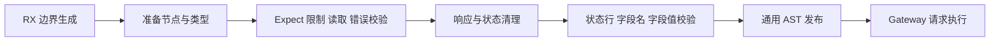
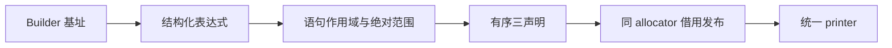

# Gateway 请求边界生成自举

## Intent：最终目标

完整迁移 readBody、respond、validHead 三项 Gateway HTTP 边界声明生成，保留
原协议、求值与错误顺序；RX 显式组装阶段，ZX 承载结构化构造。此记录遵循 IDEA。

## Data：可用证据

Native 源头是 genz/gateway/http.zig 与 head.zig，entry.render 无条件构造这三项。
readBody 先处理 Expect，再拒绝压缩与过长输入，发送/flush Continue，随后读取、
区分 OOM/StreamTooLong、检查总长度和截断。respond 清空 expect 并关闭 keep-alive。
validHead 状态行禁止所有控制字符，header value 仅允许 TAB，字段名需 token 合法。

复用 AST Context、Statement Builder、函数表与通用 borrowed 发布；新增通用
ReturnValue 构造器，不能把 return false 换成普通 false 或提前求值。已有 Catch、
for/while 及参数构造可用，不增加专用 Native 语义桥。

## Edges：边界与限制

- RX 明确 prepare/types→readBody 各职责→respond→validHead 各职责→publish。
  算法内构造保留 ZX，不能由 Native 重新执行旧生成逻辑。
- 旧 Native 仅 seed 使用。正式 Native 仅传基址、通用发布并 materialize 三声明。
- 不改变 HTTP 文案、状态、缓冲大小、读取最大长度的饱和加法和错误传播顺序。
- Catch/循环子体关闭为绝对范围，不能混入函数根；参数保持连续和原次序。
- 固定名、协议字符串与语义阈值集中 const.zx，ASCII 常量优先复用 core。
- 所有节点通过结构化原语和统一 printer；禁止完整 Zig 语句模板或 RawCode。
- 新捕获名及 payload 与 Builder 同寿命，不复制输入元数据，不增加应用运行库。
- 不新增用例。验收既有 Gateway、JSON Gateway、失败清理与两阶段产物。
  性能按实际影响测量，固定累计基线不重置，保留已迁移实现并优化实际开销。

## Answer：交付与成功标准

成功要求原生产路径实际调用 Source、完整输出及协议行为一致、错误与所有权
边界保留、性能满足累计标准。交付前自我复核剩余 Native 职责，不以此三声明
代替整个 Gateway 或完整编译器自举；统一验收全部变更、英文提交并推送。

### 实现与能力核对

三个声明由同一 RX 模块依次完成：准备/类型、readBody 的 Catch/Expect/限额/
Continue/读取/收尾、respond、validHead 的字节规则/状态行/头部循环、最终发布。
ZX 以这些内聚职责拆分，Source 最大 195 行；Native boundary 仅负责基址、通用
borrowed 发布和三个声明 materialize。head_seed/http_seed 仅初始引导使用。

新增的 ReturnValue 与 member_path 都是通用结构化 AST 原语，没有引入 HTTP
专用 Native 判断，也没有源码模板。三个函数共享只读命名节点及通用类型，语句
分别关闭为独立绝对范围，参数段与 respond 对象字段段独立连续。

实现时确认了两个既有表达边界：顶层导出 const 只支持闭合标量，名称集合改为
消费处组装已有 const.zx 标量；空列表的循环初始状态需要声明 u32[]，补充显式
类型后通过。一次修改导入列表缺少逗号被语法校验拒绝，修正后才计入成功证据。
这些是组合与类型标注修正，没有为迁移增加新的语言语法。

只读审查未发现顺序、作用域、参数或借用寿命阻断。状态行禁止 TAB，字段值
允许 TAB；OOM 直接传播；其他读取错误响应后返回 null；respond 先清 Expect。
Source payload 在 Builder allocator 创建并在打印前保持有效，临时 Input header
不发布到 AST。该审查不等于证明所有生成闭包没有描述符分配。

### 自编译与实际回归

- 两阶段 bootstrap-stage 各 21/21 步成功，P16、ReleaseSmall、12 核；第一阶段
  由上阶段 Source 自编译工具生成，第二阶段由本阶段第一阶段生成，实际分析与
  生成继续启用 Source。两个本阶段工具 SHA-256 相同：
  e0aa4f942013f7b379a4dd1afe76ee15d1d66f7b1efb25f4fbf5eb43da6be24c。
- test-gateway、test-application-json-gateway、test-module-generation 共 62/62 步、
  71/71 受管测试通过。Node Gateway 实际 HTTP 路由/状态/协议检查成功；JSON
  Gateway 另有 52/52 次 HTTP 观察，无失败，不把它们冒充 Zig 受管测试数量。
- 同一新 manifest 的完整产物 main 3623、collections 65、growth 361、ordered
  24，共 4073 文件；旧/新仅工具摘要指纹 .zxc-inputs 不同，两个新阶段全部相同。
- memo 逐键逐内容相同，无原始顺序差异：main 13142/3471/2948/0，collections
  67/45/27/27，growth 1154/315/270/0，ordered 27/14/14/14，冻结输入
  8248/2419/1945/0。

### 实际生成路径与固定累计基线

Native 隔离控制逐文件核对仅 gateway/boundary.zig 的生成开关不同；源树其余
内容一致。探针复用既有八个 JSON 输出样例的真实分析类型，组装同一标准服务
和路由后调用 Gateway entry renderer；不增加回归用例或生产特判。八份完整
Gateway Zig 输出 SHA-256 全部相同。

六轮交替、排除首轮，每轮 100 组、800 次 render：Native/Source 的 CPU 中位数
0.05/0.07 s、墙钟 0.05/0.08 s、最大 RSS 5,832,704/6,504,448 B。它包含进程
启动、一次八样例解析与首次输出写出，不包含生成后目标 Zig 编译。增加 0.02 s
CPU/0.03 s 墙钟来自放大场景，不能据相对百分比外推到真实一次生成；RSS 是
进程峰值差，不能换算为逐次申请量。此次没有声称绝对零分配或精确 CPU 相等。

固定 readability-final 输入八轮交替、排除首轮：固定基线/上阶段/本阶段 CPU
5.34/5.28/5.27 s，墙钟 1.16/1.12/1.12 s。单阶段 CPU −0.01 s、墙钟不变，
累计 −0.07/−0.04 s；仍使用同一固定历史基线二进制，不按提交重置。

RSS 中位数 494,993,408/491,585,536/496,156,672 B；上阶段范围
475,824,128～496,009,216 B，本阶段 485,326,848～498,335,744 B，明显重叠。
不将中位数 +4,571,136 B 隐去，也不将其当作稳定上升或下降。冻结输入 2268 个
产物相同，仅工具摘要指纹不同；没有新增可确认的累计时间退化。

### 首版冷编译缺口与真实归因

首对普通冷 CLI 编译：Native/Source CPU 86.95/88.27 s，墙钟 85.24/86.54 s，
最大 RSS 4,295,278,592/4,331,257,856 B。时间增量 +1.32/+1.30 s 超过容差，
因此未把首版视为成本验收通过；保留全部 Source 迁移，继续定位开销。

同输入未优化 LLVM IR 使用 --verbose-llvm-ir 单独导出，不混入普通计时。
总字节 209,795,713→211,603,974，函数 33,477→33,791；appendRows 家族净增
约 65 KB，check 家族净增约 39 KB。最大新增阶段 read_catch 为 6,152 行、
307,360 B、754 个 alloca。静态站点不是实际执行次数或底层数据复制量。

实际 boundary 调用 public.executeValue，直接静态调用 RX 根；未发现动态函数值
或重复函数类型，也没有把未调用 executeIn 的装箱算入成本。RX 阶段间确实有
宽描述符结果，但源码不能单独证明它解释全部增量。

进一步核对 close 与 Catch 构造器：它们被强制 inline，结果虽只有少数外层
字段，却包含宽状态/列描述符。隔离生成树仅将这两个 helper 的 pub inline fn
改为 pub fn，普通冷 CLI 得 CPU 86.45 s、墙钟 84.68 s、RSS 4,324,311,040 B。
这仅用于筛选假设，不是生产按函数名特判，也没有把单次较低值冒充稳定收益。

### 通用结果宽度规则与有界性

修改已有 Source entry/inlined 规则：宽输入不再只检查输出最外层字段个数，
递归计算记录/元组字段与 optional 包装占用的预算，仍使用既有最大结果字段数
4；标量和列表等叶子不继续遍历，数组不查看元素。过宽结果交给普通静态调用，
由 Zig/LLVM 决定正常内联，不关闭语言能力，不改变调用、ABI 或所有权。

每个字段先消耗 1，再以剩余预算递归；optional 减一前先检查零预算；直接字段数
超过剩余额度即退出。空记录仍消耗抵达它的父字段预算，单包装链也逐层收费，
不能通过空壳绕过工作量上限。limit=4 时类型访问为常数级，无堆申请或分析缓存。
只读审查通过，并同步 seed.zig 的同义规则，避免 seed 与 Source 提示不一致。

### 规则修改后的自编译与功能复验

规则修改需再生成工具本体：shape-bootstrap 由旧规则工具生成，shape-production
由新规则工具生成，shape-fixedpoint 再生成。第二、第三个工具字节一致，SHA-256
均为 3689d84ff3a2670ddd639943cbf1d24131099b68547978e3a1a7b9404e6f8740；
三次构建均 21/21 步。不能把 shape-bootstrap 的旧内联形态当作最终工具性能。

同一新输入的四组完整产物现为 main 3624、collections 65、growth 361、ordered
24，共 4074 文件。旧/新只有函数 inline 修饰变化：main 56、collections 2、
growth 7、ordered 0 个源码文件；严格规范比较仅去函数声明的 inline，不删除
其他 token。第一次验证碰到 .zxc-files 的预期校验变化，随后逐项验证清单路径
一致、哈希变化集合恰好等于实际变更源码集合，没有笼统忽略清单。新第二/第三
阶段全部文件精确相同。

Gateway/JSON Gateway/模块生成复验仍为 62/62 步、71/71 受管测试及实际 HTTP
检查通过。memo 逐键逐内容一致，无原始顺序差异；main 更新为 13144/3472/2949/0，
其余四组数量保持前述值。函数内联提示变化没有被误计成所有权事实变化。

新工具固定输入八轮交替、排除首轮：固定基线/上阶段/最终 CPU 5.34/5.28/5.27 s，
墙钟 1.16/1.12/1.13 s。单阶段 CPU −0.01 s、墙钟 +0.01 s，累计 −0.07/−0.03 s。
RSS 中位数 494,206,976/484,163,584/491,896,832 B，仍需结合范围判断；不宣称
稳定内存改善。冻结输入有 29 个源码仅 inline 修饰变化，清单哈希同步变化，其余
代码及 memo 一致。最终冷 CLI 对照继续使用实际新工具生成树，避免旧 flags 混用。

### 最终冷编译收口

在行为、固定累计基线与稳定点通过后，使用新工具实际生成树补两对反向顺序的
普通冷 CLI 编译。控制是原 Native 三声明与原内联提示，候选是 Source 三声明
和通用有界规则；输入、工具链、优化模式一致，每轮 local/global 缓存初始不存在，
保留 OS 缓存，不导出 IR 或附加采样。结果不能拆分归因到单一 helper 或规则。

| 指标           | Native 控制中位数 | 最终 Source 中位数 |                     差值 |
| -------------- | ----------------: | -----------------: | -----------------------: |
| CPU            |           88.08 s |            87.35 s |                  −0.73 s |
| 墙钟           |          86.335 s |            85.56 s |                 −0.775 s |
| 最大单进程 RSS |   4,294,795,264 B |    4,232,282,112 B | −62,513,152 B，约 −1.46% |

| 配对 |  CPU 差 |  墙钟差 |        RSS 差 |
| ---- | ------: | ------: | ------------: |
| 1    | −0.41 s | −0.49 s | −78,036,992 B |
| 2    | −1.05 s | −1.06 s | −46,989,312 B |

两对时间与 RSS 方向一致，支持当前职责与必要优化的收口；只有两个样本，不提供
显著性保证或全部场景的百分比承诺。此数据仅是受影响的单次 CLI 编译，不是
新的完整根冷构建测量，不与历史不同输入的数字相加。首版 +1.32 s 的失败、
单次局部去内联试验和最终四次普通编译分别保留，不挑选单个最快值。

### 自我复核与交接

本阶段完成的是 readBody/respond/validHead 三声明的完整 Source 生成职责，
包括协议拒绝、读取错误、响应与状态行/头部算法。RX 负责真实阶段组装，ZX
保留原子构造，Native 仅提供基址、通用导入与 materialize；没有以入口包装
回调旧规则。旧实现只在 generated_analysis=false 的 seed 路径使用。

通用内联规则保持预算有界、无新增堆申请与分析缓存，没有按函数名、目录或用户
样例特判。普通静态调用仍由 Zig/LLVM 正常优化；Source 和 seed 提示同义。
没有改所有权、调用接口或错误语义，数据与生成代码约束保持。描述符装箱、
flat AST 发布和参数 materialize 仍有成本，不能把这次收口写成整个 AST 零复制。

剩余 Gateway 分派、服务调用、宿主生命周期及其他编译器状态/算法仍待迁移，
整体目标未完成。三阶段本工具稳定点也不能替代最终传递依赖审计：手写 AST/IR
存储与部分原生语义仍在正式依赖闭包中。完整冷构建主峰值仍需后续科学归因，
不把本次约 63 MB 局部收益夸大为全部问题解决。

原始证据位于忽略目录
.zig-cache/cold-build-analysis/ownership-research/gateway-http：初版 bootstrap-_.log、
production.log、regressions.log，render-results.json、owned-runtime-comparison.json、
完整产物和 memo 报告；cold-screen-metrics.json、ir-functions.json 及两侧未优化 IR，
outline-scope.json 与局部筛选日志；shape-_ 三阶段构建、shape-output-summary.json、
shape-runtime-comparison.json、shape-memo-results.json、shape-regressions.log，
cold-shape-metrics.json、cold-shape-summary.json、quality.json 与 decision.json。
不提交探针、生成副本或临时日志。交付前只复核本次 diff 与必要格式检查，不再
重复已经取得的相同构建与计时证据。
