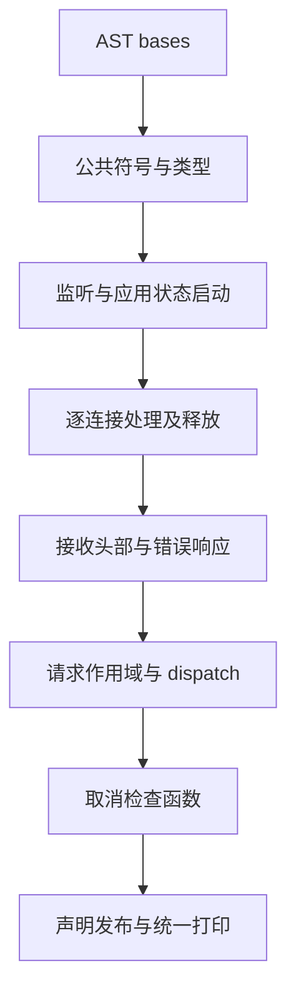
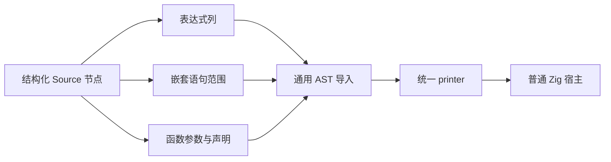

# Gateway 进程宿主生成自举

## Intent

将 Gateway 启动、连接接收、错误与取消传播、请求资源释放的完整宿主生成规则迁入 RX/ZX。
生成普通 Zig，保持声明顺序、错误传播与资源生命周期，不增加应用运行库。

## Data

原实现为 `packages/genz/src/host/gateway/root.zig` 与 `connection.zig`。
现有 Context、Statement Builder 与声明原语已能覆盖需要的 AST 节点；少量缺失
Builder helper 可补通用结构化原语，不需要新语言语法或专用 Native 语义桥。
阶段前完整冷构建为 129.05s 墙钟、195.25s 累计 CPU，单体峰值 2128068608 B、
进程树采样峰值 2134130688 B。固定基线仍为 129.74s、216.03s、
2075033600/2247294976 B，不重设。

## Edges

- 生成全部 Zig 代码必须通过结构化 AST 与统一 printer。
- 每次连接的 shutdown/close defer 保留在 while 内；releaseRetired 在 handle catch 后。
- receiveHead catch 先检查取消，再处理连接关闭、431/400 和 print/flush。
- dispatch catch 先检查取消，再返回原错误；两个取消分支共享失败语句范围。
- 不复制源文本或嵌入旧 Native 生成实现；seed 仅用于初始引导。
- 不新增持久测试；复用既有 Gateway、JSON 与相关分配检查。

## Answer

RX 显式连接宿主的类型/声明准备、启动与连接阶段、取消规则及发布；ZX 构造各
内聚 AST 片段。Native 只保留 allocator/ABI 适配和打印入口。
验收包括既有行为、生成文件一致、工具自生成一致、受影响性能路径和 Git 收口。

## 执行与验收

实现中，尚未完成验收。

### 实现边界

Source 入口为 `genz/analysis/gateway/host/build.rx`，明确依次构造启动监听、
应用状态、头部缓冲区、逐连接循环、连接 I/O、接收头、请求作用域、dispatch、
取消函数及发布。ZX helper 只负责相应 AST 片段或语法节点组装。

补充通用 `ast/context/path` 与可引用已封存子块的 `branch_range` 原语。
AST 模块导入增加可选 `statement_forms` 列视图，覆盖 while/defer_scope/discard_error
等额外语句载荷；保留既有 loops 路径与重叠列拒绝，不放宽 AST 验证或加入源码节点。

Native `host/gateway/root.zig` 仅保留 arena、输入描述符、借用导入、声明物化与打印。
原始实现完整保留为 seed，正式 generated_analysis 路径不调用旧生成规则。

单入口：102 个模块、91 个函数文件，生成成功，infer 75ms、emit 20ms、write 5ms；
只是局部生成记录，不作完整性能结论。格式与 lint 通过。
正式工具构建 21/21 通过，完整 CLI 构建与行为/成本验证进行中。

只读源码复核确认：共享取消失败块在关闭后被两个 branch_range 引用；裸 return
保留无返回表达式；shutdown/close defer 属于 while 子范围；借用节点在 Builder
arena 释放前完成物化和打印。该复核不代替实际 ABI 与产物检查。

### 正式路径初验

完整 P2 冷构建 43/43 通过，12 核、空 stage0、新 local/global cache，期间无其他
构建或大量读取。time 墙钟 130.15s、累计 CPU 195.43s、单体峰值 2126528512 B；
0.2s 树采样峰值 2129756160 B。采样器墙钟 130.317s、单体峰值 2109489152 B
单列，不代替 time 指标。

相对阶段前：墙钟 +1.10s、CPU +0.18s，单体 −1540096 B、树峰 −4374528 B。
相对固定基线：墙钟 +0.41s、CPU −20.60s，单体 +51494912 B、树峰 −117538816 B。
保留全部差额；单轮差异不能证明源码造成稳定增减，需要结合受影响生成路径对照。
历史单体峰值残余差额尚未消除。

现有 Gateway 行为检查 86/86 已通过；JSON、产物一致与受影响路径计时正在核对。

## 最终验证与收口

- Gateway 行为检查 86/86，JSON 输出检查 52/52。
- 同一路径、同一既有 main/empty Gateway：46 个生成 Zig 文件无新增、删除或字节变化。
  分目录对照中的模块路径身份差异通过同路径复核排除，没有用规范化掩盖真实差异。
- Seed 独立编译/执行成功。seed 与正式 Source 生成的宿主 main.zig 均为
  `e08ccd13f60d9cd2ac12e734e46207f13393eb5e19cecfbf94ea54f88a4f8d2d`。
- 工具自生成两轮均 21/21，通过且 SHA256 相同：
  `ed992171967c5aa4917dd4c9e910abfecf04110f772a251a39dd3e064be6faf0`。
- 本阶段 37 个 RX/ZX 文件格式与 lint 通过；Native 格式检查通过。
- 三组交替测量，每组 8 次 `--no-cache` 既有 Gateway 构建，后端缓存已预热。
  CPU 合计中位数 10.18 → 10.18s，墙钟 9.55 → 9.54s，RSS 中位数
  216219648 → 216039424 B。未观察到受影响路径退化，不承诺微小差额为稳定收益。

证据目录：`.zig-cache/cold-build-analysis/ownership-research/gateway-host/`；完整冷构建
在同级 `partition-reference/cold-gateway-host/`。日志、临时探针与产物不提交。

自我复核：源码复核、ABI 实际编译、完整产物和行为证据相互补充，未仅凭单入口
或绿色检查宣称整个自举完成。阶段交付是进程宿主生成规则迁移；AST Native 存储/
物化适配、Gateway 模块整体组装以及 CLI/Node/WASM 宿主等仍有待迁移内容。
完整自举的传递依赖审计与 stage1/2/3 目标继续保留，固定性能基线不重设。
