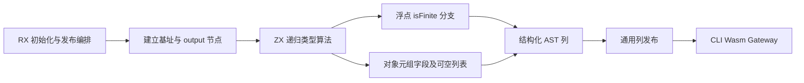
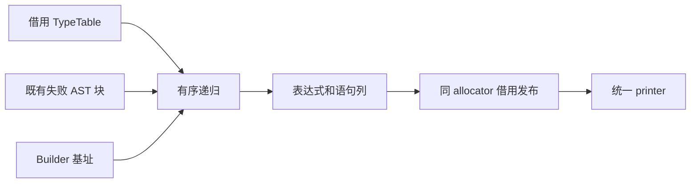

# JSON 输出有限数校验自举

## Intent：最终目标

将 CLI、Wasm/WASI 与 Gateway 共用的 JSON 输出有限数校验 AST 生成完整迁入
RX/ZX，保持原递归算法、类型表借用、捕获编号、短路及错误动作。只迁移本职责，
不将宿主包装与整个编译器宣称为已自举。本记录遵循 IDEA 框架。

## Data：可用证据

原实现位于 genz/host/json_output.zig。scalar 仅检查 f32/f64；optional/list
递归生成条件捕获或 for；object/tuple 按字段顺序递归；其他类型不生成校验。
即使子树没有浮点，optional/list 也消耗 json_value_N 编号，必须保留。

ZX 已有具名默认函数自递归，analysis/types/contains.zx 是成熟用法；无需改成
堆上工作栈。复用结构化 Context、Statement Builder 与通用 AST 列发布。
Gateway 传入包含日志和响应的自定义失败块；CLI/Wasm 使用 NonFiniteJsonNumber。
失败块只引用既有 AST，不能改成固定错误或生成完整 Zig 源码字符串。

## Edges：边界与限制

- RX 表达初始化→类型递归校验生成→最终发布，递归集合算法保留 ZX 原子函数。
- Native 仅借用 TypeTable、传入 AST 基址及失败块、发布通用列；seed 仅初始引导。
- 在 Builder allocator 生成并借用发布，所有新捕获名和调用参数与 Builder 同寿命。
  不复制底层类型表，不引入运行库或逃逸闭包。
- 需要的通用能力仅为 Statement Builder 的 for 构造及无声明 AST 片段发布；
  不为 JSON 添加专用 Native 语义桥。
- 保持默认失败行为、有限性判定顺序、输出变量名与可空/列表捕获顺序。
- 不新增用例。复用 application-json-output、application-json-gateway 的实际宿主
  回归，核对生成产物，按实际成本变化验证生成与工具构建；固定累计基线不重置。
- 保留已实现迁移并修正实际成本，不能因初版退化直接退回 Native 正式实现。

## Answer：交付与成功标准

成功要求三类宿主行为与原产物一致，异常及捕获编号不变，实际受影响路径满足
累计性能约束。交付前复核 Native 依赖与未迁移职责，统一提交推送全部变更，
确认工作区干净。两阶段一致与局部回归不能替代最终依赖闭包和三阶段标准。

### 实现与结构审查

正式 host/json_output.zig 只传入类型表视图、Builder 基址和既有失败块，并通过
通用 import_module.appendBorrowed 发布。原递归实现保留为 json_output_seed.zig，
仅 generated_analysis=false 的初始引导使用；正式 Source 路径不调用它。

Source check.zx 保留具名自递归，按类型分派；finite.zx 只构造 isFinite 分支。
for_loop.zx 与既有 while_loop builder 保持同一作用域契约。通用 importer
允许没有 extra 和 declarations/functions 的 AST 片段，原有 owning、文本借用
与完整借用模式不变。

只读审查未发现作用域、编号、类型表借用或新 payload 寿命阻断。每个可空/列表
即使无浮点子树也递增 sequence；空子体恢复父 roots。失败块共享不可变范围，
不复制日志/响应动作。临时 Input/Bases/TypeTable header 未作为 AST payload 导入。

8 个新增 Source 文件 fmt/lint 通过，ZX 最大 144 行；没有新增测试用例。

### 行为与自编译证据

- 两阶段 bootstrap-stage 均 21/21 步成功，P16、ReleaseSmall、12 核；第一阶段
  由 snapshot-cleanup 的 Source 自编译工具生成，第二阶段由本阶段第一阶段生成。
  两者 SHA-256 均为
  7eb8a011d2923bd3233eba7783501cb26c8c81fa6f74219c179bf152df8b1de7。
- test-application-json-output（包含 Gateway）和 test-module-generation 共
  62/62 步、23/23 个受管测试通过。九份 JSON 报告另有 208 次实际观察：原生、
  Wasm freestanding、WASI 各 52 次，加 HTTP Gateway 52 次；无跳过、无失败。
- 同一新 manifest，旧工具→第一阶段→第二阶段完整产物：main 3595、collections
  65、growth 361、ordered 24，共 4045 文件。旧/新仅工具摘要指纹 .zxc-inputs
  不同，两个新阶段逐文件完全相同。
- 所有权 memo 逐键逐内容一致，且无原始顺序差异：main 13013/3445/2922/0，
  collections 67/45/27/27，growth 1154/315/270/0，ordered 27/14/14/14；
  固定冻结输入为 8248/2419/1945/0。

### 受影响宿主生成路径

隔离 Native 控制逐文件核对仅 host/json_output.zig 的正式生成开关不同，其余
源码及工具链相同。探针从现有八个 application-json-output 样例取得真实分析
类型，直接调用原有 cli/wasm renderer，不包含目标 Zig 编译。计时包含一次探针
进程启动，各 render 没有独立进程。
首次准备探针时匿名结构无法隐式转换到 Output，改为从公开 renderer 参数获取
类型；这是忽略目录中的测量工具修正，正式实现未改变。

八个样例的 CLI/Wasm 共 16 个生成文件 SHA-256 全部相同。六轮交替计量、排除
首轮，每次 100 组、1600 次 render：Native/Source CPU 中位数均为 0.07 s，
墙钟 0.07/0.08 s，最大 RSS 5,799,936/5,914,624 B。RSS 增加 114,688 B；
这是整个放大探针进程的峰值，不能换算为每次申请量或完整构建峰值。

探针包含一次八样例解析及首次产物写出，主要反复执行的是 renderer。计时精度
为 0.01 s，不据此声称两侧 CPU 精确相等或 Source 更快。新增生成成本在这一
放大场景仍很小；普通应用只生成对应宿主，不将 1600 次循环当作真实端到端场景。

### 固定累计基线

固定 readability-final 输入八轮交替、排除首轮。固定基线/上阶段/本阶段 CPU
为 5.35/5.25/5.25 s，墙钟 1.17/1.11/1.12 s。单阶段 CPU 不变、墙钟 +0.01 s；
累计 CPU −0.10 s、墙钟 −0.05 s，固定基线不重置。

RSS 中位数为 492,273,664/494,354,432/495,222,784 B，需结合原始范围判断，
不将小幅中位差当作稳定趋势。冻结输入 2268 个产物相同，仅工具摘要指纹不同；
实际运行继续使用 Source 分析与生成，工具本体也由上一阶段 Source 工具生成。

### 生成形态与待收口的发布成本

检查递归 check 与 finite/identifier/branch/for 四个直接 helper：递归传递现有
context、loops、source 和 statements 的引用；已检查的 branch/for 追加均保留
zxReserve 的增长前沿，concat 只复制新增 root 后缀，for 六列 items/storage
在递归返回及 loop 写回时保留。没有发现逐字段复制整个已有前缀的明确证据；
未展开 selection/header 全部闭包，不能据此证明所有输入规模的线性复杂度。

语句状态仍存在每节点固定描述符装箱（约 28 列 slice header），不是整列底层
数据复制，也不是零分配。记录为通用生成质量待改进点，不以小样例时间掩盖。

首版三对普通冷 CLI 编译的 CPU 中位数 88.25→88.21 s、墙钟 86.45→86.43 s；
逐对 CPU −0.28/−0.04/+0.33 s，墙钟 −0.28/−0.02/+0.36 s。RSS 中位数
4,270,882,816→4,295,671,808 B，增加 24,788,992 B（约 0.58%）；逐对
+14,237,696/+25,313,280/0 B，范围虽重叠，仍不能宣称内存不变或下降。

在保留迁移的前提下继续核对发布源头。import_rows.appendRows 即使 copiedFields
为空，也先实体化整份 prepared=source.*；该路径没有任何字段修改或拥有型清理。
隔离候选将其静态改为直接引用 source，仅需要修改字段时保留可写 View。保持
原检查、reserve、提交与失败顺序，不改变拥有型复制和借用寿命。先验证实际
编译形态与成本，再决定是否进入生产，不批量更改其他算法。

### 最终只读发布实现与复验

当 copiedFields 为空时，prepared 现在直接指向 source，临时 storage 的类型为
void；其他 schema 仍有原来的可写 View。该改动只减少列描述符的实体化，不删除
拥有型深复制，不额外分配，不改释放顺序。只读审查未发现指针逃逸或别名阻断。
正式 import_rows.zig 与隔离计量副本逐字节相同。

候选单次试编译 CPU 86.46 s、墙钟 84.62 s、RSS 4,300,275,712 B，只是继续
验收的信号。未将该较低 CPU 样本并入最终配对结果；不能以这一次认定提速 2 s。
一次接入命令误用了包目录下的根相对路径，复制失败后触发原版构建，已单独保留
publication-bootstrap.log 并排除其验证资格；随后使用绝对路径完成接入及复验。

最终两阶段各 21/21 步，工具 SHA-256 均为
8969cbfb45d3bfe752940dbccc03a2884e8c4c10ad416407cbf1a64f3f5b430f。
实际工具由初版 Source 工具再生成，运行仍启用 Source 分析与生成。最终 JSON
与模块生成回归再次 62/62 步、23/23 受管测试，加 208/208 JSON 实际观察通过。
该复验对应通用 importer 的实际修改，没有重跑无关全仓应用回归。

最终四组 4045 个产物再次一致，两个新阶段完全相同；五组 memo 均逐键逐内容
一致，无原始顺序差异。最终固定输入八轮交替、排除首轮：固定基线/上阶段/
本阶段 CPU 为 5.33/5.29/5.30 s，墙钟 1.17/1.13/1.13 s；单阶段 +0.01/0 s，
累计 −0.03/−0.04 s。固定基线仍是同一历史二进制，未按提交重置；各次测量的
基线中位数会随环境波动，不能跨轮挑选数值拼接收益。

RSS 中位数为 493,682,688/495,730,688/494,682,112 B，最终与上阶段范围重叠；
不声称生成器峰值取得稳定改善。初版 1600 次宿主生成探针保留为语义和成本
筛选证据；最终实现的行为由重新构建的实际 CLI、208 次宿主观察、完整产物及
memo 核对，不将旧探针冒充最终 importer 的重新计量。

### 最终普通冷 CLI 对照

不再重复初版三对：最终改动后补两对反向顺序，控制仍为冻结的 Native JSON
及原发布实现，候选为 Source JSON 加只读发布。两侧仅这些已列明的改动，使用
同一真实 CLI 响应参数、工具链、生成输入与初始不存在的 local/global 缓存；
不导出 IR、不附加采样。该边界不是完整根冷构建，也无法单独归因两项改动。

| 指标           | Native 控制中位数 | 最终 Source 中位数 |                     差值 |
| -------------- | ----------------: | -----------------: | -----------------------: |
| CPU            |           88.66 s |            88.50 s |                  −0.16 s |
| 墙钟           |           86.93 s |           86.775 s |                 −0.155 s |
| 最大单进程 RSS |   4,271,177,728 B |    4,273,897,472 B | +2,719,744 B，约 +0.064% |

| 配对 |  CPU 差 |  墙钟差 |        RSS 差 |
| ---- | ------: | ------: | ------------: |
| 1    | −0.37 s | −0.38 s | +47,071,232 B |
| 2    | +0.05 s | +0.07 s | −41,631,744 B |

Native RSS 范围 4,241,604,608～4,300,750,848 B，最终 Source 为
4,259,119,104～4,288,675,840 B。后者落在控制范围内，方向不一致；未观察到
能够区分波动的持续增长，也没有稳定降内存的证据。两个样本的中位数是两者
均值，不提供显著性结论。时间一对改善、一对在 0.1 s 容差内微增；结合固定
生成器累计基线、行为与产物证据接受当前实现，不据此承诺稳定端到端提速。

### 自我复核与交接

交付的是共用 JSON 有限数校验的完整生成职责，包含三类宿主、种类递归、编号
和自定义失败动作；RX 负责真实准备/检查/发布，ZX 保留内聚算法。不是把旧
Native check 包进新的入口。语义、结构化生成、zero runtime、底层类型表借用
保持；中间列描述符与 flat AST 行仍有构造/发布成本，不能宣称绝对零分配或
整个 AST 发布零复制。

本阶段没有解决描述符装箱和完整冷构建主峰值，也没有完成其余宿主生成、通用
AST/IR 状态及发布基础设施的自举。seed 的存在只用于初始引导，最终总体标准
仍需传递依赖审计和 stage 1→2→3，局部两阶段一致不能替代。

初版、隔离候选和最终证据分别保存在忽略目录
.zig-cache/cold-build-analysis/ownership-research/json-output：bootstrap/production
及 publication-* 构建和日志、behavior-summary.json、publication-behavior-summary.json、
render-results.json、两组 runtime-comparison.json、fixedpoint/memo 报告、
cold-final-metrics.json（三对初版）、publication-cold/build.log（单次筛选）、
cold-publisher-metrics.json（两对最终）和 quality.json。保留全部差值与范围，
不提交构建产物、探针或临时日志。
