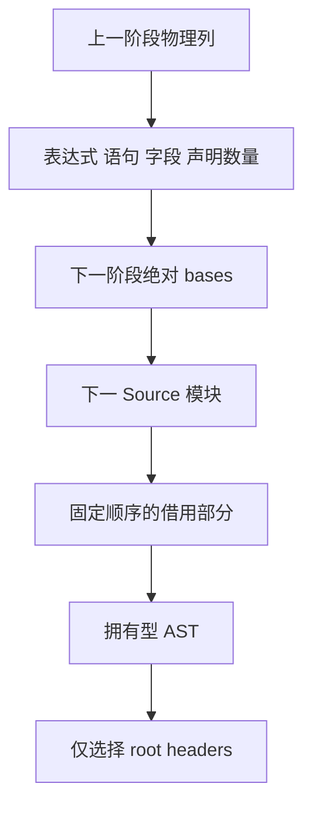

# State 顶层组合自举

## Intent：最终目标

让 State 的存储、生命周期、区域释放与 Request 顺序及编号依赖完全由 RX/ZX
表达。Native 仅同步借用输入、拥有型导入各部分、选择 roots 并调用统一 printer。

## Data：可用证据

四个已有 Source 模块分别返回 Context、局部附加列和声明/字段/语句。原 Native
逐段导入并用物理表长度计算下段 bases；同时把 Function 参数还原为数组，最终
render 又将它们存回字段列。renderStored 已能直接消费存储态声明范围。

## Edges：边界与限制

- 保持四阶段顺序；任一 invalid 立即短路。
- bases 按实际表达式、含嵌套语句、字段及全部声明数量推进，各阶段 serial 仍为 0。
- 输出异构 tuple 固定阶段顺序，不能依靠对象字段的排序推断导入顺序。
- 不合并或重建整张 Source AST 表，只保存各部分及公开 root 编号。
- root 选择只追加 header，保留所有原行号和 Request Container 的绝对范围。
- 动态名称、内层 arguments 与字段必须在 scratch 释放前完成拥有型发布。
- 不新增测试，复用 Store/State/Gateway/IO/Process；不宣称通用 AST 存储已自举。

## Answer：交付与验收

通过两阶段工具、四组完整产物及 memo、既有行为回归，以及受影响路径和固定
累计基线后收口全部变更，英文提交推送；原始数据留在忽略目录。

## 执行记录

### 实现与成本模型

state/build.rx 使用四个顺序 Task 调用既有模块，逐段检查 valid 并立即返回失败。
after_storage、after_lifecycle、after_regions 按实际物理列推进 bases，包含嵌套
语句及全部声明；保持各阶段原先独立的 serial 起点。publish 构造前三区段的
连续公开编号，再连接 Request 显式 roots，不把内部方法提升到顶层。

Output.parts 为固定顺序的可空异构 tuple；无效结果没有 parts。Native 按公开
tuple 字段索引发布，不按普通对象的字母排序。通用 import_module 拥有型导入
各部分载荷，之后 selectDeclarations 先校验旧行号并预留容量，仅追加 tags 和
offsets；原 payload、字段范围和 Container 内部声明范围完全保留。

直接 renderStored 消除了旧 Function 参数还原为字段数组再存回的中转。Source
scratch 在所有拥有型导入及 root header 选择完成后、打印开始前释放。通用 AST
存储与发布仍是 Native 过渡边界，不把这个改动宣称为其完整自举。

生成体核对：parts 只组装固定四份描述符，公开 ABI 转换逐列取 items，未发现
复制底层 AST 列；roots.push/concat 保留增长复用。三次 Bases 装箱为固定六字段
头部。四份结果同时保留的成本仍由动态测量核对，不能从静态观察预报内存收益。

### 验收与接线修正

9 个 Source 文件 fmt/lint 通过，5 个 Native 文件完成初次格式检查。两阶段工具
均 21/21 步成功且 SHA-256 一致：
4d209d555e62abda58982d0c8e343065c6cd81f7b67042c254fddd4a86c740a8。
四组 main / collections / growth / ordered 各 3553 / 65 / 361 / 24 个文件，
两阶段全部逐字节一致，与上阶段工具仅输入清单路径不同。

首次应用回归暴露 Native 适配器未将 import_module 的 InvalidAst 错误转换到
公开 allocator 错误集合，三个应用生成工具编译失败；构建内 48 项检查通过。
补齐与既有适配器相同的 failure 转换后重新验证实际应用路径。该路径此前未由
bootstrap 工具实例化，明确保留这项覆盖边界，不以先前自编译成功替代行为验收。

修正后五个目标 Store reclamation、State 应用、Gateway、Store IO、Process
全部通过：71/71 构建步骤、48/48 构建内项、11 组外部 Zig 共 61 项，另有
State 应用 8 项、Gateway 应用 86 项、Process 入口 46 项。原失败日志保留，
成功结果在 regressions-fixed.log；没有新增测试用例。

错误转换补齐后的两阶段工具各重新构建 21/21 步成功，哈希均不变，说明该改动
没有进入其可执行闭包。
因此复用同一 Source 输入、配置及相同工具字节的完整产物对照，不重复生成。

### 性能与交付

控制工具只在隔离 genz 副本将 state.renderConfigured 的组合入口关闭，回到
之前四个 Source-enabled 适配器；不切回旧 Native 生成算法。复用实际四种
reclamation 与三种 IO 模式，全部构建结束后串行八轮交替，排除首轮：

| 指标              | 原四次 Source 发布 | 本阶段组合 |
| ----------------- | -----------------: | ---------: |
| 七种模式 CPU 合计 |         0.057865 s | 0.057472 s |
| 七种模式墙钟合计  |         0.048605 s | 0.048775 s |
| 最大子进程 RSS    |         27017216 B | 27017216 B |

CPU 减少约 0.000393 s，墙钟增加约 0.000170 s，RSS 中位数相同；没有观察到
四份 Source 结果同时保留造成显著成本增长。全部八轮各 72 个文件逐字节相同。
CPU 为高精度子进程资源差值，包含 time wrapper；墙钟包含启动，RSS 不是整树。
这不是可直接外推的稳定加速百分比，也不是新的冷构建内存收益。

固定输入仍为 readability-final/cache-closure/manifest.json，基线工具与输入
不变。三工具各八轮交替，排除首轮后的中位数如下：

| 指标     |    固定基线 |      上阶段 |      本阶段 |
| -------- | ----------: | ----------: | ----------: |
| CPU      |      5.35 s |      5.32 s |      5.28 s |
| 墙钟     |      1.17 s |      1.13 s |      1.13 s |
| 最大 RSS | 494829568 B | 488751104 B | 490323968 B |

CPU 单阶段 −0.04 s、累计 −0.07 s；墙钟单阶段不变、累计 −0.04 s。RSS 上阶段
范围 474972160～497532928 B，本阶段 473219072～496140288 B，相互重叠，
不从中位数差判断确定退化或收益；不重置累计基线或重复领取 0.1 s 容差。
冻结输入 2268 个文件仅输入清单路径不同，不把整体计时差归因于某个局部原语。

全部 memo 逐键逐内容一致：main 12731/3406/2884/0，collections 67/45/27/27，
growth 1154/315/270/0，ordered 27/14/14/14，冻结输入 8248/2419/1945/0。
没有以命中计数相同代替内容核对。

证据位于 .zig-cache/cold-build-analysis/ownership-research/store-state：
bootstrap.log、production.log、bootstrap-fixed.log、production-fixed.log、
regressions.log、regressions-fixed.log、fixedpoint.json、production-fixedpoint.json、
driver-scope.json、affected-comparison.json、final-runtime-comparison.json、
memo-results.json，以及对应响应文件、脚本和逐轮输出。

### 自我复核与剩余职责

State 的四段生成和失败顺序现在由 RX/ZX 真实组合，Native 只处理借用、通用列
发布、header 选择和 printer 调用。旧分阶段适配器及 seed 仍作为引导与对照保留，
没有用隐藏的 Native 总控代替 Source 流程。此结论只覆盖 State 组合职责。

通用 AST 数据结构、发布和其他编译器专用 Native 算法仍须迁移，完整自举还需
传递依赖审计及 stage 1→2→3。初次行为构建失败揭示了自编译覆盖的实际边界，
已补真实路径验证；不以绿色局部检查证明整体完成。本阶段未测最新完整冷构建
峰值，也不把描述符共享等同于全部所有权问题已经解决。
