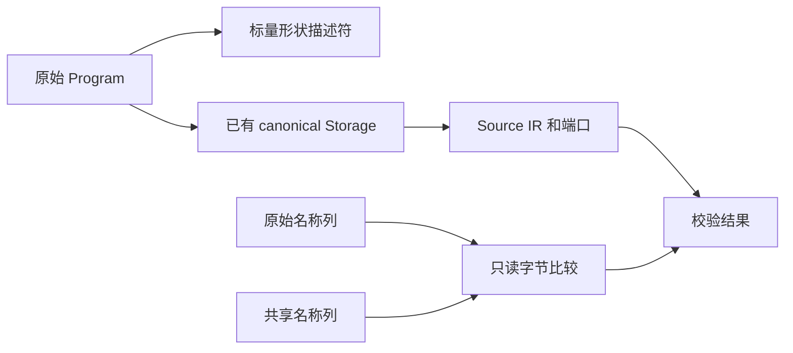

# Store 初始化器校验自举

## Intent：目标

将初始化器程序形状、完整 IR 与端口校验、命名兼容判断归入 RX/ZX，保持
原生检查顺序和分配成本。复用现有 Source IR 校验器，不复制或新增专用 IR。

## Data：证据

起点 30bdc32d。原顺序为：无分配形状拒绝 → IR 校验 → void 输入 → object
输出 → 生成稳定名称 → 按顺序比较名称 → 注册与生成。IR 校验和稳定命名
算法已经 Source 实现，原生主要保留入口与结果适配。

上一有效完整冷构建 131.29s / 198.16 CPU 秒 / 2142240768 B 单体峰值 /
2162638848 B 采样树峰。固定基线仍为 129.74s / 216.03 CPU 秒 /
2075033600 B / 2247294976 B，不随提交重置。

## Edges：边界

eligibility 先于 canonical Storage 初始化，不能先分配导出投影再拒绝无效形状。
validate.rx 先复用完整 canonical 校验，成功后才读取端口行；命名比较仍在
names.create 成功后执行，不提前生成或批量校验。原有 seed 实现保留。

TypeTable、函数表及表达式等沿现有 Storage 借用；导出元数据投影和常量
适配沿用原有成本和寿命。名称比较借两列字节切片，不复制字符串或描述符数组。
形状和名称入口使用零容量 allocator 验证无临时分配。

## Answer：交付与成功标准

既有 Store、编译库和边界检查通过，真实生成文件保持一致；核对借用和
实际生成入口，测受影响路径及完整构建累计差额。最终统一提交推送所有变更。
本阶段是校验职责迁移，不表示原生生成/缓存及完整自举已经完成。

## 实现记录

复用 canonical Storage 时经 frontend 的内部命名空间导出同一个泛型适配器，
避免从 compiler 模块直接二次导入 frontend 源文件，保持 Zig 模块归属唯一。

新校验只返回 bool，IR 工作区与导出投影没有引用逃逸。工作区改由 Bundle
的 child_allocator 支撑，结束即 deinit；不再把临时子 arena 挂在长期 Bundle
arena 上。输入仍只读借用，本阶段检验此生命周期修正的实际 CPU 与 RSS，
不能仅以 deinit 出现就宣称系统内存收益。

## 行为与局部成本

正式构建 43/43。既有 Store 库 2 项、编译库 17 项、完整边界 8 项、
Gateway 86 项通过，共 113 项，无过滤。相同输入路径的 52 个生成文件哈希
完全一致，新增、删除、修改均为零。

三组交替测量，每组 8 次强制构建且后端缓存预热：CPU 中位 6.91 → 6.92s，
墙钟 6.51 → 6.52s，RSS 中位 188317696 → 188661760 B。每次构建的
时间差约 0.00125s，当前未见可辨识退化，也不能把工作区缩短寿命解释成已
测得稳定 RSS 收益。性能仍与固定基线累计跟踪，不重置容差。

实际生成闭包复核：eligible 仅标量短路；names 先检查长度，再借原字节切片
循环调用 bytes.equals；均无 reserve/renew/create。validate 包装层直接把同一个
Canonical Input 指针传给原校验模块，失败立即返回，成功才读端口；没有
输入表复制或返回装箱。原 canonical 内部工作区仍属于原有校验成本。

这里迁移的是校验判定与可复用 Source 阶段；初始化器总流程、稳定命名的
宿主输入/输出适配以及生成发布仍有原生编排，不能宣称整个模块职责闭包已自举。

## 完整冷构建

独立全新本地/全局缓存、12 核、43/43：time 墙钟 130.74s、累计 CPU
198.15s、单体峰值 2139111424 B；采样树峰值 2145550336 B，采样器墙钟
130.776s、采样单体峰值 2125316096 B。time 与采样单体口径分别保留。

- 相对上一阶段：墙钟 −0.55s、CPU −0.01s、单体 −3129344 B、树峰 −17088512 B。
- 相对固定基线：墙钟 +1.00s、CPU −17.88s、单体 +64077824 B、树峰 −101744640 B。

本阶段未见稳定退化。冷构建下降不直接归因于应用校验工作区释放：这里同时
变化了生成闭包与原生适配，且应用局部 RSS 未证明稳定下降。固定基线累计
墙钟与单体峰值的正差额仍未消除，完整目标继续，不重置基线或夸大收益。

## 收口与自我复核

两轮自生成工具均 21/21，二进制 SHA256 一致：
`e37b06e688e1dc4f9ce08d788f1d4c9d9850a78e54336a15f9b3e8cde616c8d2`。
seed 独立探针显式实例化 initializer.append 并编译通过；5 个 RX/ZX 文件的
格式/lint、4 个 Native 文件格式及 diff 空白检查通过。
证据目录为 `.zig-cache/cold-build-analysis/ownership-research/initializer-validation/`，
最终冷构建位于同级 `partition-reference/cold-initializer-validation/`。

复核纠正了直接从 compiler 二次导入 frontend 源文件的模块归属问题，通过
frontend 内部命名空间共享已有 Storage，不复制适配器。Storage 原地 init，
自指针仅在同一帧同步使用；arena 的 defer 先于 init，失败路径同样释放。
工作区寿命缩短来自返回值和完整调用链核对，而非仅凭“调用 deinit”的判断。

校验规则已迁入 Source，命名输入/输出适配、初始化器总编排和生成缓存等
职责仍未全部迁完。两轮工具一致不是完整 stage1/2/3 或传递依赖闭包的证明，
完整自举目标保持不变。
