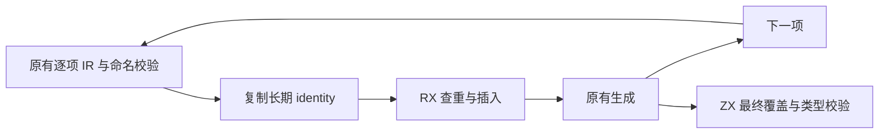
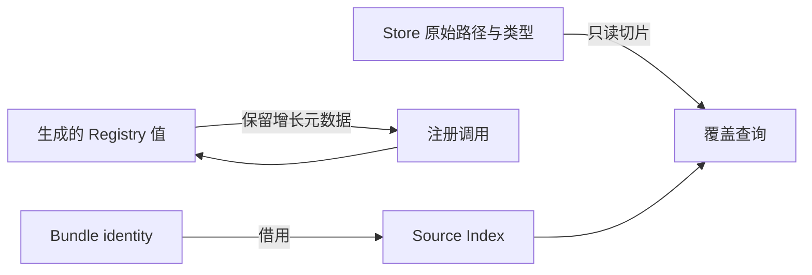

# Store 初始化器身份注册表自举

## Intent：目标

将身份到类型的注册、重复身份拒绝，以及最终 Store 覆盖和类型匹配迁入
RX/ZX。保持原来的逐项验证、命名、注册、生成顺序；不得提前批量报错。

## Data：证据

起点为 a86192a2。原实现使用 StringHashMap，注册发生在 identity 复制之后，
覆盖检查发生在所有生成之后。现有 core/bytes/index 可提供相同的哈希查找职责。
上一阶段最终冷构建为 131.21s、累计 CPU 198.46s、单体峰值 2146451456 B、
采样树峰值 2163064832 B；固定历史基线仍为 129.74s、216.03 CPU 秒、
2075033600 B 单体、2247294976 B 树峰，不随提交重置。

## Edges：边界

RX 编排注册的查重分支和插入；ZX 实现最终顺序覆盖检查。索引状态模型来自
已有 Source Index，不新增原生语义接口。原生适配仅持有 Source 生成的内部值，
映射错误并借用输入切片；它仍是待迁移的宿主传输边界。

使用 executeState 保留 items/storage，不能在每轮 executeValue 转换时丢掉
增长元数据。注册表分配在本轮 scratch arena，生成完成即释放；identity 借用 Bundle 的长期副本；
Store 路径和类型只读借用。IR 校验、命名、生成及缓存仍待迁移。

## Answer：交付与成功标准

既有 Store、编译库、Gateway 检查通过，同路径生成文件一致。
验证实际生成入口不复制输入且索引不逐轮复制前缀，再测受影响路径；
性能有正差额时继续定位，不撤回已完成迁移，也不掩盖累计趋势。
最终统一验收、提交并推送所有变更，确认工作区和上游状态。

## 实现与阶段证据

注册与插入使用 executeState，内部 managed Index 的 keys/values/buckets 均保留
items/storage；get 的栈上只读描述符只供同步查询，未进入保存状态。
实际 register、insert、put、grow 模块无 allocator.create；已有 exclusive 缓冲
保留增长前沿，rehash 直接写新桶。初始化不分配；覆盖检查只返回枚举。

正式构建 43/43；Store 库 2 项、编译库 17 项、Gateway 86 项通过。
52 个生成文件同路径哈希一致，新增、删除、修改均为零。
三组交替测量，每组 8 次强制构建且后端缓存预热：CPU 中位 6.92 → 6.93s，
墙钟均 6.51s，RSS 中位 188399616 → 188465152 B。CPU 聚合差额 0.01s，
每次约 0.00125s；不将微小差额宣称为稳定收益或以此消耗新的累计容差预算。

复用现有 Index 的代价是 register.get 后 insert 内部再次 get；未改变算法阶数，
当前局部测量未显示可辨识退化，保留此明确优化点，不增加专用绕过接口。
临时注册表与选择结果共用 scratch，返回产物不引用其缓冲；identity 指向
Bundle 的长期副本。生成完成即释放索引，不让临时表随 Bundle 延长寿命。

### 完整冷构建

43/43，通过独立全新本地/全局缓存构建。time 墙钟 131.29s、累计 CPU
198.16s、单体峰值 2142240768 B；采样进程树峰值 2162638848 B，
采样器墙钟 131.515s。所有并发均按本机 12 核执行，计时期间未并行其他构建。

- 相对上一阶段：墙钟 +0.08s、CPU −0.30s、单体 −4210688 B、树峰 −425984 B。
- 相对固定基线：墙钟 +1.55s、CPU −17.87s、单体 +67207168 B、树峰 −84656128 B。

本阶段受影响路径与完整构建未见稳定退化，微小差额不作稳定提速承诺。
固定基线累计墙钟和单体峰值的正差额未消除，不能宣称整体内存目标完成。

### 边界回归中的既有失败

补跑 rx_boundary_test 时，源码包 Call.module 被允许，违反该用例要求拒绝的
预期；它覆盖了用于后续 unchanged 断言的应用文件，导致两个缺失初始化器
子项连带失败。用 a86192a2 阶段编译器对照，失败项目和顺序完全相同，
均为 4 pass / 4 fail（含父项）；因此不能归因于本次注册表迁移。

现有 RX 文档仍描述包模块的编译库边界，与当前 mixed/source 路径需要后续
单独核对；本阶段不修改这项契约或测试预期。使用 Node test-skip-pattern
仅跳过该既有失败子项，重新隔离验证本次覆盖检查：7 项通过、0 失败（被过滤项不计入 Node 的 skipped 统计）。
两份未过滤失败日志保留为证据，不能把整个边界套件报告成全部通过。

### 收口与自我复核

两轮工具构建均 21/21，二进制 SHA256 一致：
`0450d864107a12c1bcbf3c7f208433df0850847646162e4da67349654eab8dc0`。
seed 独立入口实例化编译通过；本次 4 个 RX/ZX 的格式/lint、3 个 Native
文件格式和 diff 空白检查通过。证据目录为
`.zig-cache/cold-build-analysis/ownership-research/initializer-registry/`，完整冷构建
位于同级 `partition-reference/cold-initializer-registry/`，均不纳入提交。

复核时修正了两点：包公开模块应由 RX Call.module 调用，不能冒充本地 Call.fn；
只读 coverage 没有 executeState 变体，应使用真实生成的只读入口，不能假定
所有入口 ABI 相同。通过实际生成代码和正式编译确认描述符借用及状态存储。

本阶段完成身份注册与覆盖职责。IR 校验、命名兼容、生成及缓存流程仍有原生
职责与传输边界，源码包拒绝契约也另有既有不一致；完整自举的依赖闭包和
stage1/2/3 验收仍未完成，不能据此阶段宣布整体完成。
