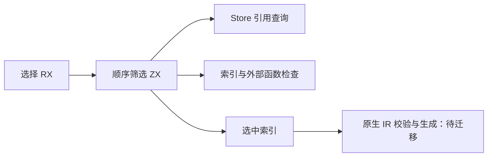
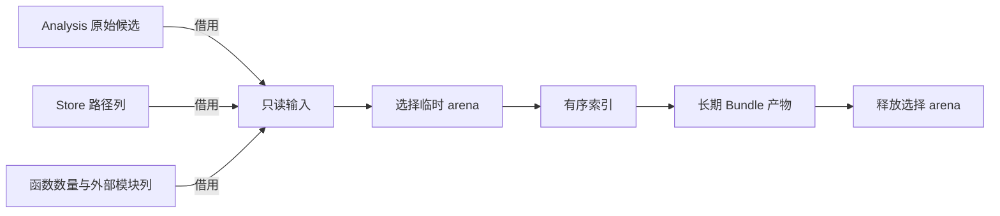

# Store 初始化器选择自举

## Intent：目标

将应用初始化器的完整选择算法迁入 RX/ZX，保持未使用项跳过、原顺序、
索引和外部函数检查。保留已迁移逻辑，再根据生成与计时证据优化。

## Data：证据

起点为 `4ad3e927`。原生实现先扫描所有候选，只有 Store 引用的候选才检查
函数；显式初始化器优先，选择完成之后逐项校验与生成，最后检查 Store 覆盖。

上一完整冷构建墙钟 130.31s、累计 CPU 197.11s，time 单体峰值
2145140736 B，采样进程树峰值 2157215744 B。固定历史基线仍为
129.74s / 216.03s / 2075033600 B / 2247294976 B，不随阶段重置。

## Edges：边界

本阶段仅交付初始化器选择职责。IR 验证、类型命名兼容、去重、生成、缓存及
覆盖校验仍为待迁移原生职责。未启用生成模块的 seed 保留原实现。

候选原始行、Store 路径、外部模块标记列只读借用；选择结果仅保存索引。
原生行调整字段顺序以匹配 Source ABI，由 storage.view 编译期检查尺寸、
对齐、字段偏移和标量表示，JSON 仍按原顺序输出。

## Answer：交付与验收

使用既有 Store 和编译库检查、同路径生成文件对比及受影响应用计时。
自生成工具一致性、完整冷构建和固定基线累计变化在收口时记录。
不得将本阶段表述为整个初始化器模块或完整自举完成。

### 执行记录

实现已接入正式生成入口，等待格式、生成 ABI、行为及成本验证。

### 行为与局部成本

正式构建 43/43。既有 Store 发布 2 项、编译库 17 项、Gateway 86 项全部通过。
同一输入路径生成的 52 个 Zig 文件逐路径哈希完全一致，新增、删除、修改均为零。

三组交替对照，每组 8 次强制重新生成、后端缓存预热：CPU 中位
6.96 → 6.95s，墙钟 6.55 → 6.53s，RSS 中位
188366848 → 188514304 B。微小差额只说明当前受影响路径没有稳定退化证据，
不作稳定收益承诺。完整冷构建仍待独立结果。

公开指针入口存在数组适配，正式调用改用现有 executeValue 值视图，直接借用
原始连续候选行。由生成入口的真实参数反射输入类型，storage.view 编译期验证
FunctionId 到 u32 的相同底层表示；正式编译已通过该检查。

### 初版完整成本与后续优化

独立冷构建 43/43，time 墙钟 130.88s、累计 CPU 197.75s，单体峰值
2146959360 B，采样树峰值 2167193600 B（采样器墙钟 131.103s）。
相对阶段前：+0.57s / +0.64 CPU 秒 / +1818624 B 单体 / +9977856 B 树峰；
相对固定基线：+1.14s / −18.28 CPU 秒 / +71925760 B 单体 / −80101376 B 树峰。
这些正差额保留，不以局部应用计时掩盖。

复核发现 needed 内层每轮再次取候选 identity。改为进入扫描前取一次，
传路径和 identity 两个只读切片，保留原生外层先持有候选的访问方式。
该改动已实现并通过格式/lint；以上数据保留为优化前证据，最终构建仍在执行。

### 最终实现与验证

needed 只接收 paths 与 identity，候选在外层每轮取一次。内层读取的是两个
原切片，bytes.equals 不分配；索引 push 使用 zxReserve 的增长前沿并保留
storage 标志，没有逐轮复制前缀。公开指针入口的适配未进入正式调用路径。

优化后正式构建 43/43；Store 2 项、编译库 17 项、Gateway 86 项再次通过。
最终同路径 52 个文件仍完全一致。最终三组交替对照，每组 8 次构建：
CPU 中位 6.95 → 6.98s，墙钟 6.54 → 6.57s，RSS 中位
188416000 → 188481536 B；每次构建差额约 +0.00375s，不把聚合时间
误作单次退化，也不将优化前的微小负差额宣称为收益。

最终独立冷构建 43/43：time 墙钟 131.21s，CPU 198.46s，单体峰值
2146451456 B，采样树峰值 2163064832 B；采样器墙钟 131.352s，
采样单体峰值 2142715904 B，不混用 time 与采样口径。

- 相对阶段前：墙钟 +0.90s、CPU +1.35s、单体 +1310720 B、树峰 +5849088 B。
- 相对固定基线：墙钟 +1.47s、CPU −17.57s、单体 +71417856 B、树峰 −84230144 B。

阶段前/初版/最终的退休指令数依次为 506653650899 / 506591252417 /
506090312463，最终相对阶段前约 −0.111%；周期为 134069259288 /
134374458238 / 134083350535，最终约 +0.011%。时间正差额与计数器
方向不一致；本阶段局部路径未见稳定退化，但不能据此抹去完整构建的正差额，
更不能宣称累计墙钟与单体峰值问题已经解决。后续仍跟踪固定基线和趋势。

最终两轮自生成工具均 21/21，二进制 SHA256 一致：
`c0e8090dcd372cc5876b8b6aeb76dc96b29a9c1c4453514a9886b56add898966`。
seed 独立探针显式实例化 initializer.append 并编译通过；4 个 RX/ZX 文件的
格式/lint、4 个 Native 文件的格式检查及 diff 空白检查均通过。

证据位于 `.zig-cache/cold-build-analysis/ownership-research/initializer-selection/`，
最终冷构建位于同级 `partition-reference/cold-initializer-selection-final/`。
初版构建与测量保留为诊断证据，不替代最终版本的验收。

自我复核：初版 needed 将候选行读取放在内层循环，虽不复制数据，仍偏离原生
先持有候选再扫描路径的成本模型，已在 Source 源头修正。公开 ABI 与值视图
并不等价，直接借用必须选择经实际生成与编译期布局检查证明的入口，不能只看
源码类型相似。最终交付为初始化器选择职责；其余原生规则及完整传递依赖与
stage1/2/3 验收仍未完成，不能以两轮工具一致代替完整自举证明。
