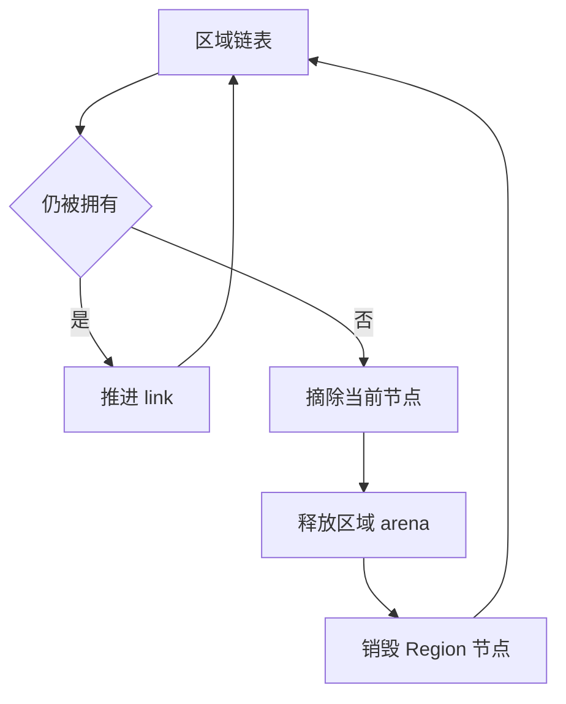

# Store 区域释放生成自举

## Intent：最终目标

将 Region 声明、应用结束释放及过期区域回收的完整生成算法迁入 RX/ZX，保留
区域链表、所有者判定、短路、释放顺序与原有成本模型，不改变应用状态语义。

## Data：可用证据

state/region.zig 与 reclaim.zig 仅由 request.lower 调用。现有 Context、字段、
混合 Constant/Function 声明及 StatementsBuilder 可复用，printer 与原生 AST
已支持可空 while capture、continue 和 StructType，缺少对应 Source 构造原语。

## Edges：边界与限制

- ReadOnly 不声明 Region；仅生成 discard self 的两个释放方法。
- 应用释放先保存 next，再 arena.deinit、destroy，最后推进游标及清空 retained。
- 过期回收先检查 release_disabled；owner 命中推进 link 后 continue，否则先摘链。
- owner 条件按可写对象的原索引左结合短路 OR，维持 O(区域数 × 可写对象数)。
- while 与 StructType 附加列仅在本模块保存，不扩大所有 Context/Builder 状态。
- 不新增测试；复用 Store 回收、State 应用和 Gateway 的实际行为回归。
- Native 只做借用与拥有型发布，保留初始引导实现；Request 创建与提交后续迁移。

## Answer：交付与验收

验收完整生成文件、memo 与两阶段工具一致，检查真实区域释放行为，再比较
受影响路径及固定累计基线。通过后一次收口全部变更，英文提交、推送并确认干净。

## 执行记录

### 实现与语义核对

regions/build.rx 连接资格、deinitialize、retired 与发布。两个子模块在 RX 中
区分 ReadOnly、Shared、Independent；ZX 保留链表算法与结构化 AST 构造。
复用生命周期资格、Context、声明 Table 与字段原语，没有新增语言语法。

通用 Context.method 按字段路径生成普通调用；while_loop 原语先发布子块 header，
恢复 parent root 后添加循环；ContinueLoop 只有 void tag。四列循环 payload
留在模块本地，OptionalType 与 StructType 也作为局部附加列，不扩大既有全局状态。

应用 deinit 保存 next 后才释放 arena 和销毁节点；releaseRetired 保留原有早退、
左结合 owner OR、推进 link 后 continue，以及摘链后释放顺序。未生成新的
运行时 owner 容器，复杂度与原实现相同。ReadOnly 不声明 Region，Shared 的
releaseRetired 仍为 discard；Independent 才消费 owner 槽位。

只读复核未发现范围或生命周期差异。实际生成的 owners 循环在进入前处理一次
共享头部，迭代中逐列回写 items + storage，未发现逐对象 Context 装箱或 plain
重建。while helper 的 Scope 描述符恢复只用于两个固定规模循环，不将其误判
为随对象数增长的平方成本，也不把静态观察当作动态性能证据。

Native regions.lower 只借用连续 Object[]、拥有型导入表达式/语句/字段/声明并
还原函数参数；所有导入在 scratch 释放前完成。原 region/reclaim 仅保留为
Source-disabled 引导路径。Request 创建及提交的原算法仍待后续迁移。

### 正确性验收

- 21 个 Source 文件 fmt/lint 通过，3 个 Native 文件完成格式检查。
- 两阶段构建各 21/21 步成功，工具 SHA-256 一致：
  e6d341ac211ada9bb748d9ca088fbf62902f814dbf529c87a332a8a6e5b8317b。
- main / collections / growth / ordered 各 3509 / 65 / 361 / 24 个文件。
  两阶段全部逐字节相同；与上阶段工具对照时仅 .zxc-inputs 路径不同。
- Store reclamation、State 应用与 Gateway 的既有回归共 57/57 步成功，
  构建内 48/48 项、4 组外部 Zig 共 22 项、State 应用 8 项与 Gateway 应用
  86 项检查通过，包含空状态、只读、共享保留、独占回收与分配失败路径。
  未新增测试用例。

### 性能与交付

受影响路径复用实际 Store reclamation 的四种模式。对照仅在隔离 genz 副本将
regions.lower 切回原 region/reclaim，其他选项、模块以及存储声明、生命周期的
Source 实现不变。全部构建结束后串行运行八轮交替，排除首轮后的中位数：

| 指标              |       对照 |     本阶段 |
| ----------------- | ---------: | ---------: |
| 四种模式 CPU 合计 | 0.035114 s | 0.035460 s |
| 四种模式墙钟合计  | 0.027529 s | 0.027635 s |
| 最大子进程 RSS    | 16318464 B | 16482304 B |

CPU 增加约 0.000346 s，墙钟增加约 0.000105 s，RSS 中位数增加 163840 B
（160 KiB）。记录这项生成器侧的实际代价，不把它解释为应用运行内存变化或
忽略累积趋势。每轮全部 43 个文件逐字节相同。CPU 为高精度子进程资源差值，
包含 time wrapper；墙钟包含启动，RSS 不是进程树峰值。

固定输入仍为 readability-final/cache-closure/manifest.json，不重置同一累计
基线工具。各工具交替八轮、排除首轮后的中位数如下：

| 指标     |    固定基线 |      上阶段 |      本阶段 |
| -------- | ----------: | ----------: | ----------: |
| CPU      |      5.35 s |      5.33 s |      5.32 s |
| 墙钟     |      1.17 s |      1.13 s |      1.14 s |
| 最大 RSS | 493764608 B | 488636416 B | 487555072 B |

CPU 单阶段 −0.01 s、累计 −0.03 s；墙钟单阶段 +0.01 s、累计 −0.03 s。
没有将用户的 0.1 s 容差重新作为本阶段预算。RSS 上阶段范围
474595328～494436352 B，本阶段 474546176～497532928 B，相互重叠，不能
据中位数差声称确定的内存优化。固定输入 2268 个文件仅输入清单路径不同。

全部 memo 逐键逐内容一致：main 12437/3366/2844/0，collections 67/45/27/27，
growth 1154/315/270/0，ordered 27/14/14/14，冻结输入 8248/2419/1945/0。
没有以计数相同代替记录内容比较。

证据位于 .zig-cache/cold-build-analysis/ownership-research/store-regions：
bootstrap.log、production.log、regressions.log、fixedpoint.json、
production-fixedpoint.json、driver-scope.json、affected-comparison.json、
final-runtime-comparison.json、memo-results.json 及对应脚本、响应文件和逐轮输出。

### 自我复核与剩余工作

本阶段完成区域声明及两类释放算法的 RX/ZX 生成和真实消费，不等于全部 Store
或完整编译器自举。Request 的字段、创建、execute、deinit、commit 构造及 State
顶层调度仍待迁移，通用 AST 存储与发布也含 Native 过渡依赖。最终仍须传递依赖
审计及 stage 1→2→3 验收。

没有新增专用运行库、动态调度、底层 Store 数据复制或运行时 owner 集合。受影响
生成器存在上述小量时间及 RSS 增量，固定累计路径没有时间退化；本阶段没有
测量完整冷构建峰值，不能将局部结果推广为新的冷构建内存收益。
