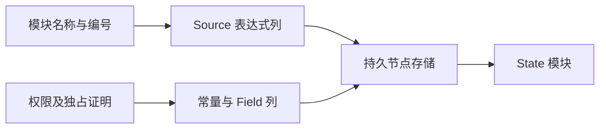

# Store 存储声明生成自举

## Intent：最终目标

将 State 的导入、存储字段、初始化模块及所有权槽位声明完整迁入 RX/ZX，复用
已自举的生命周期资格规则，保持声明顺序、布局和线性生成成本。

## Data：可用证据

state/storage.lower 是剩余的纯 Builder/Object[] 算法；正式 State 与 Gateway
renderStorage 均使用。已有连续记录 Value 视图可借用 Object[]，无需数据复制。

## Edges：边界与限制

- 保持 std/application、Self、initial_N、公共回收标记、arena/retained、对象槽位顺序。
- Independent 才声明 release_disabled/owner；Shared 仍保留 retained。
- 声明构造状态按值保持增长元数据；不能因新 Field 支持扩大既有 Table 的布局。
- Native 仅借用输入和拥有型发布，保留 seed；Region、Request 仍不属于本阶段。
- 不新增测试，复用 Store 内存行为、State 应用及 Gateway 实际生成回归。

## Answer：交付与验收

验收两阶段工具与完整生成文件/memo，复用真实应用行为；比较受影响 Store 路径
和固定累计基线。通过后收口全部变更、英文提交推送并确认工作区干净。

## 执行记录

### 实现与边界

storage/build.rx 显式连接资格、公共导入、初始模块、共享字段、Region 类型、
retained、逐对象槽位及发布。循环与节点构造留在各自 ZX 原子逻辑中，复用
lifecycle/policy、名称构造及现有 Context 原语。常量集中在所属 const.zx。

新增通用 declarations/builder，以同一个按值 State 保存混合声明的 tag/offset
和 Constant、Field payload 列；保留增长元数据，不扩大其他消费者的 Table。
OptionalType 使用独立列附加到发布视图，不扩大 Context 的全局 Forms 布局。
header 溢出后保持 invalid；Constant/Field 不再继续添加 payload。

Native 使用 executeValue 实际参数类型借用连续 Object[]，在当前栈帧构造 bases。
发布前按公开列 schema 投影去除视图元数据，再拥有型导入名称、表达式和声明，
最后释放 scratch。通用 materializeDeclaration 仅对 Function 还原参数范围，
其余声明直接保留 payload。seed 留作初始引导，不在 Source-enabled lower 中执行。

只读审查核对了 ReadOnly、Shared、Independent 的字段条件、声明与节点顺序及
发布寿命。实际生成的 initials/slots 逐列回写 items + storage，Constant/Field
四条 payload 及 header 两条列均保留可复用增长路径，没有发现逐对象整表装箱。
这是静态成本证据，不替代下面的实测。

### 正确性验收

- 20 个新增 Source 文件通过 fmt 和 lint；4 个 Native 文件完成格式检查。
- 两阶段构建均 21/21 步成功，工具 SHA-256 相同：
  49ed1ec5c933cffa67517e8e64b4a5621c03acc8f2d9d4ed00d712714454c93d。
- main / collections / growth / ordered 各 3485 / 65 / 361 / 24 个文件。
  上阶段工具与新工具仅 .zxc-inputs 路径不同，两阶段之间全部逐字节相同。
- test-store-reclamation、test-rx-state-app、test-gateway 共 57/57 步成功，
  构建内 48/48 项检查、4 组外部 Zig 共 22 项、State 应用 8 项及 Gateway
  应用 86 项检查通过；未新增用例。Gateway 空应用同时覆盖零对象声明路径。

### 性能与交付

受影响路径复用实际 Store reclamation 工具的四种模式。对照版仅在隔离 genz
副本将 storage.lower 切回 seed；两侧 lifecycle 与 writable/reclaimable 仍启用
Source 实现，其他源码、生成模块及选项相同。八轮交替，排除首轮后的中位数：

| 指标              |       对照 |     本阶段 |
| ----------------- | ---------: | ---------: |
| 四种模式 CPU 合计 | 0.035124 s | 0.035385 s |
| 四种模式墙钟合计  | 0.027585 s | 0.027778 s |
| 最大子进程 RSS    | 16302080 B | 16302080 B |

CPU 约增加 0.000261 s，墙钟约增加 0.000194 s，远小于当前累计容差；这不是
新增可反复领取的额度。每轮全部 43 个生成文件逐字节相同。CPU 使用高精度子
进程资源差值，包含 time wrapper；墙钟包含启动，RSS 不是整棵进程树。

固定输入仍使用 readability-final/cache-closure/manifest.json，不重置累计基线。
在所有构建结束后串行交替运行固定基线、上阶段及本阶段各八轮，排除首轮：

| 指标     |    固定基线 |      上阶段 |      本阶段 |
| -------- | ----------: | ----------: | ----------: |
| CPU      |      5.34 s |      5.34 s |      5.33 s |
| 墙钟     |      1.17 s |      1.14 s |      1.14 s |
| 最大 RSS | 495616000 B | 490422272 B | 489570304 B |

本阶段 CPU 单阶段与累计均为 −0.01 s，墙钟单阶段不变、累计 −0.03 s。
RSS 上阶段范围 477020160～497532928 B，本阶段 475496448～492486656 B，
范围重叠，不把中位数差解释为确定的内存优化。2268 个文件仅输入清单路径不同。

逐键核对所有 memo 内容：main 12269/3344/2822/0，collections 67/45/27/27，
growth 1154/315/270/0，ordered 27/14/14/14，冻结输入 8248/2419/1945/0，
前后全部一致。没有用计数相同代替记录内容相同。

证据位于 .zig-cache/cold-build-analysis/ownership-research/store-storage：
bootstrap.log、production.log、regressions.log、fixedpoint.json、
production-fixedpoint.json、driver-scope.json、affected-comparison.json、
final-runtime-comparison.json、memo-results.json 及对应脚本和逐轮输出。

### 自我复核与剩余职责

本阶段完成存储声明职责的 RX/ZX 实现及其实际消费路径，保留既有语义和成本。
Request、Region 构造、State 顶层调度及通用 AST 存储/发布仍含 Native 过渡实现，
不能据此宣称 Store 全部职责或完整自举完成。两阶段产物一致不替代最终传递
依赖审计与 stage 1→2→3 验收。本阶段未重新测量完整冷构建峰值。

同时收口上一轮宽结果 JSON 实验的研究记录；该隔离原型没有进入正式工具链，
其局部 RSS 收益不计入本阶段生产收益。提交前收口所有未提交文件，不遗留局部改动。
