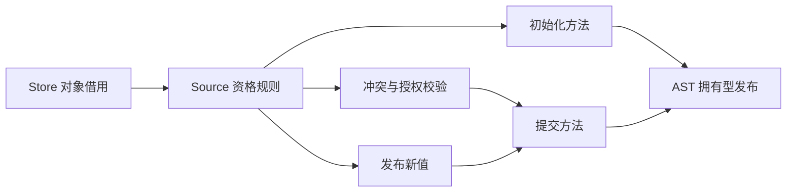
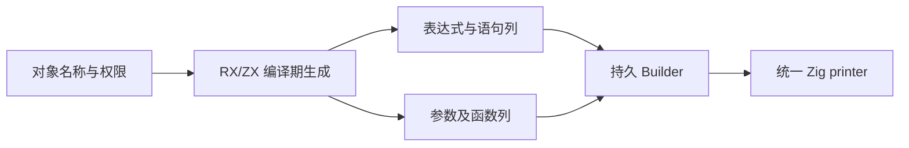

# Store 生命周期生成自举

## Intent：最终目标

将 Store 的 initialize、validate、apply、commit 四方法及可写/可回收资格规则
整体迁入 RX/ZX，由 Source 构造真实 AST，Native 仅借用输入、发布并打印。

## Data：可用证据

正式路径由 compiler/backends/zig/state 调用 genz/state.renderConfigured，Gateway
也复用 renderStorage。现有 lifecycle 是纯 Builder/Object[] 生成算法，没有递归
Lower.expr、缓存事务或类型服务交错；现有结构化 AST 足够表达。

## Edges：边界与限制

- 保持初始化顺序和对象编号；先拒绝多个更新，再拒绝只读对象写入。
- 无变更 commit 直接返回；共享直接写入在 apply 前关闭旧区域回收。
- 借用 canonical 对象行，不复制对象数据或转存 SoA；必要 ABI 指针表仅保存地址。
- Source 输出拥有型发布，临时名称和 AST 不得逃逸 scratch；不新增应用运行库。
- State 字段、Request/Region 及一般共享值回收仍是待迁移或未完成职责。
- 不新增用例，复用真实 Store 回收、别名存活与 RX I/O 回归。

## Answer：交付与验收

完成后核对两阶段自编译产物及 memo、已有 Store 行为和实际受影响路径成本，并
检查固定累计基线。集中验收后收口全部变更、英文提交推送，确认工作区干净。

## 执行记录

### 实现与接口核对

Source RX 明确组织资格分类、初始化方法、计数、多对象拒绝、只读拒写、校验结果、
apply、commit 和函数发布。ZX 生成四个方法的真实表达式、语句、参数与函数列；
Native 不再根据 Source 计划重建语句。旧实现移至 lifecycle_seed.zig，仅保留
seed/对照用途。storage.writable/reclaimable 也使用同一 Source Policy 规则。

实际生成类型说明，公开 Input.objects 是对象指针列表，executeValue 的参数
视图已有连续记录切片。本阶段直接使用后者，Native Object 对齐 canonical 的
independent/module_name/writable 顺序，默认值和字段契约不变；兼容检查核对
尺寸、对齐、字段偏移与成员类型，没有复制对象或构建指针数组。Policy 的 Value
实现不分配，继续使用零容量 FixedBufferAllocator。

Native 使用同步调用帧的 bases；Source 输出通过拥有型 importer 发布表达式、
语句、字段及函数，再 materializeFunction。Value 视图的 zx_origin 元数据只在
描述符投影时排除，不放宽 AST 未知列检查，临时文本不借出 scratch。

### 从实际生成体修正增长成本

中间候选复用 boxed Body/Statements helper，实际生成出现确定的前缀复制：
每个对象两次 assignment 都重建 plain 头，branch 连接旧 global 语句头也走
reserve(false)。这会使生成阶段的增长近似平方，并非应用 Store 数据复制。
没有撤回生命周期迁移，而是先修复构造表示。

新增通用 ast/statements/builder：单一按值状态持有 global/root 头、payload 列、
变量列、基址和有效性；open/branch 保留父作用域增长元数据，close 后只记录
方法 first/count。Store 不再同时保存四份 boxed Body。原 ast/body 修改已还原，
没有为该迁移扩大其公共接口。

新生成体核对确认：assignment 的 541399ac… 两列、header 的 a1a55758… 两列、
branch 的 825410e4… global 头及 payload 更新均使用增长前沿；initialize、
count、permissions 循环逐列回写 items/storage，实际 part_2 与 original 相同。
这证明已定位的复制路径消除，不代表所有编译内存或全部 Source helper 均已优化。

### 构建与真实 Store 行为

- 36 个 RX/ZX 文件格式与 lint 通过；常量收口的两文件另行复核。
- 最终两阶段均 21/21 步成功，工具 SHA-256 相同：
  95ebc2bcfc638ea1c4f6905ff59975adc8b30a163c44435cd2f2573d3a5e4e4a。
- main/collections/growth/ordered 为 3466/65/361/24 文件；旧工具与 bootstrap
  仅 .zxc-inputs 不同，bootstrap 与 production 全部一致。
- 四组 memo 逐键逐内容一致，记录数为 12189/3327/2805/0、67/45/27/27、
  1154/315/270/0、27/14/14/14；冻结输入的 8248/2419/1945/0 也全部一致。
- test-store-reclamation、test-store-alias-lifetime、test-rx-store-io 通过
  40/40 构建步骤；12 组外部 Zig 套件合计 77 项通过。测试实际实例化并运行
  State 生成，不用 bootstrap 未引用的接口替代此处 ABI 证据。

最后将最多一个变更的字面量提取为 maximum_store_changes。它是闭合标量常量，
保留原值及求值；复用此前真实 Store 行为和局部对照驱动，不为命名调整重新
计时。两阶段最终构建和完整生成核对使用当前源码，工具 SHA-256 亦未改变。

### 实际受影响路径对照

复用 compile-store-reclamation 的 memory、memory_borrowed、memory_pure_readonly、
memory_failure 四个已有模式。驱动生成对应的独占、共享、只读和失败 Store
程序，前述行为回归另行执行这些程序。Native 副本只切换 lifecycle 与两项资格规则回旧实现，保留相同
Source 配置、工具链和其余迁移；generated/generated_analysis/partition_groups
均为 true。没有新增用例，也没有为制造覆盖改变正式表示策略。

构建结束后交替八轮、排除首轮，各轮 43 个生成文件均逐字节一致：

| 指标                  | 原 Native 生命周期 | Source 生命周期 |
| --------------------- | -----------------: | --------------: |
| CPU 中位数            |         0.035337 s |      0.035305 s |
| 墙钟中位数            |         0.027315 s |      0.027626 s |
| 最大子进程 RSS 中位数 |         16039936 B |      16121856 B |

CPU 包含 time wrapper，墙钟包含启动；RSS 是最大子进程，不是整树。差值很小，
不解读为稳定加速、稳定内存收益或冷编译峰值改善。

### 固定累计基线与自我复核

使用相同冻结 manifest、141 入口/2220 模块、ReleaseSmall、关闭 resident，三版
工具交替八轮，排除首轮。固定基线保持 inbound-conversion，SHA-256 为
8f1e7cee1eadb3ea0f6f7150bab951c55672ce294e4fbe7c50d5858723bdd92d；
没有随提交重置。局部与累计计时串行执行，构建进程均已结束。

| 指标                | 固定累计基线 |    上一阶段 |      本阶段 |
| ------------------- | -----------: | ----------: | ----------: |
| CPU 中位数          |       5.34 s |      5.31 s |      5.32 s |
| 墙钟中位数          |       1.15 s |      1.13 s |      1.12 s |
| 最大进程 RSS 中位数 |  495894528 B | 485326848 B | 484966400 B |

单阶段 CPU +0.01 s、墙钟 −0.01 s；相对固定基线 CPU −0.02 s、墙钟 −0.03 s，
未观察到累计退化。RSS 区间 476561408～497778688 B 与
480051200～494288896 B 重叠，不能解释为稳定收益。2268 个冻结输出仅
.zxc-inputs 不同；上述数据不是当前完整冷构建的 LLVM 峰值。

证据位于忽略目录 .zig-cache/cold-build-analysis/ownership-research/store-lifecycle：
bootstrap.log、production.log、regressions.log；fixedpoint.json、
production-fixedpoint.json、memo-results.json；driver-scope.json、原始及对照
响应文件、affected-cases.json、affected-comparison.json；
final-runtime-comparison.json 保存固定工具身份与每轮样本。

本阶段迁移了真实生命周期生成和资格规则，并修复生成器自身的元数据丢失，
没有撤销迁移或靠专用运行库规避成本。完整 State 模块仍有字段、Request、Region
等 Native 职责，一般共享值的有界回收也未因此完成；全编译器自举目标继续。
