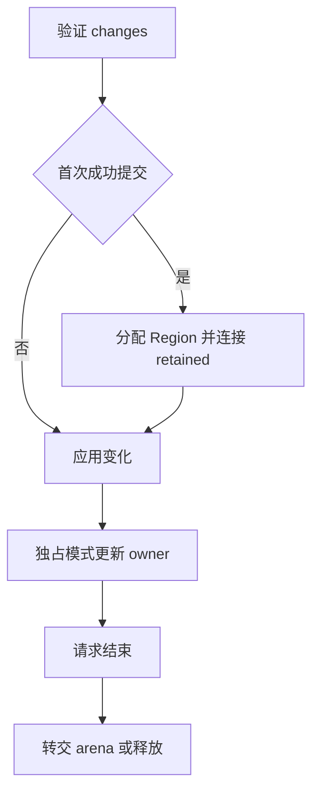

# Store 请求生成自举

## Intent：最终目标

将 Request 的字段、创建、execute、请求释放和提交生成整体迁入 RX/ZX，保留
独立请求 arena、惰性 Region 登记、验证失败顺序及 owner 更新语义。

## Data：可用证据

request.zig 与 request_commit.zig 是剩余纯 Builder 算法。现有字段、声明、
Container、错误联合及语句构造可复用；补齐两臂分支和 Context 错误传播即可。
先前存储、生命周期与区域释放已经使用 Source 路径，并有可复用的固定基线。

## Edges：边界与限制

- 初始化顺序为 parent、arena、原对象顺序的 store 槽位。
- initial 与 Request 字段各自连续，不能交错追加后冒充连续范围。
- execute 参数为 self/input/io?/process?，调用参数为 arena/input/self/io?/process?。
- execute 直接返回 application.execute，原实现不加 try；关闭时不生成该方法。
- deinit 命中 retained 时转交 arena，否则释放；两臂结束都使 self 无效。
- writable 提交先验证，首次提交才创建并登记 Region，然后 apply，最后更新 owners。
- ReadOnly 委托 parent.commit；Shared 不更新 owners；保留全部短路与失败顺序。
- Container 只引用连续的内部方法；公开 roots 只有 factory 与 Request 常量。
- 不新增测试，不引入运行库、专用编译器语义桥、动态调度或底层 Store 值复制。

## Answer：交付与验收

贯通后集中验收两阶段工具、完整产物与 memo，执行既有 Store/State/Gateway
和能力参数行为检查，测受影响路径与固定累计基线。通过后收口全部变更提交推送。

## 执行记录

### 实现与边界

request/build.rx 依次连接资格、共享字段、retained、对象槽位、factory、可选
execute、deinitialize、commit、Container 与发布。execute 的 io/process 分支
由独立 RX 子流程表达；提交在 RX 区分 ReadOnly 与 writable，ZX 构造具体节点。

initial 与成员字段各自生成，再分别追加到全局 Fields，保持两段连续；方法参数
及 Region 初始化对象也按追加前长度记录绝对范围。公开 roots 仅保存 factory
与 Request 常量，Container 只引用 methods_first 到常量追加前的连续声明范围。
Native 根据 Source 提供的 roots 发布顶层声明，没有把内部方法提升到外层。

新增通用 Context.checked、Fields.concat 与 StatementsBuilder.else_branch。
复用错误联合、Container、函数签名、字段、nullable 类型和既有生命周期谓词。
未扩大共享 Builder 状态；first/len、可选 capture 与两个分支均以结构化 AST 表示。

核对保留：execute 不增加 try；提交先验证，再惰性创建 Region、初始化并连接
parent/self retained，随后 apply，独占时才按原对象顺序更新非空 changes 的 owner。
deinit 的两个分支分别转交或释放 arena，之后统一 self.* = undefined。

只读生成体检查确认 factory 的两套 Fields 和 commit owners 的 Statements 使用
raw slice 描述符及静态 header 许可，实际追加均走 reserve(true)，没有逐对象
装箱、plain 重建或旧前缀 dupe；Context 逐列保留 items + storage。描述符按值
传输仍存在，不能把它等同于底层数据复制，也不能用静态检查替代动态性能验收。

Native 同步借用 Object[]，在 scratch 释放前拥有型导入全部名称、参数与 AST 列。
request_seed 与旧 request_commit 仅用于 Source-disabled 引导。区域释放仍复用
已自举的 regions 路径，未重新改写或撤回既有迁移。

### 正确性验收

- 34 个 Source 文件 fmt/lint 通过，3 个 Native 文件完成格式检查。
- 两阶段构建各 21/21 步成功，工具 SHA-256 一致：
  3e9f3e88a1df64b64a1ebe1d68c8f6fa8e8c43fe3fe9bfc7f36d46c20c600beb。
- main / collections / growth / ordered 各 3543 / 65 / 361 / 24 个文件。
  两阶段全部逐字节相同；上阶段工具对照仅 .zxc-inputs 路径不同。
- test-store-reclamation、test-rx-state-app、test-gateway、test-rx-store-io、
  test-process-entry 全部通过，71/71 步成功，构建内 48/48 项；State 应用 8 项，
  Gateway 应用 86 项，Process 应用入口 46 项检查通过；11 组外部 Zig 共 61 项。
  不把构建摘要误当作所有子工具测试总数。未新增用例。

### 性能与交付

复用实际 compile-store-reclamation 四种模式与 compile-rx-store-io 三种模式。
对照工具仅在隔离 genz 副本将 request.lower 切回 seed，存储、生命周期及区域
释放两侧仍启用 Source；其余源码与选项相同。所有构建结束后串行八轮交替，
排除首轮后的中位数：

| 指标              |       对照 |     本阶段 |
| ----------------- | ---------: | ---------: |
| 七种模式 CPU 合计 | 0.057948 s | 0.058042 s |
| 七种模式墙钟合计  | 0.049061 s | 0.049404 s |
| 最大子进程 RSS    | 27459584 B | 27607040 B |

CPU 增加约 0.000094 s，墙钟增加约 0.000343 s，RSS 增加 147456 B（144 KiB）。
记录生成器侧的实际代价，不推断应用内存变化。CPU 为高精度子进程资源差值，
包含 time wrapper；墙钟包含启动，RSS 非整树峰值。每轮全部 72 个文件一致。

固定输入仍为 readability-final/cache-closure/manifest.json，累计基线工具不变。
固定基线、上阶段与本阶段各八轮交替，排除首轮后的中位数如下：

| 指标     |    固定基线 |      上阶段 |      本阶段 |
| -------- | ----------: | ----------: | ----------: |
| CPU      |      5.34 s |      5.34 s |      5.34 s |
| 墙钟     |      1.17 s |      1.14 s |      1.13 s |
| 最大 RSS | 494649344 B | 492601344 B | 494764032 B |

CPU 单阶段与累计均不变；墙钟单阶段 −0.01 s、累计 −0.04 s。RSS 上阶段范围
479887360～497647616 B，本阶段 475054080～496746496 B，范围重叠，不把
中位数变化判断为确定收益或退化；保持增长趋势监控，不重置累计容差。
固定输入 2268 个文件仅输入清单路径不同。

memo 逐键逐内容全部一致：main 12681/3398/2876/0，collections 67/45/27/27，
growth 1154/315/270/0，ordered 27/14/14/14，冻结输入 8248/2419/1945/0。
没有以数量一致代替记录内容核对。

证据位于 .zig-cache/cold-build-analysis/ownership-research/store-request：
bootstrap.log、production.log、regressions.log、fixedpoint.json、
production-fixedpoint.json、driver-scope.json、affected-comparison.json、
final-runtime-comparison.json、memo-results.json 以及逐轮输出、响应文件和脚本。

### 自我复核与剩余工作

本阶段完成 Request 声明、创建、执行、释放和提交的完整 RX/ZX 生成职责。
两阶段及行为一致不能证明完整自举：State 顶层组合、通用 AST 存储/发布及其他
编译器 Native 语义和状态仍须继续迁移，并完成最终传递依赖审计及 stage 1→2→3。

没有新增运行库、动态分派或底层 Store 数据复制。局部生成器 RSS 有上述增量，
固定累计路径未发现时间退化；没有测量最新完整冷构建峰值，也不将本阶段结果
冒充内存研究原型的正式落地。提交前统一收口全部变更，避免遗留未提交文件。
