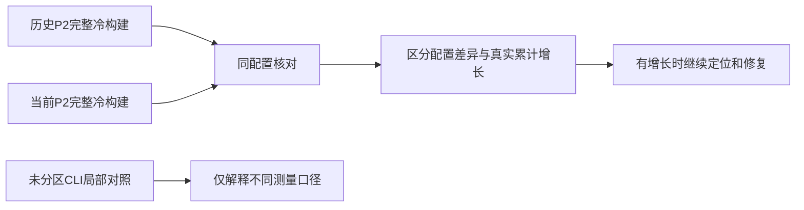

# 冷构建峰值口径核对

## Intent：最终目标

回答用户发现的“昨天约2 GB、当前超过4 GB”是否为真实累计退化。先统一入口、
分区、stage0、工具链和缓存边界，再报告最新完整冷构建峰值。若同配置存在增长，
明确量化并定位，不以最后一个阶段的小幅改善替代累计验收。

## Data：可用证据

- 历史partition-reference/cold-after：根目录zig build，ReleaseSmall、默认P2、
  空stage0、12核、固定Zig archive、全新local/global缓存。51/51步通过，
  time最大单进程2075033600 B，采样树峰2247294976 B，CPU216.03 s、墙钟129.74 s。
- 上阶段4.084 GB来自独立、未分区的CLI build-exe，根为cli/src/main.zig；响应
  文件没有zxc_partition对象和zxc_bridge模块。它的对照同样未分区，能验收该阶段
  局部变化，不能替代上述完整P2冷构建的累计验收。
- 当前根目录Safe/Small默认仍为P2，cli子包及compiler子包默认为P0。此前报告
  未充分强调测量口径变化，导致用户合理地理解为峰值翻倍；需要补齐当前P2数据，
  不能仅解释口径便认定不存在退化。

## Edges：边界与限制

- 暂停新的Gateway路由分派实现；当前生产HEAD为188f8af6，工作区没有源码修改。
- 复用原measure_cold.py，只使用新的输出目录；命令、采样间隔0.2 s、12核和
  archive不变，local/global缓存均从不存在开始，不清OS缓存或共享缓存。
- /usr/bin/time峰值与采样进程树峰值分别报告，不把RSS合计当作PSS，不把
  历史单样本描述为多轮统计。默认分区从实际命令及构建对象确认。
- 这次测量用于发现累计退化，输入源码随自举增长；历史工具链、模式、入口和
  配置可比，源码差异正是待核对的累计范围，不通过冻结旧输入掩盖它。

## Answer：交付与成功标准

成功要求给出同配置当前结果、峰值阶段和相对历史的累计变化，不以“口径不同”
代替当前实测。若发现实际退化，保留迁移并修复；测量日志和JSON只保存在忽略目录。

## 同配置当前实测

HEAD188f8af6按历史完全相同命令执行，51/51步通过；默认P2实际生成两个对象。

| 指标              | 历史cold-after | 当前same-config-current |     累计差值 |
| ----------------- | -------------: | ----------------------: | -----------: |
| 墙钟              |       129.74 s |                132.72 s |      +2.98 s |
| CPU               |       216.03 s |                214.55 s |      -1.48 s |
| time最大单进程RSS |   2075033600 B |            2179792896 B | +104759296 B |
| 0.2秒采样树峰     |   2247294976 B |            2486059008 B | +238764032 B |

结论：4 GB与2 GB的直接比较是口径错配，但同配置仍有真实累计内存增长，
不能以口径解释或上一阶段的局部下降宣称无退化。单样本尚不构成增长趋势统计，
但它已足以触发归因和修复，而不是忽略。

树峰分别在55.83/56.22 s；host此时尚未启动，峰值主要是generate-parser、
generate-lexer及translate-c重叠。三项当时占用分别
723.5/657.8/849.1 MB与730.8/909.5/828.4 MB。lexer全程自身采样峰仅从
876.2→909.5 MB，说明树峰增加主要包含峰值时序更集中，并非某个进程单独多占
239 MB。最终host启动时间分别约98.27/99.24 s，time峰增长约105 MB属于另一个问题。

只读复核确认两组bridge SHA、host优化/静态库/compiler_rt/ubsan、P2对象配置一致。
host导入模块322→422，新增100个生成入口需要核对实际定义闭包，不以声明数量
当作运行时代码生成量。正导出当前P2 host IR，对照历史P2 host IR；未分区CLI
的约197 MB IR不参与此处比较。日志、原始响应、采样与comparison.json保存在
partition-reference/cold-same-config-current，诊断IR在current-host-ir。

## 当前P2 host形态与最小候选

同配置P2 host IR历史90238799 B、19782定义，当前95091304 B、16382定义；
数量更少但IR增加约4.85 MB。按结构身份归一化后，import_rows.appendRows
31→82实例、函数体净增4044619 B，check 26→77实例、净增2797729 B。
新增来源视图带来重复代码生成，不能将其误归为前端arena未释放。

先只改一个实际热点：把已经完成校验/容量准备的行头提交循环，提取为按目标
Rows类型及offset类型共享的commitHeaders。来源tag已由原check验证布局与映射，
沿用只读零拷贝表示转换；不将整份SourceView带进循环泛型。仍按原顺序在payload
准备完成后提交行头，随后提交各payload列；base查询、offset转换、追加次序、
OOM清理及拥有型复制不变，无新分配。先比较P2完整IR与调用方合计，再决定
是否进入普通host及完整冷构建成本验收。重复生成器构建和树峰时序作为独立
后续职责，不同时修改以混淆本候选的因果范围。

## 行头共享与重复seed工具的验收边界

行头共享P2完整IR95091304→93974886 B；调用方appendRows10530042→9386297 B，
共享commitHeaders仅3个实例、27165 B，包含其成本后仍净减约1.12 MB。
发布路径现有62/62步、71/71项检查通过。普通隔离host三对：CPU中位35.37→34.73 s、
墙钟33.50→32.81 s；RSS2454650880→2436169728 B，但逐对方向不一致、范围重叠，
不声明稳定内存收益，不把隔离host峰与完整冷构建峰直接相减。

树峰的另一个已定位重复职责：空stage0时，lexer.generate与parser.generate各自
编译一份含完整seed compiler的工具；generate_parser.main原本已支持--lexer，
非空stage0也一直复用这条路径。提取既有parser工具构造为bootstrap_tool.create，
由compiler/build.zig创建一次，lexer/parser生成步骤消费同一executable；空stage0
lexer改为该既有--lexer命令。实际生成仍由各自RX/ZX输入及原分析/emit完成，不用
旧产物替代自举，不串行化全部构建，不降并发，不调整P2或引入新常驻进程。

同一工具保留既有parser工具的优化/运行检查配置。需核对生成lexer及全部main/
ordered/collections/growth产物与改动前字节一致，实际构建日志只有一次seed工具
编译，并以相同P2完整冷构建记录时间、CPU、单体及树峰，再判断累计差距。

## 首次完整修复结果

相同空缓存、空stage0、P2、12核的完整构建43/43步通过（原51步；删除的是重复
工具构造依赖，默认安装/RX编译检查仍保留）。日志只编译一次generate-parser，
不再编译generate-lexer。相对同配置修复前，CPU214.55→196.46 s、墙钟
132.72→130.15 s，time单进程峰2179792896→2154790912 B，采样树峰
2486059008→2174795776 B。当前树峰回到最终host阶段，新增模块的单体增长仍在。

相对历史固定完整基线：CPU216.03→196.46 s（-19.57 s），墙钟129.74→130.15 s
（+0.41 s），单体2075033600→2154790912 B（+79757312 B），树峰
2247294976→2174795776 B（-72499200 B）。这是各一次全冷数据，不能将墙钟差
解释为统计显著退化或已严格通过0.1 s容差；也不能因为整体树峰恢复就抹掉仍有
约80 MB的单体增长。完整高峰问题继续保留，未宣布恢复所有历史指标。

前后生成lexer完全相同；main/ordered/collections/growth分别7135/24/65/361
文件，所有代码字节相同、各仅.zxc-inputs不同。pinned-stage0引导21/21步通过，
确认共享空seed工具没有绕过固定stage0。前端八轮隔离交替、排除首轮：固定累计
基线/本次前/本次后CPU5.34/5.18/5.18 s、墙钟1.16/1.11/1.11 s；2268输出仅
工具指纹不同，RSS差异不据此声明收益。

配置边界复核：parser工具配置按原样提取；独立lexer不再有单独的优化配置。
Debug由旧Debug工具统一到既有parser的Small root/Fast imports；Safe统一到
Small root、imports仍Safe，并继承既有parser的compiler_rt及strip设置。生成
语言产物的检查语义不因工具模式改变；正在补验现有bootstrap-lexer的Debug/
Safe路径及字节输出。小范围修复不等于完整累计退化审计已经结束。

## 模式与增量补验

现有bootstrap-lexer在Debug与ReleaseSafe均14/14步通过，两种输出与Small输出
逐字节一致。额外验证共享Run的真实失效：修改既有lexer/const.zx中错误消息的
一个合法字符串值，生成步骤重跑且lexer输出改变；恢复原字节后输出回到原SHA。
修改前无变化路径及恢复路径均成功，原文件无残留diff；未新增测试源码。
首次comment-only探针因既有spacing规则被拒绝，已在finally恢复；该失败不作为
成功证据，随后改用合法现有常量值完成上述检查，原始失败日志仍在忽略目录。

该变更不降低应用生成代码的检查级别；seed工具内部模式统一到既有parser策略，
没有通过改变P2、并发或stage0边界改善指标。更新后的固定stage0引导已通过，
正在确认下一代引导SHA稳定。完整内存问题仍保留：当前普通完整构建树峰低于
历史，单进程约80 MB差额及历史墙钟+0.41 s的单样本差异尚需继续归因。

## 本阶段交付与未解决项

下一代引导21/21步通过，两代工具SHA一致：
8f22acf33e3c33b7273ab89fd92b358ed8aaa91c5fba8e60e8a8a3e5e006a14c。
本阶段保留的实际修复是共享seed工具和AST行头提交；既有RX/ZX自举迁移未撤回。
按所有未提交文件统一验收并提交推送，包含用户原话日志与本IDEA记录。

自我复核：前面4 GB报告缺少与完整P2指标的明确区分，已用同配置数据纠正；
不能据“不是翻倍”否认真实增长，也不能把本次树峰降低等同于host单体恢复。
本次完整冷构建相对修复前CPU、墙钟、单体和树峰均改善，但相对历史仍有单体
约80 MB差额，历史单样本墙钟差也未解释完。后续优先继续这部分累计归因，
Gateway路由分派尚未开始实现；完整自举与累计成本目标仍保持活动，未宣称完成。
