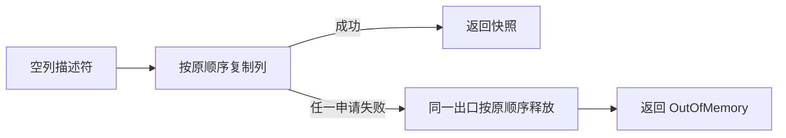

# 冷编译失败清理工作集验证

## Intent：最终目标

在不改变所有权规则、正常执行路径、分配顺序或错误语义的前提下，验证函数表
快照的重复失败清理能否从源头收敛。目标同时包含冷编译 CPU、墙钟与峰值内存，
不把更小的 IR 直接当作内存收益。本记录遵循 IDEA 框架。

## Data：可用证据

已有[十篇编译器论文对照](../2026-11-08/冷编译内存归因与错误清理优化.md)
与[宽结果研究](宽结果错误传播与冷编译内存验证.md)继续有效，不重做已否决实验。
本轮重新检索并核对以下一手资料：

| 资料                                                                                                                                            | 支持的论点                                                             | 在 zxc 中的边界                                                     |
| ----------------------------------------------------------------------------------------------------------------------------------------------- | ---------------------------------------------------------------------- | ------------------------------------------------------------------- |
| [ThinLTO，CGO 2017](https://storage.googleapis.com/gweb-research2023-media/pubtools/4743.pdf)，§1、§8                                           | 完整 IR 与分析数据共同驻留会增加内存；摘要及局部处理能约束工作集       | 不能据此认定当前 Zig 路径就是 ThinLTO，或增加分区必然降低进程树峰值 |
| [Compile-Time Analysis of Compiler Frameworks for Query Compilation，CGO 2024](https://home.cit.tum.de/~engelke/pubs/2403-cgo.pdf)，§V-C、§VIII | 多次表示构造、遍历和转换存在真实成本；编译时间与生成程序性能需同时衡量 | JIT 查询结果不能直接外推到 ReleaseSmall，也不是峰值归因证据         |
| [TPDE，CGO 2026](https://home.cit.tum.de/~engelke/pubs/2602-cgo1.pdf)，§I、§II                                                                  | 适配已有表示可以避免额外 IR 实体化                                     | 基线后端目标与当前优化构建不同，不为此更换 zxc 后端                 |
| [LLVM New Pass Manager](https://llvm.org/docs/NewPassManager.html)，工程文档                                                                    | 按同一 IR 单元集中执行 pass 有利于局部性；分析缓存必须正确失效         | 不代表当前峰值来自前端缓存，不直接修改上游 LLVM pass                |

论文给出研究方向，zxc 的测量负责确认因果。已有主峰值在 Zig/LLVM 编译进程；
生成器约 490 MB 属于另一条路径，不能将几 GB 直接归因于借用生命周期。

现存 growth-declarations/eligible.ll 中 function_table.root.snapshot 单定义为
3,953 行、251,032 B、555 个 alloca、534 个 memcpy 和 484 个 free 调用站点。
源码有 22 个列字段；每个 dupe 的错误出口展开整表 errdefer，22² 与静态站点数
一致。静态数量不是实际执行次数，也不是最新 HEAD 的完整根构建测量。

可证伪假设：让各列申请失败跳到同一清理出口，能将释放站点从平方展开降为
线性；成功路径保持原 22 列 dupe 与返回，不增加申请、复制或动态调度。

## Edges：边界与限制

- 先在忽略目录复制当前 core 输入，仅修改 snapshot；正式源码保持不动。

- 保持字段遍历及复制顺序、空切片初始化、浅复制、失败释放顺序与 OutOfMemory。

- 不使用专用运行库、资源框架、类型擦除或按用户输入特判；不新增用例。

- 比较 snapshot 整个函数家族及完整 IR；没有形态改善就停止普通计时。

- 使用既存真实 CLI 响应参数与当前源码，两侧仅 core 快照差异；新建各自编译缓存，
  OS 缓存保留。诊断 IR 导出与普通编译分别统计。

- 记录 CPU、墙钟、最大单进程 RSS 及波动；不重置固定累计基线，不将局部数据
  加到历史完整冷构建。存在取舍时按现有累计容差判断，不能反复领取容差。

## Answer：交付格式与成功标准

成功要求语义、所有权及错误清理保持一致，实际受影响路径同时满足内存与性能
要求。只有正向候选才进入生产行为回归及正式工具验证；否则保留隔离记录并停止
重复实验。最终自我复核必须区分形态证据、局部计量与尚未解决的整体峰值。

### 当前源码的隔离形态结果

两侧均编译成功，core 副本逐文件核对仅 function_table/root.zig 不同，无额外文件。
原型将逐列 dupe 包在带标签的普通块内，catch 跳出后按原顺序释放；成功直接
返回。不新增 helper 或强制内联策略。只读审查未发现语义阻断：失败 RHS 不会
写入目标列，尚未申请的列保持空切片，错误集仍为 OutOfMemory。

本次新导出的 IR 与历史 eligible.ll 不同，以下仅在同次两侧间比较。记录的是
当前命令导出的 IR，不将其称为历史未优化 IR，也不把静态 memcpy 当作底层复制。

| 指标               |        原版 | 共享失败出口 |
| ------------------ | ----------: | -----------: |
| 快照函数家族定义数 |           1 |            1 |
| 快照 IR 行数       |       1,298 |          566 |
| 快照 IR 字节       |     124,993 |       73,456 |
| 基本块             |          44 |           33 |
| alloca             |         276 |           24 |
| free 调用站点      |         231 |           21 |
| memcpy 调用站点    |         263 |           12 |
| 完整模块 IR 字节   | 162,644,842 |  162,593,305 |

当前原版已消除空列 free，释放站点为 1+…+21=231；候选汇合后为 21，不能把
历史 484 当成当前基线。完整模块只减少 51,537 B，约 0.032%。这证明局部形态
假设成立，但规模很小，不能预计解决数 GB 主峰值。

导出 IR 时使用 -fno-emit-bin，省略了机器码/链接工作；两侧诊断 CPU 为
57.19/57.66 s，墙钟 55.47/55.99 s，RSS 2,278,817,792/2,295,201,792 B。
每侧只有一次且含 IR 导出，不作性能结论。后续普通编译恢复输出二进制，单独
记录三对交替顺序结果，不将这组诊断值混入普通编译中位数。

### 普通冷 CLI 编译：三对结果

六次普通编译全部成功。顺序为原版→候选、候选→原版、原版→候选，均实际
生成二进制，未导出 IR 或附加采样。每侧每轮使用新的 local/global 缓存，保留
OS 缓存；输入与工具链相同。本次仅是既存 CLI 响应范围，不是完整根冷构建。

| 指标           |      原版中位数 |      候选中位数 |                     差值 |
| -------------- | --------------: | --------------: | -----------------------: |
| CPU            |         87.79 s |         87.68 s |                  −0.11 s |
| 墙钟           |         86.03 s |         85.91 s |                  −0.12 s |
| 最大单进程 RSS | 4,294,721,536 B | 4,276,731,904 B | −17,989,632 B，约 −0.42% |

| 配对 |  CPU 差 |  墙钟差 |        RSS 差 |
| ---- | ------: | ------: | ------------: |
| 1    | +0.75 s | +0.68 s | −18,874,368 B |
| 2    | −0.11 s | −0.12 s |    −540,672 B |
| 3    | −0.21 s | −0.13 s | −24,772,608 B |

原版 RSS 范围为 4,289,085,440～4,301,504,512 B，候选为
4,275,847,168～4,288,544,768 B。三对均降低 RSS，但第二对差值很小。时间
方向不一致，第一对明显变慢；中位数改善不能据此声称有稳定时间收益，也没有
足够样本作显著性结论。采用与否还取决于正式工具执行成本及既有失败回归。

此候选只改变一个 Native 数据基础设施职责，仍待后续 RX/ZX 自举。当前决定是
进入生产验收，不是已宣称整体问题解决。保留三对全部数据，不以更小的局部 IR
解释所有 RSS 差值，不将局部改善叠加到历史完整构建数字。

### 正式验收与决定

正式文件与配对测量副本 SHA-256 一致，未叠加其他改动。保留最小共享失败出口
实现；不加入资源框架，不将这一模式批量套用到其他职责。

- 两阶段 bootstrap-stage 均 21/21 步成功，P16、ReleaseSmall、12 核。
  第一阶段由上阶段 Source 自编译工具生成，第二阶段由本阶段第一阶段生成；
  两个本阶段工具 SHA-256 相同，均为
  0f2a678e960d6be391e8627a69b4fc5daa24f844760fc24044527725dc9173d3。
  实际运行继续启用 Source 分析与生成，不将 seed 工具的执行成本混入对照。

- 既有 test-semantic-cache 与 test-module-generation：33/33 步、30/30 项通过。
  覆盖缓存恢复、实际生成与逐分配失败清理；没有新增用例，也没有全仓回归。
  没有专门针对 snapshot 每个列槽的独立用例，列顺序与初始化语义另经静态审查。

- 固定冻结输入八轮交替对照，排除首轮：固定累计基线/上阶段/本阶段 CPU 为
  5.35/5.29/5.26 s，墙钟 1.17/1.13/1.13 s。单阶段 CPU −0.03 s、墙钟不变，
  累计 CPU −0.09 s、墙钟 −0.04 s；没有重新领取容差或改变基线。

- 生成器 RSS 中位数为 494,026,752/484,343,808/495,452,160 B。
  上阶段范围 473,366,528～498,270,208 B，本阶段
  473,153,536～500,006,912 B，明显重叠；单阶段中位数上升 11,108,352 B，
  相对固定基线上升 1,425,408 B，不能隐去，也不能据此声称稳定升降。

- 冻结输入 2268 个产物逐文件相同，仅 .zxc-inputs 的工具摘要缓存指纹不同。
  memo 的 8248/2419/1945/0 条事实逐键逐内容相同，无原始顺序差异。

采用依据是：局部表示确实减少，三对普通冷 CLI RSS 均下降，时间中位数未增加，
正式生成器实际执行成本及固定累计基线合格，行为与失败清理证据相符。样本只有
三对，第一对时间增长仍保留，不声称冷编译耗时有稳定改善。约 18 MB 的局部
峰值收益很小，不能夸大成所有权或数 GB 问题已解决。

### 自我复核与交接

本轮完成“论文论点→实际热点→隔离原型→形态与配对计量→行为验收”的闭环。
论文没有证明这个具体变换的收益，收益来自 zxc 同输入测量；静态 free/memcpy
站点减少不等于运行时深复制量下降，源程序所有权契约和底层数据表示没有改变。

剩余主要问题仍是完整冷构建的总工作集。当前没有新的完整根构建进程树测量，
不能把单进程 CLI 结果外推为整树 RSS，也不能用本轮两阶段一致替代最终自举
依赖闭包与三阶段标准。后续优先筛选占比较大的表示成本；不为本候选的小幅收益
继续重复相同计时，不因内存优化重新撤回已有 RX/ZX 迁移。

原始证据位于忽略目录
.zig-cache/cold-build-analysis/ownership-research/snapshot-cleanup：
scope.json、inspect.py、ir-summary.json、measure.py、ordinary-metrics.json、
ordinary-summary.json、每轮 args.rsp/build.log、bootstrap.log、production.log、
regressions.log、owned-runtime-comparison.json、owned-memo-results.json、decision.json。
它们保留全部配对和失败边界，不提交构建产物或临时日志。
