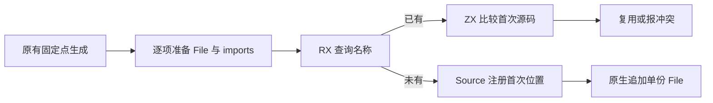
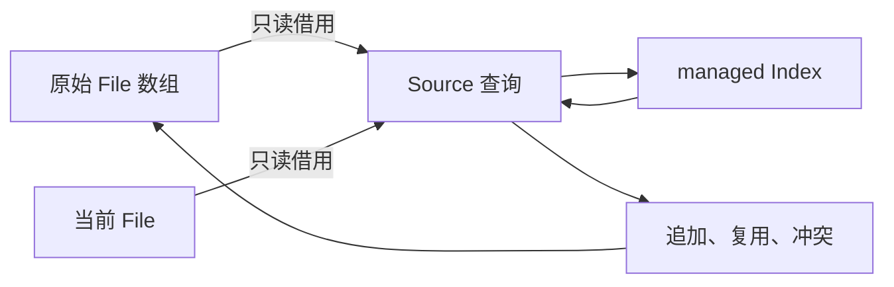

# 函数文件身份注册自举

## Intent：目标

将函数文件名称注册、首次位置保留、相同源码复用和冲突拒绝迁入 RX/ZX。
普通应用和统一库复用同一职责；不改变生成顺序或为适配另造一份文件表。

## Data：证据

起点 04bea428。modules.functionFilesFrom 完成 regular_calls 固定点生成后，
逐项准备 File 及 imports，使用 Native Map 保存名称到首次文件位置。
同名时仅比较 source；相同则跳过，不同返回 ConflictingFunction。

已有 core/bytes/index 与 executeState 支持 Source 注册状态，state.available
已证明当前 File 布局可直接借用。上一完整冷构建 130.74s / 198.15 CPU 秒 /
2139111424 B 单体峰值 / 2145550336 B 采样树峰；固定基线仍为
129.74s / 216.03 CPU 秒 / 2075033600 B / 2247294976 B。

## Edges：边界

Source 仅持有 Index，不持有另一个文件列表。每次输入同步借用当前 files.items
和候选 File；动态扩容后重新借用，不保存其栈头或旧数组指针。
注册索引使用 scratch arena，保留 managed storage 增长元数据，生成完成释放。

imports 必须先准备，再判重；重复文件的 imports 不参与一致性判断，与原实现
保持一致。regular_calls 的并行扫描、生成固定点和缓存不在本阶段改写。
原生适配只负责传递、错误映射及物理 append；seed 保留旧实现。

## Answer：交付与成功标准

核对真实生成 ABI，拒绝隐式整表转换或逐轮前缀复制；运行既有库文件表、
普通应用、Store 与编译库检查，比较同路径全部生成产物及受影响生成成本。
完成后统一提交推送，确认无未提交和未推送内容。索引迁移不代替整个后端自举。

## 生成路径与成本核对

真实 ABI：files 是 flat File[]，整段借用原始切片；candidate 仅转换三个
managed 切片头，未复制内容。私有 callValue 保留 Index 三列增长元数据，
insert/put/grow 无逐次描述符装箱或前缀复制；查询临时 origin 未被保存。

自举生成器以相同当前 manifest、相同输出路径、每个生产者独立函数缓存运行；
每轮删除 .zxc-inputs 以强制实际生成，日志确认 335 个入口。1 次预热后 3 组
交替测量，7996 个文件逐路径哈希一致，仅排除生产者身份标记 .zxc-inputs。
CPU 中位 4.53 → 4.52s、墙钟均 1.22s、RSS 中位
731447296 → 731529216 B，当前未见稳定退化，不宣称微小差额为稳定收益。

旧 Map 使用 core 优化 hash，Source Index 使用 std:bytes.hash 的普通 Wyhash，
且存在重复探测；两者哈希值一致，成本有风险。实际受影响生成路径暂无可辨识
退化，因此不为推测改通用哈希实现，保留此优化线索并继续跟踪累计变化。

## 行为与普通应用证据

正式 CLI 构建 43/43。既有 test-library-bundle 构建 41/41，普通、混合、原生、
Store 的正反序共 8 种组合、36 项检查通过。应用侧 Store 库 2 项、编译库
17 项、完整边界 8 项、Gateway 86 项通过，共 113 项，无过滤。

相同输入路径的 52 个应用生成文件完全一致，新增、删除、修改均为零。
应用 3 组交替、每组 8 次强制构建：CPU 中位均 6.92s，墙钟
6.51 → 6.50s，RSS 中位 188694528 → 188350464 B；微小差额不作收益承诺。

索引的生命周期缩至本轮 scratch。实际释放仍取决于调用者提供的 backing，
不能仅凭子 arena.deinit 宣称系统 RSS 收益。正式生成器使用可释放的 backing；
结果 File[] 和各文本始终留在原有 owned owner 中，不引用临时索引。

## 完整冷构建

独立全新本地/全局缓存、12 核，43/43。time 墙钟 129.97s、累计 CPU
197.90s、单体峰值 2136883200 B；采样树峰值 2150170624 B，采样器墙钟
130.136s、采样单体峰值 2129854464 B，两个峰值口径不混用。

- 相对阶段前：墙钟 −0.77s、CPU −0.25s、单体 −2228224 B、树峰 +4620288 B。
- 相对固定基线：墙钟 +0.23s、CPU −18.13s、单体 +61849600 B、树峰 −97124352 B。

本阶段未见稳定退化；单次下降不作稳定收益承诺，采样树峰的正差额也不删除。
固定基线的墙钟和单体正差额仍在跟踪，不能以局部差额宣称全部性能目标完成。

## 收口与自我复核

两轮工具构建均 21/21，二进制 SHA256 一致：
`cd480fb061faa4ad8dc2918900a042ddd6baca9cd2f6231868954019d7548f3b`。
seed 独立探针显式实例化 emitModules，编译通过，覆盖旧函数文件路径；
5 个 RX/ZX 的格式/lint、4 个 Native 文件格式与 diff 空白检查通过。
证据目录为 `.zig-cache/cold-build-analysis/ownership-research/function-files/`，
完整冷构建位于同级 `partition-reference/cold-function-files/`，均受忽略规则排除。

首版尝试通用 borrow 直接转换 private candidate，因 managed 切片头与原生切片
不兼容被编译器拒绝；改为显式包装三个切片头，没有放宽布局校验或增加内容
复制。files 整段仍由严格 columns.slice 检查。生产者比较的首次启动使用了错误
工作目录，已修正为 manifest 对应的 packages/compiler；失败日志不计入性能。

本阶段完整迁移文件身份注册和去重规则。生成固定点、缓存存储、并发执行、
物理文件发布及其他后端职责仍有原生实现，Native managed 状态传输也仍需
最终收口；不能以局部规则或工具一致性代替完整自举依赖闭包与 stage1/2/3 验收。
