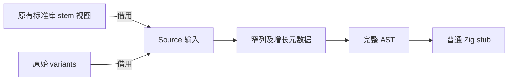

# 分区 Stub 生成自举

## Intent：目标

将分区函数 stub 的导入、变体导出及符号组装迁入 RX/ZX，保持普通与 comptime
两条分支和输出顺序。使用结构化 AST 和统一 printer，不输出源码片段。

## Data：证据

起点 62559498。旧 stub 创建 bridge/signatures 标识符，导入桥与所选签名表，
按 variants 顺序生成 import/importComptime 调用，符号为 stem_variant。
上一阶段已证明宽 Context 在循环中会丢失增长元数据，本阶段先提供窄列原语。

上一完整冷构建 130.64s / 198.72 CPU 秒 / 2142257152 B 单体峰值 /
2157838336 B 树峰。固定基线仍为 129.74s / 216.03 CPU 秒 /
2075033600 B / 2247294976 B，不随提交重置。

## Edges：边界

文件 stem 沿原有 std.fs.path.stem 借用结果传入；不用 Node path.parse.name
近似，避免点文件、父目录与 Windows 根路径的语义差异，也不增加 UTF-8
验证或复制。Source 负责导入选择、调用结构、符号组装和公开声明。

先补通用窄列表达式 builder（identifier/string/builtin/field/call），复用已有
header/named 原语；仅在 publish 时构造完整 Context。公共字段访问节点在变体
遍历前静态复用，生成文本中每个调用保持原结构，不改变程序求值语义。

原生只持有工作区、传递借用切片并导入/打印 AST。seed 保留原实现。
exports 及分区布局仍待迁移，不能据本阶段声明整个后端完成。

## Answer：交付与成功标准

真实自举生成产物逐路径一致；验证 managed storage 在循环中保留、无整表
复制和无源码内容复制。按实际影响测生成路径与完整构建，运行既有回归。
最终统一提交推送所有变更，确认工作区和上游同步。完整自举目标保持不变。

## 实现与首次成本证据

窄 builder 和 variants 循环的各列 items/storage 保留，没有宽 Context 装箱或
逐轮 plain 重置。输入名称/变体只读借用；公共访问 AST 节点复用后打印一致。
空变体会构造两个不打印的访问节点，属于固定小成本，记录而非隐藏。

初版 bytes.join 额外先堆分配两个 slice 的参数数组，再分配真正符号文本。
3 组交替生成中 CPU 4.56 → 4.58s、墙钟 1.23 → 1.24s，RSS
748224512 → 751583232 B，增量接近 CPU 容差，保留诊断证据 generator-join。

已改用既有字符串插值组装符号文本（不生成 Zig 语句/模块）。实际产物为
std.mem.concat，参数分段数组在栈上，只有一次符号字节分配；call_arguments
的两元素 u32 数组是与 seed 同职责的必要持久 payload，没有删除。

最终对相同当前 manifest、相同输出目录、每个生产者独立缓存，排除预热后
3 组交替测量：CPU 4.57 → 4.58s、墙钟 1.24 → 1.25s、RSS
748371968 → 751730688 B。8048 个文件逐路径一致，仅排除 .zxc-inputs
生产者身份标记。微小变化不作稳定收益承诺，仍保留累计差额和分配风险。

## 正式编译与行为验证

正式 CLI 构建 43/43；既有库入口发布 5 项、运行消费 2 项全部通过，无过滤。
完整当前自举生成的 8048 份文件在同一输入下逐路径一致，已同时覆盖普通和
comptime stub 及旧根模块生成。此改动没有调整库布局、Gateway 或 Store 规则，
复用上一阶段其余有效证据，不机械重复无关套件和应用性能计时。

## 完整冷构建

独立全新本地/全局缓存、12 核、43/43：time 墙钟 130.69s、累计 CPU
198.43s、单体峰值 2141421568 B；采样树峰值 2149007360 B，采样器墙钟
130.737s、采样单体峰值 2128707584 B，两个峰值口径分别保留。

- 相对上一阶段：墙钟 +0.05s、CPU −0.29s、单体 −835584 B、树峰 −8830976 B。
- 相对固定基线：墙钟 +0.95s、CPU −17.60s、单体 +66387968 B、树峰 −98287616 B。

完整构建本阶段未见稳定退化；局部生成器的 CPU/RSS 正差额仍保留，不用冷
构建的微小下降抹去。累计墙钟和单体峰值尚未恢复固定基线，整体目标继续。

## 收口与自我复核

两轮自生成工具均 21/21，二进制 SHA256 一致：
`f573b644f2b0520523e388e73f589e3dae88d91faf17bba4952f0bee3673b4f8`。
seed 独立探针以动态文件/变体/模式参数实例化 stub 并编译通过；15 个 RX/ZX
文件格式/lint、3 个 Native 文件格式及 diff 空白检查通过。
证据目录 `.zig-cache/cold-build-analysis/ownership-research/partition-stub/`，
完整冷构建位于同级 `partition-reference/cold-partition-stub/`。

复核避免了两个错误：不能把 Node 风格路径 API 当作 Zig stem 的无条件等价
替代，也不能因参数数组短小就认为同步 join 没有额外分配。保留标准库原有
stem 视图，将自有规则迁入 Source；以实际生成体识别并消除非必要参数数组，
保持必要 AST payload。字符串插值只组装语义符号，未绕过结构化 Zig 输出。

本阶段交付 stub 生成与窄列原语；exports、分区布局和其他原生职责继续迁移。
Native AST 存储/导入仍是过渡边界，工具一致性不代替完整自举闭包和三阶段验收。
