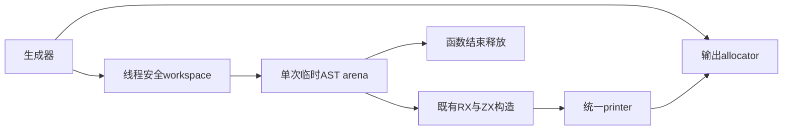

# 分区临时内存生命周期优化

## Intent：最终目标

消除分区RX/ZX生成过程中临时AST被输出arena保留的问题，保留已迁移规则与输出
所有权，不增加复制、降低并发或重置固定基线。先证明分配机制，再实测CPU/RSS。

## Data：可用证据

固定partition-root工具与当前工具在同一343入口的生成期RSS中位
757727232→761528320 B，累计+3801088 B；CPU均4.59秒、墙钟均1.24秒。
最新完整冷构建129.96秒、197.01 CPU秒、2141782016 B单体峰、2157821952 B树峰；
固定完整基线仍129.74秒、216.03 CPU秒、2075033600 B单体峰、2247294976 B树峰。

partition.root/stub/exports 的Source路径各自用输出allocator初始化临时arena，
之后render又向输出allocator分配返回字符串。Zig ArenaAllocator的free仅能回收
最近分配，子arena.deinit不保证释放被后续输出隔开的父arena空间。这是代码层面
可证明的额外存活，但其是否解释全部3.80MB，必须以实际指标判断。

## Edges：边界与限制

现有公开签名保持，默认仍使用调用者allocator；新增Backed入口显式区分输出与
工作区。内部生成调用传resident.gpa，该allocator契约已要求线程安全，用于背景
写入与并发生成；不硬编码page/smp allocator。Roots并发步骤各自创建临时arena，
共享的是线程安全backing，不共享arena状态。

返回文本仍由输出allocator拥有，输入名称与Source借用在render完成前有效；
临时AST与描述符在函数结束时从workspace释放。seed保留既有实现，不因本优化
改变初始引导语义。不要将RSS池缓存或单体峰值下降直接等同于释放字节数。

## Answer：交付与成功标准

成功要求：同输入全部生成文件一致、实测工作区不会由输出arena保留、受影响生成
路径及固定工具累计对照无稳定时间退化，相关既有构建/回归通过后统一提交推送。

## 实现与直接分配证据

内部shared_output和layout将resident.gpa显式传给Backed接口；并发Roots.step
输出仍来自各自worker arena。Backed接口各自建立工作arena，打印完成后释放。
原root/exports/stub签名仅转发到相同allocator，保持外部契约。

独立只读审查确认正式printer最终dupe到输出allocator，Native printer使用
输出allocator的toOwnedSlice，因此返回文本不借用临时AST。名称、路径和variant
仅借用至同步打印结束。seed仍走原实现，本优化不覆盖其临时分配。

忽略目录的容量诊断复用真实3181个生成模块，同一进程分别调用原接口及Backed
接口、比较全部返回文本：575761字节完全一致。返回后输出arena.queryCapacity
从33909540降为863680字节，少保留33045860字节。容量不是RSS，不能直接作为
进程峰值收益。该证据直接验证“临时块与输出分配交错使父arena保留”的机制。
探针先用CLI响应失败（该入口不导出此API所需的全部分区符号），改用实际bootstrap
工具响应后编译并运行通过；失败不作为性能样本，也未改编译或链接规则兜底。

相邻阶段同输入343入口、8110文件全部一致，热缓存预热1轮、交替3对：CPU中位
4.60→4.59秒、墙钟均1.25秒、RSS761380864→757514240 B（−3866624 B）。
不以微小时间变化宣称确定收益，但三对RSS均下降，和容量机制证据一致。
原始输入、响应、日志与脚本在忽略目录 partition-lifetime。

## 固定工具累计与空缓存对照

固定partition-root工具（62559498阶段），与当前工具运行同一343入口输入，
8110文件全部一致。预热1轮、交替3对：CPU中位均4.58秒、墙钟均1.24秒，
RSS757481472→757268480 B（−212992 B）。此前累计+3801088 B未在修复后复现；
三对均略低于固定工具，但微小下降不作为新的收益预算。

相邻阶段独立全空函数缓存3对：CPU7.42→7.36秒、墙钟1.66→1.64秒，
RSS798965760→795508736 B（−3457024 B）。该组也全部输出一致。固定、相邻、
热、冷边界分别保存，不把一次全冷构建CPU下降算成每阶段可重复领取的容差。

本阶段未改语言、AST构造、printer或库发布行为，只调整分区生成调用的工作区。
前阶段库批次41/41、CLI发布入口5/5及发布运行2/2继续复用；新增Backed路径以
实际bootstrap生成、全部文件对照及容量探针为直接证据，不机械重复无关套件。

## 自生成确认

两轮工具构建均21/21，二进制SHA256一致：
`c6ddb21b3b1a3b23a849aad45d770027e4661f9a24e0f86f56eecd8b6cfd0387`。
受影响路径已实际启用Backed调用，未用未命中的CLI路径代替。新接口只改变工作
区的来源，不改Source输出、静态链接、函数顺序或源码写出稳定性。

## 完整冷构建与固定基线

新local/global缓存、空stage0、12核，43/43通过。time墙钟131.11秒、CPU198.68秒、
单体峰2146893824 B；0.2秒采样树峰2161770496 B、单体峰2141487104 B、采样器
墙钟131.318秒。完整高峰仍在最终LLVM host编译，不是已修复的生成期输出arena。

| 指标            |     上阶段 |     本阶段 |   固定基线 | 相对固定基线 |
| --------------- | ---------: | ---------: | ---------: | -----------: |
| 墙钟秒          |     129.96 |     131.11 |     129.74 |        +1.37 |
| CPU秒           |     197.01 |     198.68 |     216.03 |       −17.35 |
| time单体RSS字节 | 2141782016 | 2146893824 | 2075033600 |    +71860224 |
| 采样树峰字节    | 2157821952 | 2161770496 | 2247294976 |    −85524480 |

相对上阶段：墙钟+1.15秒、CPU+1.67秒、单体+5111808 B、树峰+3948544 B。
不隐去这些正差，也不将一次完整构建波动说成稳定变化。本阶段没有证据表明
完整冷构建加速；确定结论限于临时容量机制及受影响生成路径的三对RSS下降，
不能据此宣布LLVM冷构建内存问题或全部性能目标已解决。
完整日志在 partition-reference/cold-partition-lifetime，性能脚本及失败诊断
均在忽略缓存中，不纳入Git提交。4个Native文件格式及diff空白检查通过。

## 自我复核与后续边界

实现只改变Native过渡适配和构建调用的临时分配来源，所有RX/ZX迁移保留。
旧公开API与seed继续保持原行为，因此不声称任意外部调用者都自动得到回收收益；
必须使用Backed入口并提供独立工作区。输出文本的拥有权不变，释放前已完成打印。
固定工具的生成期累计正差已在本轮对照中消失；完整冷构建墙钟及单体峰值仍有
差额，继续以固定基线跟踪。文档按IDEA组织，包含架构及数据流图。
