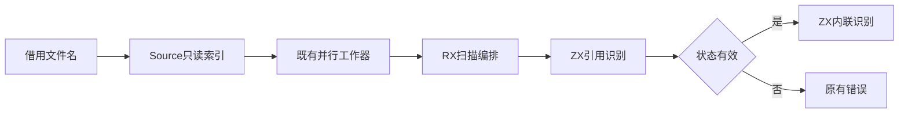
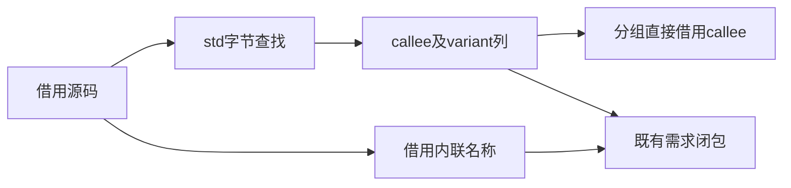

# 分区依赖扫描自举

## Intent：最终目标

把构建侧函数引用及内联声明识别迁入RX/ZX，保持原有SIMD查找、错误顺序、
引用顺序、借用切片与多核执行。保留已有自举实现，再依据证据优化。

## Data：可用证据

旧scanning.zig识别生成源码的模块引用，signature.zig识别行首inline函数。
旧引用数组随后又复制一份callee列交给分组。现有std:bytes已支持等价SIMD。
最新完整冷构建131.11秒/198.68 CPU秒/2146893824 B单体峰/2161770496 B树峰；
固定基线仍129.74秒/216.03 CPU秒/2075033600 B/2247294976 B。

## Edges：边界与限制

Source一次建立只读模块索引，RX依次连接引用扫描与内联扫描，遇引用错误提前
返回。ZX保留内聚遍历，Native保留现有parallel及后续需求闭包、布局和写出。
引用用callee/variant两列返回，直接借用callee列给分组，不转换AOS或复制源码。
Source索引动态增长与旧索引一次预留的成本差异必须测量，不声称分配次数等价。

保留缺引号、缺点号、缺函数文件的错误顺序，允许空variant及零或多个闭括号；
inline仅识别行首，缺左括号时停止并返回已收集名称，不trim，不解析注释/字符串。
seed仍保留原规则；旧compiler.search仍为其通用底层，不在本阶段删除公开接口。

## Answer：交付与成功标准

成功要求：同输入全部文件一致、真实扫描保持错误及借用边界、工具自生成一致，
相关既有构建/回归通过，记录相邻及固定基线成本，统一提交推送所有变更。

## 实现与初次优化

Source按原顺序识别引用，返回callee/variant两列。Native需求闭包直接遍历两列，
Source分组直接借用callee列，移除原AOS到ID数组的转换。引用失败由RX提前返回，
不会继续inline扫描。seed保留原匹配规则，仅同步为两列数据契约。

独立只读审查明确原错误及边界：缺引号先于缺点号，variant扫描之后才查目标；
空variant合法，inline缺左括号仅停止。这些规则已在Source实现中保留。

初版动态insert索引的热CPU中位4.60→4.62秒，墙钟均1.25秒。保留迁移，改为
按输入数量预留桶后调用现有put，避免重复get和扩容rehash；空输入仍返回空索引。
Core已有put注册，补grow/const声明时误重复put，已删除重复并保留原校验，失败
构建不算样本。初版工具与测量保留在tool-growing及generator-growing。

最终同输入346入口、8132文件逐路径哈希全部一致（仅排除.zxc-inputs）。热缓存
预热1轮、交替3对：CPU中位4.61→4.60秒、墙钟1.26→1.25秒、RSS
740425728→740753408 B（+327680 B）。空函数缓存3对：CPU7.43→7.42秒、墙钟
均1.67秒、RSS786874368→786677760 B。微小差额不声称稳定收益；热RSS正差保留。
原始证据在忽略目录partition-scanning/generator-isolated及generator-cold。

## 累计对照及自生成

固定partition-root工具、相同当前346入口，预热1轮、交替3对，8132文件全部一致。
CPU中位4.60→4.61秒、墙钟均1.25秒，RSS739540992→740048896 B（+507904 B）。
该组为固定工具累计差，不用相邻阶段的小幅下降抵消，继续记录正差与趋势。

两轮工具均21/21，SHA256一致：
`e4b524ca959171a7b2bafdef4920ccdb4991c73de77eb05c07e00bfcba8c5bd0`。
现有库批次41/41通过。旧signature.zig规则已移至Source及seed，不再留构建侧
独立实现；Native扫描文件只负责并行任务与结果保存。

## 完整冷构建与验收范围

全新local/global缓存、空stage0、12核，43/43通过。time墙钟130.62秒、CPU199.32秒、
单体峰2146992128 B；0.2秒采样树峰2161246208 B、单体峰2140831744 B、采样器
墙钟130.802秒。首轮seed及正式Source路径均实际参与构建。

| 指标            |     上阶段 |     本阶段 |   固定基线 | 相对固定基线 |
| --------------- | ---------: | ---------: | ---------: | -----------: |
| 墙钟秒          |     131.11 |     130.62 |     129.74 |        +0.88 |
| CPU秒           |     198.68 |     199.32 |     216.03 |       −16.71 |
| time单体RSS字节 | 2146893824 | 2146992128 | 2075033600 |    +71958528 |
| 采样树峰字节    | 2161770496 | 2161246208 | 2247294976 |    −86048768 |

相对上阶段：墙钟−0.49秒、CPU+0.64秒、单体+98304 B、树峰−524288 B。
不以单次墙钟下降掩盖CPU增长，也不称统计显著变化。完整冷构建CPU/树峰仍低于
固定基线，墙钟和单体仍未恢复；生成路径固定对照的+0.01CPU秒/+507904 B保留。
完整原始证据在partition-reference/cold-partition-scanning。

最终CLI对10个Source文件fmt --check与lint通过；7个Native文件格式及diff空白
检查通过。已有库批次41/41、本阶段两轮自生成21/21、全部8132文件一致为本次
直接验证。CLI入口/发布运行路径未修改，复用此前5/5、2/2有效证据，不重复构建。

## 自我复核与未完成职责

迁移了函数引用及行首inline识别规则，RX表达其真实顺序和错误短路，ZX保留
字符与集合算法。现有Nativeparallel仅调度，需求闭包、分区布局及输出写出仍为
后续职责；不能因扫描变为RX/ZX就宣布完整构建或编译器自举完成。

输入源码、索引及返回切片在布局结束前均存活，分组借用callee列没有延长到worker
arena释放后。Source建表已预留，未为通过性能门禁改算法结果、线程数、校验或
代码布局。IDEA记录包含架构和数据流图，保留初版及优化后证据，不覆盖失败记录。
