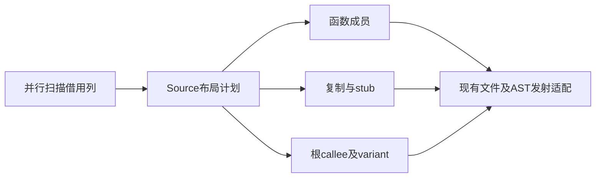

# 分区布局规划自举

## Intent：最终目标

将owner分配、export排序、闭包分组和分区入口归属从Native layout迁到RX/ZX，
由RX串联已有需求闭包与genz分组，不在ZX隐藏跨阶段调度。保留原算法和输出顺序。

## Data：可用证据

现有布局先Wyhash路径取模，再需求闭包，按文件路径字节序sortUnstable，调用已有
Source分组，更新export根的owner，再逐分区收集module及variant入口。Array.sort
已有静态比较器捕获并降为sortUnstable；std:bytes.hash匹配Wyhash(seed=0)。
上一完整冷构建130.86秒、197.96 CPU秒、time单体2137636864 B、树峰2145615872 B。
固定完整基线仍129.74秒、216.03 CPU秒、2075033600 B、2247294976 B。

## Edges：边界与限制

Source只保存callee/position和借用variant，不复制函数源码或路径字节。保留seed
布局作为初始引导；正式路径不调用旧布局算法。Native暂留扫描线程、目录路径及
结构化AST发射适配，不能宣称整个文件写出模块已自举。复用已有Source分组，不
添加专用运行库或临时桥来隐藏决策。无新增持久测试，性能只测受影响路径。

## Answer：交付与成功标准

验收同输入全部产物、静态生成体成本、前后及固定基线性能、工具自生成及相关
回归；完整职责收口后提交推送全部变更，确认工作区和远端同步。

## 实现与成本复核

新增layout/plan.rx明确连接owners、既有需求闭包、order、既有genz分组和roots。
新增genz/partition_groups普通Source包映射，不通过专用Zig桥调用分组算法。Native
布局只消费members、scopes及root计划，保留扫描线程和现有结构化AST/文件发射。

排序先对export原位置数组排序，再投影callee作为分组根，避免为排序装箱每条
export记录。比较器借用路径，使用现有std:bytes.lessThan；实际sortUnstable与原
实现一致。已有函数源码和路径字节始终借用，不复制。

初版roots重建完整owner表，生成体出现一次renew(false)。核对数据流发现原owner
更新仅供export归属判断，Source分组owners已经按排序后的export位置给出答案。
删除冗余表，直接用grouped[position]判断分区，再经positions[position]取原export
及variant。最终root/roots均无zxRenew，三个增长列reserve(true)，循环保留storage；
只在每scope发布一次Root描述符，成本O(groups)，不随export前缀累积。

seed的groups.available也可能为true，不能据此认为新布局入口已经存在。独立
layout.available以generated_parser判断；初始seed使用layout_seed，正式工具走
Source布局。保留旧seed不会让正式生成器回调Native布局决策。

## 验证证据

临时诊断256组布局图通过，包含空图、1～6个分区、环、重复边及variant顺序。
最终诊断以原Native需求DFS、owner/hash/sort和入口聚合为对照，复用已验收的
Source分组算法。诊断在忽略目录，不新增持久测试，不作为一般规模形式证明。

迁移后发现partition_demand独立公开生成入口仅剩旧适配引用。正式布局已经直接
调用Source模块，因此删除冗余入口和对应的生成调用桥；保留createSeed并在正式
生成编译器调用它时编译报错，防止旧算法回流。入口总数由中间版348回到347。
需求模块仍通过布局RX传递依赖进入编译，没有撤回需求闭包自举。

最终同一347入口输入，前后8239个文件字节一致。初版8248文件及清理入口前的
8242文件观测分别在generator-initial和before-retirement-*，不与最终集合混用。
工具构建及自生成确认均21/21，SHA-256完全一致：
`27eeaea783c6c0b6cbce0844fa354e21048a18f0340880529d8dd43af719d933`。

| 最终测量              | 前CPU秒 | 后CPU秒 | 前实际秒 | 后实际秒 |   前RSS B |   后RSS B |
| --------------------- | ------: | ------: | -------: | -------: | --------: | --------: |
| 热生成，预热后3组     |    4.65 |    4.66 |     1.27 |     1.27 | 761905152 | 762855424 |
| 冷函数缓存，3组       |    7.49 |    7.49 |     1.69 |     1.70 | 798801920 | 802684928 |
| 固定Root工具累计，3组 |    4.67 |    4.66 |     1.28 |     1.28 | 761102336 | 761643008 |

单阶段热CPU正差0.01秒，冷实际正差0.01秒；相对固定Root工具62559498的当前
输入累计时间没有增长。冷生成RSS中位数高3883008 B，热高950272 B；固定Root
累计高540672 B，保留正值观察趋势，不重置固定基线，不逐阶段重复领取容差。

SDK test-library-bundle为41/41、现有8组消费顺序及36项行为检查通过。此证据取得
于冗余入口清理前；清理只删除内部公开桥，Source函数缓存确认0个函数重新生成，
并在最终同输入全产物对照、独立Native图对照、自生成及完整冷构建核查其余影响。
不重复与内部入口退役无关的SDK/CLI消费检查。7个Source文件fmt/lint通过；7个
Native文件格式检查通过。

## 完整冷构建与性能缺口

最终全新local/global缓存、空stage0、12核，43/43步骤通过。time实际131.77秒，
CPU191.13+8.58=199.71秒；0.2秒采样墙钟131.821秒、单体采样峰2135244800 B。
time单体峰和采样树峰分列，不能混为同一口径。

| 指标      |   上一阶段 |   当前最终 | 固定完整基线 |  累计差值 |
| --------- | ---------: | ---------: | -----------: | --------: |
| 实际秒    |     130.86 |     131.77 |       129.74 |     +2.03 |
| CPU秒     |     197.96 |     199.71 |       216.03 |    −16.32 |
| time单体B | 2137636864 | 2147844096 |   2075033600 | +72810496 |
| 采样树峰B | 2145615872 | 2155773952 |   2247294976 | −91521024 |

相对上阶段，完整墙钟+0.91秒、CPU+1.75秒，单体+10207232 B、树峰+10158080 B。
本阶段清理入口前另一完整观测为130.55秒/199.87 CPU秒/time单体2141863936 B/
树峰2156101632 B，保留在cold-partition-layout；最终为cold-partition-layout-final。
同一阶段完整时间存在波动，不能挑更快的一次作为最终数据。

两轮本阶段完整构建的已完成指令计数506402539991→506341433521，CPU周期
133976631738→133985688459，工作计数接近而墙钟不同；上一阶段指令计数为
506586476512。这些计数不足以证明墙钟正差全部是噪声，也不能直接换算为CPU
收益。受影响生成路径的3组对照稳定，但完整冷墙钟仍比固定基线高2.03秒：
**布局职责实现收口，完整冷构建耗时目标尚未达标，必须继续优化，不重置基线。**
单体峰也仍比固定基线高约69.4 MiB，不能宣称历史内存问题全部消除。

## 自我复核与未完成边界

本阶段迁移布局计划的自有决策与状态流；Native扫描调度、ABI头适配、目录路径、
AST接入和发射调度仍待迁移。根计划中的callee/variant头数组是新的显式计划表示，
虽不复制payload，仍有线性描述符成本，不能宣称没有任何分配。完整自举仍需
正式入口传递依赖审计及约定stage 1/2/3核查，完整冷构建性能缺口继续保留。

本地日志和指标在`.zig-cache/cold-build-analysis/ownership-research/partition-layout/`及
`partition-reference/cold-partition-layout-final/`，受忽略规则排除，不提交。
IDEA框架记录范围及证据；阶段实现提交不代表整个自举目标或整体性能门禁完成。
