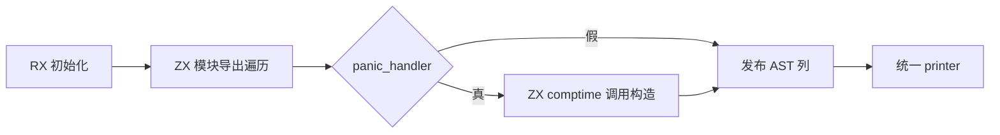
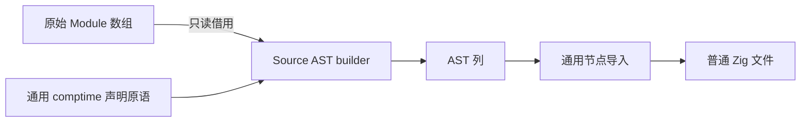

# 分区根模块生成自举

## Intent：目标

将分区根文件的模块导出与可选 panic comptime 声明构造迁入 RX/ZX。
所有 Zig 内容由结构化 AST 经统一 printer 输出，不用模板或原始代码节点。

## Data：证据

起点 48efceca。partition.root 按输入模块顺序输出公开 import 常量，最后按
panic_handler 添加 comptime exportPanic 调用。原生 AST 已支持 ComptimeScope，
Source printer 模型也已有该标签，仅 Source 声明 builder 缺少构造入口。

上一完整冷构建 129.97s / 197.90 CPU 秒 / 2136883200 B 单体峰值 /
2150170624 B 树峰。固定基线仍为 129.74s / 216.03 CPU 秒 /
2075033600 B / 2247294976 B，不随阶段重置。

## Edges：边界

本阶段完成 root 文件生成职责，exports/stub 生成及分区布局仍待迁移。
先补通用 AST comptime scope 构造，再由 RX 编排 imports 与条件 panic 阶段。
Module 输入行直接借用，原生字段顺序对齐 Source，JSON 保留既有 name/file 顺序。

Source 结果只有 AST；原生仅持有工作区、借用节点列、物化并调用 printer。
工作区遵循调用方 allocator 的寿命，不能仅以子 arena.deinit 宣称 RSS 释放。
保持 seed root 实现，不放宽结构布局或错误检查。

## Answer：交付与成功标准

核对生成闭包与借用 ABI，真实自举生成产物逐路径一致；按风险验证完整构建、
既有 AST/库路径及受影响生成成本。最终统一提交推送，确认工作区与上游同步。
完整自举仍需迁移其余原生职责并完成传递依赖和 stage1/2/3 验收。

## 初版退化与修复

初版输出 8019 个文件与旧实现一致，但生成器 RSS 中位 738918400 →
1166704640 B，CPU 4.54 → 4.56s、墙钟 1.22 → 1.25s，存在严重内存退化。
保留迁移，检查实际闭包后发现 Context 在循环中为 boxed，text/builtin 将
string、tags、offsets、builtin_name/arguments 恢复成 plain，push 每轮复制前缀，
形成 O(N²)；声明 Builder 自身保留 reserve(true)，不是主因。

修复为循环持有实际增长的窄表达式列和字符串列，直接复用现有 named/header
原语；循环结束 assemble 一次组装完整 Context，再追加可选 panic。未放宽
全局 boxing 或别名规则，未按模块名、路径或测试数据特判，未撤回迁移。

最终对同一当前 manifest、同一输出路径、每个生产者独立缓存测量，日志确认
实际执行 336 个入口，排除预热后 3 组交替：CPU 均 4.54s，墙钟均 1.23s，
RSS 中位 733741056 → 733364224 B；8021 个文件逐路径哈希一致，仅排除
生产者身份标记 .zxc-inputs。微小负差额不作稳定收益承诺。

初版证据保存在 generator-boxed，最终在 generator-isolated；两者源码形状不同，
文件数不可直接作为增减比较，所有对照均各自在相同输入下完成。

## 生成闭包复核

窄列版 item 将 strings/tags/offsets 的完整 managed 描述符传给 named/header，
builtin 两列 reserve(true)；modules 回写五列 items/storage，不再逐轮重置 plain。
item 不创建 Context/Expressions/Forms；RX 仅在遍历结束后执行一次 assemble。
每项仍按 String → Import → 公开 Constant 构造，panic 最后追加单条语句范围。
单元素 builtin 参数每项分配一次，属于与原实现一致的必要 payload。

公开 Input 的模块数组是指针形式，executeValue 则接受 flat view；正式入口
反射真实参数类型并严格检查布局，避免指针表转换。Module 的 JSON 顺序保持
旧协议，Source 只借名称和路径文本，打印结束前 owner 始终有效。

正式 CLI 构建 43/43，既有库文件表构建 41/41，8 组正反序组合的 36 项检查
通过。应用侧 Store 库 2 项、编译库 17 项、完整边界 8 项、Gateway 86 项
全部通过，共 113 项，无过滤。相同路径的 52 个应用生成文件完全一致。
本阶段性能对照针对实际受影响的自举根模块生成路径，不重复无关应用计时。

## 完整冷构建

独立全新本地/全局缓存、12 核、43/43：time 墙钟 130.64s、累计 CPU
198.72s、单体峰值 2142257152 B，采样树峰值 2157838336 B；采样器墙钟
130.711s、采样单体 2137489408 B，不混用 time 和采样口径。

- 相对上一阶段：墙钟 +0.67s、CPU +0.82s、单体 +5373952 B、树峰 +7667712 B。
- 相对固定基线：墙钟 +0.90s、CPU −17.31s、单体 +67223552 B、树峰 −89456640 B。

局部 Root 生成的平方级复制已消除，最终对照未见稳定退化；上述完整构建
正差额仍保留，不能用局部数据抹去，也不据单次冷构建宣称稳定收益或完成
全局性能目标。退休指令 506875395570、周期 134279881045，作为后续趋势证据。

## 收口与自我复核

两轮工具均 21/21，二进制 SHA256 一致：
`f7be5dc496a8bbac88499aaba7686447536e181de361f6f20b6ee982fa752378`。
seed 独立探针实例化 partition.root 并编译通过，12 个 RX/ZX 文件格式/lint、
4 个 Native 文件格式及 diff 空白检查通过。
证据目录 `.zig-cache/cold-build-analysis/ownership-research/partition-root/`，
完整冷构建位于同级 `partition-reference/cold-partition-root/`。

自我复核：首次借用依据公开 Input，未核对 executeValue 的真实 view，严格布局
检查阻止了错误适配；随后选择真实值入口。更严重的是按现有 Context API
逐项构造虽然语义正确，生成后丢失增长标记，不能称为成本等价迁移。实际
O(N²) 证据促使保留 Source 实现并重构为窄列累积、一次发布，输出和局部成本
重新验证后才收口，没有靠撤回、清理缓存或放宽全局布局规则掩盖退化。

本阶段交付根文件生成与通用 comptime scope 原语。exports/stub、分区布局、
AST 原生存储/导入适配及其他原生职责仍未全部迁完，完整自举与三阶段证明
保持原目标，不以本阶段工具一致性宣称全部完成。
