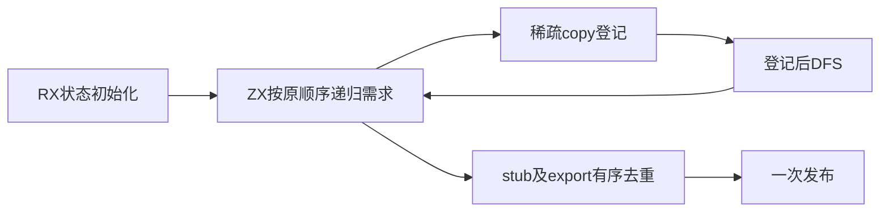
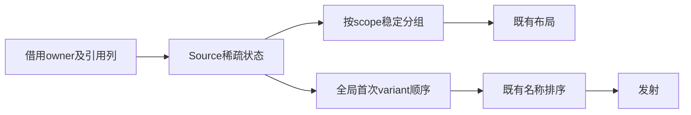

# 分区需求闭包自举

## Intent：最终目标

迁移跨分区copy/stub/export判定、递归闭包及有序去重，保留原DFS、稀疏空间和
Source零成本目标，不因性能问题撤回迁移。

## Data：可用证据

原Scopes先跳过同owner，copy按(scope,callee)递归前登记，新copy立即DFS；非inline
variant即使该callee已copy仍登记stub及export，最终发射才跳过copied stub。
callee/variant首次次序均影响输出。当前Core整数索引仅u32，组合键需要无损u64。
最新完整130.62秒/199.32 CPU秒/2146992128 B单体/2161246208 B树峰；固定完整基线
仍129.74秒/216.03 CPU秒/2075033600 B/2247294976 B，不重置。

## Edges：边界与限制

补通用u64索引，组合键(scope<<32)|callee；不使用稠密矩阵或临时字符串键。
Demand按键保存variant链表，所有列平铺，避免更新嵌套数组丢失增长元数据。
普通Source递归保留DFS；必须检查生成体及实测，不凭源码无copy宣称等价。
Native后续只排序、布局和发射；Source临时状态保存在独立工作arena，输出借用
在layout完成前存活。不新增持久测试用例，复用既有回归与忽略目录诊断。

## Answer：交付与成功标准

成功要求：原顺序与终止条件不变、同输入文件一致、生成体无额外前缀复制、实际
冷/热及固定基线性能验收、工具自生成与相关回归通过后统一提交推送。

## 实现及成本复核

RX按initialize、traverse、publish三个阶段编排。ZX保留算法内部的DFS与集合遍历；
copy按(scope,callee)登记后立即递归，stub/export按callee及variant首次出现顺序登记。
发布时按scope稳定计数分组，并通过稀疏索引过滤copied stub；export不提前过滤。
Native保持原有sortUnstable名称排序、并行扫描、布局及结构化AST发射。

通用core/integer/wide_index支持完整u64键，bucket仍为u32密集位置和max_u32哨兵。
组合键保留两个u32的所有位，避免字符串分配或scope×function密集矩阵。variant链
节点在达到max_u32哨兵前拒绝溢出，不把合法节点与终止标记混用。

初版Source状态内嵌两份Demand和一份Index，虽然热生成未显示明显退化，生成体已
证实walk入口及出口共20次强制zxRenew(false)，并且add为状态描述符堆装箱；递归
会复制已有前缀。保留自举，改为17条平铺工作列，临时组装单份Demand调用原子
操作后立即按列返回。修复后walk、add的实际生成体均无zxRenew及allocator.create，
私有callValue保留列表items/storage，不经公开ABI丢失增长元数据。

这消除的是底层集合前缀复制及描述符堆分配，递归仍传固定大小的列描述符；不能
据此宣称CPU栈上没有任何描述符复制。最终发布仍有必要的scope/variant头数组。

## 已取得的验证

忽略目录中的临时诊断将Source结果与保留的原seed算法比较：256组依赖图全部一致，
覆盖seed两种模式、环、重复边、inline和非inline variant混用及首次插入顺序。
此诊断不进入仓库测试目录，也不作为一般规模的形式证明。

同一347入口输入，优化后前后8168个文件全部字节一致。热生成一次预热加三组交替
测量：CPU中位数4.65→4.64秒，实际耗时1.26→1.25秒，RSS757694464→757612544 B。
初版与最终版证据分别保留在generator-initial及generator-isolated，不覆盖混用。

冷函数缓存三组交替：CPU7.48→7.46秒、实际耗时1.69→1.67秒，RSS
805404672→797917184 B。固定Root工具62559498对同一当前347入口输入的累计对照，
三组热生成中位数CPU均4.65秒、实际耗时均1.27秒，RSS757186560→757760000 B。
后者增加573440 B，需继续观察，不能把这点增长归零或每阶段重复领取容差。

两轮bootstrap-stage均21/21，工具自生成后SHA-256完全一致：
`5b0167c88170032b6357f18e41ce9d64f3e9b2f10c31624004d9d56daf188008`。
SDK test-library-bundle为41/41，沿用现有8组消费顺序和36项行为检查；20个Source
文件fmt/lint及6个Native文件格式检查通过。未修改CLI入口契约，复用普通调用需求
阶段已通过的入口5项和运行2项，不重复无关CLI检查。

## 完整冷构建

全新local/global缓存、空stage0、12核，43/43通过。time报告实际130.86秒，
CPU189.33+8.63=197.96秒、单体峰2137636864 B；0.2秒采样树峰2145615872 B，
单体采样峰2125135872 B，采样墙钟130.942秒。time峰值与采样峰值不混用。

| 指标      |   上一阶段 |       当前 | 固定完整基线 |   累计差值 |
| --------- | ---------: | ---------: | -----------: | ---------: |
| 实际秒    |     130.62 |     130.86 |       129.74 |      +1.12 |
| CPU秒     |     199.32 |     197.96 |       216.03 |     −18.07 |
| time单体B | 2146992128 | 2137636864 |   2075033600 |  +62603264 |
| 采样树峰B | 2161246208 | 2145615872 |   2247294976 | −101679104 |

本阶段CPU少1.36秒，单体峰少9355264 B、树峰少15630336 B；实际时间增加0.24秒。
不能把正差值清零。复核两轮进程采样：相同hash的maker从28.05秒/28.29秒启动，
可见运行跨度102.54秒/102.44秒；宿主LLVM编译均约32.88秒，分区对象阶段约
34.77秒/34.91秒。0.2秒采样无法精确分摊0.24秒，也不能证明稳定退化；结合受
影响路径三组前后对照未增长，保留此完整观测及累计正值，不重复构建未修改的
驱动来追噪声。固定基线单体RSS仍高约59.7 MiB，后续继续追踪，不能宣称全部
历史峰值内存问题已消除。

本地证据：`.zig-cache/cold-build-analysis/ownership-research/partition-demand/`及
`partition-reference/cold-partition-demand/`，日志、采样和指标均忽略，不纳入提交。

## 边界及自我复核

此阶段迁移需求状态、DFS、copy/stub/export判定与去重规则。Native ABI适配、
并行扫描调度、文件排序、布局和发射调度仍是过渡依赖；不能据此宣称完整自举。
源图和variant字节借用扫描结果，Owned工作arena在Roots并行join及发射完成后释放。

layout现在批量解析top引用后运行Source闭包；正常输入由生成器产生，产物一致。
与旧实现交替解析top/处理需求相比，异常内存耗尽与坏内部top的报错先后可能不同；
未把这一变化描述为严格保持所有异常优先级。解析错误种类及扫描检查仍保留。

零成本目标依靠实际生成体和测量验证；不把Source文件后缀、字节一致或一次计时
当作完整职责及全部性能边界的证明。固定完整冷构建基线和固定Root工具累计基线
分开记录，绝不以新阶段重置。
