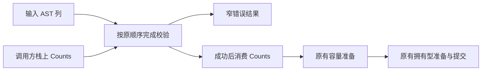

# 宽结果错误传播与冷编译内存验证

## Intent：最终目标

针对冷编译最大进程中的实际表示成本，验证一个足够小的优化候选。在保持校验、
错误顺序、所有权和分配行为的前提下，减少后端需要处理的中间结果；同时考察
CPU、墙钟与峰值内存，不能以更小的 IR 代替真实收益。

本阶段是内存优化研究，不改变所有权规则，也不以研究完成代表全部自举完成。

## Data：可用证据

### 科学依据与适用边界

沿用[已有研究及十篇编译器论文对照](../2026-11-08/冷编译内存归因与错误清理优化.md)，
本阶段重新读取以下一手资料，并将论点转化成具体假设：

| 资料                                                                                                                                   | 可以支持的判断                                                             | 不支持的推断                                       |
| -------------------------------------------------------------------------------------------------------------------------------------- | -------------------------------------------------------------------------- | -------------------------------------------------- |
| [ThinLTO，CGO 2017](https://storage.googleapis.com/gweb-research2023-media/pubtools/4743.pdf)，§2、§8                                  | 完整 IR 与分析信息的同时驻留会影响时间和内存；摘要与按需处理可以限制工作集 | zxc 已启用 ThinLTO，或增加分区一定降低整树峰值     |
| [Compile-Time Analysis of Compiler Frameworks for Query Compilation，CGO 2024](https://home.cit.tum.de/~engelke/pubs/2403-cgo.pdf)     | 应分开衡量表示转换、后端优化和生成程序执行的成本                           | 查询 JIT 的速度比例可以直接外推到 Zig ReleaseSmall |
| [TPDE，CGO 2026](https://home.cit.tum.de/~engelke/pubs/2602-cgo1.pdf)，§II-A                                                           | 适配已有表示可避免额外实体化完整 IR                                        | 为 zxc 更换后端或引入运行库就会取得相同收益        |
| [MEMOIR，CGO 2024](https://mcmichen.cc/files/papers/MEMOIR_CGO_2024.pdf)，§VII-C                                                       | 内存布局优化存在运行时间取舍，紧凑不等于更快                               | 生成程序的内存收益就是编译器峰值收益               |
| [Automatic Data Enumeration，CGO 2026](https://users.cs.northwestern.edu/~simonec/files/Research/papers/MEMORY_CGO_2026.pdf)，§III、§V | 编号共享需要考虑域密度及转换成本                                           | 所有整数键表都适合换为稠密数组                     |

[LLVM New Pass Manager](https://llvm.org/docs/NewPassManager.html) 是工程资料，
不是新增论文。它解释了按同一函数集中执行 pass 的局部性优势，也要求正确维护
分析缓存的失效边界。这里仅用于检查设计，不能据此认定前端缓存导致当前主峰值。

现有测量将主峰值定位到编译 zxc_host 的 Zig/LLVM 进程；生成器约 490 MB 是
另一条执行路径。已有 bridge 修复取得过完整冷构建收益，临时 arena 池和部分
静态拆分试验则未通过时间与内存的联合要求。本阶段不重复这些已决实验。

### 当前候选及可证伪假设

隔离标准库原型曾表明，宽 JSON 结构体的错误传播形态值得研究；没有将标准库
副本作为产品修复。本阶段改为检查 zxc 自有的 node/import_rows.zig。

冻结 host IR 中，check 的 37 个实例共 30,211 行、1,192,351 B。最大的
49-tag 实例各有 50 个完整 Counts 错误联合临时值。这些静态数量不能视为执行
次数、真实底层数据复制量或 RSS。

假设：校验的多个失败出口不需要携带完整 Counts。由调用方提供已有栈上结果
位置，内部校验返回窄错误结果，可以减少中间表示；公开 check 仍保留原返回契约。
appendRows 直接消费同一栈上结果，不增加堆申请、校验遍历或业务状态。

只读复核同时发现 function_table.snapshot 的失败清理与 artifact.nodes.expressions
的宽结果模式，但没有同时修改。它们需要各自的完整成本证据，不能批量套用结论。

## Edges：边界与限制

- 只在忽略目录复制既有 genz 输入，修改一个校验职责；先不改生产源码。
- 保留 tags/offsets、容量上限、列存在性、列长度及编译期类型兼容检查。
- 错误发生时仍不提交目标行；局部 Counts 的部分初始化不能逃逸。
- 不减少拥有型复制，不改变文本借用或失败清理，不新增专用桥及运行库。
- 使用同一冻结响应文件、工具链、优化模式与生成输入；实验不是最新 HEAD 的
  全量冷构建。每轮使用新 local/global 缓存，保留 OS 缓存，不删除共享缓存。
- 先看 wrapper 与 helper 合计及全部 host IR。若形态没有明显改善，停止计时。
  若有改善，再进行三对交替顺序的普通 host 编译，不同时导出 IR 或采样。
- 若产生生产候选，再验收实际行为、正式生成器固定累计基线及完整进程树。
  不把本阶段局部收益相加到历史完整冷构建数字。

## Answer：交付与成功标准

### 初步形态验证

隔离候选成功编译。按 check 前缀统计 wrapper 与内部 helper 的合计：

| 指标                              |       原版 |       候选 |
| --------------------------------- | ---------: | ---------: |
| 校验家族函数数                    |         37 |         43 |
| 校验家族 IR 行数                  |     30,211 |     25,671 |
| 校验家族 IR 字节                  |  1,192,351 |    888,495 |
| 校验家族宽 Counts 错误临时        |      1,514 |         12 |
| appendRows 家族宽 Counts 错误临时 |         39 |          0 |
| 整个 host IR 字节                 | 92,655,281 | 92,334,008 |

函数数增加与 IR 缩小同时发生；没有只报告包装函数变小。整体 IR 约下降 0.35%，
足以进入配对测量，但不能据此预报峰值内存下降，也不是底层 payload 零拷贝收益。

诊断、响应文件、源码 SHA 与原始数据位于忽略目录
.zig-cache/cold-build-analysis/ownership-research/ast-check-result。

### 普通 host 编译的配对结果

六次编译全部成功。三对顺序为原版→候选、候选→原版、原版→候选；表中是
每侧三次运行的中位数。全部使用安装的标准库，没有叠加上一项 JSON 原型。

| 指标           |            原版 |            候选 |                     差值 |
| -------------- | --------------: | --------------: | -----------------------: |
| 墙钟           |         31.20 s |         31.14 s |                  −0.06 s |
| user + sys     |         32.88 s |         32.83 s |                  −0.05 s |
| 最大单进程 RSS | 2,374,664,192 B | 2,345,713,664 B | −28,950,528 B，约 −1.22% |

逐对候选减原版如下；逐对差值与两侧中位数之差不是同一个统计量。

| 配对 |  墙钟差 |  CPU 差 |        RSS 差 |
| ---- | ------: | ------: | ------------: |
| 1    | +0.07 s | +0.08 s | −36,388,864 B |
| 2    | −0.06 s | −0.07 s |  −5,308,416 B |
| 3    | −0.08 s | +0.01 s | +15,171,584 B |

原版 RSS 范围为 2,330,542,080～2,387,525,632 B，候选为
2,338,275,328～2,382,217,216 B，范围重叠且配对方向不一致。三个样本不能
提供稳定峰值改善的充分证据；同样不能据此断言候选必然增加内存。

### 决策与剩余工作

**本阶段不将隔离候选并入生产。** 减少宽错误临时的假设得到 IR 支持，但实际
RSS 结果尚不能稳定区分于波动。时间差均在现有容差内，也不等于为后续阶段
获得新的性能预算。没有改变生产代码，因此不额外执行行为回归或完整冷构建。

保存 prepare.py、inspect.py、measure.py、scope.json、ir-summary.json、
ordinary/metrics.json、ordinary/summary.json、decision.json，以及每轮命令
和原始日志。原型留在忽略目录；没有复制标准库解析器到正式源码。

后续只保留两个有具体调用链的候选，不同时改造，也不重跑本次相同实验：

- core/function_table/root.zig 的 snapshot：冻结 IR 有 3,953 行，失败清理
  在逐列复制的错误出口重复展开。先核对共享失败出口能否缩小整个函数家族，
  不以减少 errdefer 数量推断收益。
- compiler/zx/modules/artifact/nodes.zig 的 expressions：冻结 IR 有 2,647 行，
  95 个完整 ExpressionTable 错误临时。先区分 planned 路径与 fallback，
  不改磁盘协议、拥有关系、类型及函数编号重映射。

这两个候选都仍需受影响路径及运行成本的验收；不是已承诺的收益。若形态改动
只是将工作转移给另一个 helper，或增加分配、复制与总 CPU，应停止该优化。

### 自我复核

本次完成的是“论文论点→真实热点→隔离改造→配对测量→不采纳”的完整研究
闭环。它没有修复剩余主峰值，也没有完成全部所有权或自举工作。37 个实例与
1,514 个临时值来自冻结输入，不代表最新 HEAD 的数量；未优化 IR 的静态复制
不等于运行时 memcpy，也不是底层 payload 的实际复制。研究不能用论文数量、
更小 IR 或一次较低 RSS 替代生产收益；后续结论继续分别标注输入和测量边界。

### 后续筛选：通用列拥有型复制

复核 CGO 2024 的表示转换成本及 CGO 2026 TPDE 的避免重复实体化原则后，
在隔离副本试验 core/columns.zig 的 own：保留公开返回契约，内部按指针填充
最终 Table，返回窄错误结果。列次序、replacement 借用、文本复制及 arena/OOM
行为不变；没有修改生产源码，也未新增用例。

冻结 Gateway HTTP CLI 输入的两侧 IR 编译均成功。八个原实例与候选的 wrapper、
helper 合计比较：函数数 8→16，IR 6383→5579 行、311826→258591 B，
宽 Table 错误临时 241→16；完整 IR 211603950→211551131 B，约减少 0.025%。
静态临时与 memcpy 站点不代表运行时复制次数或 RSS。

**停止于形态筛选，不并入生产，也不继续普通配对计时。** 这个小候选不是数 GB
峰值的主要优化方向，尚无 CPU、墙钟或峰值收益证据。此前 snapshot 的候选已在
[冷编译失败清理工作集验证](冷编译失败清理工作集验证.md)独立收口，不重复实验。

原始源码副本、响应文件、scope.json、两份 module.ll 及 ir-summary.json 位于
忽略目录 .zig-cache/cold-build-analysis/ownership-research/column-own-result。
这不是最新 HEAD 完整冷构建；全局峰值与所有权分析问题仍未解决。
