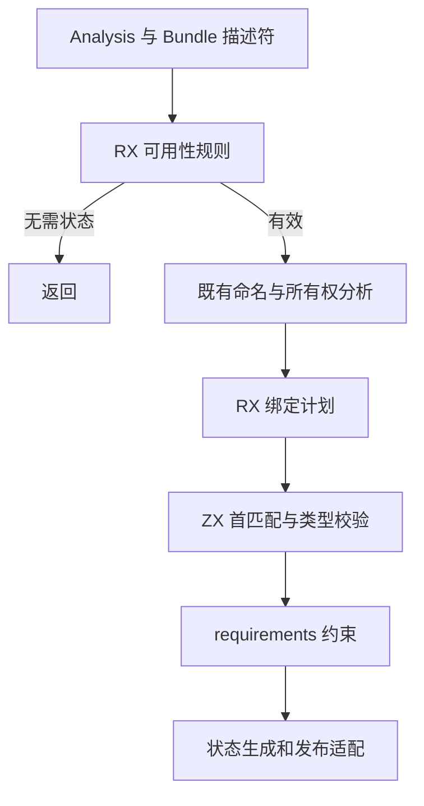
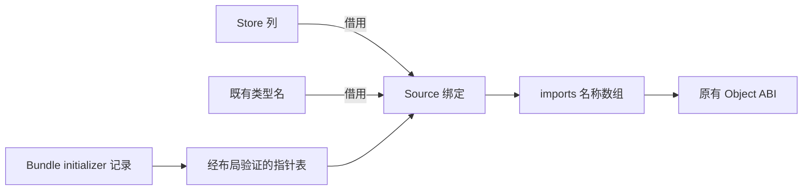

# 应用 Store 绑定计划自举

## Intent

迁移普通应用状态可用性与 Store 初始化绑定规则到 RX/ZX，复用 Gateway 查找逻辑。
保持错误顺序、Store 顺序与借用寿命，不复制原始 Store/类型表或 initializer 内容。

## Data

原职责：`backends/zig/state.zig` 的 IR 有效性、空状态、重复状态、initializer
匹配、类型名校验与 requirements 约束。Gateway 已有相同的首匹配查找。
现有 columns.pointer 提供实际 size/align/offset/type 静态校验；生成 initializer
为四字段普通记录，可以尝试直接借用，不能绕过布局检查。
阶段前冷构建 130.11s / CPU195.88s，单体峰值 2136719360 B、树峰 2150563840 B。
固定基线不变：129.74s / CPU216.03s，2075033600 / 2247294976 B。

## Edges

- 顺序保持：InvalidAnalysis → 无 Store 返回 → DuplicateState → 绑定错误 → requirements。
- initializer 使用首个相同 identity，类型不匹配报 InvalidInitializer，不跳过继续找。
- 只分配指针表，指向 Bundle 原记录；不可引用按值循环变量或临时投影。
- 指针表 scratch 可同步调用后释放；返回的模块名借用 Bundle 原始字符串。
- Source 绑定计划与可用性规则迁移；缓存、生成器调用和 Bundle 文件发布仍是过渡 Native 边界。
- 不新增持久测试；复用 Store、Gateway、发布与缓存检查。

## Answer

RX 连接状态检查、逐 Store 绑定与最终约束，ZX 负责谓词和遍历；Native 只做
输入投影、记录 ABI 组装及现有 I/O 边界。验收包括编译、产物/行为一致与成本。

## 执行与验收

实现中，尚未验收。

### 实现边界与首次生成

`state/available.rx` 依次表达 IR 有效性、空 Store 与重复状态规则；`state/build.rx`
连接初始化、逐槽绑定和 requirements 检查。initializer 模型与首匹配查找移到
`store_initializers/`，Gateway 直接消费同一函数，未保留转发包装。

Native 输入适配借用 Store 列、类型名和 initializer 记录；可用性检查只投影模块名
引用，不复制源码文本。Source 生成 imports 名称数组，Object 仍由现有 Native ABI
按列构造，缓存与文件发布仍是过渡边界。

`columns.pointers` 只创建只读指针数组，通过既有 pointer 的实际布局校验借用原行。
Gateway initializer 适配也复用该能力，删除逐条临时记录构造；原 Bundle 的记录与
文本覆盖同步调用及返回名称的寿命，scratch 仅持有指针表。

Source 单独生成两个入口成功：11 个模块、10 个函数文件；格式/lint 通过。
正式工具构建 21/21 通过，完整 CLI 构建进行中，尚未宣称 ABI/行为验收完成。

### 可用性输入表示修正

复核否定了初版模块名投影：非空 Store 时，投影数组在 DuplicateState 之前分配，
新增 O(module_count) 描述符存储，并可能让 OOM 覆盖原查重错误。初版虽已通过
Store/Gateway 运行检查，仍不能作为最终成本等价实现。

修正为 Source 借用完整只读模块记录视图，仅扫描 name。Source 视图使用字节切片
字段，不建立字符串对象；Native 内部 File 字段布局对齐规范记录，以 columns.slice
继续严格校验 size/align/offset/type。可用性检查不再分配名称数组或指针表。
File 的 JSON 输出显式保留原 name/source/imports 顺序，避免影响 artifact graph
摘要及已有缓存路径；字段名称、类型与公开数据协议不变。

原 Source 规则全部保留，调整的是缺失的借用表示能力；未把查重留回 Native，
也未以内存压力为由放宽 ABI 检查。修正后的正式构建与产物对照进行中。

### 最终模块视图版本验证

正式构建 43/43，Store 重定位检查 2/2、编译库 Store 检查 17/17、Gateway 86/86。
同一路径的 main/empty Gateway 与普通 state/advance.rx 共 52 个生成 Zig 文件，
没有新增、删除或字节变化，包含 artifact graph JSON 字段顺序对路径的影响。

最终完整 P2 冷构建：time 墙钟 130.31s、累计 CPU 197.11s、单体峰值
2145140736 B；0.2s 采样进程树峰值 2157215744 B。采样器墙钟 130.394s、单体
采样峰值 2136899584 B，不与 time 数据混同。

- 相对阶段前：墙钟 +0.20s、CPU +1.23s，单体 +8421376 B、树峰 +6651904 B。
- 相对固定基线：墙钟 +0.57s、CPU −18.92s，单体 +70107136 B、树峰 −90079232 B。
  累计差额和最近 CPU/单体波动持续保留，不把每阶段容差当作新增预算。

三组交替测量普通 Store 应用，每组 8 次强制重新生成、后端缓存预热：
CPU 中位 6.92 → 6.91s，墙钟 6.51 → 6.50s，RSS 中位
188284928 → 188809216 B。受影响生成路径没有稳定退化证据，微小差额不作收益承诺；
完整冷构建的正差额不能被此局部数据抹去。

初版模块名投影版本的冷构建与行为检查仅作问题定位，不用来替代最终模块视图
版本的验收。未保留投影分配，也未回退已迁入 Source 的规则。

只读复核确认：查重前已无名称数组/指针表分配，Source 同步查询仅返回枚举；
File JSON 明确保留原字段顺序；initializer 指针表指向 Bundle 原记录，不含局部副本。
最终格式、工具一致性与 Git 收口仍在进行。

### 自生成、seed 与收口

最终工具两轮均 21/21，SHA256 一致：
`bee58d6481ae2da2333b8b1487d5ef1ba981946a4e9ccf09eee57b75f29fd40d`。
seed 的独立编译探针显式实例化 state.append，修正过渡调用的 Options 名义类型
适配（逐字段传入 seed Options）；该改动仅涉及未启用 Source 的分支，不改变
正式路径，沿用已取得的正式性能证据，不重复完整冷计时。

本次 12 个 RX/ZX 文件格式/lint 与所有变更 Native 文件格式检查通过。
证据目录为 `.zig-cache/cold-build-analysis/ownership-research/state-binding/`，最终
冷构建位于同级 `partition-reference/cold-state-binding-view/`；中间版本和无效启动
日志保留，不混入最终结论，全部受忽略规则排除。

自我复核：曾接受名称描述符投影作为薄适配，实际仍引入不必要分配并改变低内存
错误顺序，故用只读模块记录借用补齐表示；未退回 Native 规则。JSON 字段顺序
及生命周期均有源码复核与实际产物证据。该阶段交付可用性与绑定计划，原生缓存、
发布及更广的状态桥仍未迁完，完整自举的依赖闭包与 stage1/2/3 目标保持不变。
