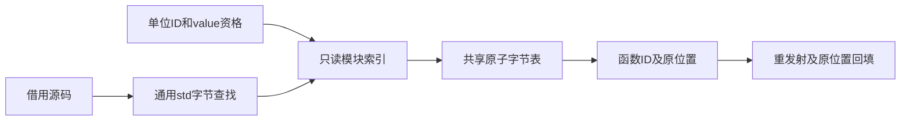

# 普通调用需求分析自举

## Intent：最终目标

迁移普通调用补全中的模块索引、源码扫描与需求选择规则，保留 SIMD 查找、
多核扫描、原子标记和最后同名代表语义，不撤回迁移来掩盖性能变化。

## Data：可用证据

原 regular_calls.complete 建立 value 函数模块表，并行扫描 import.call 标记，
按原单位次序切换为 regular 后重发射，直到不再新增。原生查找使用32字节SIMD，
而 std:bytes.indexOfSlice 使用标准库普通查找，必须先补通用能力以平移成本模型。
最新完整基线记录为130.37秒墙钟、199.68 CPU秒、2147418112 B单体峰及
2161541120 B树峰；固定基线仍129.74秒/216.03 CPU秒/2075033600 B/2247294976 B。

## Edges：边界与限制

共享 wanted 使用既有 std:bytes.AtomicRows 单行字节表和 monotonic 原子存储，
线程加入后再选择需求；扫描以空FixedBufferAllocator验证无临时分配。
Source仅借用源码与模块名称，标记切片由标准库借用，不复制字符串。
Native仍负责线程调度、发射和固定点轮次，作为明确的过渡编排边界，不宣称整个
补全流程已实现最终RX架构。源码侧索引初始化由RX表达，算法循环保留ZX。

通用SIMD查找放在std内部，保持既有indexOfSlice接口与边界语义。旧compiler.search
仍被seed和build/partition扫描消费，暂保留原实现；移除条件是这些消费者迁移完成，
不为共享一个底层文件给标准库消费者新增编译依赖或专用编译器桥。
不新增持久测试用例；使用既有构建、字节对照、回归及忽略目录中的诊断证据。

## Answer：交付与成功标准

成功要求：真实扫描在零分配预算内运行、同输入全部生成文件一致、工具自生成
及相关既有回归通过，记录实际与固定基线性能差额，统一提交推送全部变更。

## 实现与独立复核

Source build 按输入单位顺序插入，因此同名键仍由最后的函数ID代表。索引发布后
冻结，不再修改；select 按原单位次序查询代表标记，Native回填regular标签及将
候选ID置空，排除后续轮次重复选择。独立只读审查核对上述语义与原实现一致。
扫描游标仍推进到标记末尾，再取其前方最后一个引号；未知模块跳过，原子写仅
将标记置为1。线程加入后再读共享行，未增加锁、串行化或源码复制。

首次Source编译补齐string切片到u8[]的显式只读视图。void扫描采用现有成熟的
const result = loop写法；没有为本次迁移增加空回调语法。实际ABI显示index入口
有值视图，但scan/select接收只读接口指针，因此索引仅在发布时按公开列投影，
后续传稳定地址，不在每次扫描重新包装嵌套列表。

扫描使用容量为0的FixedBufferAllocator。新工具真实运行全部生成流程且未OOM，
证明当前调用路径没有隐藏的临时分配；常量、索引及AtomicRows均为普通静态Zig
数据与标准库能力。首次同输入8110份文件（仅排除.zxc-inputs）逐路径哈希一致。

## 局部验证与性能

工具两轮构建均21/21，新工具自生成后SHA256一致：
`ee8f6c54b0514b3383538da336f1414db1ef2a916a5847769f7e1382555ce893`。
现有库批次回归41/41通过，包含普通、混合、Native、Store的正反序发布。

相同当前输入343入口，热函数缓存预热1轮、交替3对：CPU中位均4.58秒、墙钟
均1.24秒、RSS761446400→761380864 B。独立全空函数缓存3对：CPU7.40→7.38秒、
墙钟1.66→1.65秒、RSS799309824→799227904 B。差异很小，不声称稳定收益；
扫描和索引的新增元数据、AtomicRows边界检查与标准库SIMD实现均已计入。

局部日志与原始指标在忽略目录
`.zig-cache/cold-build-analysis/ownership-research/regular-calls`。

## 固定工具累计核对

为避免只比较相邻阶段，额外固定早期 partition-root/confirm 工具（62559498阶段），
与当前工具使用同一343入口输入，预热1轮、交替3对。8110份生成文件继续全部
一致；CPU中位均4.59秒、墙钟均1.24秒，RSS757727232→761528320 B（+3801088 B）。
三对RSS均为正差，不能用时间持平掩盖；后续仍需核对临时AST列与输出arena的
生命周期。该固定工具基线独立于完整129.74秒基线，不能混用指标或重置为当前值。
证据在 regular-calls/generator-cumulative。

## 完整冷构建及累计指标

全新local/global缓存、空stage0、12核，43/43步通过。time墙钟129.96秒、CPU
197.01秒、单体峰2141782016 B；0.2秒采样树峰2157821952 B、单体峰2137423872 B、
采样器墙钟130.094秒，两个口径分别保留。

| 指标            |     上阶段 |     本阶段 |   固定基线 | 相对固定基线 |
| --------------- | ---------: | ---------: | ---------: | -----------: |
| 墙钟秒          |     130.37 |     129.96 |     129.74 |        +0.22 |
| CPU秒           |     199.68 |     197.01 |     216.03 |       −19.02 |
| time单体RSS字节 | 2147418112 | 2141782016 | 2075033600 |    +66748416 |
| 采样树峰字节    | 2161541120 | 2157821952 | 2247294976 |    −89473024 |

相对上阶段：墙钟−0.41秒、CPU−2.67秒、单体−5636096 B、树峰−3719168 B。
本次没有延续前阶段+2.24秒CPU增长，但单次下降不证明其根因已消除，也不把
变化全部归为本阶段收益。累计墙钟和单体峰值仍未恢复固定基线；固定工具的
生成期RSS+3801088 B也继续保留，不能用完整树峰下降抹去。

完整证据在忽略目录 `partition-reference/cold-regular-calls`。7个Source文件
通过最终CLI fmt --check与lint，5个Native文件格式及diff空白检查通过。

## 收口与自我复核

最终完整冷构建CLI的现有发布入口5/5、发布运行2/2通过。相关库批次41/41、
工具两轮21/21及完整构建43/43均有效；没有用旧工具或失败样本代替新路径验收。

迁移的是索引、扫描及需求选择规则，不是仅给旧函数换扩展名。RX显示索引准备
阶段，ZX保留原子算法循环；Native固定点轮次、线程调度和发射依然是后续迁移
职责。std SIMD底层保留为通用字节查找能力，旧compiler.search暂用于seed及
尚未迁移的构建扫描，不把它宣称为已清除的传递依赖。

本轮按IDEA组织方案与执行证据，包含架构和数据流图。实现及阶段行为验收已
收口，整体自举、累计内存及墙钟目标继续，不能仅凭本轮性能持平或自生成同值
宣布完整目标达成。
