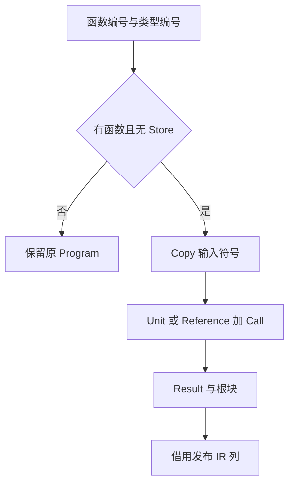
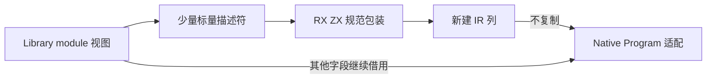

# 统一库公开入口 IR 自举

## Intent

将统一库文件模式的公开入口包装规则迁入 RX/ZX，保留未导出函数及带 Store
入口的原程序；普通入口构造 `$in → call → return` 的规范 IR。

## Data

原实现：`packages/compiler/src/backends/zig/library_entry.zig`。
已有 Core Source 的 Symbols、Expressions、Control、Contracts 列模型与 Native
借用适配。原算法只构造一个 Copy 符号、两个表达式与一个 Result/Block。
阶段前冷构建为 130.15s 墙钟、195.43s 累计 CPU，单体峰值 2126528512 B、
树采样峰值 2129756160 B。固定基线仍为 129.74s、216.03s、
2075033600/2247294976 B。

## Edges

- 不复制既有 IR 表或类型表；Source 输入只包含必要编号与 Store 数量。
- 不新增 type_only 规则；无 function 或有 Store 时必须保留原程序。
- Void 输入生成 Unit，其他输入生成 Reference(0)；Call 参数为表达式 0，
  Result 指向表达式 1，根块为 0；span 保持零、ownership 保持 Copy。
- ControlTable 描述符必须存活到 Program 使用完毕，不能引用 Native 局部变量。
- 旧实现仅留作 seed，正式路径使用 Source；不新增持久测试。

## Answer

RX 表达保留/包装分支与符号、表达式、控制流的构造顺序；ZX 构造规范列。
Native 借用结果列，只为 ControlTable 创建长期描述符并组装原有 Program。
验收覆盖库运行、Store 保留、工具自生成与产物一致，以及受影响生成路径成本。

## 执行与验收

实现中，尚未完成验收。

### 实现与首次自生成

Source 入口为 `backends/zig/library_entry/build.rx`。RX 明确判断 function/Store，
然后连接符号、两个表达式和控制表；空 Contracts 由 Return 静态组装。
列构造复用 Core 空表并声明固定规范形状，常量 span/位置允许共享不可变存储，
没有把原 IR 拷贝到 Source，也没有逐项重建原有类型。

Native 使用 `columns.borrow` 转换描述符及校验 enum 布局，直接借用 Source
输出的列；ControlTable 单独分配长期描述符，其他 Program 字段不变。

单入口 14 个模块、6 个函数文件生成成功。两轮正式工具构建均 21/21，第二轮
实际通过新的 Source 入口构造器生成；两轮工具 SHA256 相同：
`0872455874a02a60d4972b0d1c49523ef50ea70e1b0a81f4c0f115ecf469b8a1`。
这项一致性仅覆盖本阶段，不代替完整自举的依赖闭包与 stage1/2/3 目标。

完整冷构建正在执行，期间不执行其他编译或大量文件检索。随后复用现有库发布、
类型入口和 Store 入口检查，补齐行为与成本证据。

## 最终验证与性能

- 正式 P2 冷构建 43/43：time 墙钟 130.11s、累计 CPU 195.88s、单体峰值
  2136719360 B，0.2s 采样树峰值 2150563840 B。采样器墙钟 130.298s、单体
  采样峰值 2130378752 B 单列，不与 time 指标混用。
- 相对阶段前：墙钟 −0.04s、CPU +0.45s，单体 +10190848 B、树峰 +20807680 B。
  相对固定基线：墙钟 +0.37s、CPU −20.15s，单体 +61685760 B、树峰 −96731136 B。
  保留全部单轮差额，历史单体残余差额仍未消除。
- 现有公开入口发布检查 5/5；库运行/类型入口 2/2；Store 重定位与类型转发
  2/2；失败发布回滚 4/4。总计 13 项，不把这些检查外推为完整自举完成。
- 旧/新工具使用同一 324 入口清单生成整套编译器，7924 个文件字节一致；
  仅排除 `.zxc-inputs` 这一包含生成器身份的输入缓存指纹，源码和其他清单不排除。
- 三组交替生成测量，分别预热工具私有缓存，并在每次运行前移除输出输入指纹；
  日志断言每次实际生成 324 个入口。CPU 中位 4.51 → 4.52s，墙钟均 1.21s，
  RSS 中位 735084544 → 734134272 B。没有稳定退化证据，不宣称微小差额为收益。

同一路径的普通/别名/RX/类型导出库发布对照：11 个文件无新增、删除或字节差异。

首次计时曾混入完整输出命中；随后共用函数缓存也造成工具身份交替时缓存失效，
两组数据均不用于性能判断。最终隔离各工具缓存，同时强制实际生成，避免把
缓存状态差异报告成 Source 规则迁移的性能收益。

只读源码复核确认三种输入分支、Copy ownership、零 span、payload、Contracts
与 seed 一致，Control 描述符及输出数组无短命局部引用；实际构建和自生成
补充了 ABI 与产物证据。没有为本阶段新增持久测试。

证据目录：`.zig-cache/cold-build-analysis/ownership-research/library-entry/`；
完整冷构建在同级 `partition-reference/cold-library-entry/`。

自我复核：该阶段迁移完整的公开入口包装规则，Library.module 视图组装与
更广的 Native 状态/适配边界仍在。未以几个 Source 文件或工具二进制一致取代
最终依赖闭包与 stage1/2/3 的完成标准，后续继续自举，固定基线不重设。
