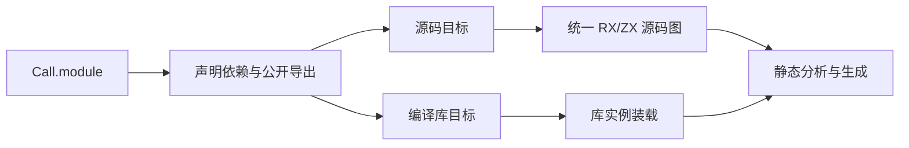
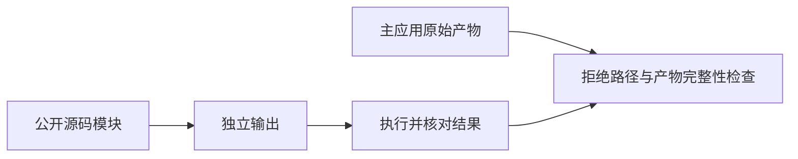

# 统一源码包调用边界对齐

## Intent：目标

消除源码包边界回归中的过期拒绝预期，恢复整项初始化器边界检查，保持
源码与编译库统一公开接口，以及真实的包、能力、实例和产物保护规则。

## Data：证据

987c3298 与 a86192a2 的编译器运行同一 rx_boundary_test，均在源码包调用
成功时触发旧拒绝断言；该调用还覆盖主应用，令后续 unchanged 检查连带失败。
[统一源码模块编译方案](../2026-10-10/统一源码模块编译方案.md)的“源码包调用与
源码结果联结”明确支持 Call.module 的源码包 RX/ZX 目标，并修正先前人为
设置中间发行库边界的判断。当前 project/reference、source_graph 和 mixed/callees
实现与此相符；它们仍按依赖和公开导出解析，不按文件存在猜测或穿透私有路径。

## Edges：边界

不修改编译器语义，不新增允许开关或自举专用名称规则。现有测试单项从拒绝
改为执行已公开源码模块，使用独立产物路径，保留主应用完整性断言。
其他拒绝条件、Store 初始器缺失、别名和实例约束继续运行。
这是既有用例和文档对齐，不新增测试场景。没有生成形态、算法、分配或缓存

变化，复用上一阶段构建和性能证据，不重新计时。

## Answer：交付与验收

运行完整既有 rx_boundary_test，不使用过滤；源码调用、Store 授权和初始化
拒绝全部通过，原主应用保持可用。检查本次 diff 和格式，统一提交推送。
完整自举仍按既定原生依赖闭包与 stage1/2/3 标准继续，不以文档对齐替代迁移。

## 执行结果与自我复核

使用 987c3298 对应正式编译器，完整 rx_boundary_test 为 8 pass / 0 fail / 0 skipped，
未使用过滤。源码公开模块输出 37，主应用内容保持相同且仍可执行；缺失全部或
部分初始化器均正常拒绝启动。日志为
`.zig-cache/cold-build-analysis/ownership-research/initializer-registry/boundary-aligned.log`。

本次没有编译器实现或生成产物变化，沿用上一阶段 43/43 构建、自生成一致性
及性能数据。测试文件按仓库 Prettier 的四空格规则排版，未新增测试项；
独立产物路径在 Windows 延用 .exe 扩展名约定，当前执行证据来自 macOS。

初次看到失败时不能据旧测试直接判断实现错误。这里以较新的统一源码模块设计、
真实解析路径和公开导出检查共同确定契约，而非仅为通过断言放宽预期。
源码清单不能使用编译库选择器、私有路径不可导入等其他边界保持既有规则，
本次没有修改相关用例或编译器判定。完整自举与其剩余原生职责仍继续推进。
