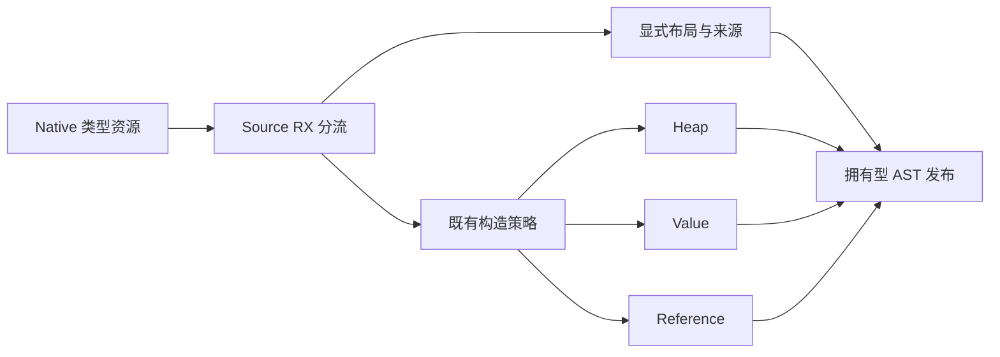
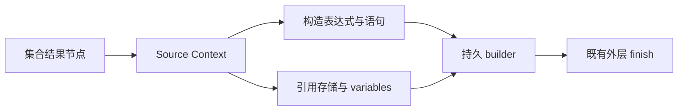

# 集合最终构造自举

## Intent：最终目标

将集合结果的最终表示选择与构造接入 RX/ZX，复用现有 Source 构造器，移除
collections 末尾的 Native 构造编排，保持原语义、求值顺序及成本模型。

## Data：可用证据

现有最终步骤分为显式 layout 与普通 construct 两条路径：前者仅为 selected
元组补充 origin 后转换目标布局；后者由 construction policy 选择 Heap、Value
或 Reference。Source 已有对应算法，不需要新语法或专用运行库。

上一阶段 boxed 结果转换的 17 个循环诊断场景均未命中其门禁。本阶段选择真实
集合最终构造路径，并在沿用已有回归时核对路径覆盖，不将旧诊断当作覆盖证据。

## Edges：边界与限制

- Heap 分支不补充元组 origin；显式 layout 分支不执行堆分配或引用存储。
- Reference 保留函数级 storage、共享 variables 列和全局语句的索引契约。
- Native 仅准备类型资源和发布 AST；不在 Native 重建 Source 已输出的语句。
- 资源准备不得改变 fresh serial、任务声明、全局语句或 reference storage。
- 递归表达式求值、公共 Lower 状态和外层 aggregate.finish 仍是过渡边界。
- 不新增用例；已有构建与检查证据按源码、工具链和配置复用。

## Answer：交付与成功标准

集中验收 Source 格式与 lint、两阶段自编译及产物/memo 一致、受影响既有行为，
再测真实受影响路径和固定累计基线。阶段收口全部未提交内容，英文提交推送并
确认工作区干净、无未推送提交。完整自举目标继续保持，不能以局部通过代替。

## 执行记录

### 实现与静态复核

新增 collections/finalize/build.rx，在显式 target 存在时调用 layout 原子函数；
其他路径直接调用已有 construction/apply。两路都复用 construction/publish。
layout 使用 origin && is_tuple 决定来源归一化，然后生成 As；Heap 的原有先行
分流保持，不对 Heap 无条件补充来源。

Native construction/build 提取 Resources.prepare 和既有 publisher：资源只返回
模式与类型表达式值句柄，不返回指向局部 AST/Capture header 的指针；请求顺序
保持 layoutExpr、按 Heap 请求 typeExpr、按 Reference 请求 state_layouts。
collections/finalize 仅准备资源和同步调用 Source，显式 target 不请求多余布局。
AST 快照和 bases 均在资源准备后取得，并断言 serial、任务声明、全局语句及
reference_storage 不变。引用存储仍通过 storage + variables 独立发布。

没有新语法、动态分发层、专用运行库或应用数据复制。Native 旧分支继续用于
seed；Source-enabled 正式路径执行新增入口，outer aggregate.finish 保持原接线。

### 构建、产物与已有回归

- 3 个 RX/ZX 文件的格式与 lint、4 个 Native 文件格式及 diff 检查通过。
- 两阶段各 21/21 步成功，工具 SHA-256 均为
  7a9c94956b6dc33d5747b3f5e52915426efec3ea6abd9ae45c15d507dedc194e。
- main/collections/growth/ordered 分别 3429/65/361/24 文件；上一阶段与
  bootstrap 仅 .zxc-inputs 不同，bootstrap 与 production 全部逐字节一致。
- 四组 memo 逐键逐内容一致，记录数为 12048/3294/2772/0、67/45/27/27、
  1154/315/270/0、27/14/14/14；冻结输入的 8248/2419/1945/0 也全部一致。
- test-immutable-list、test-owned-collections、test-array-pop、test-loop-columns、
  test-nested-buffer、test-aggregate-loop、test-borrowed-call-views 合计
  517/517 步、12100/12100 项通过。未新增测试用例。

### 受影响路径对照

使用既有 compile-immutable-list 驱动和 reverse/sort/splice 三份源码。它们没有
loop，进入普通 list_operation；取 [0] 不触发仅用于 splice [1] 的 removed-only
早退，因此必经普通 collections 最终构造。既有 with 用例走 list_update，保留
在行为回归中，排除在本阶段局部计时之外。驱动同时执行 Source 与 Library 路径。

从真实回归响应文件复制相同模块、配置和工具链，只在忽略目录 Native 副本将
const constructed 的 Source guard 改为 false，建立旧 Native 最终接线对照。
generated、generated_analysis、partition_groups 均确认为 true；其余 Source 与
配置相同。没有修改正式表示规则来制造覆盖，也没有增加用例或生产探针。

构建结束后两版交替八轮、排除首轮；每轮 12 个输出均逐字节一致：

| 指标                  | 旧最终接线 | Source 最终构造 |
| --------------------- | ---------: | --------------: |
| CPU 中位数            | 0.013260 s |      0.013302 s |
| 墙钟中位数            | 0.016508 s |      0.016604 s |
| 最大子进程 RSS 中位数 |  8241152 B |       8241152 B |

CPU 包含 time wrapper 的高分辨率子进程资源差，墙钟包含进程启动；微小差值不
解释为确定的提速或退化。该对照直接覆盖本阶段入口，不意味着 Heap、Value、
Reference、显式 layout 每种模式均由这三份源码独立命中，也不补足上一阶段
boxed 结果转换门禁的直接覆盖。

### 固定累计性能与自我复核

使用同一冻结 manifest、141 入口/2220 模块、ReleaseSmall、关闭 resident，
固定基线/上一阶段/本阶段交替八轮，排除首轮。固定基线仍为 inbound-conversion，
SHA-256 为 8f1e7cee1eadb3ea0f6f7150bab951c55672ce294e4fbe7c50d5858723bdd92d，
没有随提交重置。测量前确认构建进程已结束，局部及累计测量串行执行。

| 指标                | 固定累计基线 |    上一阶段 |      本阶段 |
| ------------------- | -----------: | ----------: | ----------: |
| CPU 中位数          |       5.33 s |      5.33 s |      5.32 s |
| 墙钟中位数          |       1.16 s |      1.13 s |      1.13 s |
| 最大进程 RSS 中位数 |  488030208 B | 491503616 B | 490192896 B |

单阶段 CPU −0.01 s、墙钟不变；相对固定基线 CPU −0.01 s、墙钟 −0.03 s，
未观察到累计退化。RSS 区间 476299264～496353280 B 与
476200960～498106368 B 重叠，不声称稳定内存收益或 LLVM 冷编译峰值改善。
2268 个冻结输出仅 .zxc-inputs 不同。

证据位于忽略目录 .zig-cache/cold-build-analysis/ownership-research/collection-finalize：
bootstrap.log、production.log、regressions.log；fixedpoint.json、
production-fixedpoint.json、memo-results.json；prepare_affected.py、
driver-scope.json、affected-cases.json、affected-comparison.json 及对应响应文件；
final-runtime-comparison.json 保存固定工具身份与每轮样本。

本阶段将最终构造分流及其实际算法接入 Source，并保留已有错误、所有权与存储
契约；不是仅返回一份计划让 Native 重建语句。资源准备和发布适配器仍是过渡
依赖，不能称完整集合职责已自举。完整目标仍需迁移递归求值、Lower 状态及
其他 Native 边界，并做最终传递依赖与阶段自编译审计；本阶段验证不替代该验收。
