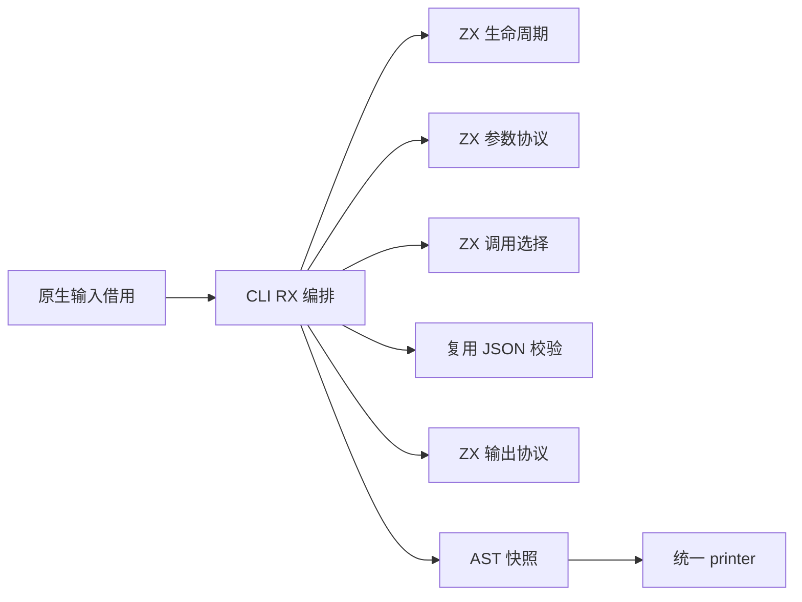
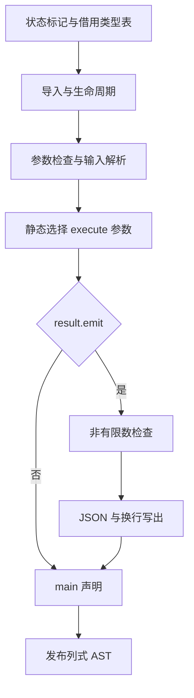

# CLI 宿主协议生成自举

## Intent：最终目标

把 CLI 应用宿主的完整生成职责从原生 Zig 迁入 RX/ZX：参数协议、Store 生命周期、执行参数选择、JSON 校验与输出。保持行为、错误顺序和生命周期一致，并满足固定累计性能标准。

## Data：可用证据

- 当前提交 `b90ac1c2`，工作区干净，已推送。
- 原生职责位于 `packages/genz/src/host/cli/{root,input,output}.zig`，合计 124 行。
- 正式调用来自 CLI artifacts；JSON 非有限数校验已有 Source 实现，可直接复用。
- 当前 Source 工具体由 Source 阶段生成，生成器 CPU 4.54 s、墙钟 1.28 s；固定比较基线为 4.69 s / 1.27 s。
- 固定完整冷构建基线：129.74 s、CPU 216.03 s、进程树峰值 2,247,294,976 B。上阶段为 129.02 s、203.10 s、2,171,289,600 B。

## Edges：边界与限制

- 保留 seed 仅作引导；正式 Source 路径不调用旧 CLI 生成规则。
- 原生适配只借用类型表、传递状态标记并打印结构化 AST，arena 在打印后统一释放。
- 应用 requires_io / requires_process 仍由生成产物静态选择，不提前猜测参数集合。
- 空输入先检查参数个数，再执行；JSON 输入先检查个数再解析。状态初始化、request 生命周期及 defer 次序不变。
- 先校验非有限数，再创建输出 writer，失败不得产生部分 JSON。
- 不新增测试；复用协议、枚举、整数与 Store 应用回归。
- 无方向时查询多篇近期原始论文；先提出可证伪假设和小范围证据，再扩展修改。

## Answer：交付与成功标准

1. RX 显式连接生命周期、输入、调用、输出和发布，ZX 按原子职责构造 AST。
2. seed / Source 对照与现有行为回归通过，生成工具进行阶段自编译。
3. 按实际成本变化验证受影响路径；不重复前一提交已完成的验证。
4. 收口全部工作区变更，英文 conventional commit 并推送，确认干净且无未推送提交。

## 实施状态

已实现 Source 职责与正式原生适配，验收进行中，尚未提交。

### 实现边界

- `build.rx` 编排导入、生命周期、输入、执行、输出和快照发布；`lifecycle.rx` 明确区分有状态与无状态流程。
- `output/build.rx` 明确连接已有非有限数检查与 writer、编码、换行和 flush。
- ZX 使用 genz AST 原语，27 个文件均小于 180 行；3 个 RX 文件表达真实编排。
- 原生 `host/cli/root.zig` 只借用类型表并调用生成入口、统一 printer；旧规则仅从 seed 分支可达。
- 剩余平台边界包括 arena、类型表借用适配和统一 printer；本阶段不宣称整个编译器自举完成。

### 正确性与成本证据

- Source 自编译 stage1、stage2、stage3 均 21/21；352 个入口、3740 个模块、3279 个函数文件。工具本体由 Source 阶段生成，运行时分析/生成亦为 Source。
- 初版已有协议/JSON/Store 回归 32/32 构建步骤、164 个 Node 测试通过。最终精简版回归另记最终结果，不把初版证据代替后续修改验收。
- 忽略目录中的诊断探针覆盖 30 组输出类型与 stateful 组合，含全部标量和嵌套 optional/list/tuple/object。seed 与最终 Source 文本哈希均 `aeaf7fc16bde4cf4`；返回文本和临时 arena 均已释放，无泄漏。
- 同批累计分配：seed 3,433,741 B / 126 次；Source 初版 6,260,283 B / 151 次；精简后 4,955,921 B / 142 次。此为累计分配，不是 RSS，也不是每次渲染的峰值。
- 原因：输出 Gated/Prepared 不应保存重复的完整 Scope.state。改为只保留 parent_tags/parent_offsets，关闭作用域时结合当前语句状态。分配下降 1,304,362 B（约 20.8%），保持全部输出一致；Source 相比 seed 仍高，不能声称分配已完全等价。
- 35 个新增 RX/ZX 文件格式与 lint 通过；只读交叉审查未发现具体语义、语句 range、借用寿命或 RX 职责阻断。产物与性能验收仍独立进行。

### 待收口

最终版现有回归已通过：32/32 构建步骤、164 个 Node 测试，零失败。

隔离生成器对照使用同一 352 入口 manifest，旧工具为上阶段 Source-body bridge-result-stage3，新工具为本阶段 Source-body stage3；运行时分析/生成均 Source。各自独立输出及函数缓存，首轮预热，交替顺序各取 3 次中位数：

| 指标     | 上阶段工具 / 当前输入 | 本阶段工具 / 当前输入 |
| -------- | --------------------: | --------------------: |
| CPU      |                4.60 s |                4.60 s |
| 墙钟     |                1.30 s |                1.31 s |
| 峰值 RSS |         774,684,672 B |         774,684,672 B |
| 生成文件 |                  8521 |                  8521 |

所有 8521 个文件在各工具重复运行及跨工具之间 SHA-256 一致。相对固定 4.69 CPU / 1.27 墙钟基线，累计 CPU -0.09 s、墙钟 +0.04 s，未超过容差；入口由 351 增为 352，不把工作量增长误写成工具回归。

首轮完整冷构建 43/43 成功，工具本体由初始 seed 构建，当前分析/生成使用 Source：130.54 s / CPU 203.41 s，采样单进程 2,147,647,488 B、进程树 2,242,478,080 B。

相对固定基线墙钟 +0.80 s，超过 0.1 s 容差，不能提交；CPU -12.62 s、树峰 -4,816,896 B。相对上一阶段墙钟 +1.52 s、CPU +0.31 s、树峰 +71,188,480 B，内存增长需要继续警惕。未降低优化级别、移除检查或重置基线。

采样关键链：seed 工具构建 19.38→19.91 s；Source 分区对象总链 32.53→33.43 s；原生 host 32.89→32.94 s。后者基本不变。分区 0 32.07→32.96 s、分区 1 26.41→27.32 s，暂不能仅凭一次计时区分全部噪声与新增成本。

### 论文启发与局部假设

重新查询并读取近期原始论文：

- [TPDE，CGO 2026](https://home.cit.tum.de/~engelke/pubs/2602-cgo1.pdf)：通过适配现有 IR 减少额外转换。其主要基准是低优化 JIT，不能将倍数外推到 zxc ReleaseSmall；本阶段只采用避免多余表示与转换的假设。
- [Reusing Highly Optimized IR，ECOOP 2025](https://drops.dagstuhl.de/storage/00lipics/lipics-vol333-ecoop2025/LIPIcs.ECOOP.2025.25/LIPIcs.ECOOP.2025.25.pdf)：复用必须验证成立条件，其预填充 JIT 缓存不能当作 zxc 冷构建优化，也不引入运行库。
- 查询到 [PIP，CGO 2026](https://haavakro.folk.ntnu.no/pip2026/)，目前只读取作者页摘要，不能宣称已审完整论文或据此重构所有权。
- 查询到 LLVM 2025 并行化演讲与 2026 ThinLTO 分拆 RFC；它们不是论文。现有 partition_groups 已考虑大小和调用图，不再凭朴素“增加并发”扩大峰值内存。

可证伪假设：CLI State 持续保留完整 source Input，但类型表只在最终 JSON 校验消费。把 types/output_type 从每个阶段状态移出，在 RX 入口直接连接到输出校验，应减少私有类型及转换依赖；公开输入输出、分支与错误顺序不变。先生成/局部探针对照，再验收成本。若收益不足，继续定位，不靠重复完整构建碰运气。

精简状态候选的小范围结果：关键分区原版 30.63 s / CPU 31.21 s / RSS 1,444,478,976 B，候选 30.68 s / 31.25 s / 1,448,034,304 B；30 组输出仍一致，分配仍为 4,955,921 B。不宣称性能收益；保留该调整只因状态确实不应携带无关类型表。

进一步按职责收口单调用方拆分：JSON 选项与解析合入 JSON 输入协议，缓冲区合入 writer 构造，encoder 合入二分输出，参数读取由同一函数选择 allocator 表达式。保留 guard block 等真正复用操作，不隐藏生命周期、输入/执行/输出之间的 RX 编排。Source 从 32 ZX + 3 RX 减为 27 ZX + 3 RX；不靠压缩排版规避 lint。生成器现为 3735 个模块、3274 个函数文件。正在做关键分区成本和同输出对照。

### 最新性能约束

用户随后明确调整：CPU 和墙钟的单阶段差异容差均为 1 s，分别保留固定基线累计变化，累计退化超过 3 s 必须警惕定位。`AGENTS.md` 与用户原话索引已同步，不重置历史基线。此前按 0.1 s 墙钟门禁判定未通过是当时规则下的记录，不删除该证据。

职责合并候选关键分区局部：30.38 s / CPU 30.95 s / RSS 1,447,690,240 B，相对 compact 的 30.63 / 31.21 减少 0.25 / 0.26 s，未扩大成整轮收益。计划使用最终版本再做一次完整冷构建，用实际最终产物收口；这次由新增代码变化及上一轮未消除的成本问题触发。

### 最终 Source 生成器核对

职责合并后的 Source-body atomic-stage 21/21 构建成功。对固定当前 352 入口输入，旧 Source-body bridge-result-stage3 与新 Source-body atomic-stage 各自独立缓存、交替运行，预热后各取 3 次中位数：CPU 4.59→4.58 s，墙钟 1.30→1.29 s，RSS 771,276,800→771,244,032 B。各轮和跨工具的 8511 个文件 SHA-256 全部一致，形成最终源码下的 Source 再生成核对。

相对固定生成器 4.69 CPU / 1.27 墙钟，累计 CPU -0.11 s、墙钟 +0.02 s；与上阶段原输入指标 4.54 / 1.28 相比，当前输入新增 CLI 宿主职责，不能把新增工作全算作工具本体变慢。

### 最终冷构建与真实应用发现的问题

职责合并版冷构建 43/43：128.23 s、CPU 204.51 s、time RSS 2,147,647,488 B；采样单进程 2,143,109,120 B、树峰 2,228,305,920 B。相对固定基线墙钟 -1.51 s、CPU -11.52 s、树峰 -18,989,056 B；相对上阶段墙钟 -0.79 s、CPU +1.41 s、树峰 +57,016,320 B。单阶段 CPU 增长超过新 1 s 观察容差，须如实记录，不以累计改善抹去；累计仍未退化。

对原始硬件计数核对：上一阶段 retired instructions 506,515,354,997、cycles 134,163,446,343；本轮 506,781,208,573、134,035,079,171。指令约 +0.05%、cycles 约 -0.10%，不能将 CPU +1.41 s 全归因新算法，也不能据此保证每轮耗时。

真实应用回归未通过时立即停止提交。合并脚本误将导入列表补充同时应用到 `application.Output` 路径数组，形成 `output.std.json.Stringify.value.application.Output`。已用最小 patch 删除多余路径段，不是所有权/编译器问题。自我批判：格式、lint 与自举产物一致都无法发现两份工具共同消费错误源码；真实应用与 seed 文本对照必须在合并后进行，不能用旧版通过证据代替。修正版复用当前冷构建缓存，仅补受影响的构建、原有回归和文本对照；上述冷构建数字明确属于路径修正前版本，不冒充修正后的重新测量。

## 最终验收与自我核对

- 修正版 CLI 在原冷构建缓存中 43/43 成功；该单纯路径常量修正不再重复整轮性能计时，冷构建证据限定在上文所述版本。
- 使用修正版安装产物直接执行现有 enum/integer/protocol/Store 应用回归，32 + 96 + 28 + 8 = 164 个 Node 测试全部通过，无新增用例。
- 由最终 P2 生成树及其真实对象链接的诊断探针，30 组 seed/Source 输出再次同为 `aeaf7fc16bde4cf4`，内存释放通过。最终 Source 5,037,657 B / 142 次、seed 3,433,741 B / 126 次；此处 Source 规则本体由初始 seed 生成，不能与先前 Source-body 探针的 4,955,921 B 混为纯合并增量。
- 修正后 Source-body corrected-stage 21/21 成功；同一最终输入由修正前/后 Source-body 工具再生成，检查所有文件 SHA-256，不以运行成功代替一致性。
- 27 ZX + 3 RX 均符合 90 列、非空对象垂直、数组多元素垂直及文件行数要求；最长 ZX 文件 141 行，保持语义空行。真实编排未移回 ZX，未添加专用运行库或 Zig 源码字符串生成。
- 累计固定基线仍改善；单阶段 CPU +1.41 s 和树峰 +57 MB 已明确保留为后续趋势观察项，不宣称每项指标都下降，也不归咎所有权分析。
- 仍有过渡依赖：原生输入借用/arena/统一 printer、其他未迁移编译器职责。CLI 宿主规则已 Source 化不等于整体自举完成。

提交前统一收口工作区全部变更；提交与推送结果见 Git。
