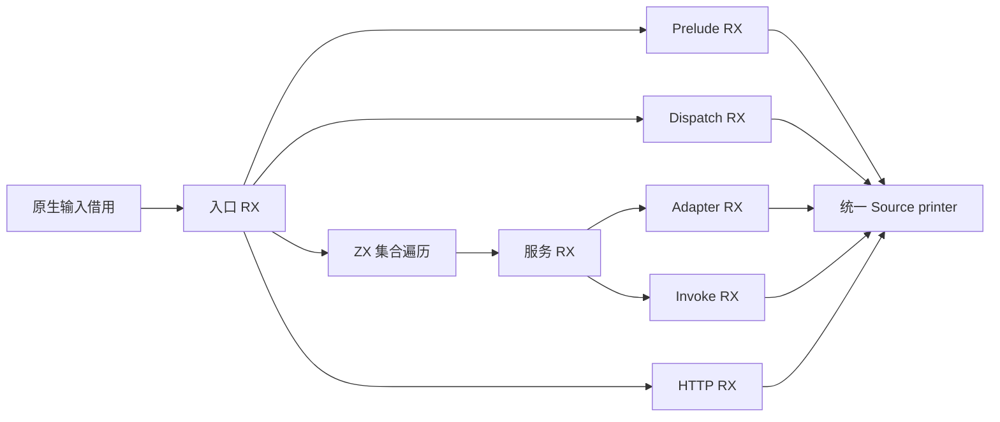
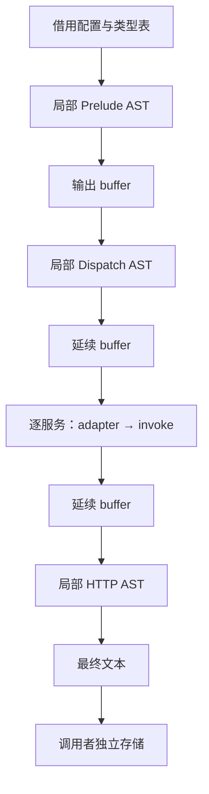

# Gateway 入口生成自举

## Intent：最终目标

迁移 Gateway entry 的完整总编排，保留 prelude → dispatch → 每个服务 adapter/invoke → HTTP helper 的顺序、错误边界和产物。正式路径不回调原生 Gateway 语义。

## Data：可用证据

- 起点提交 `4e197d1f`，工作区干净且已推送。
- 各个阶段已实现 Source，但 `gateway/entry.zig` 仍持有阶段连接、服务遍历、AST 汇总和公开根选择。
- 逐个核对公开输入，各片段仅消费 bases、类型表、配置、名称和服务序号；没有一项消费另一片段的 AST ExprId。跨片段依赖通过生成代码中的标识符连接。
- 原生 import_rows 会给 payload offset 加旧行数；Source 没有通用 snapshot append。直接拼 offsets 错误，重复 concat 列还会增加前缀复制。
- 统一 Source printer 已支持 first/count 与可延续的 output buffer，可复用而无需新运行库。

## Edges：边界与限制

- 每片段使用局部零 bases；adapter 保留全部内部声明，只打印其公开 container 根。调用名称、索引和输出顺序不变。
- RX 显式编排阶段和错误短路；ZX 只遍历服务集合并静态调用服务 RX，不隐藏总控。
- 不生成 Zig 字符串模板；完整 Zig 语句仍只由同一结构化 AST printer 输出。
- 不引入 flatten 专用桥、运行时或动态模块层。原生层仅借用输入/配置、调用并返回独立文本；旧入口仅作 seed。
- 不声称 Source arena 已逐片释放；临时数据仍由调用 arena 管理至返回，最后文本复制满足调用者所有权。
- 特别核验 output buffer 跨 Source RX 调用是否保留增长能力；若逐片复制旧前缀，先修通用生成质量，不能接受平方成本。
- CPU/墙钟单阶段容差各 1 s，分别保留固定可比基线累计变化，超过 3 s 警戒；不重置历史基线。完整冷构建固定为 129.74 s / CPU 216.03 s / 树峰 2,247,294,976 B。
- 上阶段冷构建 128.23 s / 204.51 s / 2,228,305,920 B，属于 CLI 路径常量修正前版本，沿用其明确范围而不冒充当前测量。

## Answer：交付与成功标准

1. 完整 Source RX/ZX 入口接入正式调用，原生语义总控退出正式依赖。
2. 复用现有 Gateway 回归；局部 probe 比较 seed/Source 文本、所有权释放和服务规模增长。
3. 根据实际影响测入口生成与自举生成路径，必要时做完整冷构建；保留无收益和失败记录。
4. Source 阶段再生成核对，统一收口全部变更后提交推送并确认干净。

## 执行状态

Source 编排与正式适配已实现，验收进行中，尚未提交。

### 已获得的证据

- Source stage1 21/21，353 入口、3750 模块、3288 个函数文件；本体由上一阶段 Source 工具生成，运行时分析/生成亦 Source。
- 64 组配置涵盖 0/1/2 个 Store slot、读写 slot、IO/process 标记及 void/float/optional/list 输出。seed 和 Source 文本哈希均 `d8770a488e393dfe`，调用者文本及临时 arena 释放检查通过。
- 同样输入对 seed 的累计分配 30,184,301 B / 385 次，初版 Source 32,955,363 B / 449 次。不能把 seed 当作上一版 Source 性能基线。
- 现有 Gateway 回归 41/41 构建步骤、48/48 原生测试及 86 条真实 HTTP 行为断言通过；覆盖路由、方法、JSON body、Store 跨请求共享与重启初始化、边界错误等。
- 1/8/32/128/512 服务，seed 和 Source 每个输出字节/哈希相同。Source 累计分配分别为 365,358 / 1,125,471 / 4,235,641 / 16,410,981 / 54,600,505 B，未出现逐片复制旧输出导致的平方增长。

### 同 Source 实现的性能对照

旧 Native 总编排及所有原生 genz 文件使用 HEAD 的只读归档，配套原有 Source 生成树；新实现使用当前 Source 生成树。两套规则本体均由 Source 工具生成，运行分析/生成均 Source，避免混淆 seed 与 Source。忽略目录中独立构建诊断可执行文件，交替执行，首轮排除启动开销，余下各 3 轮取中位数。

| 指标             | 旧 Source 编排 | 新 Source 编排 |
| ---------------- | -------------: | -------------: |
| 墙钟             |         0.02 s |         0.02 s |
| CPU              |         0.01 s |         0.01 s |
| RSS              |   50,135,040 B |   48,021,504 B |
| 512 服务累计分配 |   86,241,891 B |   54,600,505 B |

每轮内容稳定，跨工具所有规模的字节数和哈希相同。512 服务累计分配减少约 36.7%，RSS 减少约 2.1 MB；小计时精度有限，不宣称有可分辨的 CPU 提速，也不外推成完整冷构建收益。

### 适配缺陷与修复

- 以公开 Input 类型直接喂 executeValue 暴露布局不一致：实际入口对 routes 使用值行数组，公开规范形状为行指针数组。按既有 Gateway adapter 的成熟模式读取实际函数参数类型构造输入，不放宽 generic columns 检查。
- usize 与 u64 是不同 Zig 类型，不能使用只处理同型标量/枚举的 columns.view 代替数值转换。路由在 64 位上经 storage.view 严格验证布局后借用；32 位构造必要的加宽描述符。
- 新 Source 消费者使公共 adapter 输入可能选择 slot 行指针形式；原 Native adapter 曾假设值行形式。新增共享 slots.borrow 同时兼容二者：64 位复用原始 slot，仅在需要时构造指针表；32 位按 ABI 需要加宽头部，字节/数据载荷不复制。该逻辑仅为原生边界适配，不承载 Gateway 语义。
- 原生旧入口 API 与新入口对同一当前生成树进行额外兼容对照，避免正式新路径绕开旧 API 后留下潜在编译错误。

### 待收口

最终阶段核对、对最后的借用适配运行现有回归、受影响自举生成路径的累计性能检查，然后全工作区提交推送。

### 最终接口兼容核对

忽略目录中的独立 genz 副本仅把导出 entry 切到保留的旧总编排，在当前生成树及当前原生 adapters 下执行；新旧两入口的 64 组输出哈希仍同为 `d8770a488e393dfe`。当前接口下旧编排累计分配 46,910,259 B、新编排 32,951,315 B，均释放完整。该对照用于证明旧 API 兼容，不混入上一节原始旧接口下的性能基线。

64 位 slot 头部现在直接借用，只分配必要指针表。正在使用实际 wasm32-wasi 目标编译完整生产 Gateway entry，覆盖 32 位路由/slot 的必要加宽，避免仅凭源码审查声明跨目标完成。

### 跨目标与阶段核对

- wasm32-wasi 对完整生产 entry.render 的 build-obj 编译已成功，实际实例化有 slot 的服务和路由，覆盖 32 位头部加宽；没有运行 wasm 产物，不宣称运行验收。
- Source stage2 21/21 成功。最后一处共享 slots.borrow 适配正在用原 Gateway 回归验收。
- 一轮生成器计时误与 CLI 回归构建重叠，数据作废；其产物哈希可核对，但耗时不进入性能结论。回归结束后只补隔离计时，避免将并发干扰解释为退化。

### 最终正确性收口

最后借用适配后的完整现有 Gateway 回归再次通过：41/41 构建步骤、48/48 原生测试与 86 条真实 HTTP 断言。15 个新增 RX/ZX 文件格式与 lint 通过。只读交叉审查核对了零 bases、声明 root/range、短路、错误优先级和借用寿命，未发现阻断；未将源码审查代替已注明的运行/编译证据。

原生边界保留的职责仅有 usize/u64 与行/行指针描述符适配、同步调用、arena 和调用者文本存储。source stages 和统一 printer 负责所有 Gateway 代码语义。其他未迁移编译器职责仍在，不把本阶段等同于完整自举。

### 隔离自举生成器性能

回归结束后用独立输出和函数缓存重测：CLI Source-body corrected-stage 对 Gateway Source-body stage2，在同一当前 353 入口输入上运行 Source 分析/生成，各预热 1 轮后交替取 3 轮中位数。CPU 4.65→4.64 s、墙钟 1.32→1.33 s、RSS 775,798,784→775,831,552 B，8618 个文件各轮及跨工具 SHA-256 全一致。

相对固定 4.69 CPU / 1.27 墙钟，当前累计 CPU -0.05 s、墙钟 +0.06 s。上阶段输入下为 4.58 / 1.29，新增入口/模块后的工作量变化单独记录，不重置基线。

完整冷构建正在执行，仍按 12 核、独立本地/全局缓存及相同归档衡量。

## 冷构建警戒与优化试验

完整冷构建 43/43 成功，但 133.42 s / CPU 212.54 s、树峰 2,435,399,680 B，已触发累计墙钟 +3.68 s 警戒；CPU 相对固定仍 -3.49 s，树峰 +188,104,704 B。不得提交并称完成。

原始函数总字节仅从 37,442,235 增至 37,647,884，约 +0.2 MB；两个分区总字节从约 39.16 MB 增至 40.97 MB，额外成本主要是既有函数的副本与放置变化，不是入口生成运行时复制旧输出。两个分区峰值发生重叠，导致树峰上升，最大单进程反而略降。

试验一：把 AST 文档与通用 Source 文档 printer 拆为两个公开入口，保留全部 Source 迁移。P2 两分区字节反而升至 21,320,589 / 21,357,876 B，64 组文本虽一致，累计分配 37,870,619 B 亦高于原 Source。候选已撤销，保留原 Source 总编排，不扩大无益抽象。

试验二：分区 choose 的目标是增量代码量与超额大小，但原公式 `added + excess_after` 在每个根上重复惩罚历史超额。已有闭包的零新增复用也可能输给另一分区的新增副本。候选改为该目标的边际成本 `added + excess_after - excess_before`；增长非负，所以不减出负值，容量、顺序及 tie-break 保持不变。只改 Source 源头，先用独立生成的 partition seed 验证真实分区，尚未覆盖仓库 seed 或宣称收益。

### 边际成本候选的控制对照

使用同一 Source 工具重新生成旧公式 seed，再以相同原生编译器构建两个独立初始生成器，仅替换分区 planner。当前相同 353 入口真实图：旧公式两分区 20,459,531 / 20,517,743 B；边际公式 19,587,903 / 19,306,725 B，总量减少 2,082,646 B，原本约 0.2 MB 的新增规则仍保留。不是仅依赖“刷新 seed”解释差异。

边际公式的两个真实 P2 对象已并发编译成功：32.09 s / CPU 32.53 s / RSS 1,422,311,424 B；27.86 s / 28.35 s / 1,302,953,984 B。原 direct 冷采样对象为 34.02 / 30.90 s；局部环境和缓存边界不同，作为方向证据，不直接替代完整冷构建。

已从 Source 生成结果同步仓库 14 个 partition seed Zig 文件，未手改生成产物。接下来必须通过 Source 再生成固定点、现有回归与完整冷构建，才能接受本阶段。

种子同步采用 Source 生成结果加 `zig fmt` 的发布格式化，不改语义，也不把 stdout 的双换行直接带入提交；`.zxc-inputs`/`.zxc-files` 等诊断元数据不复制入仓库。

### 分区修正后的正确性

- marginal-stage1、stage2、stage3 均 21/21 构建成功，各阶段工具本体及运行分析/生成均 Source。未因性能撤销 Gateway 迁移。
- 使用修正后的 Source 阶段再次运行现有 Gateway 全部回归，41/41 构建步骤、48 个原生测试、86 条 HTTP 断言全部通过。
- 14 个仓库 partition seed 文件逐个等于独立 Source 生成结果经 zig fmt 的字节，不提交缓存元数据。

### 修正后的稳定性与性能

marginal-stage2 / stage3 在同一当前 353 入口输入、Source 分析/生成下，各自独立缓存并交替计时，预热后各 3 轮中位数：CPU 4.62→4.67 s、墙钟 1.32→1.34 s、RSS 774,701,056→774,504,448 B。8098 个生成文件逐字节一致，比原方案 8618 个减少 520 个分区相关文件；3288 个原始函数保留。

相对固定 4.69 / 1.27，累计 CPU -0.02 s、墙钟 +0.07 s；相对上阶段原输入 4.58 / 1.29 为 +0.09 / +0.05 s，低于单阶段 1 s 容差。仍跟踪新增工作量和累计趋势，不逐次重置。

新的完整冷构建使用已同步的 Source partition seed，执行中。最后一轮完整 Source 回归与跨阶段字节一致性已通过，当前不新增其他功能改动。

## 最终完整冷构建

`cold-gateway-entry-marginal`：相同归档/工具链、ReleaseSmall、12 核、独立本地与全局缓存，43/43 成功。初始工具本体由更新的 Source partition seed 引导；当前分析/生成使用 Source，未把该工具体和 Source 自编译工具的运行成本混比。

| 指标           |        固定基线 |          上阶段 |  Gateway 优化前 |            当前 |
| -------------- | --------------: | --------------: | --------------: | --------------: |
| 墙钟           |        129.74 s |        128.23 s |        133.42 s |        127.90 s |
| CPU            |        216.03 s |        204.51 s |        212.54 s |        205.15 s |
| 进程树采样峰值 | 2,247,294,976 B | 2,228,305,920 B | 2,435,399,680 B | 2,271,117,312 B |

累计墙钟 -1.84 s、CPU -10.88 s，未触发累计 +3 s 警戒；相对上阶段 -0.33 / +0.64 s，均在单阶段 1 s 容差内。相对本阶段优化前墙钟 -5.52 s、CPU -7.39 s、树峰 -164,282,368 B。

内存不是全部下降：当前树峰仍比固定基线高 23,822,336 B（约 1.06%），相对上阶段 +42,811,392 B，记录为趋势观察项。time RSS 2,144,321,536 B、采样单进程 2,139,865,088 B；树峰时是两个分区编译进程重叠，不把它称作 Source arena 泄漏，也不据此排除其他风险。

正在直接复用该安装产物补最后一次真实 Gateway HTTP/Store 检查；不为回归再重建编译器。随后统一提交推送全部变更。

## 最终交付核对

- 当前冷构建安装产物直接运行原有 Gateway fixture：86 条 HTTP/Store 检查全部通过；没有为该检查再构建编译器。
- Source 15 个入口相关文件与修改的 choose 源文件 lint 通过；仓库 diff whitespace 检查通过。
- 保留了完整 Gateway Source 迁移；两次无益/不充分方案的证据未删除。没有降低优化级别、跳过所有权校验、增加运行库、按用例硬编码或重置性能基线。
- 分区算法仅修正边际成本，容量、闭包遍历、tie-break 和输出覆盖不变；种子由修改后的 Source 生成再格式化，后续 Source 自编译及真实执行都验证了该阶段。
- 仍需注意：树峰相对固定基线 +1.06%，不能声称所有内存指标都改善；wasm32 只有实际生产入口编译证据，无运行证据；整体自举仍有其他原生职责未迁移。
- 本记录按 IDEA 组织：Intent 为完整职责迁移，Data 为上述产物/运行/成本，Edges 明确边界，Answer 为可复核源码、验收与统一提交推送。

所有工作区变更统一纳入本阶段提交，提交推送结果以 Git 为准。
