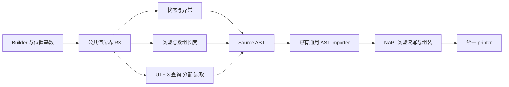
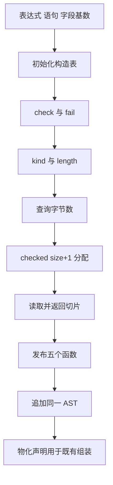

# NAPI 公共值边界自举

## Intent

将 N-API 公共值边界的 check、fail、kind、length、string 五个函数完整迁入 RX/ZX，保持异常优先级、数组校验、UTF-8 读取及生成 ABI；继续类型规划和各类型读写生成的自举。

## Data

上一阶段 6a9c9874 已迁移 Node runner/register/同步执行入口。napi/value.zig 仍手写构造上述函数。既有通用 node/import_module 能将 Source AST 追加至同一 Builder，无需新增专用语义桥；已有 Node 协议、异常、字符串、数组、所有权与 Worker 回归可复用。

固定冷基线：129.74 wall、216.03 CPU、树峰 2,247,294,976 B。上阶段最终值：119.71 wall、206.72 CPU、树峰 2,119,155,712 B；保留首次 122.18 s 及最大分区约 1.3 s 增量的记录，不把复测差异当作优化收益。

## Edges

- 仅结构化 AST 与统一 printer；Native 仅传位置基数、导入 Source AST 并物化声明，初始 seed 保留旧实现。
- error_union 的表达式 ID 和函数参数字段 ID 必须采用已有 context.source 基数，不能固定为零。现有独立模块基数为零，追加模块必须处理非零基数。
- check 先保留 PendingException，再报告 InvalidNodeValue；fail 仅在查询成功且没有 pending exception 时抛出新异常。
- length 先校验 Array 再读长度；string 先查询 UTF-8 大小、checked add 为终止符分配，再读取并返回去掉终止符的切片。不改变输入复制/借用契约。
- 参考 napi-rs，不引入 Rust 运行库、JS 编译后端或新运行时。类型可达性及各类型读写仍是后续职责，不宣称整个 napi 包迁移完成。
- Source 构造表与 Native Builder 共用生成 arena，至打印结束后释放；复用通用 importer 借用 payload，不新增同职责资源层或多余深拷贝。

## Answer

交付 RX 编排、ZX 原子构造及薄适配；对照完整 N-API 产物，覆盖非零追加基数，运行既有回归、Source 阶段核对与受影响路径性能验证。验收后统一提交全部变更并推送。记录遵循 IDEA；完整自举目标保持。

## 进展与自我复核

RX 显式连接 check/fail、kind/length、字符串查询/分配/读取与发布；ZX 保留单个边界操作的 AST 构造。Native 仅使用已有通用 importer 与声明物化接口，未新增类型判断或异常规则。仍保留 Native 类型规划及专用读写生成，不能把该阶段当作整个编解码自举完成。

fail、length 的单文件构造略高于建议 180 行，均低于硬上限 240，围绕同一个边界职责保留必要语义空行；未为行数机械拆出转发层。

## 已取得的证据

- Source stage1/2/3 各 21/21 通过；同一 358 入口、3,879 模块、3,407 函数输入下，stage2/3 的 8,364 个生成文件逐字节一致。
- 忽略目录内独立探针覆盖 11 个标量及可空、字节列表、对象、元组、错误集合、枚举，共 17 份完整 N-API 模块，Native seed 与 Source 均逐字节一致。累计分配 4,677,193 → 5,283,451 B，分配次数 88 → 92，全部释放。该数据为多次生成的累计分配，不是峰值或应用运行时分配。
- 追加基数探针先建立 Native 表前缀，再传 expressions=2、statements=1、fields=1。追加并物化五个函数后，打印结果与原完整模块中的对应 helper 区域逐字节一致，直接覆盖非零基数。
- 现有回归 47/47 步、14/14 Zig 测试通过；Node 561 协议、64 绑定、33 TypeScript 声明，以及异步 18 协议、42 所有权、11 State、12 Worker、8 执行失败检查通过。包含既有原生引用导出边界检查，未新增正式测试。未逐一注入所有 N-API C 调用失败，不声称这些出口均有动态覆盖。
- 新增/调整 Source 格式与 lint 通过；日志与临时产物在 `.zig-cache/napi-value-*.log` 和 `.zig-cache/cold-build-analysis/ownership-research/napi-value/`，不提交。

## napi-rs 原文核对

核对其 [String 转换](https://github.com/napi-rs/napi-rs/blob/main/crates/napi/src/bindgen_runtime/js_values/string.rs)：查询 UTF-8 长度、为终止符留空间、读取后按实际长度截断。保留 ZX 既有 checked add，不照搬未检查的加法。

核对其 [错误转换](https://github.com/napi-rs/napi-rs/blob/main/crates/napi/src/error.rs) 中 throw_into：先查询 pending exception，查询失败时退出。本阶段保留既有 ZX “有 pending 时不再抛新异常”契约，没有照搬 Rust 错误包装或线程引用管理。

## 性能与冷构建证据

Source 工具本体与分析/生成均为 Source：上阶段 slim-stage3 → 本阶段 stage3，在相同 358 入口输入、独立函数缓存下，一轮预热后三轮交替运行。CPU 中位数 4.84 → 4.84 s，wall 1.37 → 1.38 s，RSS 791,625,728 → 791,674,880 B；8,364 个文件跨工具及重复运行逐字节一致。固定生成器基线 CPU 4.69 / wall 1.27 s 不重置，累计 +0.15 / +0.11 s，同时记录入口规模增长。

完整冷构建使用 Zig 0.17.0、ReleaseSmall、12 核、默认三分区、固定本地 Zig 归档及全新 local/global 缓存，43/43 通过。工具本体由初始 Native seed 引导、分析/生成启用 Source；不与全 Source 工具运行成本交叉比较。

| 指标              |      固定基线 |    上阶段最终 |        本阶段 | 单阶段变化 |     累计变化 |
| ----------------- | ------------: | ------------: | ------------: | ---------: | -----------: |
| wall / s          |        129.74 |        119.71 |        122.68 |      +2.97 |        -7.06 |
| CPU / s           |        216.03 |        206.72 |        207.28 |      +0.56 |        -8.75 |
| 树峰 RSS / B      | 2,247,294,976 | 2,119,155,712 | 2,113,437,696 | -5,718,016 | -133,857,280 |
| time 单进程峰 / B | 2,075,033,600 | 2,098,446,336 | 2,097,774,592 |   -671,744 |  +22,740,992 |

CPU=197.89 user+9.39 sys。树峰为 200 ms 采样，采样单进程峰 2,092,695,552 B 与 time 口径不同。不把约 5.7 MB 树峰下降当作独立优化收益；固定树峰仍低约 5.96%，固定单进程峰仍高约 1.10%，均保留。

原始冷墙钟单点比较超过 1 s，未将其静默放行。时间线显示：configurer 首次出现 27.61 → 29.70 s，分区开始 61.74 → 63.94 s；最大分区 26.02 → 26.74 s，最终 CLI 31.52 → 31.70 s。约 2.2 s 增量发生在分区前；上一阶段两轮相同入口注册的前置阶段已有约 2 s 波动，不能据此把全部增量归因于迁移，也不能断言前置阶段毫无成本变化。

针对受影响的最大分区，固定共享 global cache、各用 fresh local cache，并在全部 Node 回归结束后隔离做一次 before/after 对照：wall 22.60 → 23.40 s，CPU 23.13 → 23.95 s，RSS 1,196,179,456 → 1,221,115,904 B。该项是各一次观测，不宣称统计显著；受影响路径增量 0.80/0.82 s 均在 1 s 门槛内，完整 CPU 增量 0.56 s。此前误与 Node 回归重叠的一组计时作废并停止，不计入结论。没有重复完整冷构建挑选更快结果。

按受影响路径与固定累计基线验收本职责；保留原始总墙钟超限这一观测限制，不声称全流程绝无波动。Node Task 后三个职责迁移的冷 CPU 趋势为 204.64 → 205.90 → 206.72 → 207.28 s，累计增长 2.64 s 已接近 3 s 警戒；即使相对固定 216.03 s 仍下降，也不能继续逐次领取容差。后续新增职责前需针对生成规模、分区和后端成本继续核对此趋势。

原始冷日志/采样：`.zig-cache/cold-build-analysis/ownership-research/partition-reference/cold-napi-value-p3/`；隔离分区对照：`napi-value/part1-control-final/`；作废对照：`napi-value/part1-control/`。均不提交。

## 最终行为与剩余范围

完整冷构建产出的默认三分区 CLI 直接运行现有 Node 协议与绑定脚本，561 协议、64 绑定、33 声明，以及异步/State/Worker/所有权/执行失败检查全部通过，没有重建测试 CLI。

本阶段完成公共值边界五个函数的 Source 迁移，保留初始 value_seed。Native 类型规划与标量/枚举/复合类型的专用读写生成仍待迁移；原生 AST 组装使用既有通用 importer，并非整个 napi 已自举。
