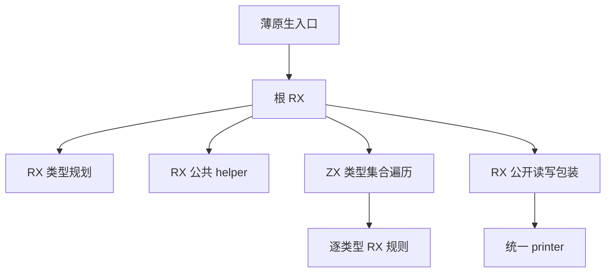

# N-API 根模块自举

## Intent

将 N-API 根模块、导入、类型别名声明、逐类型读写组装和公开包装迁入 RX/ZX。复用上一阶段的规则，共享一份 AST，消除逐类型原生适配和中间 AST 导入。

## Data

- 上阶段 `def47347`：完整冷构建 119.28 秒墙钟、217.07 秒 CPU、树峰 2,105,131,008 字节。
- 固定冷基线仍为 129.74 秒墙钟、216.03 秒 CPU、树峰 2,247,294,976 字节；生成器固定基线 4.69 秒 CPU、1.27 秒墙钟。
- ZX 已能在内聚集合遍历中调用 RX 模块，现有 services/growth 实现提供成熟范例，不需要添加循环标签或闭包运行库。
- 统一 printer 已能借用 context/forms 列，本阶段需要接纳已有的额外表达式列。

## Edges

根 RX 表达规划、公共 helper、类型遍历和公开包装；遍历保持在 ZX，逐类型读写决策继续交给 RX。正式路径不得调用种子语义，不把数组或对象先复制后迁移。所有节点由结构化构造器产生，最后一次统一打印。

初始 seed 保留独立目录；原生正式入口只处理 ABI 借用、错误归一化和通用 printer。通用 printer 扩展只接纳 AST 额外列，不增加 N-API 专用接口。

## Answer

交付完整根模块 RX/ZX 和薄入口，删除中间原生 codec/plan/value 适配。验收完整生成模块、真实 Node 行为、分配失败、三阶段与产物一致性，以及实际受影响生成、冷构建和宽类型成本。统一提交全部变更并推送，核对工作区干净和无未推送提交。

## 实现与局部证据

根流程使用类型规划 → 导入 → 公共 helper → 类型集合 → 公开包装 → 一次发布/打印。类型集合 ZX 调用 member RX，由后者显式编排别名、输入读取和输出写出。共享 AST 的字段、声明、表达式和语句基址保持一致；没有先生成一份原生 AST 再重新投影。

原生 seed 的 root/types/read/write/value/common/number/list/record 收入 `host/node/napi/seed/`。正式根入口仅传递借用类型列和零基址，调用 Source 根入口并交给统一 printer；原先三个 plan/value/codec 原生适配与生成导出替换为一个完整模块导出。

- 20 组完整模块与 seed 逐字节一致；Source 累计分配 4,909,821 字节，低于 seed 5,392,375 字节及上一阶段 Source 6,860,197 字节。
- 人为重复类型 ID 的 16/64/256/512 字段样本，当前 Source 为 1,769,780/4,862,472/23,071,809/41,861,025 字节；上一阶段 512 字段为 76,864,841 字节。所有完整输出逐字节一致。
- 真实 ZX 源码经前端产生 13 个类型，16/64/256/512 字段 Source 分配为 852,117/2,621,669/9,762,177/19,246,661 字节；对应 seed 为 865,387/2,465,065/5,626,803/14,404,707 字节。512 字段较上一阶段增加 666,872 字节，不能以合成压力样本的下降宣称所有内存路径都下降。当前仍保留 arena 容量档位与中间描述符成本，真实构建的 CPU/墙钟/RSS 待隔离确认。
- Source 三阶段各 21/21；既有回归 47/47 步、14/14 Zig 检查通过，包含 Node 561 协议、64 绑定、33 TS 声明，以及异步协议/所有权/State/Worker/失败行为 18/42/11/12/8 检查。没有新增正式测试用例。

## 生成器验收

第一次脚本只以入口数量 358 选 manifest，碰巧选中历史同数量输入。该轮生成器计时及 stage2 与该轮产物的比较全部作废，不据此推断编译器差异。已将入口名称 node_napi 加入身份核对；以同一当前 manifest 重新验证。阶段构建本身和 Native/Source 完整模块探针都显式使用当前入口，不受该脚本选取错误影响。

## 冷构建

默认四分区、12 核、ReleaseSmall、相同 Zig 归档、独立本地/全局缓存，完整构建 43/43 成功。采样树峰 2,101,428,224 字节、采样单进程峰值 2,080,669,696 字节；相对上阶段树峰减少 3,702,784 字节，相对固定基线减少 145,866,752 字节。time 的 CPU/墙钟/单进程峰值在最终表中记录，驱动采样总耗时 118.90 秒不代替 time 的墙钟值。

## 最终阶段与累计性能

更正 manifest 身份后：358 个当前入口包含 node_napi，Source 工具本体旧 stage3 → 新 stage3，同输入且均运行 Source 分析/生成。预热一次、交替三次，中位数 CPU 4.98→4.97 秒、墙钟均 1.43 秒、RSS 802,865,152→802,521,088 字节；8,528 个生成文件全量一致。stage2/stage3 对同一当前输入的 8,528 文件也全部一致。

生成器相对固定基线累计 CPU +0.28 秒、墙钟 +0.16 秒，不重新设定基线。相对上阶段不同入口输入的数字只作趋势记录，不归因于优化收益。

| 指标                    |      固定基线 | 上阶段 def47347 |          当前 |
| ----------------------- | ------------: | --------------: | ------------: |
| 冷构建墙钟（秒）        |        129.74 |          119.28 |        118.87 |
| 冷构建 CPU（秒）        |        216.03 |          217.07 |        216.74 |
| 树峰（字节）            | 2,247,294,976 |   2,105,131,008 | 2,101,428,224 |
| time 单进程峰值（字节） | 2,075,033,600 |   2,088,828,928 | 2,090,008,576 |

当前相对固定基线：墙钟 -10.87 秒、CPU +0.71 秒、树峰 -145,866,752 字节（约 -6.49%）。相对上阶段：墙钟 -0.41 秒、CPU -0.33 秒、树峰 -3,702,784 字节；time 单进程 +1,179,648 字节（约 +0.06%），独立记录，不把树峰下降当作所有进程都下降。

冷构建工具本体从 Native 初始 seed 构建，该工具生成并静态链接 Source 实现；最终正式路径使用 Source 分析/生成，不把初始工具本体称作 Source stage3。独立 Source 三阶段工具链则明确由前一 Source 阶段生成。

## 实际 N-API 路径与交付核对

上一阶段与当前冷构建安装的 CLI，对同一 512 字段源码、相同外部 Zig 和 ReleaseSmall，分别预热一次后交替三次：CPU 中位数均 0.75 秒、墙钟均 0.69 秒、time RSS 163,069,952→162,693,120 字节。两份 addon 均通过 512 字段真实 Node 往返。该项使用已预热的后端缓存；首次预热共享缓存顺序不同，明确不作为冷构建前后对比。N-API resources 在 backend artifact/cache 查询之前创建，计时仍覆盖本次改造的生成规则。

原始证据位于忽略目录 `.zig-cache/cold-build-analysis/ownership-research/napi-module/`、`partition-reference/cold-napi-module-final/` 及 `.zig-cache/napi-module-*.log`。更正后的生成器日志为 generator-current，阶段一致性日志为 stage-current-parity；首次误选 manifest 的数据不纳入验收。

## 自我核对与剩余边界

- RX 表达规划、公共 helper、类型成员和公开包装的真实顺序，ZX 保留集合遍历与原子节点构造；没有入口包装一个大型 ZX 总控函数。
- 正式 N-API 路径的自有生成规则与状态已进入 RX/ZX，手写根入口只做同步 ABI 列借用、错误归一化和调用统一 printer。原生 seed 目录仅在 generated_analysis 关闭的初始引导路径可达。
- 统一 printer 的通用额外列投影仍为手写适配，属于全编译器 AST/ABI 边界待迁移范围；本阶段不据此宣称整个编译器已自举完成。
- 20 组和扩展宽类型输出、三阶段一致不能单独证明所有内部类型表都具备同等成本；实际源码中的 arena 累计分配仍有档位波动，已逐项记录，没有把合成压力收益外推为所有路径收益。
- 不改变应用生成物、字节输入独立存储和异常顺序；没有新增业务数据复制、专用桥或运行库。提交时统一收口全部未提交内容，并核对上游同步。

最终安装 CLI 已直接通过既有 561 协议、64 绑定、33 TS 声明和 18/42/11/12/8 异步/所有权/State/Worker/失败检查，未重复构建该 CLI。106 个当前 N-API RX/ZX 文件完成格式与 lint 核对，全部 ZX 未超过 240 行；本次 diff 完成结构化生成和 seed 隔离核对。提交推送后再确认干净工作区与无未推送提交。
