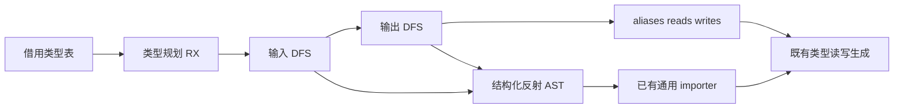
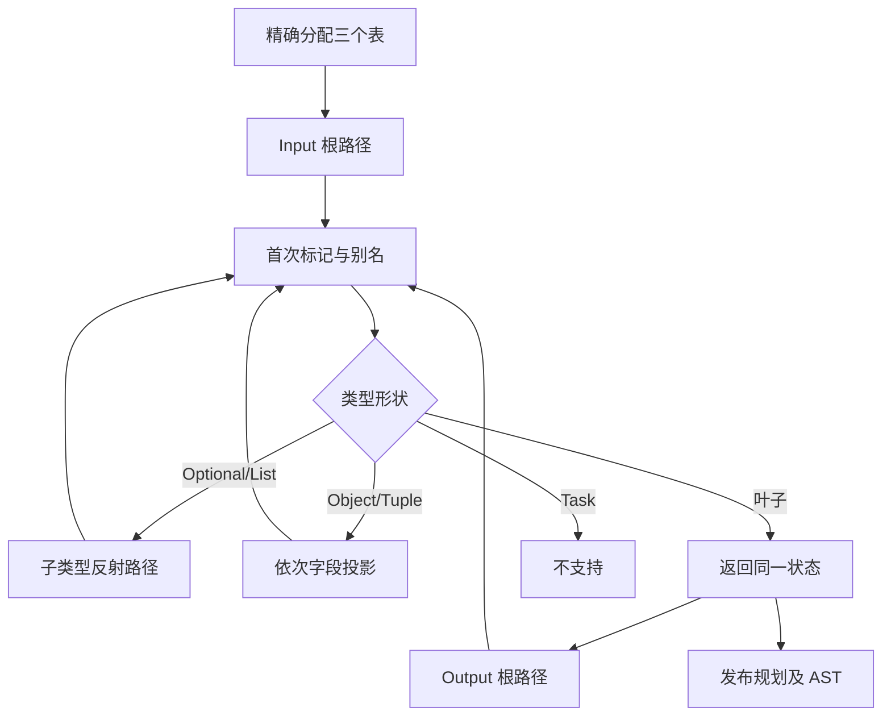

# NAPI 类型规划自举

## Intent

将输入/输出类型可达性、读写标记与首次别名路径选择完整迁入 RX/ZX，随后继续专用读写生成。保持深度优先次序与共享类型的首次到达别名；保留累计性能警戒，不因本阶段重置基线。

## Data

0483432d 已迁移五个公共值函数，类型 mark 仍为 Native 递归。既有普通递归、类型表借用、精确长度 map、结构化反射 AST 及 importer 已足够表达该职责，无需新语法或堆队列。

固定冷基线 129.74 wall、216.03 CPU、树峰 2,247,294,976 B；上阶段 122.68 wall、207.28 CPU、树峰 2,113,437,696 B。Node Task 后三次迁移 CPU 累积增长 2.64 s，接近 3 s；本阶段必须核对生成规模和分配，不能继续逐次领取容差。

## Edges

- 输入先于输出；同一方向重复访问立即返回；第一次到达写 alias；Optional/List 深入 child，Object/Tuple 按原字段顺序深度优先，Task 拒绝。NativeReference 保留原有后续读写拒绝边界。
- 延续调用栈递归，不额外分配遍历队列；三个索引表精确分配一次，复用不可变更新的转移能力。必须实测有无整表复制，不以最终结果正确替代成本等价。
- 复用纯 Type 名与反射 layout，省去未被使用的叶子 Type 标识符；只改变 AST 共享，不改变打印出的反射表达式和别名选择。
- Native 只借用类型表、导入 AST、持有 readonly 结果描述符。初始 seed 保留旧递归；类型名与布局等用于专用读写生成的 Native 构造仍是剩余职责。
- 不引入专用运行库、语义桥、源码模板、数组裸值协议或不必要数据复制。Source aliases 使用与初始 seed 相同的可空 u32 表，消费处只进行表达式 ID 的零成本枚举转换。

## Answer

交付真实 RX 输入/输出遍历顺序、ZX DFS 与投影逻辑，以及薄原生适配。核对完整 N-API 产物、共享类型、现有边界回归、分配和阶段产物，再验证受影响路径。原始墙钟波动与固定累计数据一并保留；完整职责验收后收口所有变更、提交并推送。

## 进展与自我复核

实现中，尚未验收。必须检查递归 State 及索引表的生成表示与实际分配，避免把 Native 小描述符迁为重复大表复制；发现生成质量缺口时修复通用能力，保留迁移。

## 初步正确性与成本证据

17 个标量/可空/字节列表/对象/元组/错误集合/枚举的完整 N-API 模块，Source 与初始 seed 逐字节相等。两者均使用初始 seed 引导的工具生成当前 Source 条目；本项是产物和生成分配对照，不与历史 Source 工具运行时间交叉比较。

父分配器累计分配 4,677,193 → 4,780,613 B，底层 arena 分配次数 88 → 91，全部释放；上阶段未迁移类型规划的 Source 路径为 5,283,451 B（不同代码版本，不能把差值当作稳定计时收益）。这些是父分配器看到的 arena 块，不是每个逻辑分配调用的统计。

| 对象字段数 | seed 累计分配 / B | Source 累计分配 / B | 两者底层 arena 分配次数 |
| ---------- | ----------------: | ------------------: | ----------------------: |
| 16         |         1,459,368 |           1,490,750 |                       9 |
| 64         |         4,777,558 |           3,698,132 |                      12 |
| 256        |        23,371,003 |          20,137,489 |                      15 |
| 512        |        34,472,097 |          28,898,397 |                      18 |

扩大场景中，各字段使用独立 Optional 类型并共享同一标量，覆盖重复叶子、宽图与双方向遍历。四份完整产物全部逐字节相同，均释放全部父分配器内存；512 字段约减少 16.17% 累计 arena 分配量。该观察不能单独证明所有规模都没有隐藏复制。

进一步检查生成代码：initialize 的三个 map 使用 zxReserveBounded，容量上界来自 kinds.len，首个追加按准确容量分配；claim 的 reads/writes/aliases 更新通过转移后的可写切片直接写元素；claim 与 walk 未出现整表 dupe/clone/renew/memcpy。结合规模曲线，未发现逐节点复制三个索引表的实现。递归仍使用普通函数调用，未新增堆遍历队列。

稳定函数文件定位依据现有命名 SHA256（域、源码路径、source 各带长度前缀），未按函数名猜测热点。生成片段和探针均在 `.zig-cache/cold-build-analysis/ownership-research/napi-plan/`，不提交。

## 阶段与已有回归

Source stage1/2/3 各 21/21 通过；最终 RX 在输入不支持时直接发布拒绝结果，不继续构造输出路径。stage2/3 在同一 359 入口、3,892 模块、3,418 函数输入下，8,390 个文件逐字节一致。

现有回归 47/47 步、14/14 Zig 测试通过；Node 561 协议、64 绑定、33 TypeScript 声明，以及异步 18 协议、42 所有权、11 State、12 Worker、8 执行失败检查通过。未新增正式测试，未声称覆盖所有分配失败注入点。

上阶段 Source stage3 → 本阶段 Source stage3，同一 359 入口、独立函数缓存、一轮预热后三轮交替运行：CPU 中位数 4.83 → 4.82 s、wall 1.37 → 1.36 s、RSS 793,853,952 → 793,772,032 B；跨工具与重复运行的 8,390 个文件一致。固定生成器基线仍为 CPU 4.69 / wall 1.27 s，累计 +0.13 / +0.09 s，保留输入规模增长背景；不把百分之一秒差值当作优化收益。

本阶段工具本体与分析/生成均为 Source；另行冷构建仍是初始 Native seed 引导、分析/生成启用 Source，不能交叉相减。完整冷构建结果如下。

## 完整冷构建与累计趋势

Zig 0.17.0、ReleaseSmall、12 核、默认三分区、固定本地 Zig 归档、全新 local/global 缓存，43/43 步通过。只运行本次受影响路径的一轮冷测，没有用重复计时挑选更快结果。

| 指标              |      固定基线 |        上阶段 |        本阶段 |  单阶段变化 | 固定累计变化 |
| ----------------- | ------------: | ------------: | ------------: | ----------: | -----------: |
| wall / s          |        129.74 |        122.68 |        121.63 |       -1.05 |        -8.11 |
| CPU / s           |        216.03 |        207.28 |        205.32 |       -1.96 |       -10.71 |
| 树峰 RSS / B      | 2,247,294,976 | 2,113,437,696 | 2,101,460,992 | -11,976,704 | -145,833,984 |
| time 单进程峰 / B | 2,075,033,600 | 2,097,774,592 | 2,095,136,768 |  -2,637,824 |  +20,103,168 |

CPU=195.79 user+9.53 sys；采样单进程峰为 2,080,833,536 B，不与 time 峰混淆。树峰为 200 ms 采样，固定累计约低 6.49%；固定单进程峰仍高约 0.97%，不能声称所有内存指标均已降低。约 12 MB 单阶段树峰下降不单独用作优化因果证明。

Node Task 后冷 CPU 趋势现在为 204.64 → 205.90 → 206.72 → 207.28 → 205.32 s，近段累计增长从 2.64 s 回落到 0.68 s，固定基线仍为 216.03 s。类型规划减少了反射 AST 节点和扩大场景分配，但没有逐项控制后端/调度因素，不能将全部 1.96 s 归因于单个局部改动。

完整证据在 `.zig-cache/cold-build-analysis/ownership-research/partition-reference/cold-napi-plan-p3/{command.json,build.log,samples.jsonl,metrics.json}`，不提交。采样器总时长约 121.65 s 与 time 的 121.63 s 口径不同。

最终冷构建 CLI 的现有 Node 协议及绑定脚本全部通过（561 协议、64 绑定、33 声明及异步/State/Worker/所有权/执行失败检查），未重新构建测试 CLI。类型名/布局辅助构造和专用 read/write 生成仍在 Native，整个 napi 编解码与整体自举均未完成。

## 深度与逻辑分配补充

对 16/64/256/512 层可空链，完整 Source/seed 产物全部逐字节一致，512 层正常完成。父 arena 累计字节并非所有深度均下降：

| 深度 |   seed / B | Source / B |
| ---- | ---------: | ---------: |
| 16   |    870,964 |  1,176,564 |
| 64   |  3,639,360 |  4,731,334 |
| 256  | 10,277,340 | 16,265,380 |
| 512  | 33,435,472 | 25,173,704 |

因此不宣称所有类型形状都有分配收益。整份生成管线中等深度仍有额外 arena 容量，不能只凭这些父分配器计数将其归因为规划器整表复制。

进一步将计数分配器放在 arena 之上、直接调用 Source 规划入口，排除后续 Native 读写生成/打印和父 arena 块容量：深度 16/64/256/512 的逻辑累计字节为 12,606/48,446/191,134/381,198，逻辑分配调用数 101/307/1,089/2,120，未计 setup 类型表构造。该组件近似线性，未呈现逐层复制 N 长索引表的二次增长；不是整份 N-API 管线的成本证明。

parent 只需要 context，不需要整份规划状态，最终收窄其参数。四档深链产物与上述分配计数完全不变，保留职责边界改进，不宣称性能收益。最终两文件 Source 已独立重新生成、编译并执行探针；阶段/冷构建数字对应此前相同算法与结果，未为这个等价参数收窄重复整轮计时。中等深度整管线的 arena 额外容量作为后续编解码迁移的观测边界保留。

本阶段完成类型可达性与首次别名选择自举，未增加专用原生语义桥或堆遍历队列；整个 NAPI 编解码与完整自举仍继续。
