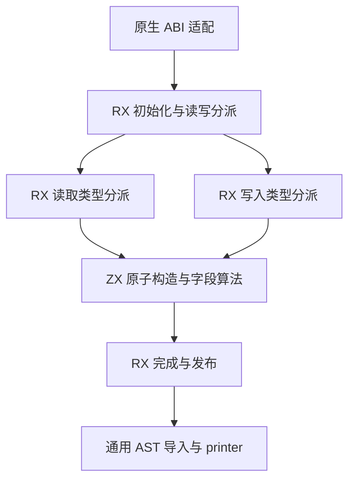

# N-API 读写生成自举

## Intent

将 N-API 类型读写的生成规则迁入 RX/ZX，保留原实现的 ABI、字段顺序、异常和所有权契约。标量、可空、列表、字节、对象、元组及命名类型作为完整职责一起验收。

## Data

- 固定基线：冷构建 129.74 秒墙钟、216.03 秒 CPU，进程树峰值 2,247,294,976 字节。
- 上一阶段 `6343681b`：121.63 秒墙钟、205.32 秒 CPU，进程树峰值 2,101,460,992 字节。
- 当前改动尚未通过生成结果、阶段自编译、既有行为回归和性能验收。
- 类型规划已来自 RX/ZX；本阶段消费它生成逐类型读写函数。

## Edges

RX 分派读取/写入及类型分支，ZX 负责结构化 AST 构造和内聚字段遍历。原生适配只传递类型列和 AST 基址，导入通用模块列；初始 seed 保留旧实现。正式路径不得回调旧读写规则。

字节输入继续复制到独立存储以满足外部可变缓冲的生命周期，不能把保活误认为不可变借用。普通类型共享已有类型列，不复制整份类型表。

## Answer

交付 RX/ZX 读写生成、薄原生适配及验证证据；全部变更统一提交推送。验收包括 Native/Source 完整生成模块对照、既有 Node 回归、Source 阶段一致性、受影响生成器及完整冷构建 CPU/墙钟/内存对照。

## 执行记录

- 检查已有未提交实现，先修复 unit 构造参数和局部 scope 与导入函数的重名。
- 清理 zray 删除后遗留的格式化忽略项。

## 验证与成本定位

- 三个 Source 阶段均 21/21；既有 Node 协议 561 项、绑定 64 项、TS 声明 33 项和异步协议/所有权/State/Worker/执行失败 18/42/11/12/8 项通过。原生引用与失败释放补验 14/14。
- 对照探针扩大至 20 个完整生成模块，包含普通整数列表、空对象和空元组，Native/Source 逐字节一致。
- 同一 360 入口输入，Source 本体旧 stage3 → 新 stage3：生成 CPU 中位数 4.96→4.97 秒、墙钟 1.41→1.42 秒，RSS 797,458,432→797,376,512 字节；8,515 个输出文件全量一致。
- 首次默认三分区冷构建 43/43：120.17 秒墙钟、214.34 秒 CPU，单进程峰值 2,086,731,776 字节，树峰 2,675,965,952 字节，内存未通过。三个 LLVM 进程约 804/934/912 MB 同时驻留，最终链接单进程没有增长。相对固定基线墙钟 -9.57 秒、CPU -1.69 秒，树峰 +428,670,976 字节，不能用墙钟收益抵消内存退化。
- Source 宽对象构造的逻辑分配随字段数线性增长：16/64/256/512 字段，读取 105,459/360,723/1,379,475/2,737,171 字节，写入 110,283/389,771/1,510,123/3,004,123 字节。完整渲染累计 arena 分配较旧实现增加，尚未解决；这与整轮冷构建 LLVM 进程重叠峰属于不同成本，不能混称同一个原因。
- 有界验证后端单元粒度：复用生产初始生成器、相同 360 入口、工具链、优化参数、全部核心与独立后端缓存，仅用四分区替换三分区。四任务同时执行，22.88 秒墙钟、71.85 秒 CPU，树峰 2,152,562,688 字节，采样单进程 993,722,368 字节。保持全局核心数和显式覆盖参数，不引入固定延时或降低任务并发。
- 根据此证据，native Safe/Small 默认粒度调整为四分区；需以完整默认冷构建进一步验证，暂不宣布阶段完成。

### 四分区整轮与发布表示优化

四分区完整默认冷构建 43/43：time 墙钟 **119.43 秒**（采样驱动含退出轮询为 119.59 秒），CPU **216.83 秒**（206.70+10.13），树峰 **2,125,152,256 字节**，time 单进程峰值 **2,101,985,280 字节**。相对固定基线：墙钟 -10.31 秒、CPU +0.80 秒、树峰 -122,142,720 字节；相对上阶段 CPU +11.51 秒但墙钟 -2.20 秒，按用户允许的 CPU/墙钟权衡接受方向，明确保留增长警戒。树峰相对上阶段 +23,691,264 字节（约 1.13%），显著低于三分区未通过结果，仍跟踪该独立指标。

进一步定位：逐类型发布经过 Task/Context 快照再追加表达式列，造成宽表达式描述符重复分配。通用导入器已有 context/extra 模块列接口，因此直接发布现有 context、额外列与声明列，不构造完整表达式快照。此处复用通用 AST 接口，没有新增 N-API 语义桥或改变生成 Zig。

同一 20 组完整模块继续逐字节一致，Source 累计分配 **10,169,299→6,860,197 字节**（减少 32.54%）；旧 Native 为 5,392,375 字节。仍存在表示成本差异，不能将下降宣称与 Native 完全等价。最终版本阶段自编译、宽度扩展、完整冷构建及实际安装 CLI 检查待补。

### 最终表示的补验

- 稀疏模块列版本的 Source 三阶段再次全部 21/21；完整既有回归 47/47 步、14/14 Zig 检查，以及所有前述 Node/Worker 检查通过。
- 最终生成器对照仍使用相同 360 入口、Source 本体 stage3 与 Source 分析/生成：CPU 4.96→4.97 秒，墙钟均 1.42 秒，RSS 798,097,408→797,769,728 字节；8,515 文件全量逐字节一致。
- 稀疏发布减少单次调用的逻辑分配 8,736 字节、9 次分配。512 字段读取/写入分别为 2,728,435/2,995,387 字节。人为重复类型 ID 的全模块探针在 16/64/256/512 字段为 2,683,800/7,237,400/28,496,155/76,864,841 字节；512 处 arena 容量越过增长档位，反而高于旧发布版本的 69,034,153 字节，因此不能宣称发布优化对所有累计 arena 样本单调降低。
- 真实 ZX 源码再经正式前端分析：四种宽度均只有 13 个类型（同形可空类型被复用）。Native/Source 完整模块摘要均一致，512 字段累计分配 14,404,707→18,579,789 字节；256 字段 5,626,803→13,051,011 字节，同样保留 arena 增长档位影响。该差异尚在，下一项用真实 N-API 构建的 CPU/墙钟/RSS 判断实际影响，不用冷构建的大数字掩盖细分路径。

## 最终验收

| 指标                    |      固定基线 |        上阶段 |    本阶段最终 |
| ----------------------- | ------------: | ------------: | ------------: |
| 冷构建墙钟（秒）        |        129.74 |        121.63 |        119.28 |
| 冷构建 CPU（秒）        |        216.03 |        205.32 |        217.07 |
| 树峰（字节）            | 2,247,294,976 | 2,101,460,992 | 2,105,131,008 |
| time 单进程峰值（字节） | 2,075,033,600 | 2,095,136,768 | 2,088,828,928 |

最终默认四分区、12 核、ReleaseSmall，独立本地与全局缓存，43/43 成功。冷构建工具本体从 Native 初始 seed 构建，再用它生成 Source 实现并静态链接正式 CLI；没有把该本体误称为 Source stage3。独立 Source stage1/2/3 工具本体链均来自前一 Source 阶段，三阶段各 21/21，stage2/stage3 同一输入的 8,515 个生成文件全部一致。正式 CLI 与 Source 工具均启用 Source 分析/生成实现，初始 fallback 仅用于引导。

固定基线累计差异：墙钟 -10.46 秒、CPU +1.04 秒（约 +0.48%）、树峰 -142,163,968 字节（约 -6.33%）。相对上阶段 CPU +11.75 秒而墙钟 -2.35 秒，记录四分区的重复后端工作权衡；CPU 容差不是新预算，累计超过 3 秒仍须定位。树峰相对上阶段 +3,670,016 字节（约 +0.17%），没有忽略三分区曾出现的大幅增长。

真实 512 字段 N-API 构建使用上一阶段和最终冷构建安装的 CLI，同一源码、同一外部 Zig、同一优化配置与后端缓存。预热各一次，交替测量三次，中位数 CPU **0.70→0.75 秒**、墙钟 **0.65→0.69 秒**、time RSS **162,922,496→162,791,424 字节**；两份 addon 均通过 512 字段真实 Node 往返。该结果为后端缓存已预热的构建路径；首次预热因共享缓存先后关系不作冷构建比较。代码中 N-API resources 在后端 artifact/cache 查询前创建，因此命中后端缓存仍经过本阶段读写生成。

生成器相对固定基线 CPU **4.69→4.97 秒**（累计 +0.28）、墙钟 **1.27→1.42 秒**（累计 +0.15），入口数量增长已明确，未重置基线。相同当前输入跨工具的差异只有 CPU +0.01 秒、墙钟不变、RSS 略降。

原始证据保存在忽略目录 `.zig-cache/cold-build-analysis/ownership-research/napi-codec/` 和 `partition-reference/cold-napi-codec-final/`；Node 最终安装 CLI 复核日志为 `.zig-cache/napi-codec-final-cli-*.log`。未新增正式测试用例。

## 自我核对与剩余边界

- RX 显式分派读写、类型与字节特殊路径；ZX 处理结构化节点构造、字段遍历和局部算法。没有原生回调承载正式读写规则，没有新增运行库或源码片段节点。
- 核对生成文本之外，还运行原生引用拒绝/分配失败、真实 Node 协议、异步所有权与 Worker 等既有检查。
- Source 的中间 AST 表示仍有分配成本，尤其 arena 增长档位使合成极宽/重复类型样本的累计分配不单调。没有证明所有合法内部表的成本与 Native 完全相同；本阶段的实际构建与固定冷基线已测，后续整体 N-API 模块迁移应继续压缩重复的中间列与描述符生命周期，不通过额外业务数据复制来绕过。
- N-API 根模块组装和公开包装、泛型 AST 导入/打印、Zig seed 引导仍有手写边界。本次完成的是逐类型读写规则的自举，不能宣称整个编译器或整个 N-API 根职责已完成自举。
- 代码组织与功能全量 diff、240 行上限、格式、无未提交和未推送内容在最终提交时核对。
