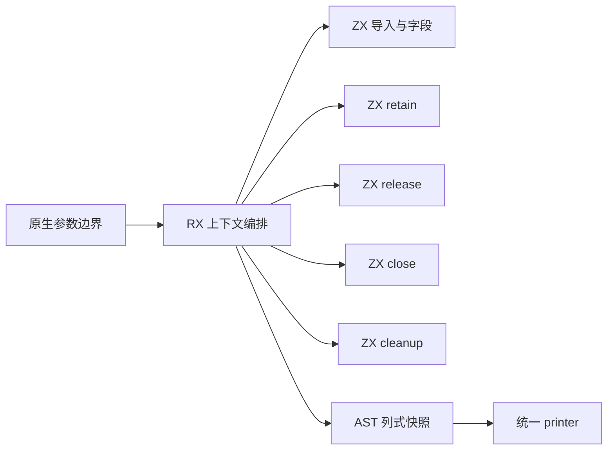
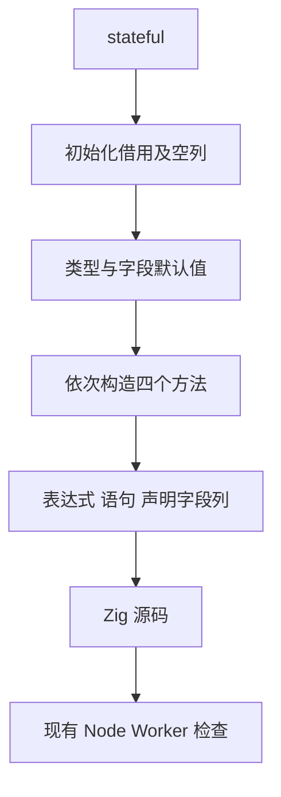

# Node 上下文生命周期自举

## Intent

把 Node 上下文的声明、引用计数、队列关闭与环境清理生成职责完整迁入 RX/ZX。保持输出、错误顺序与所有权成本模型，验收后统一提交推送。

## Data

当前 `host/node/context.zig` 用结构化 Builder 定义字段及 retain/release/close/cleanup；stateful 仅影响 State 类型及最后释放时的 state.deinit。现有 `test-napi-protocol` 覆盖状态、集合、异常和 Worker。上一完整冷构建墙钟 127.90 s、CPU 205.15 s；固定基线 129.74 / 216.03 s，生成器固定 1.27 / 4.69 s。

## Edges

不扩张为整个 Node 宿主已自举；runner、enqueue、task 与 N-API 值编解码仍是独立待迁移职责。原生仅保留参数及 AST printer 适配，旧实现用于初始 seed。不得新增专用运行库、语句模板或深拷贝。

CPU 和墙钟单阶段容差 1 s，固定基线不重置，累计退化超过 3 s 需定位；跟踪内存趋势。生成输出应与旧实现逐字节相同，语义等价部分不重复测应用运行性能；新增生成闭包需要验证工具构建成本。

## Answer

交付真实 RX 编排、ZX 字段与独立方法构造、薄原生入口、可复核的现有回归及阶段自编译证据。当前为实施中，未宣称通过。

## 实施与局部证据

- Source 已实现完整 Context schema、retain/release/close/cleanup，RX 显式串联职责，原生入口只传 stateful、调用与打印；不改变 Node 实际 ABI 和运行内存模型。
- 每个 ZX 按类型、字段、单个方法或通用 AST 构造组织，共 15 个文件，最大 187 行；未为使用 pipeline 改写必要的显式 AST 数据流。
- stage1、stage2 均 21/21；stage3 生成 0 个新文件、复用 3748 个文件，最终完成状态待核实。工具本体由 Source 阶段生成，当前分析/生成也是 Source。
- 忽略目录中的诊断探针对 stateful=false/true 使用旧 Native 构造和当前 Source 构造，统一使用 Source printer：生成文本逐字节一致，合计 Wyhash `b29d88159dd8df30`。
- 全部分配释放：累计分配 192,412→194,884 B（+2,472 B，约 1.28%），分配次数同为 8；这是两次生成的累计值，不是 RSS。不声称此迁移降低了分配。
- 首次对比脚本替换 options 时漏掉 `: bool`，实际跑了两次 Source，已判定无效并修正后重跑；上面的对照使用检查过的 false/true 参数。最初格式化命令工作目录错误也已纠正，没有把对应失败当作阶段通过。

现有两组 Node 回归进行中；尚未报告完整冷构建或性能门禁通过。

### 阶段闭包核对

stage3 也已 21/21 成功。当前四个方法的生成仅依赖 Source AST 原语、Source 状态模型与标准 bytes/integer 能力，没有调用旧 context_seed 或新增专用原生构造接口。旧构造只位于初始引导条件分支。薄原生入口仍是过渡参数/打印边界，不能据此宣称整个编译器原生闭包已消除。

真实生成出的 retain/release/close/cleanup 与旧构造逐字节相同；因此没有改变应用引用计数成本、队列算法或清理行为。性能验收重点是新增 Source 工具闭包及构建成本，而非重复测同一应用代码速度。

## 现有运行回归

`zig build test-napi-protocol test-napi-bindings`：28/28 步骤成功；561 个 NAPI 协议用例、64 个模块绑定检查、33 个 TypeScript 声明检查通过。异步检查明确报告 18 个 protocol、42 个 ownership、11 个 State、12 个 Worker 生命周期和 8 个执行失败检查通过。

12 个 Worker 检查对应有/无 State × 正常退出/主动 terminate × 3 轮，每轮队列 16 项，并确认主环境之后仍可调用。未新增正式测试文件，也未改变原有断言。

这组回归使用 Source 阶段 2 生成工具，当前分析/生成 Source。它编译的共用 CLI 为未分区测试配置，构建步骤报告 MaxRSS 4G；不能拿此数字和正式 P2 冷构建树峰直接对比。正式冷构建单独执行。

## Source 阶段固定点与生成性能

同一当前 354 入口输入，阶段 2/3 工具本体均 Source，运行分析/生成 Source，各用独立函数缓存，交替 4 次、首轮预热排除、取后 3 次中位数：

| 指标 |        stage2 |        stage3 |
| ---- | ------------: | ------------: |
| CPU  |        4.65 s |        4.64 s |
| 墙钟 |        1.32 s |        1.31 s |
| RSS  | 781,680,640 B | 781,926,400 B |

8128 个全部生成文件在跨工具及重复执行间逐字节一致。当前 3765 个模块、3301 个原始函数文件；上一阶段为 353 入口/3750 模块/3288 原始函数。相对上一已验收 4.67 / 1.34，当前 -0.03 / -0.03 s；相对固定 4.69 / 1.27，累计 -0.05 / +0.04 s。RSS 相对上一阶段 774,504,448 B 增加 7,421,952 B，保留趋势记录。

首次复制计时脚本未正确替换阶段目录，取到了旧工具且目标不存在，已判定无效。上述数值只来自检查过工具路径且完整成功的隔离对照。

完整冷构建 `cold-node-context` 执行中。固定基线不重置，不把重复的阶段间容差累加领取。

## 完整冷构建

`cold-node-context`：相同 Zig 归档和工具链、ReleaseSmall、12 核、全新本地/全局缓存，43/43 成功。引导工具本体由仓库现有 Source partition seed 生成，当前分析/生成使用 Source；不能把它的工具本体当作 Source 自编译阶段。当前迁移未改变 partition seed 或分区算法。

| 指标       |        固定基线 |  上阶段 Gateway | 当前 Node Context |
| ---------- | --------------: | --------------: | ----------------: |
| 墙钟       |        129.74 s |        127.90 s |          127.63 s |
| CPU        |        216.03 s |        205.15 s |          203.24 s |
| 树采样峰值 | 2,247,294,976 B | 2,271,117,312 B |   2,221,735,936 B |

墙钟采用 time 的 127.63 s，监测脚本包含轮询收尾为 127.825 s；CPU 为 194.34 user + 8.90 sys。time 最大 RSS 2,127,167,488 B，采样单进程峰值 2,122,121,216 B，均不能与进程树峰混为同一指标。

相对上阶段墙钟 -0.27 s、CPU -1.91 s、树峰 -49,381,376 B；相对固定基线累计墙钟 -2.11 s、CPU -12.79 s、树峰 -25,559,040 B。无需领取新的性能容差，也没有触发累计 +3 s 警戒。不同构建的采样和调度有噪声，因此只认本阶段没有可见整体退化，不把微小差值全归因于该迁移。

当前直接复用此次冷构建安装 CLI 运行已有两组 Node 用例，核对初始引导工具本体与 Source 运行路径的真实组合，不为回归重建编译器。

## 最终交付核对与自我审查

- 冷构建安装 CLI 的两组原有 Node 回归也全部通过：561 个协议用例、64 个绑定检查、33 个 TypeScript 声明检查，以及 18/42/11/12/8 项异步 protocol/ownership/State/Worker/执行失败检查。没有再次构建编译器。
- 15 个 Source 文件 lint 通过，Native 修改及原样保存的 seed 经 zig fmt 检查通过，diff whitespace 检查通过。context_seed 与上一提交的 context 完全相同。
- RX 展示真实的 schema 与方法组装，Source 没有回调旧 Context 语义；生成的应用代码与旧实现相同，未新增运行库、闭包分配、模板、按用例特殊分支或关闭所有权检查。
- 反向核对：这项迁移没有降低局部累计分配，增加 2472 B；生成器 RSS 也略增，不能仅展示完整冷构建下降的数字。完整构建和生成器均保留固定基线趋势。
- 仍有原生参数/打印适配边界，且 Node runner、enqueue、task、N-API 编解码和 WASM 等职责仍待迁移；整体自举目标保持进行中，不以当前通过的局部回归替代最终传递依赖审计。

本记录以 IDEA 说明目标、证据、边界与验收结果。全部未提交变更统一验收并提交推送，Git 结果另行确认。
