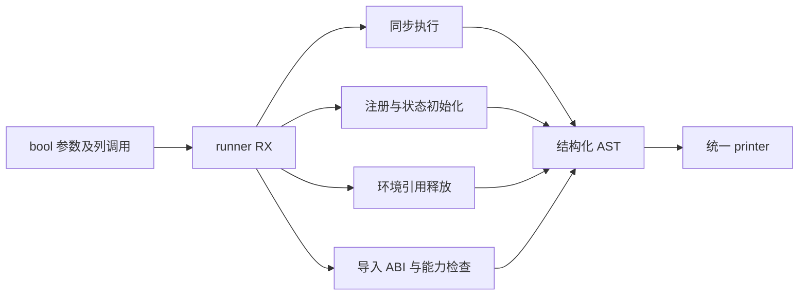
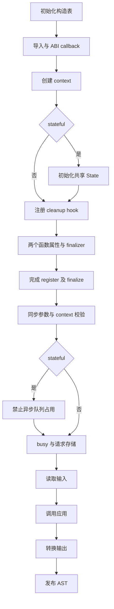

# Node 宿主入口自举

## Intent

将 runner、register 和同步 execute 的完整 Zig 生成职责迁入 RX/ZX；模块注册、状态初始化、同步调用及 finalizer 保持原有 ABI、错误与资源顺序。完成后统一验收所有变更、提交并推送，继续整体自举。

## Data

上阶段 d0ee3961 已迁移 Context、Task、enqueue；runner 仍由手写 Zig 编排 register/execute，并使用通用 Builder 输出。现有 Node 协议、绑定、State、Worker、所有权和失败恢复回归可复用。参考 napi-rs 的 async_work 与 ArrayBuffer/TypedArray 边界，保持引用持有和输入不可变存储的区别。

固定完整冷基线 129.74 wall、216.03 CPU、树峰 2,247,294,976 B；上阶段 119.84 wall、205.90 CPU、树峰 2,111,406,080 B。默认三分区、12 核、Zig 0.17.0；不随阶段重置累计基线。

## Edges

- 不新增专用原生语义桥、运行库或 Zig 模板；所有构造由普通 Source AST 与统一 printer 输出。
- 普通 ZX 借用/不可变语义不等于 JS 内存保证。同步转换的请求 arena 和异步输入快照契约不变。
- 注册函数创建 context 后立即 defer release；状态初始化完成后注册 cleanup hook，成功后置 hooked。每个导出函数先创建、挂 finalizer，再 retain，最后定义 property；失败出口不得改变这一顺序。
- 同步调用保留参数容量 2 和严格 arity；closing、busy、stateful running 按原顺序检查；busy 的清理早于 storage 释放注册，实际按 defer 逆序执行。
- stateful 使用 State.Request，stateless 使用局部 arena。能力要求在 comptime 拒绝，执行分支保留 unreachable 防止推导不支持的主机能力。
- CPU 小幅增加且冷墙钟无实质增长可接受，但内存独立验收。只测实际受影响路径，不因格式修改重复构建。

## Answer

交付真实 runner RX 阶段图、ZX 构造器与薄 Native 适配。检查 stateful 两种配置的生成文本、已有行为回归、Source 阶段间产物与完整冷构建成本。Native seed 仅初始引导；Node napi 编解码仍是剩余职责，不宣称整体自举完成。

## 进展与自我复核

RX 显式编排导入/ABI、注册、状态初始化、同步校验及执行；ZX 中的固定集合遍历只构造导出函数属性，没有把整个模块流程藏进 ZX。函数 ABI 导出通过已有 AST Function.abi_export 表达，补齐 Source method 的可选属性；叶子 unreachable 复用已有表达式 tag/printer，没有新增语言语法。复用参数读取、callback、context 解码与 function AST 构造，保留 enqueue 的独立参数容量与校验流程。

Source 构造表的成本与应用运行成本分别验收，不能以应用输出相等替代编译成本证据。napi 包编解码仍由原有静态实现承担；其迁移继续参考 [napi-rs](https://github.com/napi-rs/napi-rs)，本阶段未宣称整个 napi 包迁移完成。

## 已取得的证据

- stateful=false/true 独立探针：Native seed 与 Source runner 输出逐字节相等；合计累计分配 388,907 → 612,079 B，分配次数 10 → 12，全部释放。该增量是局部生成的累计分配，不是峰值 RSS，也不是应用运行时分配。
- Source stage1/2/3 各 21/21 步通过。stage2 与 stage3 对同一 357 入口、3,865 模块、3,395 函数输入生成的 8,330 个文件逐字节相等。
- 上阶段 Source stage3 与本阶段 Source stage3，同一 357 入口输入、独立函数缓存、一轮预热后三轮交替运行：CPU 中位数 4.83 → 4.82 s，wall 1.37 → 1.37 s，RSS 788,250,624 → 788,021,248 B。跨工具全部 8,330 个文件逐字节一致；固定生成器基线仍为 CPU 4.69 / wall 1.27 s，累计 +0.13 / +0.10 s，同时保留入口增长背景。
- 现有 Node 回归 28/28 步通过：561 协议、64 模块绑定、33 TypeScript 声明检查，以及异步 18 协议、42 所有权、11 State、12 Worker、8 执行失败检查；未新增测试。没有逐一注入全部 N-API 失败状态，不宣称这些分支都经过动态覆盖。
- 新增及调整的 39 个 ZX lint 通过，所有新 ZX 均低于 180 行；RX/ZX 通过现有 formatter。随后将 arity 中同值的 Input 字符串改为已有 const 导出引用，仅命名/常量复用，复用既有语义等价证据，不为此重复阶段计时。
- 临时探针、产物与指标保存在 `.zig-cache/cold-build-analysis/ownership-research/node-runner/`，日志 `.zig-cache/node-runner-{stage1,stage2,stage3,tests,probe,generator}.log`；均不提交。

## 首次冷构建与超限定位

首次 43/43 通过：122.18 wall、197.36 user + 9.29 sys = 206.65 CPU s；树峰 2,100,183,040 B，time 单进程峰 2,091,778,048 B。相对上阶段 wall +2.34 s、CPU +0.75 s、树峰 -11,223,040 B；固定基线累计 wall -7.56 s、CPU -9.38 s、树峰 -147,111,936 B。墙钟单阶段超过 1 s，暂不据整体累计下降直接放行。

200 ms 进程时间线：分区开始 62.78 → 63.99 s（约 +1.21 s），最大分区编译 24.84 → 26.05 s（约 +1.21 s），最终 CLI 31.88 → 31.72 s（约 -0.16 s）；采样区间不同于精确进程执行时间。

针对最大分区做独立 fresh-local 编译，固定相同共享 global cache，按 before/after/after/before 顺序：wall 中位数 21.535 → 22.830 s、CPU 22.040 → 23.375 s、RSS 1,150,312,448 → 1,189,470,208 B。确认该分区确有约 1.3 s 编译增量，不能全归于启动波动。该分区源码 15,412,212 → 15,933,782 B，约 +3.4%；全部分区总源码 39,641,581 → 40,161,203 B，约 +1.3%。

属性构造函数只需要 Task AST，不需要 runner 的 scopes/comptime 列。按这一职责收窄 binding/property 参数，并让绑定循环只携带更新的 tree/scopes，未更改运行时算法；初始 seed 重新生成后最大分区源码 15,927,166 B（减少 6,616 B）。两种配置输出仍与 seed 逐字节相等、局部累计分配仍 612,079 B：该尝试改善输入边界，但没有证明消除 1.3 s 增量，不宣称性能收益。

原始冷构建与采样在 `partition-reference/cold-node-runner-p3/`，独立对照在 `node-runner/part1-control/`，收窄后的 seed 产物在 `node-runner/slim-seed-generated/`（均相对 `.zig-cache/cold-build-analysis/ownership-research/`）。收窄后补充一次完整冷测以核对最终状态，首次结果保留，不选择性报告。

## 最终 Source 状态核对

输入收窄后，Source slim-stage1/2/3 再次各 21/21 步通过；最终 stage2 与 stage3 对同一输入的 8,330 个文件逐字节相等。两配置生成探针再次逐字节相等，累计分配未变化。最终固定输入交替对照的 CPU 4.81 → 4.80 s、wall 1.36 → 1.36 s、RSS 788,381,696 → 788,021,248 B；固定基线累计 CPU +0.11 s、wall +0.09 s。首次 Source 数据保留作为改动前证据，不将两次环境波动相减作为优化收益。

初版完整冷构建产出的 CLI 直接重跑现有 Node 协议与绑定脚本，全部通过。最终冷构建及其 CLI 已核对，见下文。

## 最终冷构建与验收边界

收窄后的完整冷构建 43/43 通过，使用相同 Zig 0.17.0、ReleaseSmall、12 核、三分区、固定本地归档、全新 local/global cache。工具本体仍由初始 Native seed 引导，分析/生成启用 Source；单独的 Source 工具对照本体与分析/生成均来自 Source，不能交叉相减。

| 指标              |      固定基线 | 上阶段 enqueue |   初版 runner |   最终 runner | 最终相对上阶段 |     最终累计 |
| ----------------- | ------------: | -------------: | ------------: | ------------: | -------------: | -----------: |
| wall / s          |        129.74 |         119.84 |        122.18 |        119.71 |          -0.13 |       -10.03 |
| CPU / s           |        216.03 |         205.90 |        206.65 |        206.72 |          +0.82 |        -9.31 |
| 树峰 RSS / B      | 2,247,294,976 |  2,111,406,080 | 2,100,183,040 | 2,119,155,712 |     +7,749,632 | -128,139,264 |
| time 单进程峰 / B | 2,075,033,600 |  2,095,153,152 | 2,091,778,048 | 2,098,446,336 |     +3,293,184 |  +23,412,736 |

CPU 197.26 user + 9.46 sys = 206.72 s，较上阶段增加约 0.40%，wall 无增加；符合用户允许的小幅 CPU/冷墙钟权衡。固定基线累计 CPU/wall 仍分别降低 9.31/10.03 s。最终树峰较上阶段增加约 0.37%，处在两次约 2.100～2.119 GB 的实测范围内；不将小幅波动称为优化收益，也不声称内存绝无增长。固定树峰仍低约 5.70%；固定单进程峰仍高约 1.13%，保留该差异。

首次超限结果与最大分区独立增量约 1.3 s 均保留。仅减少 6.6 KB 不能解释 wall 下降 2.47 s，不能归因为代码优化收益；整体 CPU 基本一致说明墙钟存在启动/调度波动。最终状态满足端到端单阶段门槛，最大分区的代码增长与后端成本仍作为后续累计趋势跟踪，不重置基线、不重复计时以选取更快结果。

最终日志及采样在 `.zig-cache/cold-build-analysis/ownership-research/partition-reference/cold-node-runner-slim-p3/{command.json,build.log,samples.jsonl,metrics.json}`。time 的 wall 119.71 s 与采样器总时长约 119.94 s 口径不同；树峰为 200 ms 采样，单进程采样峰与 time 本次恰好相同，并不构成精确瞬时峰保证。

最终冷构建的默认三分区 CLI 直接运行现有 Node 协议与绑定脚本，561 协议、64 绑定、33 声明以及异步/State/Worker/所有权/执行失败检查全部通过。日志为 `.zig-cache/node-runner-slim-final-{protocol,bindings}.log`，未重建测试 CLI，也未将此前未分区测试 CLI 的内存峰混入冷构建指标。

本阶段已完成 runner/register/同步 execute/finalize 的生成迁移及验收，Native 仅列调用与打印边界，runner_seed/register/execute/common 仍为初始引导路径保留。后续需继续迁移 genz Node napi 编解码及其传递职责；整体自举仍未完成。
