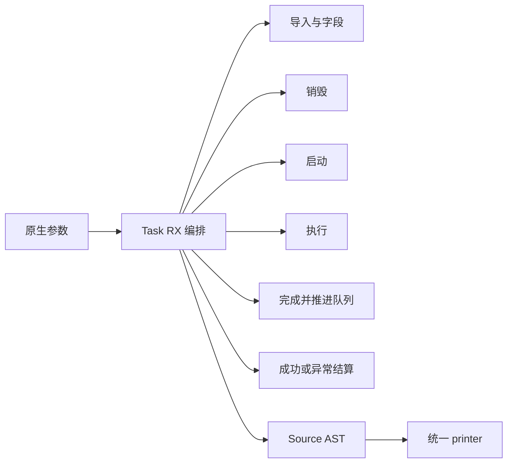
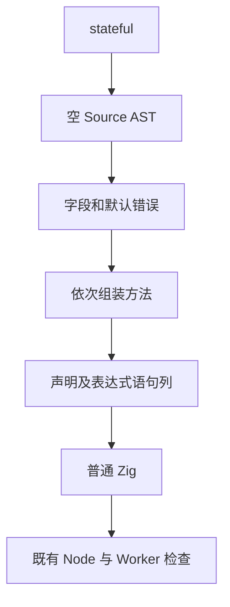

# Node 异步任务生成自举

## Intent

完整迁移 Task 声明、资源销毁、异步启动、后台执行、结果结算与完成后队列推进；保留原状态、求值及错误顺序，完成后统一提交推送。

## Data

原实现为 host/node/task/root.zig、complete.zig、settle.zig，使用结构化 Builder。上下文生命周期上一阶段已 Source，现有 Node 协议及绑定回归覆盖异步所有权、状态、失败和 Worker 清理。固定完整冷构建基线 129.74 s 墙钟、216.03 s CPU、树峰 2,247,294,976 B；上一阶段为 127.63 / 203.24 s、2,221,735,936 B。生成器固定 1.27 / 4.69 s，上一阶段 1.31 / 4.64 s。

## Edges

不改变 N-API、队列、请求 arena 转移和引用计数算法。旧实现仅作为初始 seed；不新增专用语义桥、运行库或 Zig 模板。Task 迁移不等于 Node runner/enqueue/编解码或整体自举完成。

CPU/墙钟单阶段容差均 1 s，固定基线不重置，累计退化超过 3 s 需定位；同时核对内存。只对受影响路径验证，复用同源码的已有证据。

## Answer

交付真实 RX 编排与 ZX 原子 AST 构造、薄原生入口；生成文本与旧实现对齐，既有运行回归、Source 阶段和成本证据通过后，提交全部变更。

实施中，未宣称验收通过。

## 实施核对

Source 已贯通字段、销毁、启动、执行、完成/队列推进及结算，首次生成成功：355 入口、3802 模块、3336 原始函数文件。工具构建完成状态待核实。

- output 字段保留 `anyerror!Output`，execute 直接保存错误联合，不插入 try；stateful 将 arena 转入 Request 后才创建替代 arena。
- destroy 先保存 context/env，再释放 N-API work/reference、Request、arena 和 self，最后仅使用已保存的 context.release。
- complete 先 retain/defer release，再 busy/defer busy=false；LIFO 确保先清 busy 再释放最后引用。队列先摘头/修尾再启动，启动失败结算并销毁后 continue，成功立即 return，耗尽后才 running=false。
- 现有 AST schema/printer 已支持错误捕获；仅补齐通用 else_branch helper 的可空 error_capture，已有调用省略时仍为 null。
- 原生 root 缩为参数/Source 调用/打印；旧 root 作为 seed，旧 complete/settle 只由 seed 入口引用，不是正式 Source 路径。

两次输入接线问题已修正：`cancel` 为保留结果名，改为 `cancellation`；Type 名空间不能借来引用任意字符串常量，改为公开类型模型中的 Target 枚举，Source 内映射既有常量。不为迁移扩大 RX 属性值边界。

现有异步回归覆盖失败恢复和 Worker 清理，但没有证据证明它强制触发 N-API 排队失败、非 ok status 或结算内部 API 失败；这些分支同时通过生成文本对照核对，不能把静态相等冒称运行覆盖。

## 正确性与构造成本证据

- 修正后的有/无 State 两种完整 Task 文本逐字节等于旧构造，合计 Wyhash `39ac6961110b9af2`。两种配置穷尽当前仅一个 bool 的输入选择，不等于穷尽 N-API 运行状态。
- 第一次对照捕获 destroy 声明局部 env 却使用 context.env 的错误，已修复后再次完整对照。stage2 在修正后再生成，仅更新该 1 个函数；21/21 成功。
- stage3 也 21/21 成功。当前 Source 工具本体和分析/生成均为 Source；没有将仅打开 Source 后端当作 Source 工具本体。
- 两次生成累计底层分配 411,612→710,570 B、分配次数 10→12，全部释放。此为局部累计分配，不是全编译器 RSS。
- 忽略目录的独立副本在 AST 构造边界加入请求追踪：无 State，Native 33,761 B/128 次→Source 90,708 B/556 次；有 State，37,549 B/139 次→112,528 B/653 次。增量确在 AST 构造，不应误归因于实际应用 Task 数据或仅凭 arena 收尾解释。
- 该追踪副本没有进入生产修改，未改变输出；后续正式性能计时不用插桩产物。局部内存成本更高是明确限制，整体受影响路径还需隔离测量。

## 既有运行回归

`test-napi-protocol test-napi-bindings` 28/28 成功，561 个协议、64 个绑定、33 个 TypeScript 声明检查通过。异步检查报告 18 个 protocol、42 个 ownership、11 个 State、12 个 Worker、8 个执行失败检查通过。未新增正式测试。

两个回归共用未分区 CLI 构建；其 MaxRSS 不能作为默认 P2 冷构建峰值，不和固定基线混用。没有据这些回归宣称所有 N-API 故障注入分支已运行。

## 隔离生成器对照

同一当前 355 入口、3802 模块、3336 原始函数文件，Source stage2/stage3 工具本体及运行分析/生成均 Source。各用独立函数缓存，4 轮交替、首轮预热排除，余 3 轮中位数：

| 指标 |        stage2 |        stage3 |
| ---- | ------------: | ------------: |
| CPU  |        4.70 s |        4.71 s |
| 墙钟 |        1.33 s |        1.33 s |
| RSS  | 787,660,800 B | 787,136,512 B |

8207 个全部生成文件跨工具及重复运行字节一致。相对上一阶段 4.64 / 1.31，当前 +0.07 / +0.02 s；相对固定 4.69 / 1.27，累计 +0.02 / +0.06 s，未接近 1 s 单阶段或 3 s 累计阈值。RSS 相对上一阶段 +5,210,112 B，保留趋势。

首次预热包含函数缓存建立，after 首轮墙钟 5.12 s，未把它混入热生成中位数；冷生成与完整冷构建另有口径。原始日志及请求分配追踪保存在忽略的诊断目录，不提交运行日志。

完整冷构建 `cold-node-task` 进行中。

## 未验收成本与通用根因

首轮完整冷构建 43/43，126.39 s 墙钟、205.26 s CPU，树峰 2,356,985,856 B。相对上一阶段 CPU +2.02 s、树峰 +135,249,920 B，超过单阶段 CPU 容差，未据此提交。

进程树峰来自两个分区后端重叠；采样单进程 2,115,059,712 B、time RSS 2,119,532,544 B，不能将树峰直接解释为 Source arena 泄漏。两分区源文件总量从 39,117,854 B 增至 39,654,387 B（+536,533 B），需要减少新增构造闭包成本。

局部实际运行：各 1000 次有/无 State 共 2000 次 Task 生成，排除首轮启动，Native CPU/墙钟 0.08/0.08 s，Source 0.16/0.17 s；每次 Source 增量约 40 微秒，但小范围约 2 倍的成本仍值得定位。RSS 2,113,536→2,555,904 B，绝对额外 442,368 B；不把此小程序 RSS 与编译器树峰混比。

进一步核对生成产物，固定路径 `["Context"]` 仍输出 allocator.dupe。已有 static_list 候选规则被整个入口的 scalar 标志错误限制，非标量入口的纯常量数组全部落入通用复制路径。候选检查本来已逐项限定纯 literal 和标量/枚举/ErrorSet 元素；该限制与字面量本身能否静态表示无关。

保留 Task 迁移，修正 Source 候选规则及初始 seed 对应规则，移除不再需要的 scalar 输入。继续仅接受既有 literal 元素种类，沿用结构化 ComptimeValue/Array 和 plain 只读存储；含运行时表达式或复合对象仍走既有构造，不把可变存储指向静态内存。需通过不可变集合等原有回归、实际产物及新阶段核对后才验收。

### 通用静态字面量修正的首轮证据

static-stage1/2 均 21/21，后者由已含新候选规则的 Source 工具生成。实际 Task helper 中路径由 allocator.dupe 变为 `comptime &[_][]const u8{...}` 的 plain 借用；不是源码模板或依赖 LLVM 消除复制。

有/无 State 的应用 Task 文本仍分别逐字节等于旧 Native 构造，哈希不变。局部累计分配降为 520,110 B/11 次，相对初始迁移 710,570 B/12 次下降 190,460 B（26.8%），全部释放；旧 Native 为 411,612 B/10 次，因此仍明确存在 108,498 B 的局部增量。

正在运行包含不可变列表更新的原有回归，核对静态 plain 列表不会被就地覆盖。仅移除错误的入口级前置条件，没有放开动态元素、对象元素、可空元素或任意调用成为静态候选。

### 修正后的运行与隔离证据

- 原有不可变列表 + Node：67/67 构建步骤、504/504 Zig 测试通过；Node 的 561 协议、64 绑定、33 TS 声明及 18/42/11/12/8 异步检查通过。
- 原有数组字面量及数组求值顺序：59/59 构建步骤、45/45 测试通过。动态元素求值与失败顺序未放开静态候选。
- 不可变列表分配扫描会打印 stderr，Zig 中间摘要显示 `w` 及 command 行；最终明确 504/504 passed。另一个直接执行已有 reverse 测试二进制也返回 0，未把中间 stderr 行误报为真实失败。
- 一轮生成器计时与数组回归编译重叠，整体判为无效并隔离保存；正式结果来自所有构建/探针编译退出后的新隔离轮次。

优化后局部 2000 次 Task 生成，交替 4 次、首轮排除、中位数：Native 0.08 CPU/0.08 wall，Source 0.16/0.17 s；RSS 2,113,536→2,473,984 B。分配减少未带来可辨的局部 CPU 改善，不能把节省内存描述为提速。Source 单次相对 Native 仍约 +40 微秒，记录为常数成本。

正式 Source static-stage2/3 同输入隔离结果（各 3 轮中位数）：CPU 4.71→4.70 s、墙钟 1.33→1.33 s、RSS 781,402,112→780,976,128 B。8207 个全部生成文件跨阶段和重复执行逐字节一致。相对固定基线累计 CPU +0.01 s、墙钟 +0.06 s；RSS 相对上一阶段 781,926,400 B 略降 950,272 B，不能与之前有干扰轮次混算。

static-stage1/2/3 均 21/21 成功。新的完整冷构建 `cold-node-task-static` 执行中；未重置固定基线。

### 第二轮完整冷构建与未收口项

`cold-node-task-static`：43/43 成功，墙钟 128.50 s、CPU 204.74 s（195.91+8.83），树峰 2,332,803,072 B，time RSS 2,125,414,400 B、采样单进程 2,114,715,648 B。固定基线累计墙钟 -1.24 s、CPU -11.29 s，树峰 +85,508,096 B；相对上一阶段 CPU +1.50 s、树峰 +111,067,136 B，继续收口，不宣称所有指标通过。

相对第一次 Task 冷构建，静态字面量修正减少分区源码 125,586 B、CPU 0.52 s、树峰 24,182,784 B，但墙钟 +2.11 s；不能只选下降指标。

试验将错误分支只在 Task 中通过既有 AST 列发布，恢复通用 else_branch 原接口。相同 Source 工具及输入下，先前/局部方案两分区总量分别为 38,406,723 / 38,421,933 B，没有支持闭包变小的假设；不采用该变体，恢复可复用的可空 error_capture helper。该对照是 Source 工具体，不能与冷构建的初始 seed 工具体输出大小直接混比；已观察到两者部分函数的临时状态引用形态不同。

当前进一步消除 Task publish 的中间完整 Context 快照：直接组装最终 Expressions/Statements/Declarations，仍复用各通用列快照原语，避免先发布后再次重建两张大表。输出 schema 不变，必须重新核对实际文本、受影响路径及构建成本。

### 假设排除与论文引导的边界试验

直接构造发布快照的试验也没有支持收益：Source Task publish 函数从 6840 B 变为 35,550 B，局部分配 520,110→521,250 B，文本仍相等。既有 Context snapshot 原语已复用大部分元数据，不能从源码中的再次组装直接推断底层数据复制。该试验已恢复，不为它再跑完整冷构建。

缺少明确方向后复查多篇原文：

- [TPDE，CGO 2026](https://home.cit.tum.de/~engelke/pubs/2602-cgo1.pdf)：通过适配已有 SSA IR 减少额外表示转换。这里只提炼“检查实际表示边界”原则，不替换 Zig/LLVM，也不把其 JIT/O0 速度比当作 ReleaseSmall 预期。
- [Reusing Highly Optimized IR，ECOOP 2025](https://drops.dagstuhl.de/storage/00lipics/lipics-vol333-ecoop2025/LIPIcs.ECOOP.2025.25/LIPIcs.ECOOP.2025.25.pdf)：复用必须验证编译时事实；论文的预填充 IR 缓存不能改善本仓库空缓存冷构建，因此不据此引入缓存来掩盖成本。
- [PIP，CGO 2026 原文](https://haavakro.folk.ntnu.no/pip2026/Krogstie-PIP-CGO2026-preprint.pdf)：不完整程序分析区分外部可达对象与未逃逸对象。本地推论是先检查已有桥边界能证明哪些别名事实；不移植整套 points-to 求解器，不声称论文直接证明本实现。

现有分区 bridge 的 C 入口只由 Forward.forward 同步调用，后者两条返回分支均新建结果变量，结果槽的地址只交给该次入口，不由参数可达；返回结果内部仍可借用输入。由此只给内部输出槽参数增加 noalias，不给参数数据或结果中的指针添加不相交假设，不改变公开 ZX/应用 ABI。

受控试验只改此处参数注解，用同一已生成分区 0、同工具链，前后各独立本地/全局缓存比较 CPU、墙钟和 RSS；若无可辨收益不保留。当前未宣称通过，也未改变性能基线。

### 当前交接状态（尚未收口）

noalias 的单分区受控结果：CPU 30.64→30.66 s、墙钟 29.83→29.81 s、RSS 1,519,517,696→1,505,476,608 B。CPU/墙钟没有可辨收益，RSS 单次小幅波动不足以支持保留，已恢复原 bridge；没有把新注解留入正式修改。

当前 genz 全部源码逐字节等于已通过静态字面量、不可变集合、数组求值顺序与 Node 回归的变体；Task publish/通用 helper/noalias 三个无益试验均没有残留。有效工具为 static-stage3；不要使用 direct/local-branch 阶段作为当前产物。

**已实现**：完整 Task Source 生成、现有回归、Source 阶段核对；通用常量数组零拷贝修正保留。**尚未通过阶段收口**：相对上一已提交阶段 CPU +1.50 s（超过单阶段 1 s），树峰 +111,067,136 B；相对固定基线树峰 +85,508,096 B。固定 CPU/墙钟累计仍下降，但不能借此隐藏单阶段和内存增量。

没有再次执行无改动的完整冷构建。保留全部迁移与有效修正，下一步只针对仍未消除的后端编译成本/并行峰值找证据；无代码变化时复用上述正确性证据。阶段尚未完成，所以本轮没有提交推送，也不把整体 goal 标记完成或阻塞。

## 用户最新验收约束与明确根因

用户允许 CPU 小幅增加而冷构建墙钟不实质增加或下降的权衡，已记入 AGENTS.md；这不豁免内存问题。用户明确要求树峰增长继续修复，因此没有据 CPU 规则调整提交阶段。

进一步逐函数比较确认：Task publish 的冷构建函数 29,620 B、Source 工具体生成的同函数 6840 B，均为同 2 个状态引用和 2 次描述符分配；前者额外拆装 114 个 plain 列表 header，后者浅复制已有描述符后只覆盖 7+3 列。字段底层列表仍共享，差异主要放大后端 SROA/编译状态，并不能将其称为底层列深拷贝。

实际 `object_update` 的 Source 匹配/生成已支持完成求值后的多字段修改、已缓存的稳定字段路径以及未选中对象的解引用布局；初始 seed fallback 仍只支持直接 Reference 和单字段，导致冷构建正式工具首次生成时无法复用这个既有优化。当前修正 seed，使其遵循同一 Source 条件与成本模型，不增加新语言特性、不回退 Task 迁移，也不把新桥藏进正式路径。

种子路径修正包含：evaluated 匹配与非 evaluated 的单字段限制分开；只沿 plain Reference/Field 路径找已存在状态 owner；字段路径须已缓存；借用/栈状态/normalize/renew 仍拒绝；所有变更值先绑定再写入本地浅副本，保持求值与错误顺序；只有 selected 布局清除 origin。需先核对生成形态和已有边界回归，再测冷构建。

### seed 与 Source 的生成协议对齐

第一版 seed 扩展虽然通过 31/31 构建，但只读复核指出两处成本协议不一致：额外逐字段 fresh 命名、以及单字段也分配可空 ExprId 数组。已按 Source 的 fresh(updated)→layout→reference→operand/block 顺序对齐；多字段使用 `<updated>_value_<position>`，单字段不分配 values，多字段仅 u32[F]。采用结构化 AST，不拼接 Zig 语句。

最终新 seed 路径再次 31/31 构建成功。另复用生产冷构建的精确初始生成器命令（工具本体为 Native seed、使用 seed fallback），同一冷构建 manifest、同 cwd、355 入口、P2 重新生成：

| 指标         |     修复前 |     修复后 |
| ------------ | ---------: | ---------: |
| P0 文件字节  | 19,726,397 | 19,163,208 |
| P1 文件字节  | 19,802,404 | 19,224,531 |
| 合计         | 39,528,801 | 38,387,739 |
| Task publish |     29,620 |      6,840 |

两个分区总共减少 1,141,062 B；Task publish 中多余 plain 描述符构造从 114 处降为 0，函数大小等于 Source 自编译工具的结果。这个对照不更换工具本体阶段，避免将 Source 工具体与初始 seed 的成本直接混算。后端峰值尚待独立冷构建确认。

### parity 修复的现有回归

使用 `-Dstage0=` 从初始 seed 路径构建并执行既有 object construction/evaluation order、immutable list、Node protocol/bindings：178/178 构建步骤、593/593 Zig 测试全部通过；561 个 NAPI 协议、64 个绑定、33 个 TS 声明，以及 18/42/11/12/8 项异步检查通过。

只读复核确认最终 matcher 与 Source 资格条件一致，Scope false 模式仍仅允许直接 Reference 和单字段；执行顺序为快照→绑定全部变更 RHS→写全部字段→按 selected 清 origin→break。heap 字段转换前缀仍进入 parent。剩余 target identifier 的内部 AST 编号构造先后没有求值或 fresh 副作用，不扩大修改。

新初始 seed 路径 31/31、Source 阶段 2 已 21/21；阶段 3 及最终隔离核对后再收口。

### 最终 Source 阶段核对

parity-source-stage2/3 均 21/21，工具本体及运行分析/生成均 Source；同一 355 入口、独立函数缓存、交替 4 轮排除预热，各 3 轮中位数 CPU 4.73→4.72 s、墙钟 1.34→1.34 s、RSS 781,336,576→781,107,200 B。8207 个全部生成文件跨阶段及重复执行逐字节一致。

相对固定生成器基线 CPU +0.03 s、墙钟 +0.07 s；相对上一提交 CPU +0.08 s、墙钟 +0.03 s。Native 初始 seed parity 只影响初始生成形态，没有用 Source 后端开关来掩盖旧工具本体，也没有跳过所有权检查。

独立完整冷构建 `cold-node-task-parity` 执行中，等待实际峰值后收口。

### parity 后的峰值：个体下降但峰值对齐

`cold-node-task-parity` 43/43：123.06 s 墙钟、200.03 s CPU（191.00+9.03），time RSS 2,100,510,720 B、采样单进程 2,095,448,064 B。相对上一轮两个分区的个体最高峰：P0 1,433,894,912→1,318,600,704 B（-115,294,208），P1 1,307,770,880→1,249,492,992 B（-58,277,888）。描述符重建修复产生真实个体成本收益。

但 P0/P1 的峰值时间从相差 3.62 s 变成相差 0.24 s，树峰反而 2,332,803,072→2,514,796,544 B。树峰时两个后端分别占 1,239,908,352 与 1,249,492,992 B。这仍是未通过的内存问题，不能选择单进程下降来宣布修好。

继续有界验证分区粒度：不改全局核心数、不加固定延迟、不通过减少并发掩盖问题。相同已修复初始 seed、相同 355 入口生成 P3，三个分区源码分别 12,574,927 / 15,088,684 / 11,654,442 B，合计 39,318,053 B，比修复后 P2 多约 2.4%，允许先单独验证后端真实树峰/耗时；不因分区更多自动认定收益。

### 三分区后端受控结果

保持生产 build-obj 的工具链、target、Osmall、fllvm、ABI/standard 模块参数，仅按已生成 P3 替换输入和分区编号，三任务同时执行，独立缓存：整体墙钟 23.95 s、采样树峰 1,894,744,064 B、采样单进程 1,070,661,632 B。三个任务分别为 CPU 22.44/24.28/14.86 s、墙钟 22.03/23.90/14.50 s，CPU 合计 61.58 s；time RSS 各 1,032,011,776 / 1,137,524,736 / 762,036,224 B。此为单独后端路径，不冒充完整冷构建。

该结果支持减小 LLVM 单元以避免大单元峰值同时驻留：没有减少全局核心数、串行化或固定延时。原有 `generated-partitions` 配置继续可覆盖，根构建 native Safe/Small 默认由 2 改 3，Debug/其他既有契约不变。最终以默认命令的完整冷构建重新验证，固定基线仍保留原 P2，明确记录策略变化。

只读核实 `-fno-libllvm` 不能直接建立独立 LLVM 进程；正常机器码仍要求 libllvm，现有 Builder→bitcode→释放 Builder 并未释放 Zcu/Sema。该开关不采用，不把未做的替代构建当证据。论文思路与本地实现约束分开。

完整默认 P3 冷构建 `cold-node-task-p3` 执行中；不预先认定端到端内存通过。

## 最终完整冷构建验收

`cold-node-task-p3`：默认构建、ReleaseSmall、12 核、相同工具链/归档、独立本地及全局缓存，43/43 成功。当前默认 native Safe/Small 使用 3 分区；固定可比用户命令仍不带分区覆盖，原 P2 基线保留用于累计比较，明确说明策略改变。初始生成器本体仍由 Native seed 构建，本次已使该 seed 的对象更新与 Source 规则对齐；正式生成工具运行的分析/生成实现归属按各阶段记录，不混称 Source 自编译本体。

| 指标       |        固定基线 |      上次已提交 |  Task 修复前 P2 |     本次默认 P3 |
| ---------- | --------------: | --------------: | --------------: | --------------: |
| 墙钟       |        129.74 s |        127.63 s |        128.50 s |        119.49 s |
| CPU        |        216.03 s |        203.24 s |        204.74 s |        204.64 s |
| 树采样峰值 | 2,247,294,976 B | 2,221,735,936 B | 2,332,803,072 B | 2,121,023,488 B |

time CPU=195.61 user+9.03 sys，time RSS=2,106,605,568 B，采样单进程=2,100,428,800 B。监测脚本包含轮询收尾的墙钟 119.673 s，主要验收采用 time 的 119.49 s。

相对固定基线：墙钟 -10.25 s、CPU -11.39 s、树峰 -126,271,488 B（约 -5.62%）。相对上次提交：墙钟 -8.14 s、CPU +1.40 s（约 +0.69%）、树峰 -100,712,448 B。CPU 小幅上升而墙钟明显下降，依照用户最新明确允许的权衡接受，累计趋势不重置。

相对 seed parity 后曾出现的 2,514,796,544 B 重叠峰，当前树峰减少 393,773,056 B；没有通过减少全局并发、固定延时或撤回迁移规避问题。单分区输入表示修正与 LLVM 单元粒度调整分别有受控证据，最终以本次整个树峰验证联合效果。

正在直接复用本次 P3 安装 CLI 运行原有 Node/Worker 两组检查，确保默认新分区下的跨分区调用真实可用；不重建编译器。

## 最终交付与自我审查

- 默认 P3 冷构建安装 CLI 直接运行原有两组 Node 检查全部通过：561 个协议、64 个绑定、33 个 TS 声明，以及 18/42/11/12/8 项异步协议/所有权/State/Worker/失败检查；未再次构建编译器。
- Task 有/无 State 的完整生成文本与原 Native seed 一致；原 root_seed 逐字节等于上次提交的 root。Source 40 个相关文件 lint 通过、Native diff 经 zig fmt 检查，diff whitespace 通过。
- 正式 Task 构造在 RX/ZX，RX 展示 schema 与方法组装、完成流程/队列分支及结算；ZX 保留原子 AST 构造。旧 complete/settle 只由初始 seed 入口引用，没有新增正式语义桥或运行库。
- 保留用户最新 CPU/墙钟权衡及内存独立约束，两个原话追加统一 user_request.jsonl。没有据 CPU 的允许增幅忽略内存问题；最终树峰低于固定基线且低于上一提交。
- 反向核对失败路径：局部 else_branch、直接 publish 和 noalias 试验没有收益，均没有残留；中途有干扰的计时未计入验收。有效修正来自实际 seed/Source 表示差异与单元峰值重叠的证据。
- 仍有局部成本限制：Source Task 两次生成累计分配 520,110 B，旧 Native 411,612 B；局部 2000 次构造 CPU 0.16 对 0.08 s，没有以整体构建改善抹去它。应用 Task 代码本身字节一致，无新增应用运行开销。
- 本阶段默认分区策略由 P2 改 P3，未改优化级别、关闭安全/所有权检查、减少12核并发或人为延时；可配置覆盖继续保留。不同机器的最优粒度可能不同，不据单机结果承诺所有平台同样收益。
- Node runner/enqueue/N-API 编解码、WASM 以及其他原生职责仍待迁移，整体自举 goal 继续；最终验收仍需完整传递依赖与阶段自编译审计，不能以本阶段测试代替。

本记录以 IDEA 保存目标、证据、边界和验收交付，保留无益试验以防重复绕圈。阶段完整职责及性能已按最新要求收口，统一提交全部变更并推送，最终以 Git 结果确认。
