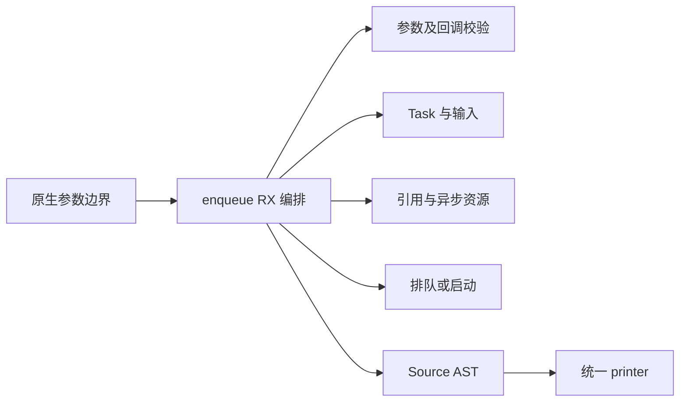
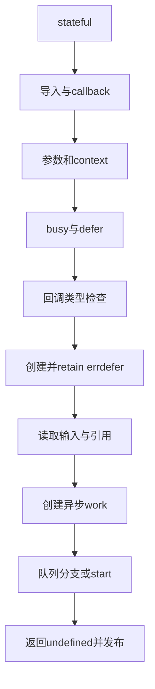

# Node 异步提交入口自举

## Intent

完整迁移 enqueue 模块：N-API callback、参数及回调校验、Task 创建和输入接管、引用及异步资源创建、stateful 队列/无状态启动。保持成功/失败顺序及现有不可变输入快照语义，收口后统一提交推送。

## Data

现有 host/node/enqueue.zig 共用 Task/Context，后两者已以 Source 生成。现有 Node 协议、绑定与 Worker 回归覆盖异步参数、状态、失败恢复与生命周期。上一阶段默认三分区冷构建 119.49 wall/204.64 CPU、树峰 2,121,023,488 B；固定基线仍为 129.74/216.03 s、树峰 2,247,294,976 B，生成器固定 1.27 wall/4.69 CPU。

## Edges

不改变运行时队列算法、N-API、资源顺序或输入复制契约；Source 属性只组装，计算在 ZX。不得新增运行库、专用语义桥或 Zig 模板。Native 仅参数/打印适配与初始 seed；Node runner/registration/编解码仍是独立剩余职责。

CPU小幅增长且冷墙钟不实质增长/下降可接受，累计趋势不重置；内存独立验收，不因CPU规则放过膨胀。沿用12核与三分区，不靠固定延迟。

## Answer

交付真实 RX 阶段与 ZX 原子构造、薄 Native 入口；两种 stateful 配置文本相等、既有回归与阶段自编译、相关成本证据通过后统一提交所有变更。

## 实施证据

Source 第一、二轮自编译均 21/21 通过；新增 25 个 RX/ZX 文件已格式化，24 个 ZX lint 通过。独立探针对 stateful=false/true 比较 Native seed 与 Source，生成文本均逐字节相等；两种配置合计累计分配 377,644 → 430,868 B，分配次数均 10，全部释放。该数字是局部构造的累计分配，不是冷构建峰值；完整成本与行为证据见后续验收记录。

## napi-rs 参考

按用户要求，napi 包后续实现与迁移参考 [napi-rs](https://github.com/napi-rs/napi-rs)。本阶段已核对其 [async_work.rs](https://github.com/napi-rs/napi-rs/blob/main/crates/napi/src/async_work.rs)：提交成功前由发起方负责 work、task 及引用的失败回收；执行线程只做计算，完成阶段返回环境线程。现有 ZX 生成的 retain、errdefer destroy、start 成功后交接保留相同职责边界。

其 [ArrayBuffer/TypedArray](https://github.com/napi-rs/napi-rs/blob/main/crates/napi/src/bindgen_runtime/js_values/arraybuffer.rs) 分别表达局部借用与持有 N-API 引用。引用可保持对象存活，不能阻止 JS 修改其字节；不能据此将 ZX 异步不可变输入直接借用为可变 JS 内存。本阶段保留既有输入转换，不宣称完成 napi 包所有职责迁移。

## 同期范围调整

用户明确移除 zray 包。删除 app/server/shared 源码及包说明，同时移除根启动/构建脚本、workspace、专用忽略项、锁文件入口与网站说明中的关联。历史交接文档及用户原话不改写；其与编译器无依赖，不做性能对比。

## 验收记录

- Source stage1/2/3 各 21/21 构建步骤通过；stage2 与 stage3 在相同 356 入口、3,827 模块、3,359 函数输入下，8,256 个文件逐字节一致。
- 本体与分析/生成均为 Source 的工具对比：上阶段 Source stage3 → 本阶段 Source stage3，独立函数缓存，各一轮预热与三轮交替计时。CPU 中位数 4.75 → 4.75 s，wall 1.35 → 1.35 s，RSS 785,563,648 → 785,809,408 B；8,256 个文件也跨工具逐字节一致。相对固定生成器基线 CPU +0.06 s、wall +0.08 s；输入增加一个入口，不能将此输入增长直接等同迁移本身成本。
- 现有 Node 回归 28/28 步通过：561 协议用例、64 模块绑定用例、33 TypeScript 声明检查，以及异步 18 协议、42 所有权、11 State、12 Worker、8 执行失败检查。未新增测试。未注入每一个 N-API 分配/创建/提交失败点，不宣称这些错误出口均经过动态覆盖。
- 完整冷构建产出的默认三分区 CLI 再直接运行上述 Node 协议与绑定脚本，全部通过；不重建 CLI，不把测试构建中未分区 CLI 的峰值混入完整冷构建指标。
- zray 移除后，pnpm 只列出根、test、website 三个工作区；离线 frozen-lockfile 检查通过。锁文件由 pnpm 重算，删除仅由 zray 引用的依赖及修正剩余共享依赖的 optional 标记，未升级保留工作区的直接依赖。生产源码、脚本、workspace 与锁文件中均无 zray 引用；历史文档和需求记录保留。
- 日志位于 `.zig-cache/node-enqueue-{stage1,stage2,stage3,tests,generator}.log`；局部与跨阶段产物在 `.zig-cache/cold-build-analysis/ownership-research/node-enqueue/`。这些探针、日志和临时产物均不提交。

## 完整冷构建成本

同一 Zig 0.17.0、ReleaseSmall、12 核、默认三分区、全新 local/global 缓存及固定本地 Zig 归档；构建 43/43 通过。工具本体由初始 Native seed 引导生成，正式分析/生成启用 Source，不能把此路径的成本与全 Source 自编译工具本体直接相减。

| 指标              |      固定基线 | 上阶段 Node Task | 本阶段 Node enqueue | 本阶段相对上阶段 | 累计相对固定基线 |
| ----------------- | ------------: | ---------------: | ------------------: | ---------------: | ---------------: |
| wall / s          |        129.74 |           119.49 |              119.84 |            +0.35 |            -9.90 |
| CPU / s           |        216.03 |           204.64 |              205.90 |            +1.26 |           -10.13 |
| 树峰 RSS / B      | 2,247,294,976 |    2,121,023,488 |       2,111,406,080 |       -9,617,408 |     -135,888,896 |
| time 单进程峰 / B | 2,075,033,600 |    2,106,605,568 |       2,095,153,152 |      -11,452,416 |      +20,119,552 |

CPU +1.26 s（约 0.62%），wall +0.35 s 在 1 s 容差内，符合用户“小幅 CPU 增长但冷墙钟无实质增长可接受”的权衡规则；相对固定基线 CPU 与 wall 均下降，未重置累计基线。树峰未增长，较固定基线约低 6.05%；单进程峰相对固定基线仍高约 0.97%，保留该未消除差异，不能将其与树峰混淆。上一阶段到本阶段约 9.6 MB 的树峰下降不足以独立证明优化收益；本阶段以未出现实质内存退化验收。

原始记录：`.zig-cache/cold-build-analysis/ownership-research/partition-reference/cold-node-enqueue-p3/{command.json,build.log,samples.jsonl,metrics.json}`。采样单进程峰 2,090,745,856 B，和 time 的 2,095,153,152 B 口径不同，树峰来自 200 ms 采样，不将采样值当作精确瞬时峰。

本次 RX 空行恢复仅语义分组；不为此重复性能构建。

## 自我复核与剩余边界

RX 显式连接校验、创建、输入读取、引用/work、启动/队列与发布；ZX 中的循环只构造参数/引用列表或局部 AST，不隐藏跨职责入口调度。复用 Task/Context 的通用 AST 构造与 printer，没有复制整个运行时实现作为专用库。局部生成分配增量 53,224 B 有证据，不能把生成应用文本相等当作编译成本相等，已同时以完整冷构建和生成器对比验收。

Native enqueue 只保留列调用/打印边界；enqueue_seed 保存初始引导实现，正式 Source 路径不调用它。Node runner、注册及 napi 编解码仍有待迁移职责；本阶段及阶段间产物一致不能宣称整个编译器已完成自举。
